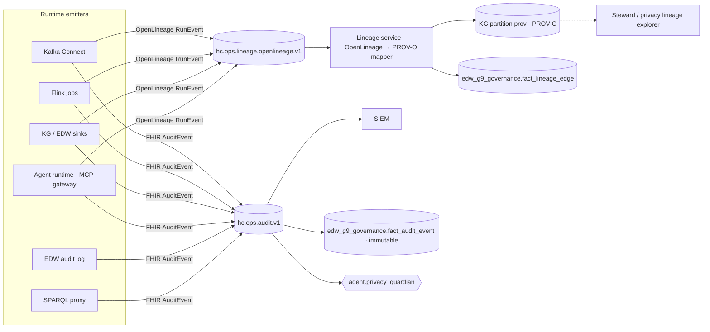
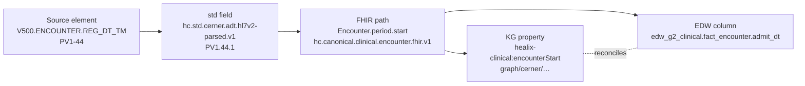

# Lineage, Provenance and Audit

HEALIX must be able to answer three questions for any fact, at any point in time: *where did it come from*
(lineage), *who or what produced it and under which activity* (provenance), and *who has looked at it* (audit).
This document specifies the PROV-O model in the knowledge graph, OpenLineage events on
`hc.ops.lineage.openlineage.v1`, field-level lineage across all five representations of a data element, FHIR
`AuditEvent` records on `hc.ops.audit.v1`, retention of both streams and the lineage coverage metric.

## 1. Model overview



Two complementary representations are kept:

| Representation | Granularity | Where | Purpose |
|----------------|-------------|-------|---------|
| **OpenLineage RunEvents** | Job run × dataset (topic, table, graph, file) with column-level facets | `hc.ops.lineage.openlineage.v1`, lineage service | Operational lineage, impact analysis, freshness, backfills |
| **PROV-O** | Entity × Activity × Agent, bitemporal, per batch and per assertion | KG partition `prov`; `prov_activity_iri` on every fact (CONVENTIONS §4) | Legal provenance, as-of reconstruction, audit joins |

The lineage service maps every OpenLineage run to a `prov:Activity`, every dataset version to a `prov:Entity`, and
every job owner or agent to a `prov:Agent`, so the two views never diverge.

## 2. PROV-O model in the knowledge graph

### 2.1 Core classes and HEALIX subclasses

| PROV-O | HEALIX subclass | Instances |
|--------|-----------------|-----------|
| `prov:Entity` | `healix:SourceRecord`, `healix:StdRecord`, `healix:CanonicalResource`, `healix:KgAssertionSet`, `healix:EdwRowVersion`, `healix:OntologyRelease`, `healix:DqResult`, `healix:ChangeRequest` | One per record version / batch / release |
| `prov:Activity` | `healix:CaptureActivity`, `healix:StandardiseActivity`, `healix:CanonicaliseActivity`, `healix:DqEvaluation`, `healix:KgLoad`, `healix:EdwLoad`, `healix:EntityResolution`, `healix:Deidentification`, `healix:AgentTask`, `healix:HumanApproval` | One per job run or per agent task |
| `prov:Agent` | `healix:SoftwareAgent` (connector, Flink job with version), `healix:LlmAgent` (`agent.*`, model id, manifest version), `healix:Person` (steward, approver), `healix:Organization` (source system owner) | — |
| `prov:Plan` | `healix:MappingSpec`, `healix:DqRulePack`, `healix:R2rmlMapping`, `healix:AgentManifest` | Versioned artefacts the activity followed |

### 2.2 Required properties per activity

Every `healix:*Activity` MUST carry: `prov:startedAtTime`, `prov:endedAtTime`, `prov:wasAssociatedWith` (agent),
`prov:used` (inputs with `healix:datasetVersion`), `prov:generated` (outputs), `prov:hadPlan` (mapping/rule/manifest
version IRI), `healix:environment`, `healix:runId` (OpenLineage run UUID), `healix:changeRequest` (when applicable),
and `healix:phiClassMax` (highest PHI class touched). Agent tasks additionally carry `healix:modelId`,
`healix:promptHash`, `healix:evaluatorScore`, and `healix:approvedBy` when a human gate was passed.

### 2.3 Example (Turtle, abbreviated)

```turtle
@prefix prov: <http://www.w3.org/ns/prov#> .
@prefix healix: <https://ontology.healix.example.org/governance/> .
@prefix g: <https://ontology.healix.example.org/graph/> .

g:cerner/2026-10-17/01J9ZK3Q8X5F  a healix:KgAssertionSet, prov:Entity ;
    prov:wasGeneratedBy healix:act/kgload/01J9ZK3Q8X5F ;
    prov:wasDerivedFrom <kafka:hc.canonical.clinical.encounter.fhir.v1/partition=3/offset=88213001-88214999> ;
    healix:dataClassification healix:phi_clinical .

healix:act/kgload/01J9ZK3Q8X5F a healix:KgLoad, prov:Activity ;
    prov:startedAtTime "2026-10-17T03:10:04Z"^^xsd:dateTime ;
    prov:endedAtTime   "2026-10-17T03:10:41Z"^^xsd:dateTime ;
    prov:wasAssociatedWith healix:agent/kg_builder ;
    prov:hadPlan <https://ontology.healix.example.org/mapping/r2rml/encounter/1.4.0> ;
    healix:runId "0f3f0d9c-5c0a-4a2b-9f45-1a9c2d7e8b11" ;
    healix:environment "prod" ;
    healix:phiClassMax healix:phi_clinical .
```

Assertions inside the named graph are annotated with RDF-star (`<< s p o >> healix:validFrom … ; prov:wasGeneratedBy …`)
per TKG-01, so provenance is available at triple level without duplicating the activity.

## 3. OpenLineage events

### 3.1 Topic and envelope

`hc.ops.lineage.openlineage.v1` carries OpenLineage 1.x `RunEvent` JSON (`START`, `RUNNING`, `COMPLETE`, `FAIL`,
`ABORT`), keyed by `run.runId`, JSON Schema registered as `hc.ops.lineage.openlineage.v1-value`. Headers:
`hc-event-time`, `hc-phi-class=internal` (lineage events never carry payload data), `hc-producer`.

### 3.2 Naming

| Dataset kind | `namespace` | `name` |
|--------------|-------------|--------|
| Kafka topic | `kafka://<cluster>` | `hc.canonical.clinical.encounter.fhir.v1` |
| EDW table | `<edw-dialect>://<host>` | `edw_g2_clinical.fact_encounter` |
| KG named graph | `sparql://<endpoint>` | `graph/cerner/2026-10-17/01J9ZK3Q8X5F` |
| Source table (CDC) | `oracle://<millennium-replica>` | `V500.ENCOUNTER` |
| Oracle Fusion BICC extract | `bicc://<pod>` | `FscmTopModelAM.ItemAM.Item` |
| File | `s3://<bucket>` / `abfss://…` | path |
| Ontology release | `ontology://healix` | `clinical/1.8.0` |

Job names are `<module>.<component>.<name>` (e.g. `07.flink.canonicalise-encounter`, `10.agent.source_mapper`).

### 3.3 Facets

| Facet | Standard / HEALIX | Content |
|-------|-------------------|---------|
| `schema` | standard | Fields and types of the dataset version |
| `columnLineage` | standard | Per output field: input fields and transformation description — the backbone of §4 |
| `dataSource`, `documentation` | standard | — |
| `dataQualityAssertions` | standard | Rule ids and pass/fail from `hc.dq.*` |
| `healix_phiClass` | HEALIX | Max PHI class of the dataset and per-field tags |
| `healix_provActivity` | HEALIX | IRI of the generated `prov:Activity` |
| `healix_changeRequest` | HEALIX | CR id, approver, evaluator score for agent-initiated runs |
| `healix_bitemporal` | HEALIX | `valid_from`/`valid_to` range and `recorded_at` of the batch |
| `healix_mappingVersion` | HEALIX | Mapping/rule/R2RML version IRIs used |

## 4. Field-level lineage

A data element exists in five representations. Lineage MUST be navigable in both directions across all five.



| Hop | Lineage source | Stored as |
|-----|----------------|-----------|
| Source element → `std` field | Connector / parser manifest (module 03) | `columnLineage` facet of the standardise job; `prov:wasDerivedFrom` |
| `std` field → FHIR path | Mapping spec (module 06, maintained by `agent.source_mapper`) with FHIRPath/expression | `columnLineage` with `transformationDescription`; mapping version in `hadPlan` |
| FHIR path → KG property | R2RML/RML and FHIR→RDF mapping (module 08) | `columnLineage`; ontology property IRI |
| FHIR path → EDW column | dbt-style model / sink mapping (module 05) | `columnLineage`; `ref_data_element.column_fqn` |
| Terminology hops | Concept map version used for code translation (`$translate`) | `healix_mappingVersion` facet includes `ConceptMap` version |

The lineage service materialises `edw_g9_governance.fact_lineage_edge(from_node, to_node, hop_type, plan_iri,
valid_from, valid_to, recorded_at, prov_activity_iri)` so stewards can query impact (“which EDW columns and KG
properties depend on `PV1-44`?”) in SQL and SPARQL. The ontology links each source element to its canonical and
EDW bindings via `healix:boundTo`, so semantic coverage (VIS-00 §8) and lineage coverage (§7) are computed from the
same graph.

## 5. Audit events

### 5.1 Topic and profile

`hc.ops.audit.v1` carries FHIR R4 `AuditEvent` JSON conforming to the HEALIX `AuditEvent` profile (module 06,
derived from IHE BALP). Key: `AuditEvent.id` (ULID). Headers: `hc-event-time`, `hc-phi-class` set to the highest
class of the *entities referenced* (the event body itself contains identifiers of the accessed records, so audit
payloads are PHI), `hc-producer`.

| Element | HEALIX usage |
|---------|--------------|
| `type` / `subtype` | DICOM `110110` (Patient Record), `110112` (Query), `110114` (User Authentication), `rest` for API; HEALIX `agent-tool-call`, `consent-decision`, `policy-decision`, `deid-export`, `break-glass` |
| `action` | C/R/U/D/E |
| `recorded` | event time (UTC) |
| `outcome` | 0 success, 4 minor failure (denied), 8 serious, 12 major |
| `purposeOfEvent` | Purpose-of-use code (GOV-01 §4) |
| `agent[]` | Requestor (user or `agent.*` with `who.identifier`), on-behalf-of (`cr_id`), network address, `role`, `purposeOfUse`, `altId` = OIDC `sub` |
| `source` | Component and environment |
| `entity[]` | Each accessed record: `what` reference (Patient/MRN token, Encounter id, topic+offset, table+row key, named graph), `type`, `role`, `securityLabel` = PHI class, `query` (SQL/SPARQL hash + bind parameters hashed), `detail` (row count, masked columns) |
| `extension[healix-cr]`, `extension[healix-tool]` | Change request id; MCP tool name, arguments hash, result size, model id |

### 5.2 Mandatory emitters

| Emitter | Event |
|---------|-------|
| IdP / gateway | Authentication success/failure, token exchange for agents |
| Kafka authorizer and header guard | Topic read permits/denials per consumer group (sampled 1:1 for denials, aggregated per minute for permits), header rejections |
| SPARQL proxy | Every query touching `instances/*` partitions: graphs, masked properties, result size |
| EDW | Every statement touching tagged columns; row counts; masking applied |
| FHIR facade / Bulk Data | Every resource read, export job |
| Consent engine | Every gate decision (permit/block) with `Consent.id` |
| De-identification service | Every export with method, dataset fingerprint, recipient DSA |
| MCP tool gateway | **Every agent tool call**, including denied calls, with tool name, scopes, PHI class of result, row count, `cr_id` |
| Orchestrator | CR state transitions, evaluator scores, human approvals, guardian vetoes |
| Break-glass service | Activation, renewal, expiry |

Audit emission is **synchronous for denials and PHI reads** (the PEP waits for the broker ACK before returning
data) and asynchronous for metadata-only operations. A failure to write audit MUST fail the access.

### 5.3 Sinks and analytics

- SIEM ingests the topic in real time for correlation (impossible travel, bulk reads, after-hours access, agent
  tool anomalies).
- `edw_g9_governance.fact_audit_event` is an append-only, hash-chained table (each row stores the SHA-256 of the
  previous row) for tamper evidence; a nightly job verifies the chain.
- `agent.privacy_guardian` consumes the topic to detect minimum-necessary violations (a role's read volume or PHI
  class distribution deviating from its baseline) and opens issues.
- Accounting-of-disclosures reports are generated per patient from this table for right-of-access requests.

## 6. Retention

| Stream / store | Retention | Rationale |
|----------------|-----------|-----------|
| `hc.ops.audit.v1` (Kafka) | 90 days hot | Replay to SIEM/EDW |
| `fact_audit_event` (EDW, immutable) | 6 years minimum (HIPAA §164.316(b)(2)); 7 years where state law requires; longer under legal hold | Regulatory |
| `hc.ops.lineage.openlineage.v1` (Kafka) | 30 days | Replay to lineage service |
| PROV-O partition in KG | Life of the facts it describes + 6 years | Facts must remain explainable |
| `fact_lineage_edge` | Same as PROV-O | — |
| Agent prompt/tool transcripts | 2 years (masked), 6 years if attached to a `phi-affecting` CR | Evaluation and audit |

Deletion is executed by the module 12 retention jobs and itself produces an `AuditEvent` (`action=D`).

## 7. Lineage coverage metric

`lineage_coverage = |{targets with a complete path to ≥ 1 source element}| / |{targets}|`, computed nightly for two
target sets: (a) EDW columns in `fact_*`/`dim_*` tables excluding surrogate keys and audit columns, and (b) KG data
and object properties with instances. A path is complete when every hop in §4 has a `columnLineage` edge with a
resolvable plan version. Results are published as DQ results on `hc.dq.result.v1` under the rule family
`DQR-COMPLETENESS-GOVERNANCE-*` (module 09), rolled into `hc.dq.scorecard.v1`, and shown on the governance
dashboard (OPS-03). Targets: ≥ 95 % at first release, 100 % for `phi:direct` columns and properties at all times.

## 8. Requirements

> **GOV-LIN-001** (P0, test) — Every persisted fact in KG and EDW MUST reference a `prov_activity_iri` resolvable to a
> `prov:Activity` carrying the properties in §2.2.

> **GOV-LIN-002** (P0, test) — Every job run (Connect, Flink, sink, agent task, de-identification export) MUST emit
> OpenLineage `START` and terminal events on `hc.ops.lineage.openlineage.v1` with `columnLineage` and
> `healix_provActivity` facets.

> **GOV-LIN-003** (P0, test) — The lineage service MUST map each OpenLineage run to PROV-O within 5 minutes of the
> terminal event.

> **GOV-LIN-004** (P0, test) — Field-level lineage MUST be navigable from any EDW column or KG property back to the
> source element and forward from any source element to all its targets, including concept-map versions used.

> **GOV-LIN-005** (P0, test) — Lineage events MUST NOT contain payload values; `hc-phi-class` on the lineage topic MUST
> be `internal`.

> **GOV-LIN-006** (P0, test) — Every read of a `phi:*` or `pii:workforce` entity, every denial and every agent tool
> call MUST produce a FHIR `AuditEvent` on `hc.ops.audit.v1` conforming to §5.1.

> **GOV-LIN-007** (P0, test) — For PHI reads and denials the audit write MUST be acknowledged before data is returned;
> audit unavailability MUST fail closed.

> **GOV-LIN-008** (P0, test) — `AuditEvent.agent` for agent actions MUST identify `agent_id`, `cr_id`, model id and tool
> name; `AuditEvent.entity` MUST carry the PHI class as a security label.

> **GOV-LIN-009** (P0, test) — `fact_audit_event` MUST be append-only and hash-chained; chain verification MUST run
> nightly and alert on break.

> **GOV-LIN-010** (P0, test) — Audit records MUST be retained ≥ 6 years and MUST be extensible under legal hold; raw
> Kafka audit retention MUST be ≥ 90 days.

> **GOV-LIN-011** (P0, demo) — An accounting of disclosures for any patient MUST be producible from audit data within
> 1 business day.

> **GOV-LIN-012** (P1, test) — Audit events MUST reach the SIEM within 60 seconds (p95).

> **GOV-LIN-013** (P1, test) — Consent gate decisions MUST be audited with the `Consent.id` applied and the outcome.

> **GOV-LIN-014** (P1, test) — De-identified exports MUST be audited with method, dataset fingerprint and recipient
> data-sharing agreement id.

> **GOV-LIN-015** (P1, test) — Agent prompt and tool transcripts MUST be stored masked, linked to the `prov:Activity`
> and retained per §6.

> **GOV-LIN-016** (P0, test) — Lineage coverage MUST be computed nightly; release gates MUST require ≥ 95 % overall and
> 100 % for `phi:direct` targets.

> **GOV-LIN-017** (P1, test) — Impact analysis (“what depends on X”) MUST return in ≤ 10 s for any source element
> across EDW and KG targets.

> **GOV-LIN-018** (P2, test) — Lineage and audit MUST be queryable as-of any past transaction time using the
> bitemporal model.

## 9. Traceability

| Requirement | Verified by |
|-------------|-------------|
| GOV-LIN-001, 004, 016 | SHACL shape `healix:ProvenanceShape`; nightly coverage job; EDW constraint tests |
| GOV-LIN-002, 003, 005 | Lineage integration tests in module 07/10 CI |
| GOV-LIN-006–009 | Audit emitter contract tests; chain verification job |
| GOV-LIN-011 | Privacy Office drill (annual) |
