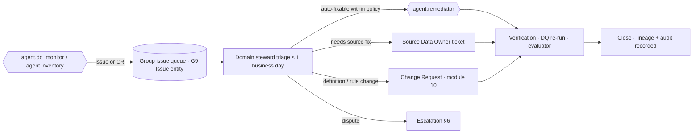

# Master Data Management and Stewardship

Master data are the entities that every subject-area group shares: who the patient, provider, organisation,
location, item, supplier, cost centre and employee *are*. HEALIX treats these as **conformed dimensions** in the EDW
(ARC-01 §4) and as **resolved entities** in the knowledge graph (module 08). This document specifies the stewardship
model that makes those records trustworthy: who is accountable, how golden records are formed, what contracts bind
source owners to the platform, how issues escalate, how data are shared and which metadata standards describe them.

## 1. Stewardship model

### 1.1 Roles

| Role | Scope | Accountabilities |
|------|-------|------------------|
| **Group Steward (G1–G9)** | One per group (GOV-00 §2) | Owns definitions, DQ thresholds, survivorship rules and data contracts for the group; approves `medium` CRs; chairs the group's issue queue |
| **Domain Steward** | One per MDM domain (§2) | Day-to-day resolution of match/merge exceptions, reference-data maintenance, golden-record overrides |
| **Source Data Owner** | Business owner of a source system (Cerner HIM director, Oracle Fusion ERP process owner, LIS manager) | Signs the data contract; fixes defects at source; notified of schema drift |
| **Technical Steward** | Integration or platform engineer paired with each domain | Implements mappings and rules the steward approves; maintains connector health |
| **Terminology Steward (G8)** | Code systems, value sets, concept maps | Approves bindings; licence compliance (SNOMED CT, CPT) |
| **Metadata Steward (G9)** | Catalog, classification, lineage | Keeps Source Registry and Data Element Catalog complete; owns DCAT/Dublin Core compliance |
| Agents (`agent.inventory`, `agent.dq_monitor`, `agent.remediator`, `agent.terminology_steward`) | Automated first line | Detect, propose and (within policy) apply fixes; never final arbiter for golden-record conflicts involving `phi:direct` |

Every steward appointment is a G9 fact (`dim_steward_assignment`, bitemporal) so accountability can be reconstructed
as-of any date. A group without an active steward MUST NOT accept `medium`/`high` CRs.

### 1.2 Steward workflow



## 2. MDM domains

| Domain | Golden entity | Primary sources (ARC-01 §4) | Matching strategy | Owner group | Resolution engine |
|--------|---------------|-----------------------------|-------------------|-------------|-------------------|
| **Patient / Person** | `Patient`, `Person`, `RelatedPerson` → `dim_patient`, `dim_person` | Cerner Millennium (MRN per facility, EMPI id), HIE, payer eligibility, portal | Enterprise Master Patient Index: deterministic on EMPI id, probabilistic (Fellegi–Sunter) on name, DOB, sex, address, phone, SSN-last4 with privacy-preserving linkage tokens; thresholds auto-link ≥ 0.98, review 0.85–0.98 | G1 | Module 08 entity resolution (TKG-03, `08-temporal-knowledge-graph/03-entity-resolution.md`), with Cerner EMPI as authoritative when present |
| **Provider / Practitioner** | `Practitioner`, `PractitionerRole` → `dim_practitioner` | Cerner provider registry, credentialing, Oracle HCM (employed), NPPES | Deterministic on NPI; fallback on licence number + state; name + DOB for non-NPI staff | G1 (with G5 for employed) | Module 08 ER |
| **Organization / Location** | `Organization`, `Location` → `dim_organization`, `dim_location` | Cerner organisation/location tables, Oracle Fusion legal entities and business units, NPPES, payer directories | Deterministic on tax id / NPI type 2 / Oracle BU id; hierarchy from Oracle Fusion for internal, NPPES for external | G1, G8 (hierarchy) | Module 08 ER |
| **Item / Product** | `Item` (SCM), `Medication`, `Device` → `dim_item` | Oracle Fusion SCM item master, pharmacy formulary, GUDID, RxNorm/NDC | Deterministic on GTIN/UDI-DI, NDC, Oracle item id; RxNorm normalisation for drugs | G4 (G2 for medications) | Terminology Service + ER |
| **Supplier / Vendor** | `Organization` (supplier role) → `dim_supplier` | Oracle Fusion SCM suppliers, AP vendors, contract systems | Deterministic on tax id, DUNS; fuzzy on name + address | G4 (G3 for AP) | Module 08 ER |
| **Cost Center / Chart of Accounts** | `dim_cost_center`, `dim_gl_account` | Oracle Fusion GL segments | Exact on segment values; hierarchy versions from Oracle trees | G3 | Reference load (no fuzzy matching) |
| **Employee / Worker** | `Worker` (HCM) ↔ `Practitioner` → `dim_employee` | Oracle Fusion HCM, credentialing, timekeeping | Deterministic on person number; link to Practitioner via NPI/licence | G5 | Module 08 ER |
| **Payer / Plan** | `Organization` (payer), `Coverage` plan → `dim_payer` | Payer directories, clearinghouse, Cerner health plan tables | Deterministic on payer id (X12), fuzzy name | G3 | Module 08 ER |

Each domain publishes its golden records to `hc.canonical.party.<entity>.fhir.v1` (patients, practitioners,
organisations, locations) or `hc.canonical.<domain>.<entity>.fhir.v1` for items and suppliers, with `Patient.link`,
`Practitioner.identifier` cross-references and `meta.source` pointing to the resolution activity. Source-level
records remain available (not destroyed) so merges can be reversed.

## 3. Golden-record policies

### 3.1 Survivorship

Survivorship is rule-based per attribute, versioned in `04-master-data/survivorship/<domain>.yaml` (planned) and
owned by the domain steward. Default precedence:

| Attribute class | Rule | Example |
|-----------------|------|---------|
| Identifiers | Union; never drop; each retains `system` and period | All MRNs kept as `Patient.identifier[]` |
| Demographics (`phi:direct`, `phi:quasi`) | Source-of-truth precedence (Cerner EMPI > HIE > payer > portal), then most recent *verified* value, then most frequent | Address from Cerner if updated < 12 months else HIE |
| Clinical flags (deceased, sex, birth date) | Cerner authoritative; conflicts raise a `P1` issue, never auto-resolved | Conflicting DOB |
| Contact preferences and consents | Patient-asserted (portal, consent forms) wins | Communication preference |
| Organisation hierarchy | Oracle Fusion wins for internal, NPPES for external | — |
| Item attributes | Oracle SCM wins for commercial, GUDID/RxNorm wins for regulatory | — |
| Workforce attributes | Oracle HCM wins; credentialing wins for licences | — |

### 3.2 Merge, unmerge and identity history

- A merge creates a new golden-record version (SCD2 in `dim_*`; new bitemporal assertions in KG) and records a
  `healix:EntityResolution` activity with the match score, rule version and reviewer.
- Unmerge MUST be possible for 100 % of merges: source records are kept, surrogate keys are never reused, and every
  fact row stores the **source business key** as well as the golden `*_sk`.
- `Patient.link` (`replaces`/`replaced-by`) and `Person.link` reflect the current state; history is in the KG.
- Merges touching `phi:sensitive-category/*` encounters MUST be reviewed by a human before publication.

### 3.3 Golden-record quality targets

| Metric | Target | Measured by |
|--------|--------|-------------|
| Duplicate rate (patients) | ≤ 0.5 % residual duplicates (sampled manual audit) | Quarterly audit |
| False-merge rate | ≤ 0.01 % | Steward review of auto-links |
| Review-queue age | p90 ≤ 2 business days | Issue queue |
| Identifier completeness (NPI for billing providers, tax id for suppliers) | ≥ 99 % | DQ rules `DQR-COMPLETENESS-PRACTITIONER-*` |
| Hierarchy consistency (every cost centre maps to one active org unit) | 100 % | DQ rules |

## 4. Reference data stewardship (G8)

Reference data (code systems, value sets, concept maps, calendars, geography, currency, UCUM, organisation
hierarchy, service lines) are mastered in the Terminology Service and Ontology Registry (modules 02, 06) and
projected to `edw_g8_reference.ref_*`. The Terminology Steward approves bindings proposed by
`agent.terminology_steward`; licence status for SNOMED CT, CPT and other licensed vocabularies is recorded per code
system and blocks distribution outside licensed scope.

## 5. Data contracts

A **data contract** is a versioned YAML document agreed between a Source Data Owner and the platform for every
registered source dataset (module 03 Source Registry). Contracts are enforced by CI (OPS-02) and by runtime checks
in the standardisation layer.

```yaml
# 03-source-systems/contracts/cerner.encounter.v2.yaml (illustrative)
contract_id: dc.cerner.encounter.v2
source_system: cerner-millennium
dataset: V500.ENCOUNTER            # or HL7 v2 ADT^A01..A08
owner: { role: HIM Director, contact: him-director@example.org }
steward_group: G2
delivery: { mode: cdc, cadence: continuous, latency_slo_p95_s: 5 }
schema_ref: hc.std.cerner.encounter.cdc.v1-value@3
phi_class_max: phi:direct
fields:
  - { name: ENCNTR_ID, type: number, nullable: false, phi_class: phi:direct, business_key: true }
  - { name: REG_DT_TM, type: timestamp, nullable: false, phi_class: phi:quasi, maps_to: Encounter.period.start }
quality:
  - { rule: DQR-COMPLETENESS-ENCOUNTER-001, threshold: 0.995 }
  - { rule: DQR-TIMELINESS-ENCOUNTER-002, threshold_p95_s: 5 }
change_policy: { notice_days: 30, breaking_requires: [steward_G2, platform_owner] }
retention: { raw_days: 30, std_days: 90 }
legal_basis: HIPAA-TPO        # or GDPR Art.6(1)(b) for EU workforce datasets
```

| Clause | Enforced by |
|--------|-------------|
| Schema (`schema_ref`) | Schema Registry compatibility check; drift detected by `agent.inventory` opens an issue to the owner |
| PHI classes per field | Must match the classification register (GOV-01); mismatch fails CI |
| Quality thresholds | DQ engine (module 09); breach pages the steward |
| Delivery SLO | OPS-03 SLIs; breach is a contract incident |
| Change notice | Owner must announce breaking changes ≥ 30 days ahead; unannounced breaking drift triggers escalation §6 |
| Legal basis | Required for `pii:workforce` datasets in GDPR scope |

## 6. Issue management and escalation

| Level | Trigger | Owner | Target time |
|-------|---------|-------|-------------|
| L0 — automated | Rule breach within auto-remediation policy (e.g. code re-map with evaluator score ≥ threshold) | `agent.remediator` | ≤ 15 min |
| L1 — domain steward | Match review, threshold breach, contract drift | Domain steward | Triage ≤ 1 business day; resolve ≤ 5 |
| L2 — group steward | Disputed definition, cross-source precedence conflict, repeated L1 breach | Group steward | ≤ 10 business days |
| L3 — cross-group | Conflict between groups (e.g. G1 vs G5 on practitioner identity), semantic dispute | Ontology Board (semantics) or DGC working group | Next scheduled meeting ≤ 14 days |
| L4 — council | Risk acceptance, policy change, source owner non-compliance | DGC | Fortnightly meeting or emergency session |
| Privacy track | Any issue touching `phi:*` classification, consent or disclosure | Privacy Office (parallel to all levels) | Per GOV-01 §8 |

Issues are G9 `Issue` entities with bitemporal state, linked to DQ results, CRs and lineage so each resolution is
explainable. Ageing issues raise their level automatically when the target time lapses.

## 7. Data-sharing agreements

A **data-sharing agreement (DSA)** governs any flow of HEALIX data to a party outside the covered entity, and any
internal research use of identifiable data.

| DSA element | Requirement |
|-------------|-------------|
| Parties, purpose of use (GOV-01 §4), legal basis | Mandatory |
| Permitted PHI classes and de-identification method | Mandatory; `deidentified:*` or `pseudonymised` for research unless IRB waiver |
| Delivery channel | Named topic mirror, FHIR Bulk Data export, or EDW share; no ad hoc files |
| Re-identification prohibition, onward transfer limits, Part 2 notice | Mandatory |
| Retention and destruction obligations of the recipient | Mandatory; certificate of destruction |
| Audit rights and incident notification (≤ 24 h to HEALIX Privacy Office) | Mandatory |
| Expiry (≤ 24 months) and review | Mandatory |

DSAs are registered as G9 entities (`ref_data_sharing_agreement`) and referenced by `AuditEvent` on export
(GOV-LIN-014). Flows without an active DSA are blocked by the consent/policy gate.

## 8. Metadata standards

| Standard | Use in HEALIX | Where |
|----------|---------------|-------|
| **DCAT 3** | Every dataset (topic, table, graph, extract) is a `dcat:Dataset` with `dcat:Distribution`s; the catalog is a `dcat:Catalog` | Data Element Catalog (G9), exported for enterprise data marketplace |
| **Dublin Core (DCMI Terms)** | `dcterms:title`, `description`, `creator`, `publisher`, `issued`, `modified`, `license`, `accessRights`, `conformsTo` on every dataset, ontology release and document | Catalog; ontology front matter (CONVENTIONS §5) |
| **DCAT-AP / HealthDCAT-AP** | Profile for health datasets (population coverage, legal basis, `dpv:hasPurpose`) | Research datasets (G7) |
| **W3C DPV (Data Privacy Vocabulary)** | Purpose, legal basis, processing categories on contracts and DSAs | Governance partition |
| **SKOS** | Classification scheme and all controlled vocabularies | G8 |
| **PROV-O / OpenLineage** | Provenance and lineage (GOV-03) | `prov` partition |
| **ISO/IEC 11179** | Data-element definition structure (name, definition, representation, permissible values) in the catalog | G9 |
| **FHIR `CodeSystem`/`ValueSet`/`ConceptMap`/`NamingSystem`** | Terminology metadata; `NamingSystem` for every identifier system (MRN per facility, NPI, EIN) | Terminology Service |
| **ISO 8000-110** | Master-data quality characteristics (portability, provenance, accuracy) used in golden-record scorecards | MDM scorecards |

Catalog completeness (every registered dataset has mandatory DCAT/DCMI terms, a steward, a classification and a
contract) is a DQ rule family `DQR-COMPLETENESS-CATALOG-*`.

## 9. Requirements

> **GOV-MDM-001** (P0, inspection) — Every subject-area group MUST have an appointed Group Steward and every MDM domain
> a Domain Steward, recorded bitemporally in G9; groups without an active steward MUST NOT accept `medium` or `high` CRs.

> **GOV-MDM-002** (P0, test) — Patient, practitioner, organisation, location, item, supplier, cost centre and employee
> golden records MUST be produced as conformed dimensions and KG entities carrying all source identifiers.

> **GOV-MDM-003** (P0, test) — Patient matching MUST auto-link only at score ≥ 0.98, route 0.85–0.98 to steward review
> and never auto-merge conflicting birth date, sex or deceased status.

> **GOV-MDM-004** (P0, test) — Every merge MUST be reversible: source records retained, surrogate keys never reused, and
> source business keys stored on every fact row.

> **GOV-MDM-005** (P0, test) — Survivorship rules MUST be versioned, per attribute, and referenced as `prov:Plan` by the
> entity-resolution activity.

> **GOV-MDM-006** (P0, test) — Merges involving `phi:sensitive-category/*` records MUST require human review before
> publication.

> **GOV-MDM-007** (P0, inspection) — Every registered source dataset MUST have an approved data contract before data
> flows beyond `hc.raw.*`.

> **GOV-MDM-008** (P0, test) — Contract field classifications MUST match the classification register; schema drift
> against the contract MUST open an issue to the Source Data Owner within 15 minutes.

> **GOV-MDM-009** (P1, inspection) — Breaking source changes MUST be announced ≥ 30 days ahead; unannounced breaking
> drift MUST escalate to L2 automatically.

> **GOV-MDM-010** (P1, test) — Issue ageing MUST auto-escalate per §6 targets and issues MUST link to DQ results,
> CRs and lineage.

> **GOV-MDM-011** (P0, inspection) — No data MUST leave the covered entity, and no identifiable research use MUST
> occur, without an active DSA registered in G9 and referenced by the export audit event.

> **GOV-MDM-012** (P1, test) — Every dataset MUST carry mandatory DCAT 3 and DCMI terms, a steward, a classification
> and a contract reference; catalog completeness MUST be ≥ 98 %.

> **GOV-MDM-013** (P1, test) — Every identifier system MUST be registered as a FHIR `NamingSystem` and used as
> `identifier.system` in canonical resources.

> **GOV-MDM-014** (P1, analysis) — Residual patient duplicate rate MUST be ≤ 0.5 % and false-merge rate ≤ 0.01 %,
> audited quarterly.

> **GOV-MDM-015** (P1, test) — Golden records MUST be published to `hc.canonical.party.*` with `meta.source`
> referencing the resolution activity and `Patient.link` / `Person.link` reflecting merges.

> **GOV-MDM-016** (P1, inspection) — Licensed terminologies MUST record licence status per code system and MUST NOT be
> distributed outside licensed scope.

> **GOV-MDM-017** (P2, test) — Research datasets SHOULD be described with HealthDCAT-AP and DPV purpose/legal-basis
> terms.

> **GOV-MDM-018** (P2, analysis) — MDM scorecards SHOULD report ISO 8000-110 characteristics per domain monthly.

## 10. Traceability

| Requirement | Verified by |
|-------------|-------------|
| GOV-MDM-002–006, 015 | Entity-resolution test suite (module 08); DQ rule packs (module 09) |
| GOV-MDM-007–009 | Contract linter and drift detector (OPS-02, `agent.inventory`) |
| GOV-MDM-011 | Export gate integration test; GOV-LIN-014 |
| GOV-MDM-012, 013 | Catalog completeness DQ rules; FHIR validator |
