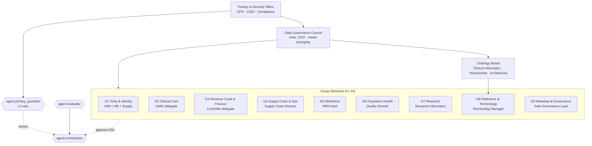

# Module 11 — Governance, Security & Compliance

## 1. Purpose and scope

Module 11 is the **policy authority** of HEALIX. It owns the one cross-module contract that every other module
consumes — the **PHI classification & policy contract** (`01-hipaa-phi-and-privacy.md`, see ARC-01 §6) — and it
specifies how identity, access, lineage, audit and master-data stewardship are applied across the six layers of the
reference architecture. Nothing in modules 02–10 or 12 may store, move, transform or expose a record unless the
behaviour is permitted by a policy defined here.

The module answers four questions for every data flow and every agent action:

| Question | Owning document | Requirement prefix |
|----------|-----------------|--------------------|
| *What kind of data is this and what may be done with it?* | [01 HIPAA, PHI & Privacy](01-hipaa-phi-and-privacy.md) | `GOV-PHI-NNN` |
| *Who (or which agent) may touch it, and under which purpose?* | [02 Access Control](02-access-control.md) | `GOV-ACC-NNN` |
| *Where did it come from, who saw it, and can we prove it?* | [03 Lineage, Provenance & Audit](03-lineage-provenance-audit.md) | `GOV-LIN-NNN` |
| *Which record is the truth and who is accountable for it?* | [04 Master Data & Stewardship](04-master-data-and-stewardship.md) | `GOV-MDM-NNN` |

**In scope:** HIPAA Privacy and Security Rules, 42 CFR Part 2, state privacy overlays, GDPR for international
workforce data, identity and access management for humans and agents, Kafka/graph/EDW authorisation, encryption and
key management, PROV-O and OpenLineage lineage, FHIR `AuditEvent` audit trail, consent enforcement, master data
management (MDM) and stewardship, data contracts, metadata standards.

**Out of scope:** physical security of data centres, workstation endpoint management, clinical-content governance
inside Cerner Millennium (order sets, documentation templates), and payer contract negotiation. Operational
observability, DR and retention *mechanics* are in module 12; this module defines the retention *policy* inputs.

## 2. Governance operating model

HEALIX governance is a federated model: a central council sets policy, group stewards apply it, an ontology board
guards semantics, and the privacy office holds veto power through `agent.privacy_guardian` (ARC-01 §5, autonomy
level L4).

### 2.1 Bodies and their authority

| Body | Composition | Authority | Cadence |
|------|-------------|-----------|---------|
| **Data Governance Council (DGC)** | CDO (chair), CMIO, CFO delegate, CHRO delegate, CISO, Chief Privacy Officer, Enterprise Architect, Head of Analytics | Approves policies, data-sharing agreements, retention schedule, stewardship appointments, risk acceptance; final escalation point | Fortnightly; emergency session within 2 business days |
| **Privacy & Security Office (PO)** | Chief Privacy Officer, CISO, Compliance, Legal | Owns the PHI taxonomy, consent rules, BAAs, breach response; configures `agent.privacy_guardian` policies; may veto any change | Continuous; weekly policy review |
| **Ontology Board (OB)** | Lead ontologist, clinical terminologist, finance and supply data modellers, EDW architect | Approves Stage 4 ontology releases and breaking schema changes; arbitrates semantic disputes between groups | Weekly release review |
| **Group Stewards (G1–G9)** | One accountable steward and named delegates per group | Approve mappings, DQ thresholds, golden-record rules and data contracts in their group; triage issues | Daily queue; weekly steward forum |
| **Platform Owner (module 12)** | Data Platform engineering lead | Implements controls; owns operational evidence | Continuous |

### 2.2 Decision rights by change class

Every autonomous change (module 10 change request, CR) is classified by the orchestrator and routed per this
matrix. `agent.privacy_guardian` reviews **every** CR for PHI impact regardless of class and MAY veto.

| Change class | Example | Auto-approve allowed? | Human approver | Guardian review |
|--------------|---------|-----------------------|----------------|-----------------|
| `low` | New alternate label; DQ threshold ±5 % | Yes, if evaluator score ≥ threshold | — | Automated |
| `medium` | New HL7 v2 → FHIR mapping; new value-set binding | Yes for non-PHI fields | Group steward | Automated + sampled human |
| `high` | New OWL axiom; EDW DDL migration; new topic | No | Ontology Board or EDW architect + group steward | Mandatory |
| `phi-affecting` | Any change touching a `phi:*` element, consent rule or masking function | No | Privacy Office + group steward | Mandatory, veto-capable |
| `policy` | Change to this module's taxonomy or access matrix | No | DGC | Author |

## 3. RACI

R = Responsible, A = Accountable, C = Consulted, I = Informed.

| Activity | DGC | Privacy Office | Ontology Board | Group Steward | Platform Owner | `agent.privacy_guardian` | `agent.orchestrator` |
|----------|-----|----------------|----------------|---------------|----------------|--------------------------|----------------------|
| Define PHI taxonomy and `hc-phi-class` values | A | R | C | C | I | I | I |
| Classify a new data element | I | A | C | C | I | R | I |
| Approve data-sharing agreement / BAA | A | R | I | C | I | I | I |
| Approve access-policy change (RBAC/ABAC) | A | R | I | C | R | C | I |
| Approve ontology release (Stage 4) | I | C | A | C | I | R (PHI check) | R (routing) |
| Approve EDW DDL migration | I | C | C | A | R | R (PHI check) | R |
| Approve DQ threshold change | I | I | I | A | I | C | R |
| Resolve a DQ or MDM issue | I | I | C | A/R | C | I | R (opens issue) |
| Investigate audit anomaly / breach | I | A/R | I | C | R | R (detect) | I |
| Golden-record survivorship rules | I | C | C | A/R | C | C | I |
| Retention schedule and legal hold | A | R | I | C | R (execute) | C | I |

## 4. Interfaces this module exposes

| Interface | Form | Consumers |
|-----------|------|-----------|
| PHI classification taxonomy and `hc-phi-class` header values | `01-hipaa-phi-and-privacy.md` §3; `policies/phi-classes.yaml` (planned) | All modules; Kafka producers set the header; `agent.privacy_guardian` enforces |
| Column/property tag vocabulary (`phi:direct`, `phi:quasi`, …) | SKOS scheme `<base>scheme/data-classification` in G8/G9 | 02, 05, 08, 09 |
| Purpose-of-use codes and consent gates | FHIR `Consent` profile + policy rules | 06, 07, 08, 10 |
| Access matrix (role × purpose × PHI class × group × facility) | `02-access-control.md` §4; OPA/Rego bundle (planned) | 07, 08, 05, 10, 12 |
| Audit event profile (`hc.ops.audit.v1`) | FHIR `AuditEvent` JSON Schema | 07, 10, 12 |
| Lineage event profile (`hc.ops.lineage.openlineage.v1`) | OpenLineage 1.x RunEvent with HEALIX facets | 07, 08, 09, 10, 12 |
| Data contract template | `04-master-data-and-stewardship.md` §5 | 03, 09 |
| Golden-record and MDM domain policies | `04-master-data-and-stewardship.md` | 05, 08 |

## 5. Dependencies on other modules

| Depends on | For |
|------------|-----|
| ARC-01 | Layers, G1–G9 groups, agent roster, topic naming, NFRs ARC-NFR-003/006 |
| Module 07 (`STR-*`) | `hc.ops.*` topic provisioning, ACL application, header propagation |
| Module 08 (`TKG-*`) | Named-graph model where PROV-O and access partitions live; entity resolution for EMPI |
| Module 10 (`AGT-*`) | Change Request schema, evaluator hooks, tool-call audit emission |
| Module 12 (`OPS-*`) | Retention execution, backup encryption, SIEM integration, environment isolation |

## 6. Requirement index

| Range | Topic | Document | P0 count (indicative) |
|-------|-------|----------|-----------------------|
| `GOV-PHI-001`–`GOV-PHI-024` | PHI taxonomy, minimum necessary, de-identification, consent, BAAs, breach, state law, GDPR | 01 | 14 |
| `GOV-ACC-001`–`GOV-ACC-022` | Identity, RBAC/ABAC, Kafka ACLs, graph and EDW security, agent identities, break-glass, keys, network | 02 | 15 |
| `GOV-LIN-001`–`GOV-LIN-018` | PROV-O, OpenLineage, field-level lineage, AuditEvent, retention, coverage metric | 03 | 11 |
| `GOV-MDM-001`–`GOV-MDM-018` | Stewardship, MDM domains, golden records, data contracts, escalation, DSAs, metadata standards | 04 | 8 |

## 7. Compliance frameworks referenced

| Framework | How used |
|-----------|----------|
| HIPAA Privacy Rule (45 CFR 164 Subpart E) | Minimum necessary, uses and disclosures, de-identification standard §164.514 |
| HIPAA Security Rule (45 CFR 164 Subpart C) | Administrative, physical, technical safeguards; audit controls §164.312(b) |
| HITECH / Breach Notification Rule (§164.400–414) | Breach risk assessment and notification timelines |
| 42 CFR Part 2 | Substance use disorder records segmentation and consent |
| NIST SP 800-53 Rev. 5, NIST CSF 2.0 | Control catalogue for access, audit, key management |
| HITRUST CSF | Assessment target for the platform |
| GDPR (Reg. 2016/679) | Lawful basis and data-subject rights for EU/UK workforce records in Oracle HCM |
| ONC HTI-1, Information Blocking (45 CFR 171) | Ensures governance does not block permitted exchange |
| W3C PROV-O, OpenLineage 1.x, FHIR R4 `AuditEvent`/`Consent`/`Provenance` | Technical standards for lineage, audit, consent |

## 8. Definition of done for this module

1. Every `P0` requirement maps to a test, inspection checklist or demo script registered in module 13.
2. `agent.privacy_guardian` policies are expressed as machine-readable rules and pass the module 10 evaluation suite.
3. All `hc.canonical.*`, `hc.kg.*` and `hc.edw.*` topics carry a valid `hc-phi-class` header in `test` and above.
4. Lineage coverage metric (GOV-LIN-016) ≥ 95 % of EDW columns and KG properties.
5. Signed security and privacy review recorded as a `G9` governance fact in the KG.
