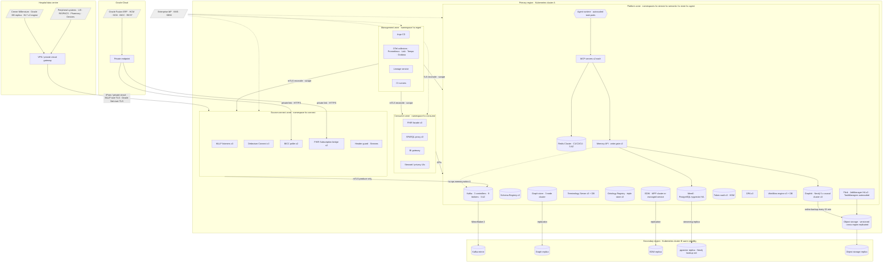

# Deployment Topology

HEALIX runs on Kubernetes across three network zones and two regions, is cloud-agnostic behind the interfaces in
ARC-01 §3, and reaches Cerner Millennium on-prem and Oracle Fusion Cloud through dedicated, private connectivity.
This document specifies the topology, high-availability design per component, sizing assumptions and example
mappings to AWS, Azure and OCI.

## 1. Topology

### 1.1 Kubernetes layout

| Aspect | Decision |
|--------|----------|
| Clusters | One cluster per environment per region (`dev`, `test` share a non-prod cluster with namespace isolation; `uat` and `prod` have dedicated clusters). `prod` has a warm-standby cluster in the secondary region. |
| Namespaces | `hc-connect`, `hc-stream`, `hc-semantic`, `hc-store`, `hc-agent`, `hc-consume`, `hc-mgmt`; each namespace maps to one zone and one `NetworkPolicy` set |
| Node pools | `general` (control services), `kafka` (local NVMe, dedicated), `flink` (memory-optimised), `graph` (memory + NVMe), `agent` (burstable, no PHI volumes), `memory` (memory + NVMe for Neo4j, pgvector and Redis of the module 14 memory stack; no PHI volumes), `gpu` (optional, local inference) |
| Availability zones | Every stateful set spread across 3 AZs with topology spread constraints; pod anti-affinity per component |
| Ingress | Internal load balancers only; no public ingress to any zone; consumer zone reachable from corporate network via IdP-authenticated gateway |
| Service mesh | mTLS via mesh (Istio/Linkerd) or SPIRE-issued certs; `STRICT` mode in all namespaces |
| Operators | Strimzi (Kafka), Flink Kubernetes Operator, graph-store vendor operator or StatefulSet, Vault injector, OTel Operator, Argo CD, CloudNativePG (Mem0 pgvector), Neo4j Helm/operator (Graphiti), Redis operator (cache cluster) |

## 2. Network zones

| Zone | Namespace(s) | Purpose | Ingress allowed from | Egress allowed to |
|------|--------------|---------|----------------------|-------------------|
| **Source-connect** | `hc-connect` | Terminate source protocols (MLLP, Oracle Net, HTTPS to BICC/FHIR) and produce to Kafka | On-prem VPN/private circuit CIDRs; Oracle Cloud private endpoint | Kafka bootstrap and brokers (mTLS 9093); Schema Registry; OTel collector; Vault |
| **Platform** | `hc-stream`, `hc-semantic`, `hc-store`, `hc-agent` | All processing and storage | Source-connect (Kafka only); consumer zone APIs; management zone | KMS; LLM provider via egress proxy (`hc-agent` only); object storage; secondary region replication endpoints |
| **Consumer** | `hc-consume` | Human and application access with policy enforcement | Corporate network via authenticated gateway; partner SMART clients via API gateway | Platform zone APIs; IdP |
| **Management** | `hc-mgmt` | GitOps, CI, observability, lineage | Admin VPN; Git provider webhooks via allowlisted IPs | All zones (reconcile/scrape over mTLS); SIEM; Git provider |

Egress from `hc-agent` to the LLM provider passes an egress proxy with domain allowlist, TLS termination for DLP
(detecting `phi:direct` patterns per GOV-ACC-018) and request logging. No other namespace has internet egress.

The module 14 memory stack — Memory API (C26), Mem0 on pgvector/Qdrant (C26), Graphiti on Neo4j 5.x or FalkorDB (C27)
and the Redis cache cluster (C28) — runs in `hc-agent` on the `memory` node pool, one instance of each per environment
(MEM-01 §9). It holds no PHI by contract (ADR-08, MEM-CACHE-001; GOV-01 §3 ceiling `internal`) and its
`NetworkPolicy` allows only: Kafka `hc.ops.*` topics (write log, healing, canary, policy and invalidation events), the
Terminology Server (C2/C3 re-validation), Git (M3 playbooks and prompts), Vault, OTel collectors and — for Mem0
embeddings — the LLM egress proxy under GOV-PHI-017 zero retention. It has no path to `raw`/`std`/`canonical` topics,
the graph store, the EDW or the token vault; only the Memory API holds write credentials to Mem0, Graphiti and the write
log (MEM-ARCH-002).

### 2.1 On-prem connectivity for Cerner Millennium

| Element | Specification |
|---------|---------------|
| Circuits | Two diverse private circuits (e.g. 1 Gbps each) or IPsec VPN tunnels from the hospital data centre to the primary region, plus one to the secondary region; BGP with ECMP; failover ≤ 30 s |
| HL7 v2 | Cerner's interface engine (Open Engine / Cloverleaf) sends MLLP to a load-balanced VIP in the source-connect zone; MLLP wrapped in TLS 1.2+ where the engine supports it, otherwise inside IPsec only; ACKs (AA/AE/AR) returned synchronously; three listeners behind the VIP with sticky sessions per sending facility |
| CDC | Debezium Oracle connector (LogMiner) against a **read-only Millennium replica** (Data Guard physical standby opened read-only or GoldenGate-fed copy), never against the production RAC; connection over Oracle Net with TLS; supplemental logging enabled on the replica source |
| FHIR | Oracle Health Millennium FHIR R4 APIs over HTTPS with SMART Backend Services; Subscription bridge polls or receives notifications |
| Bandwidth | Peak ADT + ORU + CDC ≈ 40 Mbps sustained, 200 Mbps burst (sizing §5); 1 Gbps circuits leave headroom for replay |
| Time | NTP/PTP from a shared stratum source; `hc-source-time` header derived from Millennium timestamps with declared offset |

### 2.2 Oracle Fusion Cloud connectivity

BICC extracts land in Oracle Cloud Object Storage (UCM/OSS) and are pulled over a private endpoint (OCI Service
Gateway / FastConnect, or cross-cloud private link) by the BICC poller; REST and FHIR-style APIs for near-real-time
entities use the same path. Credentials are OAuth 2.0 client credentials stored in Vault (GOV-ACC-016).

## 3. High-availability design per component

| Component | HA mechanism | Failure tolerated | Failover time |
|-----------|--------------|-------------------|---------------|
| Kafka | 3 KRaft controllers, ≥ 9 brokers across 3 AZs; RF = 3, `min.insync.replicas = 2`, rack-aware; producers `acks=all`, idempotent | Loss of one AZ | Seconds (leader election) |
| Kafka Connect | 3+ workers per connector group; tasks rebalance; offsets in Kafka | Worker loss | ≤ 60 s rebalance |
| MLLP listeners | 3 pods behind VIP; source engine retries with queueing | Pod loss | Immediate; engine resends |
| Schema Registry | 3 replicas, leader election, backed by Kafka `_schemas` | Pod loss | Seconds |
| Flink | JobManager HA (Kubernetes HA service) with 2 standbys; checkpoints every 30 s to object storage; exactly-once with Kafka transactions (ARC-NFR-004) | TaskManager or JobManager loss | ≤ 2 min restore from checkpoint |
| Terminology Server | 3 stateless replicas + HA PostgreSQL (synchronous replica, automated failover) | Pod or DB primary loss | ≤ 60 s |
| Ontology Registry | Git is the source of truth; triple store 3 replicas; rebuildable from Git | Store loss | Rebuild ≤ 30 min |
| Graph store | 3-node cluster (vendor HA: GraphDB cluster, Stardog HA, Neptune multi-AZ); writes via quorum; reads load-balanced; async replica in secondary region | Node loss | Seconds; cross-region per OPS-04 |
| EDW | Managed MPP service with multi-AZ or Teradata Vantage HA nodes; cross-region replication of storage | Node/AZ loss | Vendor-dependent; ≤ 15 min |
| Token vault | 3 replicas with HSM-backed keys; Raft | Pod loss | Seconds |
| OPA | 3 replicas; bundle cached locally; PEPs fail closed if PDP unreachable > 5 s | PDP loss | Fail closed |
| Workflow engine | 3 frontend/history/matching replicas + HA DB | Pod or DB loss | ≤ 60 s |
| Agent runtime | Stateless task pods; Temporal retries tasks; no in-pod state | Pod loss | Task retry |
| MCP servers | 2+ replicas each behind gateway | Pod loss | Immediate |
| Observability | Prometheus HA pair + long-term store; Loki/Tempo on object storage | Pod loss | Seconds; gaps ≤ scrape interval |
| Object storage | Provider durability; versioning; cross-region replication | AZ loss | — |
| Memory API / write-gate (C26) | 3 stateless replicas; every write appended to `hc.ops.memory.write.v1` and acknowledged before materialisation (MEM-ARCH-007); on store outage agents run memoryless and CRs carry `memory_degraded=true` (MEM-ARCH-034) | Pod loss; downstream store loss | Immediate; degraded mode detected ≤ 60 s |
| Mem0 store (C26) | HA PostgreSQL + pgvector (CloudNativePG, synchronous replica, automated failover) or 3-node Qdrant; derived state rebuildable from the write log ≤ 4 h (MEM-ARCH-008) | DB primary loss | ≤ 60 s |
| Graphiti graph (C27) | Neo4j 5.x causal cluster, 3 core members across 3 AZs, one database per environment (FalkorDB / Neptune swappable, MEM-GRA-001); online backup every 15 min; asynchronous episode ingestion buffers in the write log | Node loss | Seconds (leader election); backlog ≥ 10 min sets `graphiti: degraded` and healing falls back to the Git playbook index (MEM-ARCH-035) |
| Redis cache (C28) | Redis Cluster across 3 AZs, 1 replica per shard, automatic failover ≤ 30 s; clients time out at 20 ms and bypass within 50 ms after 5 consecutive failures (MEM-CACHE-004) | Shard or whole-cluster loss | ≤ 30 s failover; pipeline latency unaffected (bypass) |
| Healing / improvement controllers (C29) | Temporal workflows on the HA workflow engine; kill switch halts executing runs ≤ 30 s (MEM-HEAL-007); ≤ 3 concurrent healing actions platform-wide | Worker or pod loss | Temporal retry; in-flight actions idempotent (MEM-HEAL-003) |

Every component declares a `PodDisruptionBudget` and a readiness probe that checks dependencies (e.g. a Connect
worker is not ready until Kafka and Vault respond), so rolling upgrades never breach quorum.

## 4. Cloud-agnostic mapping

| Capability | AWS | Azure | OCI | On-prem |
|------------|-----|-------|-----|---------|
| Kubernetes | EKS | AKS | OKE | OpenShift / Rancher |
| Kafka | Self-managed on EKS (Strimzi) or MSK | Strimzi on AKS or Event Hubs (Kafka API, limited) | Strimzi on OKE or OCI Streaming (limited) | Strimzi |
| Object storage | S3 | ADLS Gen2 / Blob | Object Storage | MinIO / Ceph |
| EDW | Redshift / Snowflake / Databricks SQL / Teradata Vantage on AWS | Synapse / Snowflake / Databricks / Teradata on Azure | Autonomous Data Warehouse / Teradata on OCI | Teradata Vantage |
| Graph store | Neptune / GraphDB / Stardog on EKS | GraphDB / Stardog on AKS | GraphDB / Stardog on OKE | Same, self-managed |
| KMS / HSM | KMS + CloudHSM | Key Vault (Managed HSM) | OCI Vault (HSM) | Thales / Entrust HSM |
| Secrets | Vault on EKS or Secrets Manager | Vault or Key Vault | Vault or OCI Vault | Vault |
| Identity | IAM Roles for Service Accounts + enterprise IdP | Workload Identity + Entra ID | OCI IAM workload identity | SPIRE |
| Private connectivity to Cerner on-prem | Direct Connect + Site-to-Site VPN | ExpressRoute + VPN Gateway | FastConnect + IPsec | — |
| Private connectivity to Oracle Fusion | Interconnect (AWS–OCI) or VPN | Oracle Interconnect for Azure | Service Gateway / FastConnect | VPN |
| Load balancer (internal, L4 for MLLP) | NLB internal | Internal Load Balancer | OCI LB (private) | MetalLB / F5 |
| Observability long-term store | Mimir on S3 / AMP | Mimir on Blob / Azure Monitor | Mimir on Object Storage | Mimir |
| Agent memory graph (Graphiti backend) | Neo4j 5.x on EKS (Helm/operator) or Amazon Neptune (swappable per MEM-GRA-001) | Neo4j on AKS | Neo4j on OKE | Neo4j or FalkorDB self-managed |
| Agent memory vector store (Mem0) | CloudNativePG + pgvector on EKS or RDS PostgreSQL (pgvector) | CloudNativePG on AKS or Azure Database for PostgreSQL | CloudNativePG on OKE or OCI PostgreSQL | CloudNativePG / Qdrant |
| Semantic cache (Redis) | Redis Cluster on EKS (operator) or ElastiCache (Redis-compatible with vector search) | Redis on AKS or Azure Managed Redis | Redis on OKE or OCI Cache | Self-managed Redis Cluster |

Only HIPAA-eligible services are permitted (GOV-PHI-016); the provider BAA list is checked at `terraform plan` by a
policy test. Vendor-specific services are used only behind the interfaces in ARC-01 §3 so the same Helm/Terraform
modules deploy to any column with a different values file.

## 5. Sizing assumptions (first release, `prod`)

| Driver | Assumption | Basis |
|--------|------------|-------|
| Health system size | 6 hospitals, 2,500 beds, 60 clinics, 25,000 workers | Persona scenario |
| HL7 v2 inbound | ≈ 6 M messages/day (ADT, ORU, ORM, SIU, MDM, DFT), avg 4 KB, peak 350 msg/s | Typical Millennium volumes |
| CDC from Millennium replica | ≈ 40 M row changes/day across ~400 tables, peak 2,000 changes/s | Clinical + charge tables |
| Oracle Fusion BICC | ≈ 300 extracts/day, 20 GB/day compressed | ERP/HCM/SCM incremental |
| Canonical FHIR resources | ≈ 50 M/day, avg 6 KB JSON, sustained 600/s, peak 5,000/s (ARC-NFR-002) | Derived |
| DQ results | ≈ 1 result/resource/rule family → 400 M/day small records | Module 09 |
| Audit events | ≈ 20 M/day (consumer reads, agent tool calls, policy decisions) | GOV-03 |
| KG assertions | ≈ 1.2 B triples/year added (RDF-star annotations ×3) | Module 08 |
| EDW growth | ≈ 4 TB/year compressed, 10-year horizon | Module 05 |
| Agent workload | ≈ 2,000 CRs/day; 50,000 tool calls/day; p95 CR cycle ≤ 30 min | Module 10 |
| Agent memory and cache workload | ≈ 50,000 memory operations/day (`remember`/`recall`, 50 concurrent recalls at peak); ≈ 1 M cache lookups/day across C1–C4; ≈ 500 healing incidents/month in the chaos-sized estate | Module 14 (MEM-02 §2, MEM-03 §1, MEM-04 §2) |

| Component | Sizing (prod, primary) | Headroom |
|-----------|------------------------|----------|
| Kafka brokers | 9 × (16 vCPU, 64 GB, 4 TB NVMe); ≈ 25 TB usable at RF3 for 30-day `raw`, 90-day `std`, compacted `canonical` | ×3 throughput (ARC-NFR-002) |
| Flink | 2 JobManagers (4 vCPU, 8 GB); 24–96 TaskManagers (4 vCPU, 16 GB) autoscaled on backlog | Burst to peak 5,000/s |
| Terminology Server | 3 × (4 vCPU, 16 GB) + PostgreSQL 8 vCPU, 64 GB, 500 GB | 5,000 `$translate`/s |
| Graph store | 3 × (32 vCPU, 256 GB, 8 TB NVMe) | 5 B triples |
| EDW | 32–64 vCPU-equivalent MPP, 50 TB storage initial | 3× yearly growth |
| Agent runtime | 0–200 task pods (2 vCPU, 4 GB) autoscaled; model gateway 3 × (4 vCPU, 8 GB) | Burst 10× |
| Object storage | 100 TB year 1 (checkpoints, backups, extracts) | Lifecycle to cold tier |
| Observability | Prometheus/Mimir 3 × (8 vCPU, 32 GB), Loki/Tempo on object storage; 30 days hot metrics, 90 days logs | — |
| Memory API (C26) | 3 × (2 vCPU, 4 GB) | 50 concurrent recalls at p95 targets (MEM-GRA-023) |
| Mem0 / pgvector (C26) | PostgreSQL 3 × (4 vCPU, 16 GB, 500 GB NVMe) | ≈ 5 M records at year 1 (MEM-01 §8 retention) |
| Graphiti / Neo4j (C27) | 3 × (8 vCPU, 64 GB, 1 TB NVMe) | Year-1 sizing of MEM-02 §2 with the 400-day hot window; ×3 episodes |
| Redis cache (C28) | 6 shards × (4 vCPU, 16 GB) + 1 replica each | Hot-key ceiling 5,000 QPS/key (MEM-CACHE-011); 64 KB max entry |

Non-prod: `dev`/`test` at 10 % of prod with synthetic data; `uat` at 50 % with de-identified data (OPS-02 §6).

## 6. Requirements

> **OPS-DEP-001** (P0, test) — All platform components MUST be deployed on Kubernetes from versioned Helm/Terraform
> modules in Git; manual changes MUST be detected and reverted by the GitOps controller within 10 minutes.

> **OPS-DEP-002** (P0, test) — The four zones in §2 MUST be enforced with default-deny `NetworkPolicy`; a connectivity
> test suite MUST prove that only the permitted paths are open.

> **OPS-DEP-003** (P0, test) — The source-connect zone MUST be the only zone that initiates or accepts connections
> from source systems, and MUST be able to reach only Kafka, Schema Registry, Vault and OTel collectors.

> **OPS-DEP-004** (P0, test) — Debezium MUST connect to a read-only Millennium replica, never to the production
> database; the replica endpoint MUST be the only Oracle Net destination allowed from `hc-connect`.

> **OPS-DEP-005** (P0, test) — MLLP traffic MUST be encrypted in transit (TLS or IPsec) and MUST return HL7 ACKs
> synchronously; listener loss MUST not lose a message (source engine retry + idempotent produce).

> **OPS-DEP-006** (P0, test) — On-prem connectivity MUST consist of at least two diverse circuits or tunnels with
> automatic failover ≤ 30 s, plus a path to the secondary region.

> **OPS-DEP-007** (P0, test) — Kafka MUST run with RF = 3, `min.insync.replicas = 2`, rack awareness across 3 AZs,
> and producers MUST use `acks=all` with idempotence.

> **OPS-DEP-008** (P0, test) — Flink jobs MUST checkpoint to object storage at ≤ 30 s intervals and MUST recover
> exactly-once within 2 minutes of a JobManager or TaskManager failure.

> **OPS-DEP-009** (P0, test) — Every stateful component MUST tolerate the loss of one availability zone without data
> loss and without exceeding its failover time in §3.

> **OPS-DEP-010** (P0, inspection) — All ingress MUST be internal; no public endpoint MUST exist in any zone.

> **OPS-DEP-011** (P0, test) — Only `hc-agent` MUST have internet egress, exclusively through the DLP egress proxy to
> allowlisted LLM provider domains.

> **OPS-DEP-012** (P0, test) — PEPs MUST fail closed when the PDP is unreachable for more than 5 s.

> **OPS-DEP-013** (P0, inspection) — Only HIPAA-eligible managed services covered by the provider BAA MUST be used; a
> policy test MUST block non-eligible services at plan time.

> **OPS-DEP-014** (P1, test) — The same Helm/Terraform modules MUST deploy to at least two of AWS, Azure and OCI with
> only values-file differences.

> **OPS-DEP-015** (P1, test) — Every component MUST define a `PodDisruptionBudget` and dependency-aware readiness
> probes so rolling upgrades never breach quorum.

> **OPS-DEP-016** (P1, analysis) — Capacity MUST meet the sizing table in §5 with ×3 throughput headroom and MUST be
> reviewed monthly against observed growth.

> **OPS-DEP-017** (P1, test) — Agent task pods MUST run on a node pool without PHI volumes and with no network path to
> raw or std topics.

> **OPS-DEP-018** (P1, test) — Service-to-service traffic in every namespace MUST use mTLS in strict mode.

> **OPS-DEP-019** (P2, test) — Kafka brokers SHOULD run on dedicated node pools with local NVMe and tiered storage to
> object storage for topics with retention > 7 days.

> **OPS-DEP-020** (P2, analysis) — A warm-standby cluster in the secondary region SHOULD be kept at ≥ 50 % of primary
> capacity to meet RTO (OPS-04).

> **OPS-DEP-021** (P0, test) — The module 14 memory stack (Memory API, Mem0 on pgvector or Qdrant, Graphiti on Neo4j or
> FalkorDB, Redis cache cluster) MUST be deployed once per environment in `hc-agent` on a node pool without PHI volumes,
> with `NetworkPolicy` permitting only the paths in §2; only the Memory API MAY hold write credentials to the memory
> stores and the write log (MEM-ARCH-002), Redis MUST run as a 3-AZ cluster with per-agent ACL users (MEM-CACHE-023),
> and the connectivity test suite MUST prove that no path exists from these components to `raw`/`std`/`canonical`
> topics, the graph store, the EDW or the token vault.

## 7. Traceability

| Requirement | Verified by |
|-------------|-------------|
| OPS-DEP-001, 002, 003, 010, 011, 018 | Conftest/OPA policy tests on manifests; network connectivity test job (OPS-02 stage `security`) |
| OPS-DEP-004, 005, 006 | Connectivity acceptance test with Cerner interface team; failover drill |
| OPS-DEP-007, 008, 009, 015 | Chaos tests (AZ drain, pod kill) in `uat`; recorded in G9 |
| OPS-DEP-013, 014 | Terraform plan policy; multi-cloud deployment pipeline |
| OPS-DEP-021 | Network connectivity test job for `hc-agent` memory stack; Redis ACL test; credential inventory check (MEM-ARCH-002); Neo4j/Redis AZ-drain chaos in `uat` |
