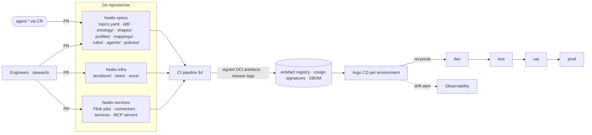
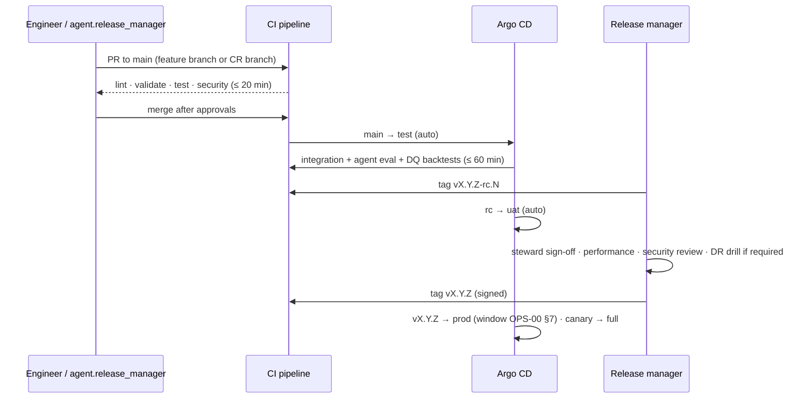

# Environments, GitOps and CI/CD

Every HEALIX artefact — infrastructure, topics, DDL, ontology, SHACL shapes, FHIR profiles, mapping specs, DQ rules
and agent manifests — is a file in Git, validated by one CI pipeline and promoted through four environments by
GitOps. Agents (module 10) are first-class committers: their change requests become pull requests that pass the same
gates as human changes. This document specifies the environments, the GitOps model, CI stages, promotion gates,
non-production data strategy and release management.

## 1. Environments

| Environment | Purpose | Data | Cluster | Who may deploy | Change source |
|-------------|---------|------|---------|----------------|---------------|
| `dev` | Engineer and agent iteration; feature branches | **Synthetic** only (Synthea-derived FHIR, synthetic HL7 v2, synthetic ERP/HCM) | Shared non-prod cluster, namespace prefix `dev-` | Any engineer; agents in sandbox | Any branch via preview environments |
| `test` | Automated integration and regression; agent evaluation suite | Synthetic + **replayed `deidentified:safe-harbor`** fixtures | Shared non-prod cluster, prefix `test-` | CI only | `main` after merge |
| `uat` | Steward and business validation; performance tests at 50 % scale; DR drills | **De-identified/pseudonymised** copy of prod (`pseudonymised`, non-prod token keys) refreshed weekly | Dedicated cluster | Release manager via GitOps | Release candidate tags `vX.Y.Z-rc.N` |
| `prod` | Live platform | Real PHI | Dedicated cluster + warm standby (OPS-01) | GitOps only; no human `kubectl` write | Signed release tags `vX.Y.Z` |

Environment-specific values (sizes, endpoints, key references) live in `envs/<env>/values.yaml`; everything else is
identical across environments so that a passing `uat` is predictive of `prod`.

## 2. GitOps model

| Rule | Detail |
|------|--------|
| Single source of truth | The cluster state is derived from Git; `kubectl apply` by humans is disabled in `uat`/`prod` (admission policy) |
| Spec artefacts are deployed, not copied | `topics.yaml` → Strimzi `KafkaTopic` CRs + ACLs; `ddl/*.sql` → migration job; `ontology/` → Ontology Registry release; `rules/` → DQ engine config map; `agents/*.yaml` → agent runtime registry; `policies/` → OPA bundle |
| Agents commit like humans | `agent.release_manager` opens PRs from approved CRs with the CR id, evaluator score and approver in the PR body; branch protection requires CI green and the approvals mandated by GOV-00 §2.2 |
| Signed everything | Commits signed (Sigstore gitsign); images and artefact bundles signed with cosign; Argo CD verifies signatures before sync (ARC-NFR-006) |
| Drift | Argo CD `selfHeal` + `prune`; drift events alert on-call; manual drift is a SEV3 |
| Secrets | Never in Git; External Secrets Operator pulls from Vault (GOV-ACC-016) |

## 3. Branching and promotion flow

## 4. CI pipeline stages

The pipeline is one reusable workflow; each stage runs only when relevant paths change but **all** stages run on
release tags. Failure in any `blocking` stage fails the PR.

| # | Stage | Artefacts | Tooling | Blocking | Typical duration |
|---|-------|-----------|---------|----------|------------------|
| 1 | `lint-yaml-json` | `topics.yaml`, agent manifests, rule packs, contracts, OpenLineage/AuditEvent schemas, module 14 `memory-schema.yaml`, `cache-policy.yaml` and `healing-playbooks/*.yaml` | JSON Schema validation (`ajv`), `yamllint`, custom linters for CONVENTIONS §3 naming and requirement-ID format; module 14 silent-invalidator lint (MEM-03 §3.2) and playbook `limits`/`guards` fixed-point check | Yes | 1 min |
| 2 | `sql-parse-migrate` | `ddl/*.sql`, dbt models | Dialect-aware parser (Teradata + portable); dry-run migration against ephemeral DB; forward-only and idempotency checks (CONVENTIONS §5) | Yes | 5 min |
| 3 | `owl-reasoning` | `ontology/*.ttl/.owl` | HermiT/ELK consistency and satisfiability; profile check (OWL 2 DL/EL); SKOS integrity (no cycles, unique prefLabel per scheme) | Yes | 5–15 min |
| 4 | `shacl` | `shapes/*.ttl` + test instance data | SHACL validation (pySHACL / TopBraid); shape coverage report (every class has a shape) | Yes | 3 min |
| 5 | `fhir-validator` | `profiles/*.json`, example resources, canonical fixtures | HL7 FHIR Validator with US Core 6.1 and HEALIX IGs; terminology checks against test Terminology Server | Yes | 5 min |
| 6 | `classification-tags` | DDL, ontology, topics, contracts | Every column/property/topic has exactly one classification tag matching the register (GOV-PHI-002, GOV-ACC-007); masking policies generated and diffed | Yes | 2 min |
| 7 | `mapping-tests` | HL7 v2 → FHIR, CDC → FHIR, FHIR → RDF, FHIR → EDW mappings | Golden-file tests on synthetic messages; round-trip checks; lineage facet generation | Yes | 10 min |
| 8 | `dq-backtests` | `rules/*.yaml` | Replay rule pack over the last 30 days of `deidentified:safe-harbor` `test` fixtures; compare breach counts to baseline; flag rules whose breach rate changes > 20 % without an approved threshold CR | Yes for `P0` rules | 15 min |
| 9 | `agent-eval` | `agents/*.yaml`, prompts, tool definitions, policies | Module 10 evaluation suite: rubric scoring, negative tests (tool denial, PHI leak attempts), regression on historical CRs; thresholds from module 13 | Yes | 30–60 min |
| 10 | `security` | Everything | SAST, dependency and container CVE scan (fail on critical), IaC policy (Conftest/OPA for OPS-01 rules), secret scanning (GOV-ACC-014), SBOM generation, signature verification | Yes | 10 min |
| 11 | `contract-drift` | `contracts/*.yaml` vs registered schemas | Schema Registry compatibility (`BACKWARD_TRANSITIVE`/`FULL` per CONVENTIONS §5) and contract field classification match (GOV-MDM-008) | Yes | 2 min |
| 12 | `build-sign-publish` | Images, Helm charts, spec bundles | Build, cosign sign, push to registry, attach SBOM and provenance attestation (SLSA L3 target) | Yes | 10 min |
| 13 | `docs` | PRD and runbooks | Front matter lint (CONVENTIONS §1), requirement-ID uniqueness, `depends_on` resolution, Mermaid render check, link check | Yes for PRD paths | 2 min |

### 4.1 Integration stage in `test`

After deployment to `test`, a second workflow runs: end-to-end replay of synthetic HL7 v2 and CDC fixtures through
`raw → std → canonical → dq → kg/edw`; KG/EDW reconciliation; header-guard and ACL tests (GOV-PHI-001, GOV-ACC-004);
audit emission contract tests (GOV-LIN-006); performance smoke at 10 % load; non-prod PHI scanner.

## 5. Promotion gates

| Gate | From → To | Automated checks | Human approvals | Evidence stored |
|------|-----------|------------------|-----------------|-----------------|
| G-A | branch → `main` | All CI stages green; signed commit; CR id present for agent PRs | Approvals per GOV-00 §2.2 (none for `low`; steward for `medium`; board/architect for `high`; Privacy Office for `phi-affecting`) | PR metadata, CI logs |
| G-B | `main` → `test` | Automatic on merge | — | Argo sync record |
| G-C | `test` → `uat` | Integration workflow green; agent eval ≥ thresholds; DQ backtests pass; SLO smoke pass | Release manager tags rc | Release candidate manifest with artefact digests |
| G-D | `uat` → `prod` | 7-day soak (or 48 h for hotfix) with error budget intact; performance test ≥ ARC-NFR-001/002; security review complete; DR drill current (OPS-04) if storage layout changed; non-prod PHI scanner zero findings | Steward sign-off for affected groups; release manager; Privacy Office for `phi-affecting` content; CAB for `high` | Signed release record in G9 (`fact_release`), changelog |
| G-E | canary → full in `prod` | Canary (10 % of partitions / one facility's topics / one EDW schema) for ≥ 2 h with SLIs within SLO; automated rollback on burn-rate alert | — | Canary report |

Emergency changes bypass soak time but never bypass CI stages 1–7, 10 or Privacy Office approval for
`phi-affecting` content; they require a retrospective within 5 business days.

## 6. Non-production data

| Environment | Source of data | Transform | Residual PHI permitted | Refresh |
|-------------|----------------|-----------|------------------------|---------|
| `dev` | Synthetic generators (Synthea for FHIR/HL7 v2; synthetic ERP/HCM/SCM generator seeded from Oracle Fusion metadata only) | None needed | None | On demand |
| `test` | Synthetic + `deidentified:safe-harbor` fixtures curated from prod (GOV-01 §6.1) | Safe Harbor + date shift; free-text redaction | None (`deidentified:safe-harbor`) | Monthly fixture release |
| `uat` | Full prod copy | Pseudonymisation: FF1 identifiers with `tok-nonprod` keys, synthetic names/addresses/contacts, consistent date shift per patient, free-text redaction; `phi:sensitive-category/*` records dropped unless the test plan needs them (then pseudonymised and flagged) | `pseudonymised` only; zero `phi:direct` | Weekly, automated |
| `prod` | Live | — | Real PHI | — |

The **non-prod PHI scanner** runs daily in `dev`, `test`, `uat` over Kafka topics (sampled), EDW tables, graph
partitions and object storage, using the GOV-01 §2 identifier detectors plus a dictionary of real MRN/NPI formats; any
finding quarantines the environment (blocks promotion) until purged (GOV-PHI-011). Referential integrity across
topics, graph and EDW is preserved by deterministic tokens (GOV-PHI-013) so end-to-end tests remain valid.

## 7. Release management and versioning

| Artefact | Version scheme | Breaking-change rule | Compatibility check in CI |
|----------|----------------|----------------------|---------------------------|
| Topics (`topics.yaml`) | `v<N>` suffix in topic name; schema subject versions | New `vN` topic + dual-publish window ≥ 30 days; old topic deprecated with `deprecated_after` date | Schema Registry compatibility (`BACKWARD_TRANSITIVE` canonical, `FULL` kg/edw) |
| Schemas (Avro/JSON Schema) | Registry version per subject | Incompatible change ⇒ new topic version | Stage 11 |
| Ontology (SKOS/OWL/SHACL) | SemVer per module ontology + `owl:versionIRI` dated; SKOS `dcterms:modified` | Class/property removal or range narrowing ⇒ major; deprecate with `owl:deprecated true` for ≥ 2 minor releases before removal | Stage 3/4 + diff report (`ONT-07` governance) |
| FHIR profiles / IGs | IG SemVer; `StructureDefinition.version` | Cardinality tightening or must-support addition ⇒ major | Stage 5 |
| Mapping specs | SemVer; referenced as `prov:Plan` | Any output-changing edit ⇒ minor; field removal ⇒ major | Stage 7 |
| DQ rule packs | SemVer per pack; rule-level `since` | Threshold change ⇒ patch; new `P0` rule ⇒ minor | Stage 8 |
| EDW DDL | Sequential, forward-only migrations `V<yyyymmddHHMM>__<name>.sql` with compensating migration | Column drop only after ≥ 1 release of deprecation and zero lineage consumers (GOV-03) | Stage 2 |
| Agent manifests and prompts | SemVer; prompt hash recorded in PROV | Tool allowlist widening ⇒ `phi-affecting` CR | Stage 9 |
| Healing playbooks, cache policy, memory schema (module 14) | SemVer; playbook `status` ladder `shadow → assisted → autonomous → retired`; release events on `hc.ops.agent.policy.release.v1` | Status promotion or any `limits`/`guards` change ⇒ `playbook`/`policy` CR with approved evidence; breaking schema change ⇒ new `vN` | Stage 1 + Stage 9 |
| Platform release (umbrella) | `vX.Y.Z` tag spanning all repos with a lock file of artefact digests | — | Stage 12 |

Release notes are generated by `agent.release_manager` from CR metadata and include: requirement IDs touched,
ontology diff summary, topic/schema changes, DDL migrations, DQ rule changes, agent manifest changes, and the
PHI impact assessment (GOV-PHI-023). Rollback is a Git revert of the umbrella tag; stores with irreversible
migrations roll forward with the compensating migration.

## 8. Requirements

> **OPS-ENV-001** (P0, test) — Exactly four environments (`dev`, `test`, `uat`, `prod`) MUST exist, differing only in
> `envs/<env>/values.yaml`; a diff of rendered manifests across environments MUST show only values-file differences.

> **OPS-ENV-002** (P0, test) — All cluster and platform state MUST be reconciled from Git by a GitOps controller;
> human write access to the Kubernetes API in `uat` and `prod` MUST be denied by admission policy.

> **OPS-ENV-003** (P0, test) — Every spec artefact type (topics, DDL, ontology, shapes, profiles, mappings, rules,
> agent manifests, policies) MUST be deployed from Git through CI; out-of-band edits MUST be impossible or reverted.

> **OPS-ENV-004** (P0, test) — Agent-originated changes MUST enter as pull requests carrying the CR id, evaluator
> score and approvals, and MUST pass the identical CI pipeline as human changes.

> **OPS-ENV-005** (P0, test) — CI stages 1–7 and 10–11 MUST block merges; stages 8–9 MUST block merges touching
> `P0` DQ rules or agent manifests.

> **OPS-ENV-006** (P0, test) — OWL reasoning MUST prove consistency and profile conformance; SHACL MUST validate test
> instances and report 100 % class-shape coverage.

> **OPS-ENV-007** (P0, test) — The HL7 FHIR Validator MUST pass all profiles, examples and canonical fixtures against
> US Core 6.1 and HEALIX IGs with zero errors.

> **OPS-ENV-008** (P0, test) — CI MUST fail when any column, property or topic lacks exactly one classification tag or
> when generated masking policies differ from the register.

> **OPS-ENV-009** (P0, test) — DQ rule changes MUST be backtested against ≥ 30 days of de-identified fixtures and MUST
> fail on unexplained breach-rate shifts > 20 % for `P0` rules.

> **OPS-ENV-010** (P0, test) — Agent manifests and prompts MUST pass the module 10 evaluation suite at module 13
> thresholds, including negative PHI-leak and tool-denial tests, before promotion.

> **OPS-ENV-011** (P0, test) — Security scanning MUST block critical CVEs, secrets in code and IaC policy violations;
> every image and bundle MUST be cosign-signed with an attached SBOM and provenance attestation.

> **OPS-ENV-012** (P0, test) — Argo CD MUST verify artefact signatures before sync and MUST refuse unsigned or
> untrusted artefacts.

> **OPS-ENV-013** (P0, test) — `dev` and `test` MUST contain only synthetic or `deidentified:safe-harbor` data; `uat`
> MUST contain only pseudonymised data with non-prod token keys; the daily PHI scanner MUST block promotion on any
> finding.

> **OPS-ENV-014** (P0, test) — Promotion to `prod` MUST require the gate G-D checks and approvals in §5; the signed
> release record MUST be stored in G9.

> **OPS-ENV-015** (P0, test) — `prod` rollouts MUST use a canary with automatic rollback on SLO burn-rate alerts.

> **OPS-ENV-016** (P1, test) — Breaking topic or schema changes MUST produce a new `vN` topic with a dual-publish window
> ≥ 30 days.

> **OPS-ENV-017** (P1, test) — Ontology releases MUST carry a dated `owl:versionIRI`, deprecate before removal, and
> publish a machine-readable diff.

> **OPS-ENV-018** (P1, test) — EDW migrations MUST be forward-only and idempotent with a compensating migration tested
> in CI; column drops MUST be preceded by one release of deprecation and zero lineage consumers.

> **OPS-ENV-019** (P1, test) — Release notes MUST be generated automatically with requirement IDs, artefact diffs and
> the PHI impact assessment.

> **OPS-ENV-020** (P1, test) — The PR-level CI pipeline MUST complete in ≤ 20 minutes (p95) excluding `agent-eval`;
> the `test` integration workflow in ≤ 60 minutes.

> **OPS-ENV-021** (P1, inspection) — Emergency changes MUST still pass CI stages 1–7 and 10 and Privacy Office
> approval for `phi-affecting` content, and MUST be reviewed within 5 business days.

> **OPS-ENV-022** (P2, test) — Preview environments per PR SHOULD be provisioned in `dev` with synthetic data and
> torn down within 24 hours of PR close.

## 9. Traceability

| Requirement | Verified by |
|-------------|-------------|
| OPS-ENV-001–003, 012 | Rendered-manifest diff test; admission policy tests; Argo signature verification test |
| OPS-ENV-005–011 | Pipeline definition review; negative test commits per stage |
| OPS-ENV-013 | Non-prod PHI scanner reports (GOV-PHI-011) |
| OPS-ENV-014, 015 | Release record inspection; canary rollback drill |
