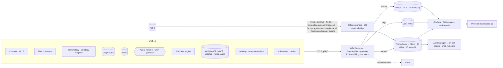

# Observability and Service Level Objectives

HEALIX is observable end to end: every component emits metrics, logs and traces through OpenTelemetry with a shared
set of `healix.*` attributes, so a single trace can follow an HL7 v2 message from the MLLP listener to the EDW row
and KG assertion it produced, and a single dashboard can show whether the platform is keeping its promises to
clinicians, stewards, agents and auditors. This document defines the telemetry model, SLIs and SLOs, alerting and
on-call, persona dashboards and cost observability.

## 1. Telemetry architecture

| Signal | Standard | Retention | Notes |
|--------|----------|-----------|-------|
| Metrics | OpenTelemetry metrics → Prometheus remote write; exemplars link to traces | 30 days raw, 13 months downsampled (5 min) | Cardinality budget per service; patient-level labels forbidden |
| Logs | OTel logs, JSON structured, `trace_id` and `span_id` injected | 90 days | PHI scrubbing processor (GOV-01 §2 detectors) drops or hashes `phi:direct` patterns before export; a scrubbed-field counter is itself a metric |
| Traces | W3C Trace Context propagated in Kafka headers (`traceparent`) end to end; tail sampling keeps 100 % of errors and slow traces, 1 % of healthy | 14 days | Span attributes carry record keys as tokens, never MRNs |
| Business events | `hc.dq.*`, `hc.ops.audit.v1`, `hc.ops.lineage.openlineage.v1`, `hc.ops.agent.memory.episode.v1`, `hc.ops.heal.incident.v1`, `hc.ops.heal.action.v1`, `hc.ops.improve.canary.v1` bridged to metrics | Per module 07/11/14 | Source for DQ, consent, audit, lineage, memory, healing and canary SLIs |

## 2. HEALIX semantic conventions

All emitters attach these resource and span attributes so signals correlate across layers.

| Attribute | Values | Set by |
|-----------|--------|--------|
| `healix.environment` | `dev`,`test`,`uat`,`prod` | Resource |
| `healix.layer` | `raw`,`std`,`canonical`,`dq`,`kg`,`edw`,`ops` | Span |
| `healix.domain` / `healix.group` | Kafka domain (`clinical`…) / `G1`–`G9` | Span |
| `healix.topic`, `healix.partition`, `healix.offset` | Kafka coordinates | Span |
| `healix.source_system` | `cerner-millennium`, `oracle-fusion`, `lis`, … | Span |
| `healix.fhir.resource_type`, `healix.fhir.profile` | `Encounter`, HEALIX profile URL | Span |
| `healix.phi_class` | GOV-01 §3 tag of the record handled | Span (from header) |
| `healix.purpose_of_use` | GOV-01 §4 code | Span |
| `healix.agent_id`, `healix.cr_id`, `healix.model_id`, `healix.tool` | Agent context | Agent runtime, MCP gateway |
| `healix.rule_id`, `healix.rule_dimension` | DQ rule coordinates | DQ engine |
| `healix.prov_activity` | PROV-O activity IRI | Sinks, agents |
| `healix.memory.tier`, `healix.memory.scope_kind`, `healix.memory.class` | `M0`–`M4`; `agent`/`steward`/`run`/`global`; memory record class (MEM-01 §4) | Memory API |
| `healix.cache.tier`, `healix.cache.namespace`, `healix.cache.outcome` | `C0`–`C4`; policy namespace; `hit`/`miss`/`bypass`/`stale` | Cache server, model gateway |
| `healix.incident_id`, `healix.fault_class`, `healix.playbook_id`, `healix.ladder_level` | Healing coordinates (`FLT-*`, `PBK-*`, L1–L4) | Healing controller |
| `healix.candidate_id`, `healix.canary_stage`, `healix.prompt_version` | Improvement-loop coordinates | Canary controller, agent runtime |
| `healix.event_time`, `healix.source_time` | From Kafka headers | Span |

Metric names follow `healix_<component>_<measure>_<unit>` (e.g. `healix_canonical_latency_seconds`,
`healix_agent_cr_cycle_seconds`, `healix_dq_detection_seconds`).

## 3. SLIs and SLOs

SLOs are measured over rolling 28-day windows unless stated; error budgets drive alerting (§4) and promotion gates
(OPS-02 §5). Targets apply to `prod`; `uat` runs the same SLOs with 50 % stricter alerting to catch regressions.

| # | SLI | Definition (good event / total) | SLO target | Source | Owner | Linked NFR / goal |
|---|-----|---------------------------------|------------|--------|-------|-------------------|
| S1 | **Ingest latency (HL7 v2 / CDC)** | Records whose `hc-event-time` (canonical) − `hc-source-time` ≤ 5 s | p95 ≤ 5 s; 99 % of records ≤ 15 s | Flink canonicalise span; Kafka header diff | SRE / module 07 | ARC-NFR-001 |
| S2 | **Ingest latency (BICC batch)** | Extracts landed to canonical ≤ 15 min after extract completion | 99 % | BICC poller + canonicalise span | SRE / module 03 | ARC-NFR-001 |
| S3 | **Ingest availability** | Minutes in which every registered source produced ≥ 1 record (or heartbeat) | 99.9 % | Connector heartbeat metric | SRE | — |
| S4 | **Canonical validity** | Canonical resources passing FHIR validator and HEALIX profile | ≥ 99.5 % | DQ structural rules; validator metric | Module 06 | G-02 |
| S5 | **Header compliance** | Records on `canonical/kg/edw` with valid `hc-phi-class` | 100 % (any rejection is an incident) | Header guard counters | Module 11 | GOV-PHI-001 |
| S6 | **Consumer lag** | Consumer groups for KG sink, EDW sink, DQ engine with lag ≤ 60 s | 99 % of minutes | Kafka consumer-group lag exporter | SRE | ARC-NFR-004 |
| S7 | **DQ detection time** | Rule breaches detected ≤ 15 min after record arrival (canonical event time → DQ result time) | p95 ≤ 15 min; p99 ≤ 30 min | `hc.dq.*` bridge | Module 09 | G-03 |
| S8 | **DQ pipeline coverage** | Critical data elements with ≥ 1 active rule evaluated in window | ≥ 90 % | Rule registry × catalog | Module 09 | G-03 |
| S9 | **KG load latency** | Canonical record → assertions queryable in KG ≤ 2 min | p95 ≤ 2 min; p99 ≤ 10 min | KG sink span; probe query | Module 08 | VIS-00 §8 |
| S10 | **KG query availability / latency** | SPARQL proxy requests succeeding; p95 latency ≤ 2 s for registered query classes | 99.9 % / p95 ≤ 2 s | Proxy metrics | Module 08 | — |
| S11 | **EDW freshness** | Streaming tables: canonical → row visible ≤ 5 min; batch models: completed by 06:00 local | p95 ≤ 5 min; 99 % of days on time | Sink span; dbt run metrics | Module 05 | VIS-00 §8 |
| S12 | **EDW query availability** | Persona view queries succeeding | 99.9 % (06:00–22:00), 99.5 % otherwise | EDW audit/metrics | Module 05 | — |
| S13 | **KG–EDW reconciliation** | Nightly reconciliation: business keys and counts matching between KG and EDW | ≥ 99.99 % matched; discrepancies issue-tracked ≤ 24 h | Reconciliation job | Module 05/08 | ADR-07 |
| S14 | **Agent CR cycle time** | Change requests from creation to final disposition (applied, rejected or escalated) ≤ 30 min for `low`/`medium` classes | p95 ≤ 30 min; `high`/`phi-affecting` excluded (human gate) but time-in-agent ≤ 30 min | Workflow engine metrics | Module 10 | G-06 |
| S15 | **Evaluator agreement** | Evaluator disposition agreeing with human reviewer on the sampled review set (≥ 200 CRs/month) | Cohen's κ ≥ 0.8; disagreement on `phi-affecting` = 0 | Module 10 review sampling | Module 10 | VIS-00 §8 |
| S16 | **Agent tool-call success / denial** | Tool calls succeeding; denial rate as a health signal | Success ≥ 99 %; denial rate ≤ 2 % (spike alert) | MCP gateway metrics | Module 10/11 | GOV-ACC-010 |
| S17 | **Audit completeness** | PHI reads with a matching `AuditEvent` on `hc.ops.audit.v1` (sampled trace join) | 100 % | Trace × audit join | Module 11 | GOV-LIN-006 |
| S18 | **Audit → SIEM delivery** | Audit events arriving in SIEM ≤ 60 s | p95 ≤ 60 s | SIEM ingest metric | Module 11 | GOV-LIN-012 |
| S19 | **Lineage coverage** | Nightly metric per GOV-03 §7 | ≥ 95 %; 100 % for `phi:direct` | Lineage service | Module 11 | GOV-LIN-016 |
| S20 | **Terminology service latency** | `$translate` / `$validate-code` p95 ≤ 50 ms | 99.9 % availability; p95 ≤ 50 ms | TS metrics | Module 06 | — |
| S21 | **Platform availability (composite)** | Minutes in which S3, S6, S10, S12 are all met | 99.9 % | SLO engine | SRE | — |
| S22 | **Consent propagation** | Consent changes enforced on all projections ≤ 15 min | 100 % | Consent engine probe | Module 11 | GOV-PHI-009 |
| S23 | **Agent memory availability and latency** | Memory API `remember`/`recall` requests succeeding (policy rejections excluded); recall p95 ≤ 200 ms at the API, Graphiti hybrid recall p95 ≤ 500 ms, write-gate p95 ≤ 300 ms; episode recallable ≤ 60 s p95 after append | Write availability 99.9 %; latency targets met in 99 % of 5-min windows; `memory_quarantine_total` = 0 (any quarantine is an incident) | `healix.memory.*` metrics (MEM-01 §11, MEM-02 §9) | Module 14 / Agent operator | ADR-08; MEM-ARCH-012, 040; MEM-GRA-017, 023 |
| S24 | **Cache health** | Cache calls answered within tier budget (C1 p95 < 5 ms, C2 p95 < 25 ms, C3 p95 ≤ 5 ms, C4 p95 < 5 ms) with bypass only on policy; invalidation propagated ≤ 60 s | Bypass-on-failure ≤ 0.1 % of calls; invalidation lag p95 ≤ 60 s; semantic-cache divergence (1 % shadow recompute) ≤ 0.5 % | `healix.cache.*` metrics (MEM-03 §9) | Module 14 / SRE | ARC-NFR-001; MEM-CACHE-004, 009 |
| S25 | **Self-healing and improvement safety** | Incidents in autonomous playbook scope healed within their fault-class MTTR (MEM-04 §2); blast-radius budget never exceeded; canary rollbacks complete ≤ 5 min | ≥ 90 % of in-scope incidents within MTTR; 0 budget breaches; 0 autonomous `schema`/`data_mutation` actions; 100 % of rollbacks ≤ 5 min | `hc.ops.heal.*.v1` and `hc.ops.improve.canary.v1` bridges | Module 14 / Agent operator | ADR-09; MEM-HEAL-001, 002, 054; MEM-IMP-004 |

Error budget: `1 − SLO` of the window. Example: S21 at 99.9 % over 28 days = 40.3 minutes.

## 4. Alerting and on-call

### 4.1 Alert design

| Principle | Rule |
|-----------|------|
| Symptom-based | Page on SLO burn, not on component internals; component alerts are tickets unless they predict SLO breach |
| Multi-window burn rate | Page when 2 % of budget burns in 1 h (14.4× rate) or 5 % in 6 h (6×); ticket when 10 % in 3 days |
| Every alert has a runbook | Alert annotation `runbook_url` is mandatory (OPS-00 §7); CI rejects alert rules without it |
| Routing by owner | Labels `healix.owner` (`sre`, `stream`, `semantic`, `store`, `agent`, `privacy`) map to Alertmanager routes |
| Deduplication and inhibition | Zone-down inhibits component alerts in that zone; Kafka-down inhibits lag alerts |

### 4.2 Alert catalogue (excerpt)

| Alert | Condition | Severity | Route |
|-------|-----------|----------|-------|
| `IngestLatencyBurn` | S1 burn rate ≥ 14.4× for 1 h | Page (SEV2) | `stream` |
| `SourceSilent` | Registered source produced nothing for 10 min during expected hours | Page | `stream` + Cerner interface team |
| `HeaderGuardRejection` | Any `canonical/kg/edw` rejection (S5) | Page (SEV1 if `phi:direct` payload) | `privacy` + `stream` |
| `ConsumerLagHigh` | Lag > 60 s for 5 min on sink/DQ groups | Ticket → page after 15 min | `store` |
| `DQDetectionSlow` | S7 p95 > 15 min for 30 min | Page | `semantic` |
| `KGLoadStalled` | S9 p99 > 10 min for 15 min or sink error rate > 1 % | Page | `store` |
| `EDWBatchLate` | Batch models not complete by 06:00 | Page | `store` |
| `ReconciliationMismatch` | S13 < 99.99 % | Ticket (SEV3); SEV2 if `G2` or `G3` | `store` |
| `AgentCRCycleSlow` | S14 p95 > 30 min for 2 h | Ticket | `agent` |
| `AgentDenialSpike` | Denial rate > 2 % or any `phi:direct` denial for an agent | Page (SEV2) | `privacy` + `agent` |
| `EvaluatorDrift` | S15 κ < 0.8 on monthly sample | Ticket + auto-raise autonomy review | `agent` |
| `AuditGap` | S17 < 100 % in any 5-min window | Page (SEV1) | `privacy` + `sre` |
| `AuditSIEMDelay` | S18 p95 > 60 s for 10 min | Page | `sre` |
| `PDPUnreachable` | PEP fail-closed events > 0 | Page | `sre` |
| `NonProdPHIFound` | Scanner finding in `dev`/`test`/`uat` | Page (SEV1) | `privacy` |
| `ConsentPropagationLate` | S22 probe > 15 min | Page (SEV1) | `privacy` |
| `CertificateExpiring` | TLS cert < 14 days | Ticket | `sre` |
| `BudgetAnomaly` | Daily cost > forecast + 25 % | Ticket | `sre` |
| `MemoryQuarantineNonZero` | Any memory record quarantined by the write-gate PHI scan or injection scan (S23) | Page (SEV2) | `privacy` + `agent` |
| `MemoryDegraded` | Mem0 or Graphiti `health ≠ ok` for 5 min; agents running memoryless (MEM-ARCH-034) | Ticket (SEV3); page if > 60 min | `agent` |
| `CacheBypassSustained` | Bypass-on-failure > 1 % of calls for 10 min (FLT-PLAT-001) | Ticket → page after 30 min | `sre` |
| `CacheInvalidationLate` | S24 invalidation lag p95 > 60 s for 5 min (stale terminology or mapping risk) | Page (SEV2) | `agent` + `semantic` |
| `HealingCircuitOpen` | Playbook circuit breaker tripped (3 consecutive failures) or any blast-radius budget refusal | Page (SEV2) | `agent` + `sre` |
| `HealingKillSwitch` | Kill switch engaged at any scope (playbook → agent → module 14 → global) | Page (SEV2) + DGC notice | `agent` + `sre` |
| `CanaryRollback` | Improvement canary rolled back; SEV2 if rollback > 5 min or trigger is `phi_fail` / privacy-guardian veto | Ticket; page on SEV2 | `agent` + `privacy` |

### 4.3 On-call

| Rotation | Coverage | Scope | Escalation |
|----------|----------|-------|------------|
| Platform SRE primary | 24×7, weekly rotation, ≥ 4 engineers | All pages; first responder | Secondary SRE after 15 min; engineering manager after 30 min |
| Stream & semantic engineering | Business hours + paged for SEV1/2 | Flink, connectors, terminology, ontology registry | Module lead |
| Store engineering | Business hours + paged for SEV1/2 | KG, EDW, reconciliation | Module lead |
| Agent operator | Business hours; paged for `AgentDenialSpike`, `MemoryQuarantineNonZero`, `HealingCircuitOpen`, `HealingKillSwitch` | Agent runtime, evaluator, workflow, memory stack (C26–C28), healing playbooks and canaries (C29) | Module 10 / 14 lead |
| Privacy on-call | 24×7 for SEV1 privacy alerts | Header rejections, audit gaps, non-prod PHI, consent | Chief Privacy Officer |
| Cerner interface team (external) | Per hospital IT rota | MLLP source issues | Hospital IT manager |

Incident handling follows OPS-00 §7 severities; every SEV1/SEV2 produces a post-incident review with SLO impact,
and recurring causes feed the reliability backlog, which is prioritised when the error budget is exhausted.

## 5. Dashboards per persona

| Persona (VIS-00 §5) | Dashboard | Key panels |
|---------------------|-----------|------------|
| Platform SRE | **Platform health** | S1–S3, S6, S10, S12, S21 with burn rates; Kafka cluster (URP, ISR, disk), Flink checkpoint age, graph/EDW node health, Neo4j/pgvector/Redis cluster health (S23, S24), healing incidents by ladder level (S25), certificate expiry |
| Integration Engineer | **Source & interface** | Per source: message rate, ACK error rate (AE/AR), parse failure rate, CDC lag per table, BICC extract status, schema drift events |
| Data Steward | **Quality & stewardship** | DQ index per group, breaches by rule and dimension, S7/S8, open issues by level and age (GOV-04 §6), golden-record review queue, contract drift |
| Ontologist / Taxonomist | **Semantic pipeline** | CRs by stage (0–5) and disposition, reasoner run time and consistency, SHACL violations trend, semantic coverage %, terminology unmapped codes |
| Data Warehouse Architect | **EDW & KG projection** | S9, S11, S13, table freshness by group, migration status, storage growth, query p95 by persona view |
| Analyst / Data Scientist | **Trust panel** (embedded in BI) | Freshness of the tables used, DQ score of the dataset, lineage link, as-of timestamp |
| Privacy & Security Officer | **Governance** | S5, S17, S18, S19, S22; PHI reads by role and class vs baseline; denials; break-glass activations; agent tool calls touching PHI; consent blocks; non-prod scanner results; memory write-gate PHI-scan rejections and quarantine (S23), memory honeytoken probes, monthly memory audit sample (MEM-06 §7) |
| Agent Operator | **Agent operations** | S14–S16, S23–S25; CRs per agent and class; evaluator score distribution; auto-approve vs human; vetoes by `agent.privacy_guardian`; token usage and cost per agent; rollback count; memory recall volume, degraded minutes and quarantine; cache hit ratio, bypass and invalidation lag per tier; healing incidents by fault class, playbook status (shadow/assisted/autonomous) and MTTR; canary candidates by stage and outcome |
| Executive / DGC | **Scorecard** | Platform-level KPIs (VIS-00 §8), error-budget status, incident count, cost vs budget |

Dashboards are JSON in Git (OPS-02) and deployed by GitOps; every panel references the SLI id it visualises.

## 6. Cost observability

| Dimension | Mechanism | Allocation key |
|-----------|-----------|----------------|
| Kubernetes compute and storage | Resource labels `healix.component`, `healix.group`, `healix.environment`; cost exporter (OpenCost/Kubecost) | Namespace + component |
| Kafka | Bytes in/out and retained GB per topic → mapped to domain/group | Topic prefix → `G1`–`G9` |
| EDW | Query credits/CPU seconds per persona view and schema | `edw_gN_*` schema and role |
| Graph store | Node hours + storage; query CPU per partition | Access partition |
| Object storage | GB-month by bucket prefix (checkpoints, backups, extracts) | Prefix |
| LLM inference | Tokens in/out per agent, model and CR class via model gateway | `healix.agent_id`, `healix.cr_id` |
| Agent memory and caches | Neo4j and pgvector node hours and storage; Redis memory GB-hours; C0 prompt-cache read/write tokens and C1/C2 hits reported as avoided LLM cost (MEM-03 §9) | `healix.component` ∈ {`memory`, `cache`}, `healix.agent_id` |
| Egress and connectivity | Circuit and transfer charges | Fixed / SRE |

Unit economics reported monthly: cost per million canonical resources, cost per CR, cost per active EDW persona,
LLM cost per auto-approved change. Forecast variance > 25 % raises `BudgetAnomaly`; agent token budgets are enforced
per agent per day with a soft limit (alert) and hard limit (pause non-`P0` CRs).

## 7. Requirements

> **OPS-OBS-001** (P0, test) — Every platform component MUST export metrics, structured logs and traces via OTLP with
> the `healix.*` attributes in §2; a component missing any signal MUST fail the readiness check in `test`.

> **OPS-OBS-002** (P0, test) — W3C Trace Context MUST be propagated in Kafka headers from source-connect through sinks
> so a canonical record's trace spans every layer.

> **OPS-OBS-003** (P0, test) — Telemetry MUST NOT contain `phi:direct` values; the collector scrubbing processor MUST
> run on all pipelines and its findings MUST be audited.

> **OPS-OBS-004** (P0, test) — Every alert rule MUST carry a `runbook_url` and `healix.owner` label; CI MUST reject
> rules without them.

> **OPS-OBS-005** (P0, test) — Alerting MUST be SLO burn-rate based for all paging alerts, using the multi-window
> thresholds in §4.1.

> **OPS-OBS-006** (P0, inspection) — A 24×7 Platform SRE rotation and a 24×7 privacy escalation path MUST exist with
> the escalation timings in §4.3.

> **OPS-OBS-007** (P0, test) — Dashboards for every persona in §5 MUST exist as code and MUST reference SLI ids.

> **OPS-OBS-008** (P1, test) — Metrics MUST be retained 30 days at full resolution and 13 months downsampled; logs 90
> days; traces 14 days with 100 % retention of error and slow traces.

> **OPS-OBS-009** (P1, test) — Cost MUST be allocated to component, group, environment and agent per §6 and reported
> monthly with the unit economics listed.

> **OPS-OBS-010** (P1, test) — Agent LLM token budgets MUST be enforced per agent per day with alerting at the soft limit
> and pausing of non-`P0` CRs at the hard limit.

> **OPS-OBS-011** (P1, test) — The observability stack MUST itself meet 99.9 % availability and MUST alert via an
> independent dead-man's switch when it is down.

> **OPS-OBS-012** (P1, test) — Metric cardinality MUST exclude patient- or record-level labels; a cardinality guard
> MUST drop series exceeding the per-service budget.

> **OPS-OBS-013** (P2, test) — Synthetic probes SHOULD exercise ingest (test HL7 message), KG query, EDW query and
> consent propagation every minute in `prod`.

> **OPS-OBS-014** (P2, inspection) — Post-incident reviews for SEV1/SEV2 SHOULD be completed within 5 business days and
> linked to SLO impact.

> **OPS-OBS-015** (P1, test) — The module 14 signals (`healix.memory.*`, `healix.cache.*`, healing and canary event
> bridges) MUST be exported with the §2 attributes, registered with the SLO engine as S23–S25 and visualised on the
> Agent Operator, Privacy & Security Officer and Platform SRE dashboards; `MemoryQuarantineNonZero` MUST page at SEV2
> (MEM-ARCH-040).

> **OPS-SLO-001** (P0, test) — Ingest latency MUST meet S1 (p95 ≤ 5 s HL7 v2/CDC) and S2 (BICC ≤ 15 min) per
> ARC-NFR-001.

> **OPS-SLO-002** (P0, test) — Canonical validity (S4) MUST be ≥ 99.5 % and header compliance (S5) MUST be 100 %.

> **OPS-SLO-003** (P0, test) — Consumer lag (S6) MUST be ≤ 60 s for 99 % of minutes for KG, EDW and DQ consumer groups.

> **OPS-SLO-004** (P0, test) — DQ detection time (S7) MUST be p95 ≤ 15 min and coverage (S8) ≥ 90 %.

> **OPS-SLO-005** (P0, test) — KG load latency (S9) MUST be p95 ≤ 2 min and EDW streaming freshness (S11) p95 ≤ 5 min;
> batch models MUST complete by 06:00 local on 99 % of days.

> **OPS-SLO-006** (P0, test) — Agent CR cycle time (S14) MUST be p95 ≤ 30 min for `low`/`medium` classes.

> **OPS-SLO-007** (P0, analysis) — Evaluator agreement (S15) MUST be κ ≥ 0.8 with zero disagreement on
> `phi-affecting` dispositions; falling below MUST trigger an autonomy-level review in module 10.

> **OPS-SLO-008** (P0, test) — Audit completeness (S17) MUST be 100 % and consent propagation (S22) MUST be 100 % within
> 15 min.

> **OPS-SLO-009** (P0, test) — Composite platform availability (S21) MUST be ≥ 99.9 % over 28 days.

> **OPS-SLO-010** (P1, test) — KG–EDW reconciliation (S13) MUST match ≥ 99.99 % with discrepancies tracked ≤ 24 h.

> **OPS-SLO-011** (P1, test) — SLO definitions MUST be stored as code (SLI query, target, window) and evaluated by the
> SLO engine; targets MAY change only via a reviewed PR.

> **OPS-SLO-012** (P1, inspection) — Exhausted error budget for any `P0` SLO MUST freeze non-emergency `prod`
> promotions until the budget recovers or the DGC accepts the risk.

> **OPS-SLO-013** (P1, test) — Memory, cache and healing SLOs S23–S25 MUST be met for 28 days in `uat` before any
> module 14 playbook leaves `shadow` status or any improvement canary runs in `prod`, and continuously in `prod`
> thereafter; a breach of S25 MUST pause autonomous playbooks and canaries until reviewed by the Agent Operator.

## 8. Traceability

| Requirement | Verified by |
|-------------|-------------|
| OPS-OBS-001–003 | Telemetry conformance test in `test` integration workflow; scrubber unit tests |
| OPS-OBS-004, 005, 007 | Alert-rule and dashboard linters in CI stage `lint-yaml-json` |
| OPS-SLO-001–010 | SLO engine reports over 28 days in `uat` performance test and `prod` soak (OPS-02 gate G-D) |
| OPS-OBS-015, OPS-SLO-013 | Module 14 telemetry conformance test; S23–S25 SLO engine reports; alert-rule linter for the module 14 alerts in §4.2 |
| OPS-SLO-012 | Promotion gate check |
