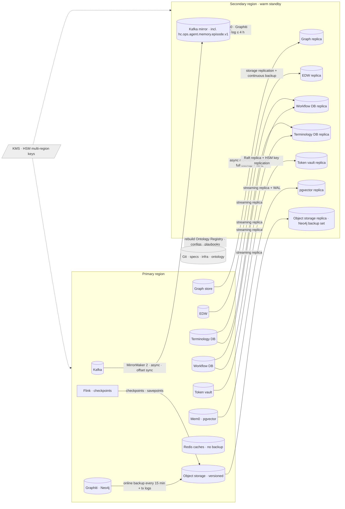

# Disaster Recovery and Data Retention

HEALIX holds the only cross-system, bitemporal record of what the health system's data meant at any moment, and it
holds PHI. It therefore has to come back after a regional failure with no more than 15 minutes of loss and within 4
hours (ARC-NFR-007), and it has to keep — and then destroy — data on schedules set by law and by module 11. This
document specifies backup and restore per store, Kafka mirroring, point-in-time recovery for the graph and EDW, RPO
and RTO per tier, the retention schedule by data class, legal hold, data destruction and the DR test cadence.

## 1. Recovery architecture

**Recovery principle:** Kafka is the system of replay, Git is the system of configuration, and the graph and EDW are
projections that can be rebuilt from `canonical` snapshots when a store backup is unusable. The compacted
`hc.canonical.*` snapshot topics (ARC-NFR-005) make a full re-projection possible; store backups make it fast.

## 2. Recovery tiers, RPO and RTO

| Tier | Components | RPO | RTO | Rationale |
|------|------------|-----|-----|-----------|
| **T0 — Control & security** | KMS/HSM keys, Vault, PDP bundle, IdP federation, Git | 0 (synchronous/multi-region) | 30 min | Nothing else can start without them |
| **T1 — Ingest & backbone** | Kafka (all layers), Schema Registry, Connect offsets, MLLP VIP, on-prem circuits | ≤ 5 min (mirror lag SLO) | 1 h | Clinical events must resume; sources queue briefly |
| **T2 — Processing** | Flink jobs (from checkpoint/savepoint), header guard, consent engine, Terminology Server, Ontology Registry | ≤ 15 min | 2 h | Rebuilt from checkpoints and Git |
| **T3 — Projections** | Graph store, EDW, token vault, workflow engine, Mem0 (pgvector) and Graphiti (Neo4j) memory stores | ≤ 15 min | 4 h (platform RTO) | Restore replica + replay Kafka from last applied offset; memory stores are derived state rebuilt from the mirrored `hc.ops.agent.memory.episode.v1` log when the replica is unusable (MEM-ARCH-039) |
| **T4 — Agentic & consumer** | Agent runtime, Memory API, MCP servers, Redis caches, healing and improvement controllers, SPARQL proxy, FHIR facade, dashboards | ≤ 15 min (state in T3) | 4 h | Stateless; depends on T3; Memory API starts in memoryless degraded mode until T3 memory stores are back; caches start cold with bypass (MEM-CACHE-004) and are never restored |
| **T5 — Analytics extras** | Lineage service, cost exporter, long-term metrics | ≤ 24 h | 24 h | Rebuildable from `hc.ops.*` replay |

Whole-platform targets (ARC-NFR-007): **RPO ≤ 15 min, RTO ≤ 4 h**, measured from declaration of disaster to the
moment S1–S12 SLIs (OPS-03) are green in the secondary region.

## 3. Backup and replication per store

| Store | Mechanism | Frequency | Copies | Encryption | Restore test |
|-------|-----------|-----------|--------|------------|--------------|
| **Kafka** | MirrorMaker 2 active→passive to secondary with consumer-offset translation; topic configs and ACLs mirrored from `topics.yaml` (GitOps); tiered storage segments replicated via object storage | Continuous (lag SLO ≤ 5 min) | Primary RF3 + secondary RF3 | Volume + envelope (GOV-ACC-013); mirror traffic mTLS | Monthly consumer-offset failover test |
| **Schema Registry** | Backed by Kafka `_schemas` topic (mirrored); nightly export of all subjects to object storage | Continuous + nightly | 2 regions | Yes | Monthly |
| **Flink state** | Checkpoints every 30 s and savepoints before every deploy to versioned object storage (replicated) | 30 s / per deploy | Cross-region | Yes | Weekly automated restore in `uat` |
| **Graph store** | Vendor async replication to secondary cluster; nightly full backup + continuous transaction-log shipping to object storage for PITR; weekly RDF export (N-Quads per named graph) as vendor-independent copy | Continuous / nightly / weekly | 3 (replica, PITR set, export) | Yes (`kg-phi`) | Weekly PITR restore to ephemeral cluster, SHACL + count checks |
| **EDW** | Managed continuous backup (Time Travel / snapshots) with cross-region replication; nightly logical export of `dim_*`/`ref_*` to Parquet; `hist_*` tables never purged by restore | Continuous + nightly | 3 | TDE + CMK | Weekly PITR of one schema; quarterly full |
| **Terminology Server DB** | PostgreSQL streaming replica + daily base backup + WAL archiving (PITR) | Continuous | 2 regions | Yes | Monthly |
| **Ontology Registry** | Git is authoritative; triple store rebuilt from signed release tags; nightly snapshot for speed | Nightly | Git (multi-region) | Yes | Monthly rebuild from Git in `test` |
| **Workflow engine DB** | Streaming replica + PITR | Continuous | 2 regions | Yes | Monthly |
| **Token vault** | Raft replication across regions; HSM key material replicated by the provider's multi-region key feature; split-knowledge export to offline escrow quarterly | Continuous / quarterly | 2 regions + escrow | HSM | Quarterly escrow restore (two custodians) |
| **Object storage** | Versioning + cross-region replication + object lock on backup prefixes (WORM) | Continuous | 2 regions | Yes (`backup` key) | Part of every drill |
| **Observability** | Metrics long-term store and logs on replicated object storage; dashboards in Git | Continuous | 2 regions | Yes | Annual |
| **Audit (`fact_audit_event`)** | Included in EDW backup **plus** independent WORM copy (object lock, 6 years) of daily hash-chained partitions | Daily | 3, one immutable | Yes | Quarterly chain verification from WORM copy |
| **Memory write log (`hc.ops.agent.memory.episode.v1`)** | Compacted Kafka topic with infinite retention, mirrored like every topic; authoritative source of truth for Mem0 and Graphiti, which are derived state (MEM-ARCH-007) | Continuous (mirror lag SLO ≤ 5 min) | Primary RF3 + secondary RF3 | Yes | Quarterly `rebuild` drill: record counts ±0, identical `record_id` sets, ≤ 4 h (MEM-ARCH-008) |
| **Mem0 (PostgreSQL + pgvector / Qdrant)** | Streaming replica to secondary + daily base backup + WAL archiving (PITR); full rebuild from the write log ≤ 4 h as fallback | Continuous / daily | 2 regions | Yes (`memory` key class; no PHI by contract) | Monthly PITR to ephemeral target; quarterly rebuild from write log |
| **Graphiti (Neo4j 5.x / FalkorDB)** | Online backup every 15 min plus transaction logs to replicated object storage; weekly JSON-LD export of the hot window as vendor-independent copy; rebuild from write log as fallback | 15 min / weekly | 3 (backup set, export, write log) | Yes (`memory` key class) | Monthly restore to ephemeral cluster with MEM-GRA bitemporal fixtures; quarterly rebuild |
| **Redis caches (C1/C2/C4 and C3 tier)** | **Not backed up and never replicated across environments** (`cache-policy.yaml` `backup: none`); rebuilt from origin by cache warming; clients bypass ≤ 50 ms during cold start | — | 0 | mTLS in transit, AES-256 at rest | Monthly cold-start chaos test (MEM-CACHE-004) |
| **Playbooks, prompts, policies (M3)** | Git signed tags (ARC-NFR-006) + object store; re-indexed into Graphiti after rebuild | Per release | Git (multi-region) | Yes | Covered by the Ontology Registry Git rebuild test; healing continues from the Git index while Graphiti is down (MEM-ARCH-035) |

Backups are encrypted with a key class distinct from live data (GOV-02 §6) and restoring to any environment other
than `prod`/DR MUST pass through the pseudonymisation pipeline (OPS-02 §6), never raw.

## 4. Point-in-time recovery (PITR)

### 4.1 Graph store

1. Identify target transaction time `T` (e.g. before a faulty `agent.kg_builder` load).
2. Restore the nightly full backup preceding `T` to an ephemeral cluster and replay transaction logs to `T`.
3. Because the graph is bitemporal, **logical** PITR is also available without restore: query with
   `recorded_at ≤ T` (TKG-01) to see the as-of state; to *repair*, supersede the faulty assertions (set
   `superseded_at`) rather than delete, preserving provenance (GOV-03). Physical PITR is reserved for corruption.
4. Re-apply Kafka records from the offsets recorded in the last good `healix:KgLoad` activity.
5. Validate with SHACL, triple counts per named graph and the KG–EDW reconciliation (OPS-03 S13).

### 4.2 EDW

1. Use native Time Travel / snapshot restore to `T` for affected schemas (`edw_gN_*`) only; `hist_*` and
   `fact_audit_event` are restored only on corruption, never to roll back content.
2. Re-run sink from the Kafka offsets recorded in the `healix:EdwLoad` activity; migrations are idempotent so
   replay is safe (CONVENTIONS §5).
3. Reconcile with KG and publish a `healix:Restore` PROV-O activity describing the window and reason.

### 4.3 Kafka replay as universal recovery

Any projection can be rebuilt from `hc.canonical.*` compacted snapshots plus the retained change topics: the sink
is pointed at offset 0 of the snapshot topic and then at the earliest retained offset of the change topic. Full
re-projection of the EDW is sized at ≤ 24 h and of the KG at ≤ 36 h for first-release volumes (OPS-01 §5); this is
the fallback path when both replica and backup are unusable and is tested annually.

## 5. Failover and failback procedure

| Step | Action | Owner | Target elapsed |
|------|--------|-------|----------------|
| 0 | Declare disaster (two of: region health, SLO engine, provider status); open SEV1 | SRE lead + Platform Owner | T+0 |
| 1 | Verify T0: KMS keys, Vault, PDP bundle, IdP available in secondary; promote Vault | SRE | T+15 min |
| 2 | Promote Kafka mirror: stop MirrorMaker, flip DNS/bootstrap, translate consumer offsets, re-apply ACLs from Git | SRE | T+45 min |
| 3 | Re-point on-prem circuits and Oracle private endpoint to secondary (pre-provisioned); restart MLLP/Debezium/BICC connectors from stored offsets; sources drain queues | SRE + Cerner interface team | T+1 h |
| 4 | Restore Flink jobs from latest checkpoint in replicated object storage; header guard and consent engine first | Stream engineering | T+1.5 h |
| 5 | Promote graph replica and EDW replica; apply PITR if needed; resume sinks from recorded offsets | Store engineering | T+3 h |
| 6 | Start Memory API in memoryless degraded mode, promote the pgvector replica and restore Neo4j from the latest backup set (or `rebuild` both from the mirrored write log), start Redis cold; start agent runtime, MCP servers, healing/improvement controllers (playbooks `assisted` until S25 green), proxies, facade; run SLI probes; declare recovered when S1–S12 green | SRE + Agent operator | T+4 h |
| 7 | Communicate: status page, DGC, Privacy Office (PHI handling during DR logged) | Platform Owner | Continuous |
| Failback | Reverse mirroring once primary healthy; planned cut-over in a change window; reconcile KG/EDW; post-incident review | SRE | ≤ 7 days |

Agents operate in **read-only mode** (no CR application) until S13 reconciliation passes after failover, to avoid
acting on a partially restored projection.

## 6. Retention schedule

Retention *policy* is owned by module 11 (GOV-01, GOV-03) and legal; this table is the executable schedule. Kafka
retention is set in `topics.yaml` (module 07) and enforced by the broker; store retention by scheduled jobs.

| Data class / store | Content | Retention | Basis | Disposition |
|--------------------|---------|-----------|-------|-------------|
| `hc.raw.*` topics | Unaltered source messages (PHI) | 30 days (ARC-NFR-005); 7 days in non-prod | Replay window; raw is not the medical record | Broker deletion; segments on tiered storage expire |
| `hc.std.*` topics | Parsed records | 90 days | Reprocessing after mapping fixes | Broker deletion |
| `hc.canonical.*` change topics | FHIR resources (events) | 1 year | Re-projection, DQ backtests | Broker deletion |
| `hc.canonical.*` compacted snapshots | Latest resource per key | Infinite (compacted) | Universal recovery source | Tombstone on legal destruction only |
| `hc.dq.*` | DQ results | 1 year in Kafka; 7 years in EDW `fact_dq_result` | Quality trend evidence | Broker deletion; EDW purge job |
| `hc.ops.audit.v1` | AuditEvents | 90 days in Kafka; **≥ 6 years** in `fact_audit_event` + WORM copy (GOV-LIN-010); 7 years where state law requires | HIPAA §164.316(b)(2); state law | Purge job after legal review; WORM lock expires |
| `hc.ops.lineage.openlineage.v1` | Lineage events | 30 days in Kafka; PROV-O retained life of facts + 6 years | GOV-03 §6 | Purge with the facts it describes |
| **EDW G2 clinical facts and dims** | Patient-level clinical data (designated record set projection) | **Adult: ≥ 10 years after last encounter; minors: until age of majority + 10 years (or state maximum, e.g. 25+ years); never less than state medical-record statute** | State medical-record retention statutes; CMS Conditions of Participation (≥ 5 years); Medicare managed-care 10 years | Patient-level destruction job with Privacy Office approval; aggregates retained |
| EDW G3 finance, claims, GL | Claims, remittances, GL journals | 7 years after fiscal year close (10 years for Medicare cost-report support) | IRS, CMS, FCA look-back | Purge job |
| EDW G4 supply chain | POs, receipts, inventory | 7 years | Financial audit | Purge job |
| EDW G5 workforce | Worker, assignments, payroll aggregates | Employment + 7 years (I-9: 3 years after hire or 1 year after termination; OSHA exposure records 30 years); EU staff per GDPR storage limitation | FLSA, ADEA, OSHA, GDPR | Purge job; GDPR erasure workflow |
| EDW G6 pophealth, G7 research | Measures, cohorts | Measure reporting period + 10 years; research per IRB protocol (≥ 3 years after study close, FDA 2 years after approval) | CMS, 45 CFR 46, 21 CFR 312 | Purge job |
| EDW G8 reference, G9 governance metadata | Code systems, catalog, classifications, contracts | Indefinite (versioned) | Needed to interpret retained data | Versions deprecated, not deleted |
| **Knowledge graph** | Bitemporal assertions per group | Same as the EDW class of the group, applied per named graph; PROV partition life of facts + 6 years | Mirror of EDW | Named-graph drop with tombstones in snapshot topics; superseded assertions kept until class expiry |
| Flink checkpoints / savepoints | Operator state | Last 10 checkpoints; savepoints 90 days | Recovery | Lifecycle policy |
| Backups | All stores | Daily 35 days; weekly 13 months; monthly 7 years for EDW/KG (WORM) | Restore and legal | Lifecycle policy |
| Agent transcripts | Prompts, tool calls (masked) | 2 years; 6 years when attached to `phi-affecting` CR (GOV-LIN-015) | Evaluation and audit | Purge job |
| `hc.ops.agent.memory.episode.v1` | Event-sourced agent memory writes (no PHI; GOV-01 §3 ceiling `internal`) | Infinite (compacted); `purge` writes a compaction tombstone | MEM-01 §8; ADR-08 | Tombstone + physical erasure in Mem0, Graphiti, C4 and archives (MEM-ARCH-037) |
| Agent memory records (Mem0, Graphiti) | `decision`/`outcome`/`incident` classes; `preference` and `steward_feedback`; `observation`; Graphiti hot window | 2,555 d; 365 d rolling; 180 d; hot 400 d then JSON-LD archive (still rebuildable) | MEM-01 §4, §8 | `forget` = transaction-time close (tombstone); `purge` only with Privacy Office or DGC approval |
| `hc.ops.heal.incident.v1`, `hc.ops.heal.action.v1`, `hc.ops.improve.canary.v1`, `hc.ops.agent.policy.release.v1`, `hc.ops.cache.invalidate.v1` | Healing, canary, policy-release and cache-invalidation events | 30 d / 30 d / 30 d / compacted / 7 d in Kafka; mirrored to `fact_healing_incident` and G9 facts for 7 years | MEM-00 §5.1; GOV-03 | Broker deletion; EDW purge job |
| Cache entries (C0–C4) | Derived accelerators (ceiling `internal`, GOV-01 §3) | TTL ≤ 24 h per namespace; purged on version-tag invalidation | MEM-03 §2 | TTL expiry; namespace purge |
| Observability | Metrics 13 months; logs 90 days; traces 14 days | — | OPS-03 | Lifecycle policy |
| Non-prod data | Synthetic/pseudonymised copies | Refresh cycle (weekly `uat`); fixtures 12 months | — | Overwritten at refresh |

Retention jobs run weekly, compute eligibility from `valid_to`/`recorded_at` and the class table, honour legal
holds (§7), emit `AuditEvent` `action=D` per batch with counts and class (GOV-03 §6) and a `healix:Destruction`
PROV-O activity, and never delete `hist_*`/audit rows except at class expiry.

## 7. Legal hold

| Aspect | Rule |
|--------|------|
| Placement | Legal or Privacy Office registers a hold as a G9 entity (`ref_legal_hold`: scope by patient tokens, encounter ids, date range, group, custodian, matter id) |
| Effect | Retention jobs skip any row/assertion/segment matching an active hold; Kafka topics containing held keys have deletion suspended by extending retention (segment-level) and the compacted snapshot tombstones are blocked |
| Preservation copy | On placement, an immutable export (Parquet + N-Quads) of the held scope is written to WORM storage with hash manifest |
| Release | Only by the placing office; release re-enables normal retention at the next run |
| Audit | Placement, scope changes and release are `AuditEvent`s; a monthly report lists active holds and suppressed deletions |

## 8. Data destruction

| Target | Method | Verification |
|--------|--------|--------------|
| Kafka segments | Broker deletion + tiered-storage object deletion; encrypted volumes make residual data unreadable; crypto-shred by retiring the per-source DEK when a whole source is decommissioned | Deletion logs; key retirement record |
| EDW rows | `DELETE` in batch with vacuum/reclaim; Time Travel window shortened to 1 day for destroyed partitions | Row counts before/after; `AuditEvent` |
| Graph assertions | Named-graph drop or RDF-star supersession then physical purge at class expiry; backups age out by lifecycle | Count check; PROV `healix:Destruction` |
| Backups | Lifecycle expiry; WORM lock must have lapsed; crypto-shred of backup KEK generation at the end of a retention class | Provider deletion evidence |
| Object storage | Versioned delete + lifecycle expiry of non-current versions | Inventory report |
| Decommissioned media (on-prem) | NIST SP 800-88 purge or destroy; certificate of destruction | Certificate filed in G9 |
| Recipient copies (DSA) | Certificate of destruction from recipient (GOV-04 §7) | Filed in G9 |
| Patient-requested erasure (GDPR workforce only; HIPAA has no erasure right for the medical record) | Erasure workflow for `pii:workforce` records of EU/UK staff within 30 days (GOV-PHI-020) | Workflow record |
| Agent memory records | `purge`: compaction tombstone on `hc.ops.agent.memory.episode.v1` **plus** physical erasure from Mem0, Graphiti, C4 and JSON-LD archives; requires Privacy Office or DGC approval recorded in the AuditEvent (MEM-ARCH-037); steward `pii:workforce` preferences erased on request (GOV-PHI-020) | Purge receipt; AuditEvent; next rebuild drill shows the record absent |

## 9. DR test cadence

| Test | Scope | Cadence | Pass criteria | Evidence |
|------|-------|---------|---------------|----------|
| Component restore | Each store from backup to ephemeral target (§3 column "Restore test") | Weekly (Flink, KG, EDW) to quarterly (vault escrow) | Restore completes; checks pass | Automated report to G9 |
| Kafka consumer-offset failover | Promote mirror in `uat`, consumers resume without duplicates/loss | Monthly | Zero loss; duplicates idempotently absorbed | Report |
| AZ loss chaos | Drain one AZ in `uat` under load | Monthly | No data loss; failover times in OPS-01 §3 met | Chaos run log |
| **Regional failover drill** | Full §5 procedure in `uat` (50 % scale) with Cerner interface team sending test messages | Quarterly | RTO ≤ 4 h, RPO ≤ 15 min; S1–S12 green | Signed drill record, timeline |
| **Production failover** | Full failover and failback of `prod` in a planned window | Annually | Same as drill | DGC-reviewed report |
| Universal re-projection | Rebuild one EDW group and one KG group from canonical snapshots | Annually | Reconciliation ≥ 99.99 % | Report |
| Breach reconstruction (GOV-PHI-018) | Reconstruct a simulated exposure from audit + lineage | Annually (with Privacy Office) | ≤ 24 h | Report |
| Retention and legal-hold | Dry run showing eligible deletions and suppressed by hold; sample purge in `uat` | Quarterly | Zero held items deleted | Report |
| Memory rebuild (module 14) | `rebuild` Mem0 and Graphiti from `hc.ops.agent.memory.episode.v1` into an ephemeral target; Redis cold-start under load | Quarterly | ≤ 4 h; record counts ±0 and identical `record_id` sets (MEM-ARCH-008); cache bypass ≤ 50 ms with ARC-NFR-001 unaffected | Automated report to G9 |
| Tabletop | Scenario exercise with SRE, Privacy, Cerner IT, DGC | Semi-annually | Actions assigned | Minutes |

A failed drill opens a `P0` reliability item; `prod` promotions of storage-layout changes are blocked until the next
successful drill (OPS-02 gate G-D).

## 10. Requirements

> **OPS-DR-001** (P0, test) — The platform MUST achieve RPO ≤ 15 min and RTO ≤ 4 h for regional failure, demonstrated
> by the quarterly drill and annual production failover (ARC-NFR-007).

> **OPS-DR-002** (P0, test) — Tier T0 components (keys, secrets, policy bundle, identity, Git) MUST be available in the
> secondary region with RPO 0 and MUST be verified before any other recovery step.

> **OPS-DR-003** (P0, test) — Kafka MUST be mirrored to the secondary region with consumer-offset translation; mirror
> lag MUST be ≤ 5 min (p99) and alerted.

> **OPS-DR-004** (P0, test) — Flink checkpoints and savepoints MUST reside in cross-region replicated object storage and
> jobs MUST restore from them with exactly-once guarantees.

> **OPS-DR-005** (P0, test) — The graph store MUST support PITR to any second within the last 35 days via backup plus
> transaction-log replay, and logical as-of recovery via bitemporal queries.

> **OPS-DR-006** (P0, test) — The EDW MUST support PITR per schema to any point within 35 days without affecting `hist_*`
> or `fact_audit_event`.

> **OPS-DR-007** (P0, test) — Every projection MUST be rebuildable from `hc.canonical.*` compacted snapshots and
> retained change topics; full re-projection MUST complete ≤ 24 h (EDW) and ≤ 36 h (KG).

> **OPS-DR-008** (P0, test) — Backups MUST be encrypted under the `backup` key class, stored with object lock (WORM) for
> their retention period and MUST require two roles to restore to `prod`.

> **OPS-DR-009** (P0, test) — Restores to any non-production environment MUST pass through pseudonymisation; raw backup
> restore outside `prod`/DR MUST be technically blocked.

> **OPS-DR-010** (P0, test) — Each store's restore MUST be tested at the cadence in §3 with automated verification and
> evidence written to G9.

> **OPS-DR-011** (P0, test) — Retention MUST be enforced per the schedule in §6 by scheduled jobs that compute
> eligibility bitemporally, honour legal holds and emit `AuditEvent` and PROV-O destruction records.

> **OPS-DR-012** (P0, test) — Audit records MUST be retained ≥ 6 years in an immutable WORM copy independent of the EDW
> backup (GOV-LIN-010).

> **OPS-DR-013** (P0, test) — Patient-level clinical data MUST NOT be destroyed before the longest applicable state
> medical-record retention period for that patient's facility and age class, and never without Privacy Office approval.

> **OPS-DR-014** (P0, test) — Legal holds MUST suppress deletion across Kafka, KG, EDW and backups within one retention
> cycle of placement and MUST create an immutable preservation copy.

> **OPS-DR-015** (P1, test) — `hc.raw.*` MUST be retained 30 days and compacted canonical snapshots indefinitely
> (ARC-NFR-005); other topic retention MUST match `topics.yaml` and §6.

> **OPS-DR-016** (P1, test) — Agents MUST be held in read-only mode after failover until KG–EDW reconciliation passes.

> **OPS-DR-017** (P1, inspection) — Decommissioned media and recipient copies MUST be destroyed per NIST SP 800-88 with
> certificates filed in G9.

> **OPS-DR-018** (P1, test) — Token vault keys MUST be replicated across regions and escrowed quarterly with
> split-knowledge; escrow restore MUST be tested quarterly.

> **OPS-DR-019** (P1, inspection) — A failed DR drill MUST block `prod` promotion of storage-layout changes until a
> successful re-run.

> **OPS-DR-020** (P2, test) — Retention jobs SHOULD produce a monthly report of deletions, suppressed deletions and
> upcoming expiries per data class for the DGC.

> **OPS-DR-021** (P1, test) — Mem0 and Graphiti MUST be recoverable within the T3 RPO/RTO by replica or backup
> promotion or by `rebuild` from the mirrored `hc.ops.agent.memory.episode.v1` log, demonstrated quarterly (MEM-ARCH-039);
> Redis caches MUST NOT be backed up or restored across environments and MUST start cold with bypass; memory retention
> and `purge` MUST follow §6 and §8.

## 11. Traceability

| Requirement | Verified by |
|-------------|-------------|
| OPS-DR-001–004, 016 | Quarterly regional drill and annual production failover records |
| OPS-DR-005–007 | Weekly PITR restore jobs; annual re-projection test |
| OPS-DR-008–010 | Backup policy tests (IaC); restore job evidence |
| OPS-DR-011–015, 020 | Retention dry-run reports; legal-hold test; audit WORM verification |
| OPS-DR-021 | Quarterly memory rebuild drill report; Redis cold-start chaos test; memory purge receipt inspection |
