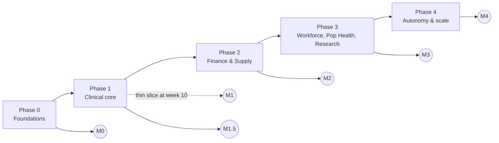

# Phased Roadmap

The programme is delivered in five phases. Each phase is described with the same template: objectives, scope by module,
deliverables, entry criteria, exit criteria, dependencies, team shape, duration assumptions and requirements. Exit
criteria reference acceptance IDs in `02-acceptance-criteria.md` (RMP-02); a phase exits only when every referenced
acceptance criterion has passing evidence attached to the release record.

## 1. Phase ladder at a glance

| Dimension | Phase 0 | Phase 1 | Phase 2 | Phase 3 | Phase 4 |
|-----------|---------|---------|---------|---------|---------|
| Subject-area groups added | G8, G9 | G1, G2 | G3, G4 | G5, G6, G7 | — (scale) |
| Sources added | Terminology feeds, Oracle Fusion reference data (BICC) | Cerner ADT, ORU, ORM, scheduling (SIU), LIS results | Oracle Fusion ERP (GL, AP/AR, FA, Projects), SCM (Items, PO, Inventory, Receipts), RCM/clearinghouse X12 837/835/270/271/278, Cerner charges | Oracle Fusion HCM, credentialing, timekeeping, HIE C-CDA inbound, payer files, research systems | Partner outbound FHIR/HL7 v2, device gateways at scale, portal |
| Ontology Pipeline stages | Stage 0 for Cerner & Fusion (inventory) | Stages 0–2 for G1/G2 | Stages 3–4 for G1/G2; Stages 0–2 for G3/G4 | Stages 3–5 for G3/G4; Stages 0–5 for G5–G7; Stage 5 across all | Continuous curation |
| Agent autonomy ceiling | L1 | L2 | L2 (L3 for inventory/dq_monitor/kg_builder) | L3 for most | L3/L4 per policy, auto-approval expansion |
| Memory & self-improvement (module 14) | Memory API + write-gate, Mem0 and Graphiti deployed per environment, write log and module 14 `ops` topics in `topics.yaml`, C1/C3 caches; every playbook `shadow` | M1 memory live for L2 agents; C1–C3 caches; self-healer `shadow` → `assisted` for ingestion faults; memory audit begins | First `autonomous` playbooks (ingestion/platform classes); C2 semantic cache; consolidation at L3; improvement canaries in `uat` only | Improvement canaries in `prod`; playbook learning from resolved incidents (depth ≤ 2); monthly memory-influence report | Steady-state recursive learning under MEM-06; quarterly memory-lift ablation and kill-switch drills |
| Adversarial review (module 15) | Findings register, severity scale and threat model opened; legacy outlier inventory | Red-team of the thin slice; gate at M1 and M1.5 | Red-team of finance/X12 flows and SoD; gate at M2 | Red-team of HCM, research and Part 2 flows; re-identification attempts; gate at M3 | Annual red-team and pen-test; partner egress adversarial tests; gate at M4 and every `prod` release |
| KPI focus | Platform SLOs | Latency, FHIR validation, bitemporality | DQ coverage, reconciliation | Semantic coverage, conformed dimensions | Autonomy rate, partner conformance |

## 2. Phase 0 — Foundations

### 2.1 Objectives

Stand up the platform, the registries and the conventions every later phase relies on, so that Phase 1 teams start
integrating on day one rather than building scaffolding. No PHI flows in Phase 0 except de-identified or synthetic
data in `dev`/`test`.

### 2.2 Scope by module

| Module | In Phase 0 | Deferred |
|--------|-----------|----------|
| 02 Ontology Pipeline | Ontology Registry (Git-backed, SKOS/OWL/SHACL skeletons), IRI base and concept-scheme conventions, Stage 0 metadata inventory process and Source Registry schema, competency-question template | Stage 1+ content for any group |
| 03 Source Systems | Source Registry populated for Cerner Millennium and Oracle Fusion at system/interface level; Cerner replica and BICC connectivity proven in `dev` | Field-level mapping specs |
| 04 Reference Data Models | UDMH/HCDM licence confirmation, blueprint access, harmonisation method and matrix template; G1–G9 group definitions ratified | Entity-level harmonisation |
| 05 EDW Schema | EDW platform provisioned; `edw_g8_reference`, `edw_g9_governance` schemas; conformed-dimension design for Date/Time, Code, Source System | G1–G7 schemas |
| 06 Interoperability | Terminology Server deployed; SNOMED CT (US edition), LOINC, RxNorm, ICD-10-CM/PCS, CPT/HCPCS, CVX, UCUM, NUCC loaded; `$lookup/$validate-code/$expand/$translate` tested; FHIR validator service with US Core 6.1 package | Custom profiles, HL7 v2 → FHIR maps |
| 07 Streaming | Kafka (KRaft) clusters per environment, Schema Registry, Kafka Connect, Flink runtime; topic catalog linter; `hc.raw.*`/`hc.std.*` naming and header conventions implemented; `hc.ops.*` topics | Domain topics for G1–G7 |
| 08 Temporal KG | Triple store provisioned; bitemporal model and named-graph conventions implemented; RDF-star annotation pattern tested; PROV-O activity pattern | Entity resolution, domain graphs |
| 09 Data Quality | DQ engine deployed; rule-pack schema; DQ result topic `hc.dq.result.v1`; scorecard skeleton | Domain rule packs |
| 10 Agentic Pipeline | Agent runtime, MCP tool servers for registry/terminology/git, change-request schema, `agent.orchestrator`, `agent.inventory`, `agent.evaluator` at L1; evaluation harness | Domain agents acting on real data |
| 11 Governance | PHI classification scheme, topic-level ACL model, audit event schema, OpenLineage collector, non-prod masking standard, stewardship RACI | Steward onboarding for G1–G7 |
| 12 Platform & Ops | `dev`/`test`/`uat`/`prod` environments, CI/CD with artefact validation (YAML schema, SQL parse, SHACL, reasoner), observability stack, SLO definitions, backup; memory stack components C26–C29 provisioned per environment | DR drill at full scale |
| 14 Memory & Self-Improvement | Memory API (MCP `memory`) with write-gate and PHI firewall; `hc.ops.memory.write.v1` and the other five module 14 `ops` topics registered in `topics.yaml`; Mem0 (pgvector, `enable_graph: false`) and Graphiti (Neo4j 5.x) deployed per environment; Redis cache cluster with `cache-policy.yaml` C1/C3 namespaces; `memory-schema.yaml`, `cache-policy.yaml`, `playbook.schema.json` linted in CI; seven seed playbooks in `shadow`; honeytoken probes | C2 semantic cache; consolidation; `agent.improver`; any `assisted`/`autonomous` healing |
| 15 Adversarial Review | Findings register schema and severity scale (`critical`/`high`/`medium`/`low`, SLA per severity); threat model and red-team plan for the thin slice; legacy/tech-debt outlier inventory (interface engine, Millennium replica lag, BICC PVO gaps) | Red-team execution against real data flows |

### 2.3 Deliverables

1. Platform landing zone: Kafka + Schema Registry + Connect + Flink; triple store; EDW; terminology server; agent runtime; CI/CD; observability.
2. Ontology Registry v0 with IRI base `https://ontology.healix.example.org/`, empty concept schemes for G1–G9, SHACL shape library skeleton.
3. Source Registry and Data Element Catalog (G9) populated to interface level for Cerner and Oracle Fusion by `agent.inventory` (Stage 0).
4. G8 reference content: code systems loaded, enterprise value-set naming, `edw_g8_reference` populated (Code, Calendar, Geography, Currency, Unit).
5. Topic catalog `07/topics.yaml` v1 with `raw`, `std`, `dq`, `ops` layers and header contract.
6. Agent change-request schema, evaluator rubric v0, evaluation harness with ≥ 100 seeded test cases.
7. Governance baseline: PHI classification policy, ACL matrix, audit schema, masking standard, stewardship charter.
8. Conventions linter enforcing CONVENTIONS.md on every pull request.
9. Module 14 memory stack in `dev`/`test`: write-gate rejecting PHI honeytokens, Mem0/Graphiti rebuilt from the write log, cache bypass chaos test passed, all playbooks `shadow`.
10. Module 15 findings register live with threat model v0 and the legacy outlier inventory; adversarial review gate procedure approved by the DGC.

### 2.4 Entry criteria

- Programme charter approved; licences for UDMH, HCDM, SNOMED CT, CPT, LOINC (free registration), RxNorm (UMLS licence) confirmed or in procurement with dates (see RMP-RISK-001..004).
- Cerner replica (read-only Oracle standby or Oracle Health-provided data feed) access request lodged; Oracle Fusion BICC service account requested.
- Named owners for each module front-matter `owners` field.

### 2.5 Exit criteria (gate M0)

| # | Criterion | Evidence (RMP-02 ref) |
|---|-----------|------------------------|
| E0-1 | All four environments provisioned with IaC; CI validates YAML/SQL/SHACL/OWL artefacts on every PR | RMP-ACC-120, RMP-ACC-121 |
| E0-2 | Terminology server answers `$validate-code` for SNOMED CT, LOINC, RxNorm, ICD-10-CM, CPT, CVX, UCUM with p95 ≤ 200 ms | RMP-ACC-060 |
| E0-3 | Topic catalog linter rejects a non-conforming topic name; Schema Registry compatibility policy enforced | RMP-ACC-070 |
| E0-4 | Bitemporal named-graph write/read round-trip demonstrated with as-of query | RMP-ACC-080 |
| E0-5 | Source Registry holds 100 % of in-scope Phase 1 interfaces with steward assigned | RMP-ACC-030 |
| E0-6 | Agent evaluation harness runs end-to-end on seeded cases with `agent.evaluator` producing scored verdicts | RMP-ACC-100 |
| E0-7 | PHI policy, ACL matrix and audit schema approved by Privacy & Security Officer | RMP-ACC-110 |
| E0-8 | Memory write-gate rejects 100 % of PHI honeytokens; Mem0 and Graphiti rebuilt from `hc.ops.memory.write.v1` in `test` with record counts ±0; every playbook `shadow` | RMP-ACC-130, RMP-ACC-131, RMP-ACC-135 |
| E0-9 | Adversarial review gate defined: findings register live, severity scale and SLAs approved by DGC, thin-slice threat model recorded | RMP-ACC-140 |

### 2.6 Dependencies

Procurement (licences, cloud), Identity (OIDC tenant), Network (MLLP ingress from Cerner interface engine, private link to Oracle Fusion), Oracle Health contractual permission for CDC on the Millennium replica.

### 2.7 Team shape

| Squad | Roles | FTE |
|-------|-------|-----|
| Platform | Kafka/Flink engineers ×3, SRE ×2, cloud/IaC ×1 | 6 |
| Semantics | Ontologist ×1, terminologist ×1, knowledge engineer ×1 | 3 |
| Data warehouse | DW architect ×1, data engineer ×1 | 2 |
| Agents | ML/agent engineer ×2, evaluation engineer ×1 | 3 |
| Governance | Privacy officer (part) ×0.5, data governance lead ×1 | 1.5 |
| Programme | Programme manager ×1, product owner ×1 | 2 |
| **Total** | | **17.5** |

### 2.8 Duration assumptions

13 weeks. Assumes cloud landing zone exists, licences are granted within 6 weeks, and terminology content is loaded from standard distribution formats (RF2, LOINC CSV, RxNorm RRF, CMS files) without custom transforms.

### 2.9 Requirements

| ID | Priority | Verification | Requirement |
|----|----------|--------------|-------------|
| **RMP-PH0-001** | P0 | inspection | Phase 0 MUST deliver `dev`, `test`, `uat` and `prod` environments from infrastructure-as-code before any Phase 1 work starts. |
| **RMP-PH0-002** | P0 | test | The CI pipeline MUST validate every machine-readable artefact (topic catalog YAML, DDL, SKOS/OWL, SHACL, DQ rule packs, agent manifests) and block merge on failure. |
| **RMP-PH0-003** | P0 | test | The Terminology Server MUST serve SNOMED CT (US edition), LOINC, RxNorm, ICD-10-CM, ICD-10-PCS, CPT, HCPCS, CVX, UCUM and NUCC with `$lookup`, `$validate-code`, `$expand` and `$translate`. |
| **RMP-PH0-004** | P0 | inspection | The Source Registry MUST contain every Phase 1 interface (system, interface, transport, message/resource types, steward) before Phase 1 entry. |
| **RMP-PH0-005** | P0 | inspection | No production PHI SHALL flow through the platform in Phase 0; `dev`/`test` MUST use synthetic or de-identified data. |
| **RMP-PH0-006** | P0 | demo | The bitemporal graph model (valid time, transaction time, PROV-O activity) MUST be implemented and demonstrated with an as-of query before Phase 1 entry. |
| **RMP-PH0-007** | P1 | test | The agent evaluation harness MUST execute ≥ 100 seeded evaluation cases and report per-rubric scores. |
| **RMP-PH0-008** | P1 | inspection | The G1–G9 group definitions in ARC-01 §4 MUST be ratified by the architecture board and frozen for Phase 1. |
| **RMP-PH0-009** | P0 | inspection | Licences for IBM UDMH, Teradata HCDM, SNOMED CT and CPT MUST be confirmed in writing before any licensed content is accessed by agents or staff. |
| **RMP-PH0-010** | P1 | test | `edw_g8_reference` and `edw_g9_governance` schemas MUST be deployed with the Date/Time, Code and Source System conformed dimensions populated. |
| **RMP-PH0-011** | P0 | test | The module 14 memory stack (Memory API with write-gate, Mem0, Graphiti, Redis caches, write log) MUST be deployed per environment in Phase 0 with the PHI firewall active, and MUST contain no value classified above `internal` (GOV-01 §3 Table 3-A) at any time; every healing playbook MUST be in `shadow` status at gate M0. |
| **RMP-PH0-012** | P1 | inspection | The module 15 findings register, severity scale and adversarial review gate procedure MUST be approved by the DGC before gate M0, and a threat model for the thin vertical slice MUST be recorded. |

## 3. Phase 1 — Clinical core

### 3.1 Objectives

Prove the whole architecture on real clinical data with the thin vertical slice, then widen to Cerner ADT, ORU and ORM
(plus SIU scheduling and LIS results) so that G1 Party & Identity and G2 Clinical Care are populated in both the
knowledge graph and the EDW with DQ measured at ingestion. Carry G1/G2 vocabulary through Stages 0–2 of the Ontology
Pipeline.

### 3.2 The thin vertical slice (weeks 1–10)

| Layer | Slice content |
|-------|---------------|
| Source | Cerner ADT (A01, A02, A03, A04, A08, A11, A13, A40 merge) from one facility over MLLP |
| Raw / Std | `hc.raw.cerner.adt.hl7v2.v1` (unchanged message + headers), `hc.std.cerner.adt.hl7v2-parsed.v1` (parsed segments PID, PV1, PV2, MRG, NK1, IN1) |
| Canonical | `hc.canonical.party.patient.fhir.v1` (US Core Patient), `hc.canonical.clinical.encounter.fhir.v1` (US Core Encounter), `hc.canonical.party.location.fhir.v1` |
| Terminology | PV1-2 patient class → `v2-0004` → enterprise encounter-class value set; PID-8 sex → `v2-0001`; CODE_VALUE sets for admit source/type bound via `urn:healix:cerner:code-set:<n>` → SNOMED/HL7 v3 |
| Ontology | Stage 0 inventory of ADT segments; Stage 1 controlled vocabulary for encounter class, admit source, discharge disposition, patient identifier types; Stage 2 taxonomy for encounter class and location hierarchy |
| DQ | 20 ontology-derived rules (completeness of MRN/FIN, validity of codes, consistency of admit ≤ discharge, uniqueness of FIN per facility, timeliness) on `hc.dq.result.v1`; quarantine topic |
| KG | Patient, Encounter, Location as bitemporal RDF-star assertions in `<base>graph/cerner/<date>/<ulid>`; A40 merge handled as bitemporal supersession |
| EDW | `dim_patient` (SCD2 + bitemporal `hist_`), `dim_location`, `fact_encounter` in `edw_g1_party`/`edw_g2_clinical`; nightly reconciliation vs KG |
| Agents | `agent.inventory` L1→L2; `agent.source_mapper`, `agent.vocabulary_curator`, `agent.taxonomist`, `agent.dq_author` at L1 (propose), `agent.evaluator` scoring, `agent.privacy_guardian` classifying; all approvals human |
| Governance | PHI classification on every topic; ACLs; audit events for every read of `canonical.*`; OpenLineage from raw to EDW |

Slice exit (**M1**): shadow-mode in `prod` for ≥ 2 weeks with FHIR validation ≥ 99.5 %, p95 source→canonical ≤ 5 s,
100 % bitemporal assertions, DQ results flowing, nightly reconciliation variance ≤ 0.1 %.

### 3.3 Scope by module (full Phase 1)

| Module | In Phase 1 | Deferred |
|--------|-----------|----------|
| 02 | Stages 0–2 for G1/G2: Stage 0 inventory of ADT/ORU/ORM/SIU/LIS elements; Stage 1 vocabularies (encounter class, admit source, discharge disposition, order status, result status, specimen type, identifier types, practitioner roles); Stage 2 taxonomies (encounter class, location/bed hierarchy, service line, lab test panels via LOINC parts) with polyhierarchy checks; competency questions for G1/G2 | Stage 3 thesaurus relations; OWL axioms (Stage 4) beyond the skeleton |
| 03 | Cerner ADT, ORU (lab, micro, vitals), ORM/OMG (orders), SIU (scheduling), MDM (document metadata) interface specs; CDC from Millennium replica for `PERSON`, `ENCOUNTER`, `CODE_VALUE`, `ORDERS`, `CLINICAL_EVENT` tables; LIS peripheral | Oracle Fusion field mappings; RIS/PACS; pharmacy dispense |
| 04 | Harmonisation matrix rows for G1/G2 entities against UDMH/HCDM patterns | G3–G7 rows |
| 05 | `edw_g1_party`, `edw_g2_clinical` logical/physical models; conformed dims Patient, Practitioner, Organization, Location; `hist_*` bitemporal tables | G3–G7 schemas |
| 06 | HL7 v2 → FHIR maps for ADT/ORU/ORM/SIU per V2-to-FHIR IG; HEALIX profiles on Patient, Encounter, Observation, DiagnosticReport, ServiceRequest, Specimen, Practitioner, Location; enterprise value sets and concept maps for Cerner code sets; FHIR validator in stream | C-CDA, X12, outbound |
| 07 | `party` and `clinical` domain topics in catalog; Debezium Oracle connector; MLLP source; Flink canonicalisation jobs with exactly-once; replay tooling | `finance`, `supply` topics |
| 08 | G1/G2 named graphs; FHIR → RDF (FHIR RDF/ShEx) mapping by `agent.kg_builder`; EMPI-style entity resolution for Patient and Practitioner (Fellegi–Sunter scoring) with human review queue; as-of query library | Cross-group reasoning |
| 09 | DQ stream plane: rule derivation from SHACL/ontology constraints, profiling, thresholds for G1/G2 critical data elements; scorecards; quarantine + remediation tickets | Cross-system reconciliation DQ |
| 10 | Domain agents at L2 for low-risk classes (label edits, synonym additions, DQ threshold tuning); evaluator rubrics for mapping and vocabulary; HITL review UI; memory of accepted/rejected proposals | L3 for domain agents |
| 11 | PHI tagging of every canonical element; steward onboarding for G1/G2; audit and lineage live; minimum-necessary enforcement for agent tool calls | Research consent flows |
| 12 | Production go-live of slice; SLO dashboards; on-call; first DR drill (partial); S23–S25 memory/cache/healing SLOs live | Full DR drill |
| 14 | M1 memory in `prod` (Mem0 preferences/decisions, Graphiti episodes) feeding the `steward_preferences` and `precedent` retrieval profiles of L2 agents; C1/C2/C3 caches for terminology lookups and mapping suggestions with TS re-validation; `agent.self_healer` in `shadow` then `assisted` for ingestion fault classes (MLLP sequence gap, CDC lag, schema drift) with the chaos suite; `agent.memory_curator` consolidation in `shadow`; memory audit ≥ 200 records/month | `autonomous` playbooks; `agent.improver` beyond offline evaluation in `test`; C4 recall cache tuning |
| 15 | Red-team of the thin slice before M1 (PHI exfiltration via agent tools, header-guard and ACL bypass, prompt injection into memory and CRs, MLLP replay/duplicate injection, consent-gate bypass); adversarial review gate applied at M1 and M1.5; legacy outliers (Cloverleaf-fronted ADT quirks, Millennium replica lag) logged with owner and remediation date | Finance and workforce attack surfaces |

### 3.4 Deliverables

1. Thin vertical slice live (M1), then Cerner ADT/ORU/ORM/SIU/MDM and LIS canonicalised to FHIR R4 on `hc.canonical.party.*` and `hc.canonical.clinical.*` (M1.5).
2. Ontology release `v0.2` containing G1/G2 Stage 1 concept schemes and Stage 2 taxonomies with SKOS integrity reports.
3. `edw_g1_party` and `edw_g2_clinical` populated with bitemporal history; conformed dimensions Patient/Practitioner/Organization/Location.
4. G1/G2 bitemporal named graphs with entity resolution and PROV-O lineage.
5. DQ rule pack `rules/g1-party.yaml`, `rules/g2-clinical.yaml` (≥ 150 rules) with scorecards per facility.
6. Agent catalog v1 with manifests for all roster agents, L2 policy for low-risk classes, evaluation report with evaluator–human agreement.
7. Nightly KG↔EDW reconciliation job and report.

### 3.5 Entry criteria

Gate M0 passed; Cerner MLLP feed and replica CDC authorised in `prod`; G1/G2 stewards (clinical informatics, HIM/registration) named; synthetic FHIR bundle set and golden HL7 v2 message corpus (≥ 5,000 messages, de-identified) available.

### 3.6 Exit criteria (gate M1.5)

| # | Criterion | Evidence |
|---|-----------|----------|
| E1-1 | 100 % of Phase 1 interfaces emit `canonical.*`; FHIR validator pass ≥ 99.5 % over 30 days | RMP-ACC-060, RMP-ACC-061 |
| E1-2 | p95 source→canonical ≤ 5 s (HL7 v2/CDC) sustained; ≥ 5,000 resources/s load test passed | RMP-ACC-070..072 |
| E1-3 | 100 % of G1/G2 KG assertions bitemporal with PROV-O; as-of queries correct on golden set | RMP-ACC-080, RMP-ACC-081 |
| E1-4 | DQ coverage ≥ 90 % of G1/G2 critical data elements; MTTD < 15 min | RMP-ACC-090, RMP-ACC-091 |
| E1-5 | Entity resolution precision ≥ 0.995 and recall ≥ 0.98 on golden pairs; zero unreviewed auto-merges | RMP-ACC-082 |
| E1-6 | Ontology v0.2: SKOS integrity 100 %; Stage 2 polyhierarchy checks pass; ≥ 90 % of G1/G2 competency questions answerable | RMP-ACC-020..022 |
| E1-7 | KG↔EDW reconciliation variance ≤ 0.1 % of business keys nightly for 14 consecutive nights | RMP-ACC-050 |
| E1-8 | Evaluator–human agreement κ ≥ 0.85 on ≥ 300 adjudicated proposals; zero unreviewed PHI-affecting changes | RMP-ACC-100..103 |
| E1-9 | Audit completeness 100 %; lineage coverage 100 % raw→EDW/KG; PHI access exceptions resolved < 24 h | RMP-ACC-110..112 |
| E1-10 | Memory and caches: zero PHI findings (scanner + honeytokens) for 30 days; memory-lift ablation shows κ and CR acceptance with memory ≥ without; S23/S24 met in `uat`; chaos suite passes for every `assisted` playbook | RMP-ACC-130, RMP-ACC-132..134, RMP-ACC-137 |
| E1-11 | Adversarial review gate: red-team re-test of the slice completed; zero open `critical`; zero `high` without approved, dated mitigation | RMP-ACC-140..142 |

### 3.7 Dependencies

Oracle Health contractual approval for CDC (RMP-RISK-002); Cerner interface engine routing; HIM steward availability; terminology licences active in `prod`.

### 3.8 Team shape

Phase 0 squads plus: Clinical Integration squad (HL7 v2 engineers ×3, Cerner Millennium SME ×1, FHIR engineer ×2), Data Quality squad (DQ engineer ×2, clinical data steward ×1), Knowledge Graph squad (KG engineer ×2, entity-resolution engineer ×1). Agents squad grows to 4. **Total ≈ 29 FTE.**

### 3.9 Duration assumptions

26 weeks: 10 weeks thin slice (including 2 weeks shadow mode), 16 weeks breadth. Assumes one facility first, remaining facilities onboarded by configuration not code; assumes Cerner CODE_VALUE sets exported with display and definition text.

### 3.10 Requirements

| ID | Priority | Verification | Requirement |
|----|----------|--------------|-------------|
| **RMP-PH1-001** | P0 | demo | Phase 1 MUST begin with the thin vertical slice defined in §3.2 and MUST NOT add a second source interface until gate M1 is passed. |
| **RMP-PH1-002** | P0 | test | Every Cerner ADT, ORU, ORM, SIU and MDM interface in scope MUST publish to a `hc.canonical.*` FHIR R4 topic validated against the HEALIX profiles. |
| **RMP-PH1-003** | P0 | test | G1 and G2 vocabularies MUST complete Stage 0 (inventory) and Stage 1 (controlled vocabulary) with preferred label, definition, scope note and code binding for ≥ 98 % of concepts before Stage 2 taxonomy work on that scheme starts. |
| **RMP-PH1-004** | P0 | test | Stage 2 taxonomies for G1/G2 MUST pass SKOS integrity checks (no `skos:broader` cycles, unique `skos:prefLabel` per language per scheme, every concept in a scheme has `skos:inScheme`). |
| **RMP-PH1-005** | P0 | test | The DQ stream plane MUST evaluate ontology- and SHACL-derived rules on every canonical G1/G2 record and publish results to `hc.dq.*` within 15 minutes of event time. |
| **RMP-PH1-006** | P0 | test | The knowledge graph and EDW MUST both be populated for G1/G2 from the same canonical topics and reconciled nightly with variance ≤ 0.1 %. |
| **RMP-PH1-007** | P0 | inspection | Patient and Practitioner entity resolution MUST route every proposed merge above the auto-merge threshold to a human review queue in Phase 1; no auto-merge SHALL be applied. |
| **RMP-PH1-008** | P1 | test | Domain agents MAY operate at L2 only for the change classes `label-edit`, `synonym-add`, `scope-note-edit`, `dq-threshold-tune` and only after `agent.evaluator` agreement κ ≥ 0.85 is demonstrated on that class. |
| **RMP-PH1-009** | P0 | inspection | `agent.ontologist` and `agent.schema_architect` MUST remain at L1 throughout Phase 1. |
| **RMP-PH1-010** | P0 | test | Every Phase 1 topic, table and named graph MUST carry a PHI classification and ACL before it receives production data. |
| **RMP-PH1-011** | P1 | test | A golden HL7 v2 corpus of ≥ 5,000 de-identified messages covering every in-scope trigger event MUST be maintained as the regression suite for mappings. |
| **RMP-PH1-012** | P1 | demo | Additional Cerner facilities MUST be onboarded by configuration (facility, MLLP endpoint, CODE_VALUE set mapping) without code changes to canonicalisation jobs. |
| **RMP-PH1-013** | P0 | test | Throughout Phase 1 every healing playbook MUST remain in `shadow` or `assisted` status; no autonomous healing action SHALL execute in `prod`, and `agent.improver` MUST NOT run canaries outside `test`. |
| **RMP-PH1-014** | P0 | inspection | The module 15 adversarial review gate MUST be passed before the thin slice enters `prod` shadow mode (M1) and again at M1.5. |

## 4. Phase 2 — Finance & Supply

### 4.1 Objectives

Bring Oracle Fusion ERP and SCM and the revenue cycle (Cerner charges, clearinghouse X12) into the platform as G3 Revenue
Cycle & Finance and G4 Supply Chain & Operations. Promote G1/G2 vocabularies through Stage 3 (thesaurus) and Stage 4
(ontology, first OWL release with SHACL shapes). Introduce cross-system reconciliation DQ (Cerner charges ↔ 837 claims ↔
835 remittances ↔ Fusion GL; Fusion PO ↔ receipts ↔ supplier invoices).

### 4.2 Scope by module

| Module | In Phase 2 | Deferred |
|--------|-----------|----------|
| 02 | Stage 3 thesaurus for G1/G2 (associative `skos:related`, equivalence to SNOMED/LOINC, scope notes); Stage 4 OWL release `v1.0-g1g2` (classes, object/data properties, domain/range, disjointness, cardinality via SHACL) with reasoner consistency; Stages 0–2 for G3/G4 (chart of accounts hierarchy, cost-centre taxonomy, item category taxonomy via UNSPSC, payer/plan taxonomy, revenue code and bill-type vocabularies) | Stage 5 full KG instance population beyond G1–G4 |
| 03 | Oracle Fusion ERP (GL journals, AP invoices, AR, fixed assets, projects, cost centres), SCM (items, suppliers, purchase requisitions/orders, receipts, inventory balances, contracts) via BICC and REST; Cerner charge services (`CHARGE`, `CHARGE_EVENT`) via CDC; clearinghouse X12 837P/I, 835, 270/271, 278; payer eligibility | HCM |
| 04 | Harmonisation matrix for G3/G4 against UDMH/HCDM finance and supply patterns | G5–G7 rows |
| 05 | `edw_g3_finance`, `edw_g4_supply`; conformed dims Payer, Item, Cost Center; bridge tables Charge↔Claim line↔Remittance line | G5–G7 schemas |
| 06 | HEALIX-ERP FHIR-style extension profiles (GL journal, purchase order, requisition, position placeholder); FHIR Account, ChargeItem, Claim, ClaimResponse, Coverage, CoverageEligibilityRequest/Response, PaymentReconciliation, Invoice, SupplyDelivery, SupplyRequest; X12 → FHIR maps aligned to CARIN BB and Da Vinci PAS/PDex | Outbound partner conformance |
| 07 | `finance`, `supply` domain topics; BICC poller connector with ≤ 15 min latency; X12 parser; compacted `canonical` snapshots | Partner egress |
| 08 | G3/G4 named graphs; Organization/Supplier/Payer resolution; cross-group links (Encounter→Account→Claim; Item→SupplyDelivery→Location) | — |
| 09 | Cross-system reconciliation rule family (`DQR-CONSISTENCY-RECON-*`), financial completeness/accuracy rules, late-arriving-data handling in DQ windows | — |
| 10 | `agent.inventory`, `agent.dq_monitor`, `agent.kg_builder` to L3; L2 widened to `mapping-add-low-risk`, `valueset-member-add`, `dq-rule-add-non-critical`; evaluator rubrics for axioms | L3 for curator/mapper |
| 11 | Financial data classification (PCI-adjacent fields), supplier confidentiality, SoD for finance stewards; 42 CFR Part 2 flags carried into claims | — |
| 12 | Capacity expansion; full DR drill (RPO ≤ 15 min, RTO ≤ 4 h) including memory rebuild from the write log; cost monitoring | — |
| 14 | First `autonomous` playbooks for ingestion and platform fault classes after ≥ 10 shadow/assisted matches with ≥ 90 % agreement; C2 semantic cache for classification and mapping suggestions; `agent.memory_curator` consolidation (sleep cycle) at L3; `agent.improver` offline optimisation with canaries in `uat` only; canary rollback drill | Canaries in `prod`; playbook learning |
| 15 | Red-team of finance and X12 flows (`confidential:financial` exposure, SoD bypass for finance stewards, X12 injection); scale and legacy outlier review (BICC PVO gaps, LogMiner stalls, clearinghouse SFTP); gate at M2 | — |

### 4.3 Deliverables

1. Oracle Fusion ERP/SCM and RCM/X12 canonicalised to `hc.canonical.finance.*` and `hc.canonical.supply.*` (M2).
2. Ontology release `v1.0-g1g2` (OWL DL consistent, SHACL shapes bound to every G1/G2 profile) and `v0.3-g3g4` (Stage 2).
3. `edw_g3_finance`, `edw_g4_supply` populated; conformed dims Payer/Item/Cost Center shared by ≥ 2 groups.
4. Cross-system reconciliation DQ pack with scorecards (charge→claim→remit, PO→receipt→invoice).
5. Agent autonomy report demonstrating ≥ 50 % auto-approval of low-risk changes with κ ≥ 0.85.
6. Full DR drill report.

### 4.4 Entry criteria

Gate M1.5 passed; BICC extracts and REST APIs authorised; clearinghouse SFTP/AS2 feed for X12 agreed; finance and supply stewards named; UDMH/HCDM finance/supply blueprint sections accessible to the DW squad.

### 4.5 Exit criteria (gate M2)

| # | Criterion | Evidence |
|---|-----------|----------|
| E2-1 | 100 % of Phase 2 interfaces emit `canonical.*`; FHIR validation ≥ 99.5 % (including HEALIX-ERP profiles); X12 parse error rate < 0.1 % | RMP-ACC-060..063 |
| E2-2 | BICC batch p95 ≤ 15 min source→canonical | RMP-ACC-070 |
| E2-3 | Ontology `v1.0-g1g2`: OWL DL consistent under HermiT/ELK; ≥ 95 % of `edw_g1/g2` attributes bound to an ontology property; every canonical G1/G2 profile element has a SHACL shape | RMP-ACC-020..024 |
| E2-4 | Reconciliation DQ: ≥ 99 % of charges matched to a claim line or an explained exception within 45 days; ≥ 99.5 % of 835 lines matched to a claim | RMP-ACC-092 |
| E2-5 | Conformed dims Payer, Item, Cost Center used by ≥ 2 fact groups | RMP-ACC-051 |
| E2-6 | ≥ 50 % of eligible low-risk changes auto-approved; rollback rate ≤ 2 %; κ ≥ 0.85 | RMP-ACC-100..104 |
| E2-7 | DR drill meets RPO ≤ 15 min, RTO ≤ 4 h | RMP-ACC-122 |
| E2-8 | ≥ 50 % of registered fault classes have a post-shadow playbook; ≥ 90 % of autonomous-scope incidents healed within MTTR with 0 blast-radius breaches; canary rollback drill ≤ 5 min in `uat`; memory rebuild drill current | RMP-ACC-131, RMP-ACC-134..136 |
| E2-9 | Adversarial review gate at M2: zero open `critical`; zero unmitigated `high`; legacy outliers remediated or scheduled | RMP-ACC-140..143 |

### 4.6 Dependencies

Oracle Fusion BICC extract scheduling and PVO coverage (RMP-RISK-005); clearinghouse contract for X12 feeds; AMA CPT licence covering analytic use; finance close calendar (avoid cut-over at quarter end).

### 4.7 Team shape

Phase 1 squads re-pointed: Clinical Integration squad becomes Enterprise Integration (adds Oracle Fusion SME ×1, X12/EDI engineer ×1); DW squad grows to 4; Semantics squad adds a second ontologist for OWL work; finance and supply stewards ×2. **Total ≈ 32 FTE.**

### 4.8 Duration assumptions

26 weeks. Assumes BICC PVOs cover required GL/AP/AR/PO/Inventory objects; X12 transactions are already received by the organisation's clearinghouse and can be mirrored; Stage 3→4 promotion for G1/G2 is limited to relations stable for ≥ 1 release.

### 4.9 Requirements

| ID | Priority | Verification | Requirement |
|----|----------|--------------|-------------|
| **RMP-PH2-001** | P0 | test | Oracle Fusion ERP and SCM entities in scope MUST be canonicalised to FHIR R4 resources where a resource fits and to governed HEALIX-ERP extension profiles where none fits, published on `hc.canonical.finance.*` and `hc.canonical.supply.*`. |
| **RMP-PH2-002** | P0 | test | X12 837, 835, 270, 271 and 278 transactions MUST be parsed to `hc.std.clearinghouse.x12.*` (837, 835, 277) and `hc.std.payer.x12.*` (270/271, 278) and mapped to FHIR Claim, ClaimResponse, CoverageEligibilityRequest/Response and PaymentReconciliation consistent with CARIN BB and Da Vinci PAS conventions. |
| **RMP-PH2-003** | P0 | test | Stage 3 thesaurus relations for G1/G2 MUST be promoted to OWL object properties only when they have been unchanged for one full release cycle and have a human-approved domain and range. |
| **RMP-PH2-004** | P0 | test | Ontology release `v1.0-g1g2` MUST be OWL DL consistent under at least one reasoner and MUST ship SHACL shapes for every HEALIX canonical profile element of G1/G2. |
| **RMP-PH2-005** | P0 | test | Cross-system reconciliation DQ rules MUST link Cerner charges, 837 claim lines, 835 remittance lines and Fusion GL postings by business key and report unmatched items within one business day. |
| **RMP-PH2-006** | P1 | inspection | `agent.inventory`, `agent.dq_monitor` and `agent.kg_builder` MAY be promoted to L3 after two consecutive release cycles at L2 with zero rolled-back changes attributable to them. |
| **RMP-PH2-007** | P0 | test | BICC batch extracts MUST reach `canonical.*` within 15 minutes (p95) of extract completion. |
| **RMP-PH2-008** | P1 | test | Conformed dimensions Payer, Item and Cost Center MUST be owned by G1/G8 and consumed by at least two fact groups. |
| **RMP-PH2-009** | P0 | inspection | Financially sensitive fields (bank accounts, tax identifiers, payment card references) MUST be classified and masked under module 11 policy before Phase 2 production load. |
| **RMP-PH2-010** | P1 | demo | A full disaster-recovery drill MUST be executed in Phase 2 and meet ARC-NFR-007. |
| **RMP-PH2-011** | P1 | test | A healing playbook MAY be promoted to `autonomous` in Phase 2 only for ingestion and platform fault classes whose actions have blast-radius class `observe`, `restart`, `reconfigure`, `reroute` or `replay`, after ≥ 10 consecutive shadow/assisted matches with ≥ 90 % agreement and an approved `playbook` CR. |
| **RMP-PH2-012** | P0 | test | Improvement canaries MUST run in `uat` only during Phase 2, and a canary rollback drill (≤ 5 min, cache purge ≤ 60 s) MUST pass before any `prod` canary is enabled in Phase 3. |

## 5. Phase 3 — Workforce, Population Health, Research

### 5.1 Objectives

Complete the enterprise ontology across all nine groups. Ingest Oracle Fusion HCM (G5 Workforce), derive G6 Population
Health & Quality and G7 Research & Analytics from canonical clinical, financial and external (HIE, payer) data, and
complete Stage 5 (knowledge graph instance population against validated ontology) for every group. Graduate most agents
to L3.

### 5.2 Scope by module

| Module | In Phase 3 | Deferred |
|--------|-----------|----------|
| 02 | Stages 3–5 for G3/G4; Stages 0–5 for G5 (job/position taxonomy, credential types, competency frameworks), G6 (measure taxonomy aligned to CMS eCQM/HEDIS structure, SDOH domains per Gravity), G7 (study phases, cohort definitions, consent types); enterprise ontology release `v1.0` spanning G1–G9; cross-group competency questions | Continuous curation |
| 03 | Oracle Fusion HCM (worker, assignment, position, job, absence, timecard aggregates, learning), credentialing, timekeeping; HIE C-CDA 2.1 inbound; payer attribution/gap files; research systems (CTMS, IRB consent) | Device gateways at scale |
| 04 | Harmonisation matrix completed for G5–G7 | — |
| 05 | `edw_g5_workforce`, `edw_g6_pophealth`, `edw_g7_research`; conformed dims complete; measure fact tables | — |
| 06 | FHIR Practitioner/PractitionerRole/Organization enrichment from HCM; C-CDA → FHIR (documents, problems, meds, allergies, results); Measure/MeasureReport; ResearchStudy/ResearchSubject/Consent profiles; Gravity SDOH profiles | FHIR R5 |
| 07 | `workforce`, `pophealth`, `research` domains; derived-topic lineage (`hc.canonical.pophealth.*` produced by Flink from clinical + finance) | — |
| 08 | Stage 5 full KG: all groups populated; cross-group reasoning (ELK) for care-gap inference; research de-identified graph projection | — |
| 09 | DQ for derived data (measure numerator/denominator plausibility), HCM completeness; DQ index per group | — |
| 10 | L3 for `agent.vocabulary_curator`, `agent.taxonomist`, `agent.thesaurus_editor`, `agent.source_mapper`, `agent.terminology_steward`, `agent.dq_author`, `agent.remediator`, `agent.interop_engineer`, `agent.release_manager`; L2 for `agent.ontologist` on non-PHI-affecting axiom classes; L1 for `agent.schema_architect` | L4 beyond privacy guardian |
| 11 | Research consent and 42 CFR Part 2 segmentation; de-identification service (Safe Harbor + expert determination hooks); workforce data privacy (HR confidentiality) | — |
| 12 | Multi-region option; cost per canonical resource reporting | — |
| 14 | Improvement canaries in `prod` (5 % → 25 % → promoted) for prompts, exemplars and retrieval profiles of L3 agents; playbook learning from resolved incidents (recursion depth ≤ 2, ledger entries); memory-influenced vs non-influenced acceptance reported monthly to the DGC; Graphiti consolidation and utility decay | Medium-risk policy classes in canaries |
| 15 | Red-team of HCM, research and Part 2 flows (`pii:workforce` exposure, de-identification re-identification attempts, Part 2 consent bypass, memory poisoning via steward feedback); findings backlog burn-down (`high` ≤ 30 days); gate at M3 | — |

### 5.3 Deliverables

1. Enterprise ontology release `v1.0` covering G1–G9: SKOS schemes, OWL DL ontology, SHACL shape library, competency-question test suite.
2. G5/G6/G7 canonical topics, named graphs and EDW schemas populated.
3. Stage 5 knowledge graph with cross-group links and PROV-O lineage for derived facts.
4. Derived population-health measures with DQ plausibility rules and lineage back to source events.
5. Agent autonomy report: ≥ 65 % auto-approval, κ ≥ 0.85, rollback ≤ 2 %.
6. Research de-identified projection with expert-determination documentation.

### 5.4 Entry criteria

Gate M2 passed; HCM BICC/REST access; HIE participation agreement for C-CDA; IRB/research governance engaged; workforce privacy policy approved.

### 5.5 Exit criteria (gate M3)

| # | Criterion | Evidence |
|---|-----------|----------|
| E3-1 | Ontology `v1.0`: ≥ 95 % of EDW attributes across G1–G9 bound to an ontology property; OWL DL consistent (G-01) | RMP-ACC-020, RMP-ACC-023 |
| E3-2 | 100 % of in-scope interfaces emit `canonical.*` (G-02) | RMP-ACC-060 |
| E3-3 | All G1–G9 EDW groups populated; conformed dims shared by ≥ 2 groups (G-04) | RMP-ACC-050, RMP-ACC-051 |
| E3-4 | DQ coverage ≥ 90 % of critical data elements for all groups; MTTD < 15 min (G-03) | RMP-ACC-090, RMP-ACC-091 |
| E3-5 | 100 % of KG assertions bitemporal with PROV-O, including derived facts (G-05) | RMP-ACC-080 |
| E3-6 | ≥ 65 % auto-approval; κ ≥ 0.85; rollback ≤ 2 %; zero unreviewed PHI-affecting changes | RMP-ACC-100..104 |
| E3-7 | Research projection passes de-identification review | RMP-ACC-113 |
| E3-8 | Improvement loop: rollback rate of promoted candidates < 10 % per quarter; 0 held-out leakage; ≥ 80 % of fault classes have a post-shadow playbook; memory-influence report published monthly | RMP-ACC-132, RMP-ACC-135, RMP-ACC-136 |
| E3-9 | Adversarial review gate at M3 passed, including re-identification and memory-poisoning scenarios | RMP-ACC-140..143 |

### 5.6 Dependencies

HCM data-sharing agreement with HR; HIE onboarding; payer file formats; IRB policy on graph-based cohort discovery.

### 5.7 Team shape

Steady state ≈ 30 FTE with mix shifting from integration engineering to stewardship and ontology curation (ontologists ×3, terminologist ×1, stewards ×5 across groups). Agent squad ×4 focused on evaluation and policy.

### 5.8 Duration assumptions

26 weeks. Assumes derived G6 measures start with ≤ 10 measures chosen by the quality office; research scope limited to cohort discovery and consent tracking.

### 5.9 Requirements

| ID | Priority | Verification | Requirement |
|----|----------|--------------|-------------|
| **RMP-PH3-001** | P0 | test | Enterprise ontology release `v1.0` MUST span all nine groups, be OWL DL consistent and bind ≥ 95 % of EDW attributes to an ontology property. |
| **RMP-PH3-002** | P0 | test | Oracle Fusion HCM entities in scope MUST be canonicalised to FHIR Practitioner/PractitionerRole/Organization and HEALIX-ERP workforce profiles on `hc.canonical.workforce.*`. |
| **RMP-PH3-003** | P0 | test | Derived G6 and G7 facts MUST carry PROV-O derivation chains to the canonical source events they were computed from. |
| **RMP-PH3-004** | P0 | test | Stage 5 instance population MUST be validated against SHACL shapes before any named graph is published; shapes violations MUST route to quarantine. |
| **RMP-PH3-005** | P0 | inspection | Research projections MUST be de-identified per HIPAA Safe Harbor or documented expert determination before any researcher access. |
| **RMP-PH3-006** | P1 | inspection | Agents listed in §5.2 (module 10 row) MAY be promoted to L3 only after two consecutive release cycles meeting RMP-ACC-100..104. |
| **RMP-PH3-007** | P0 | inspection | `agent.ontologist` MAY operate at L2 only for axiom classes tagged `non-phi-affecting` and `non-disjointness`; all other axioms remain human-approved. |
| **RMP-PH3-008** | P1 | test | Workforce data MUST be segmented so that HR-confidential attributes are visible only to roles authorised under module 11 policy. |
| **RMP-PH3-009** | P0 | test | Improvement canaries MAY run in `prod` from Phase 3 only through `agent_policy`/`playbook`/`dq_rule` CRs that passed offline evaluation, with at most one active canary per agent and three platform-wide, and rollback ≤ 5 min on any trigger (MEM-IMP-001/004/006). |
| **RMP-PH3-010** | P1 | inspection | The module 15 red-team for Phase 3 MUST include de-identification re-identification attempts against the research projection and memory-poisoning attempts through steward feedback, with results in the findings register before gate M3. |

## 6. Phase 4 — Autonomy & scale

### 6.1 Objectives

Reach the G-06 autonomy target (≥ 80 % auto-approval of vocabulary/mapping/DQ-rule changes), expand outbound
interoperability to partners (payers, HIE, public health, research networks) as FHIR R4 and HL7 v2, and open a FHIR R5
profile track so the canonical model can version forward without breaking consumers.

### 6.2 Scope by module

| Module | In Phase 4 |
|--------|-----------|
| 02 | Continuous curation; ontology release cadence monthly; deprecation workflow; multilingual labels where required |
| 03 | Device gateways at scale; patient portal; CRM; remaining low-frequency file sources |
| 06 | Outbound FHIR R4 Bulk Data (`$export`), Subscriptions, HL7 v2 outbound for legacy consumers; partner conformance suites; FHIR R5 profile track (parallel `fhir-r5` profile set and `hc.canonical.*.fhir.v2` topics only when a consumer needs them) |
| 07 | Egress gateway with per-partner topic filters and consent enforcement; multi-cluster replication |
| 08 | Graph scale-out (sharding/federation); SPARQL federation for research networks |
| 09 | Predictive DQ (drift forecasting), automated remediation within policy |
| 10 | Auto-approval expansion to medium-risk classes under evaluator confidence; `agent.privacy_guardian` L4 veto audited; agent cost/latency SLOs |
| 11 | Partner data-sharing agreements encoded as policy; TEFCA/QHIN readiness assessment |
| 12 | Capacity for ×3 headroom; chaos testing; cost optimisation |
| 14 | Steady-state recursive learning under MEM-06 trust tiers and separation of duties; quarterly memory-lift ablation and kill-switch drills; fixed-point list review; playbook coverage of new fault classes via `policy` CRs |
| 15 | Annual red-team and penetration test; adversarial tests of partner-facing egress and consent filters; production-readiness sign-off per `prod` release; findings register trend reported to the DGC |

### 6.3 Deliverables

1. Autonomy report demonstrating ≥ 80 % auto-approval with κ ≥ 0.85 and rollback ≤ 2 % (G-06).
2. Partner outbound interfaces live with conformance suites passing (≥ 2 partners).
3. FHIR R5 profile track with gap analysis and migration plan per canonical resource.
4. Scale evidence: sustained ≥ 5,000 resources/s with ×3 headroom (ARC-NFR-002).

### 6.4 Entry / exit criteria

Entry: gate M3. Exit (**M4**): RMP-ACC-100..104 at Phase 4 thresholds, RMP-ACC-064 (partner conformance), RMP-ACC-071 (headroom), RMP-ACC-065 (R5 track), RMP-ACC-130..137 (memory, cache, healing and improvement loop at steady state) and the adversarial review gate RMP-ACC-140..143 including partner egress scenarios.

### 6.5 Dependencies

Partner agreements; FHIR R5 maturity of US Core successors; organisational appetite for medium-risk auto-approval.

### 6.6 Team shape

≈ 24 FTE steady state: platform/SRE ×5, semantics/stewardship ×8, integration ×4, agents ×4, governance ×2, programme ×1.

### 6.7 Duration assumptions

26 weeks to M4, then continuous operation under module 12 SLOs with quarterly roadmap reviews.

### 6.8 Requirements

| ID | Priority | Verification | Requirement |
|----|----------|--------------|-------------|
| **RMP-PH4-001** | P0 | analysis | By gate M4, ≥ 80 % of vocabulary, mapping and DQ-rule change requests MUST be auto-approved after evaluation with evaluator–human agreement κ ≥ 0.85 and rollback rate ≤ 2 %. |
| **RMP-PH4-002** | P0 | inspection | Zero PHI-affecting changes SHALL be applied without `agent.privacy_guardian` review and, where policy requires, human approval. |
| **RMP-PH4-003** | P1 | test | Outbound partner interfaces MUST pass the partner conformance suite (FHIR validator + partner-specific profiles) at ≥ 99.5 % before go-live. |
| **RMP-PH4-004** | P1 | inspection | The FHIR R5 profile track MUST publish a gap analysis per canonical resource and MUST NOT replace R4 `canonical.*.fhir.v1` topics; R5 is introduced as a parallel versioned topic/profile set. |
| **RMP-PH4-005** | P1 | test | The platform MUST demonstrate sustained throughput ≥ 5,000 canonical resources/s with ×3 headroom in a load test. |
| **RMP-PH4-006** | P2 | demo | Egress MUST enforce partner-specific consent and data-sharing policy at the topic filter before any record leaves the platform. |
| **RMP-PH4-007** | P1 | analysis | From M4 the memory-lift ablation and kill-switch drill MUST be executed quarterly and the recursion-depth histogram published monthly (MEM-GOV-038); any ablation showing memory-enabled κ below memory-disabled κ MUST trigger an autonomy review. |
| **RMP-PH4-008** | P1 | inspection | An annual red-team and penetration test under module 15, including partner egress and consent filters, MUST be completed with zero open `critical` findings before each annual production failover (OPS-04 §9). |

## 7. Cross-phase workstreams

| Workstream | Runs through | Cadence / gate |
|------------|--------------|----------------|
| Ontology release train | Phases 1–4 | Monthly minor, quarterly major; `agent.release_manager` publishes changelog |
| Agent evaluation and autonomy review | Phases 1–4 | Each release cycle; autonomy board decides promotions/demotions |
| Steward onboarding | Phases 1–3 | Per group, before that group's Stage 1 starts |
| Security & privacy review | Every phase | Gate on each module's definition of done (CONVENTIONS §6.4) |
| Reconciliation KG↔EDW | Phases 1–4 | Nightly; variance trend reviewed weekly |
| Golden datasets and synthetic bundles | Phases 0–4 | Extended with every new interface; versioned in Git |
| Risk register review | Every phase | Monthly (RMP-03) |
| Memory and self-improvement governance (module 14) | Phases 0–4 | Monthly DGC report (MEM-GOV-038); quarterly memory rebuild, canary rollback and kill-switch drills; memory audit ≥ 200 records/month |
| Adversarial review (module 15) | Every phase | Gate at every milestone (M0–M4) and every `prod` release (RMP-02 §4 items 26–27); findings register reviewed monthly; `critical` fixed before promotion, `high` mitigated with date |

## 8. Duration and sizing assumptions (consolidated)

| Assumption | Value | If violated |
|------------|-------|-------------|
| Calendar start | 2027-01-04 (indicative) | Shift all dates; dependencies unchanged |
| Phase lengths | 13 / 26 / 26 / 26 / 26 weeks | Gates slip; scope does not shrink below exit criteria |
| Facilities on Cerner | Onboarded by configuration after the first | Add 2 weeks per facility requiring code changes |
| Licences | Granted within 6 weeks of Phase 0 start | Phase 0 extends; see RMP-RISK-001 |
| Cerner CDC | Permitted on replica with LogMiner | Fall back to HL7 v2 + FHIR API polling; add 4 weeks |
| BICC PVO coverage | ≥ 90 % of required objects | REST fallback per object; add 1 week per 10 objects |
| Evaluator agreement | κ ≥ 0.85 reached by end of Phase 1 | Autonomy stays at L1/L2; G-06 slips to post-M4 |

## 9. Agent autonomy graduation by phase

| Agent | P0 | P1 | P2 | P3 | P4 |
|-------|----|----|----|----|----|
| `agent.orchestrator` | L2 | L3 | L3 | L3 | L3 |
| `agent.inventory` | L1 | L2 | L3 | L3 | L3 |
| `agent.vocabulary_curator` | — | L1→L2 | L2 | L3 | L3 |
| `agent.taxonomist` | — | L1→L2 | L2 | L3 | L3 |
| `agent.thesaurus_editor` | — | — | L2 | L3 | L3 |
| `agent.ontologist` | — | L1 | L1 | L1→L2 (restricted) | L2 (restricted) |
| `agent.kg_builder` | L1 | L2 | L3 | L3 | L3 |
| `agent.source_mapper` | — | L1→L2 | L2 | L3 | L3 |
| `agent.terminology_steward` | L1 | L2 | L2 | L3 | L3 |
| `agent.schema_architect` | — | L1 | L1 | L1 | L1→L2 (restricted) |
| `agent.dq_author` | — | L1→L2 | L2 | L3 | L3 |
| `agent.dq_monitor` | L1 | L2 | L3 | L3 | L3 |
| `agent.remediator` | — | L1 | L2 | L3 | L3 |
| `agent.interop_engineer` | — | L1 | L2 | L3 | L3 |
| `agent.privacy_guardian` | L4 | L4 | L4 | L4 | L4 |
| `agent.evaluator` | active | active | active | active | active |
| `agent.release_manager` | L1 | L2 | L2 | L3 | L3 |
| `agent.memory_curator` | L1 (shadow consolidation) | L2 | L3 | L3 | L3 |
| `agent.self_healer` | — (playbooks `shadow`) | L1→L2 (`shadow` → `assisted`) | L3 (`autonomous` for ingestion/platform classes) | L3 | L3 |
| `agent.improver` | — | L1 (offline evaluation in `test`) | L1 (canaries in `uat`) | L1 (canaries in `prod`) | L1 |

Promotion rule (all phases): two consecutive release cycles with κ ≥ 0.85 for the agent's change classes, rollback
rate ≤ 2 % and no PHI incident attributable to the agent. Demotion is immediate on any PHI incident or on rollback
rate > 5 % in one cycle. `agent.improver` stays at L1 by design (ADR-09): it proposes candidates and the canary
controller, not the agent, promotes or rolls back; healing playbooks graduate individually (`shadow → assisted →
autonomous`, MEM-04 §8) and a circuit-breaker trip or any memory PHI finding demotes the playbook or agent immediately.
