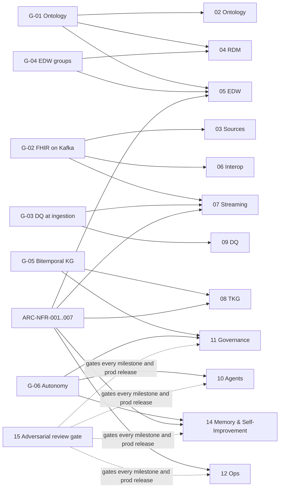

# Acceptance Criteria

This document defines what *done* means for every module, how each criterion is tested, and the checklist a release
must satisfy before promotion to `prod`. Thresholds are the first-release measures from `00-vision-and-scope.md` §3
(G-01..G-06) and the NFRs in `01-architecture-overview.md` §8 (ARC-NFR-001..007). CONVENTIONS §6 makes this document
the authority for the agent evaluation thresholds in every module's definition of done.

## 1. Traceability: goals → modules → acceptance

| Goal | First-release measure | Acceptance IDs |
|------|-----------------------|----------------|
| G-01 | ≥ 95 % EDW attributes bound to ontology property; OWL DL consistent | RMP-ACC-020, 023, 040, 052 |
| G-02 | 100 % in-scope interfaces emit `canonical.*`; FHIR validator ≥ 99.5 % | RMP-ACC-030, 060, 061 |
| G-03 | DQ coverage ≥ 90 % of CDEs; MTTD < 15 min | RMP-ACC-090, 091 |
| G-04 | All G1–G9 populated; conformed dims shared by ≥ 2 groups | RMP-ACC-050, 051 |
| G-05 | 100 % KG assertions bitemporal with PROV-O | RMP-ACC-080, 081 |
| G-06 | ≥ 80 % auto-approval; zero unreviewed PHI-affecting changes | RMP-ACC-100..104, 111, 130..137 |
| Release gate (all goals) | Zero open `critical` and zero unmitigated `high` adversarial findings at every milestone and `prod` release | RMP-ACC-140..143 |

## 2. Acceptance by module

Each table lists the criterion, the goal/NFR it serves, the measurable threshold, the test approach (§3) and the
evidence artefact attached to the release record.

### 2.1 Module 02 — Ontology Pipeline

| Criterion | Goal | Threshold | Test approach | Evidence |
|-----------|------|-----------|---------------|----------|
| Stage 0 inventory completeness | G-01 | 100 % of in-scope sources, interfaces and data elements registered with steward | Registry audit vs source metadata export | Inventory coverage report |
| Stage 1 vocabulary quality | G-01 | ≥ 98 % of concepts have `skos:prefLabel`, `skos:definition`, `skos:scopeNote` (where required by scheme policy) and a code binding or explicit `local-only` flag | SKOS lint (SPARQL queries) | Lint report per concept scheme |
| Stage 2 taxonomy integrity | G-01 | 0 `skos:broader` cycles; 0 duplicate `prefLabel` per language per scheme; every polyhierarchy justified by a facet tag | SKOS integrity checks; polyhierarchy report | Integrity report |
| Stage 3 thesaurus conformance | G-01 | 100 % of `skos:related` pairs are symmetric and not also hierarchical; mappings to external systems typed (`exactMatch`/`closeMatch`/`broadMatch`/`narrowMatch`) | ISO 25964-style checks via SPARQL | Thesaurus conformance report |
| Stage 4 ontology consistency | G-01 | OWL DL profile; consistent under HermiT and ELK; 0 unsatisfiable classes; every object property has domain and range | Reasoner run in CI | Reasoner log |
| Stage 4 SHACL coverage | G-01, G-03 | 100 % of canonical profile elements have a SHACL shape; shapes validate synthetic bundles with 0 unexpected violations | SHACL validation of golden RDF | SHACL report |
| Stage 5 instance conformance | G-05 | 100 % of KG named graphs validated by SHACL before publish | Pre-publish validation gate | Gate log |
| Competency questions | G-01 | ≥ 90 % of registered competency questions answerable by SPARQL against the KG with correct results on the golden set | CQ test suite | CQ pass report |
| Semantic coverage | G-01 | ≥ 95 % of EDW attributes, ≥ 95 % of canonical FHIR elements and ≥ 90 % of `std` fields bound to ontology IRIs | Coverage query across registry, DDL, profiles | Coverage dashboard snapshot |

### 2.2 Module 03 — Source Systems

| Criterion | Goal | Threshold | Test approach | Evidence |
|-----------|------|-----------|---------------|----------|
| Interface registration | G-02 | 100 % of in-scope interfaces in Source Registry with transport, message/resource types, cadence, steward, PHI class | Registry audit | Registry export |
| Mapping specification coverage | G-02 | ≥ 98 % of source fields in scope have a mapping spec (to `std` and to FHIR) or a documented `not-mapped` reason | Mapping matrix lint | Mapping coverage report |
| Cerner CODE_VALUE coverage | G-02 | 100 % of CODE_SET numbers referenced by in-scope fields bound to `urn:healix:cerner:code-set:<n>` with ≥ 99 % of active CODE_VALUEs mapped to enterprise value sets | Terminology coverage query | Unmapped-code report |
| Oracle Fusion lookup coverage | G-02 | 100 % of referenced `FND_LOOKUP` types bound to `urn:healix:fusion:lookup:<type>`; ≥ 99 % of active values mapped | Terminology coverage query | Unmapped-code report |
| Extraction fidelity | G-02 | 0 message loss (raw count = source count per interface per day); CDC row count parity ± 0 | Daily counts reconciliation | Parity report |
| Steward sign-off | G-02 | Every mapping spec version approved by named steward before `prod` | Change-request audit | Approval records |

### 2.3 Module 04 — Reference Data Models

| Criterion | Goal | Threshold | Test approach | Evidence |
|-----------|------|-----------|---------------|----------|
| Harmonisation coverage | G-04 | 100 % of G1–G9 core entities traced to a UDMH pattern, an HCDM pattern, a FHIR resource family, or a documented HEALIX-native justification | Matrix inspection | Harmonisation matrix |
| Licence compliance | — | 0 proprietary entity definitions, attribute lists or diagrams reproduced in the repository | Repository scan + legal review | Compliance attestation |
| Naming harmonisation | G-04 | 100 % of EDW tables/columns conform to CONVENTIONS §3 and the harmonised glossary | DDL lint | Lint report |
| Deviation log | G-04 | Every deviation from blueprint patterns recorded with rationale and owner | Inspection | Deviation register |

### 2.4 Module 05 — EDW Schema

| Criterion | Goal | Threshold | Test approach | Evidence |
|-----------|------|-----------|---------------|----------|
| Group population | G-04 | All nine `edw_gN_*` schemas deployed and loaded (G8/G9 in Phase 0, G1/G2 in Phase 1, G3/G4 Phase 2, G5–G7 Phase 3) | Row-count and freshness checks | Load report |
| Conformed dimensions | G-04 | Each of Patient, Practitioner, Organization, Location, Date/Time, Payer, Item, Cost Center, Code, Source System used by ≥ 2 fact groups | Dependency query on DDL | Usage matrix |
| Ontology binding | G-01 | ≥ 95 % of columns carry an ontology IRI in catalog metadata | Coverage query | Coverage report |
| Bitemporal history | G-05 | 100 % of `hist_*` tables have `valid_from/valid_to/recorded_at/superseded_at/prov_activity_iri`; as-of queries on golden set return expected rows | DDL lint + as-of test suite | Test report |
| Migration safety | — | Migrations forward-only, idempotent (re-run = no-op) and reversible by compensating migration; tested in `test` and `uat` | Migration CI | Migration log |
| KG↔EDW reconciliation | G-04, G-05 | Nightly business-key and measure reconciliation variance ≤ 0.1 % for 14 consecutive nights before each gate | Reconciliation job | Reconciliation report |
| Query performance | ARC-NFR | p95 ≤ 10 s for the 20 reference analytic queries on `uat`-scale data | Benchmark suite | Benchmark report |

### 2.5 Module 06 — Interoperability

| Criterion | Goal | Threshold | Test approach | Evidence |
|-----------|------|-----------|---------------|----------|
| FHIR validation | G-02 | ≥ 99.5 % of `canonical.*` resources pass the FHIR validator against HEALIX profiles (US Core 6.1 base) over a rolling 30 days | Validator in stream + batch re-validation | Validation dashboard |
| HL7 v2 conformance | G-02 | ACK error (AE/AR) rate < 0.1 %; 100 % of in-scope trigger events have a conformance profile | Golden corpus replay; conformance profile checks | Replay report |
| V2→FHIR mapping fidelity | G-02 | 100 % of golden HL7 v2 messages produce expected FHIR bundles (field-level diff) | Golden corpus regression | Diff report |
| X12 parsing and mapping | G-02 | Parse error < 0.1 %; 100 % of golden 837/835/270/271/278 produce expected FHIR resources | Golden X12 regression | Diff report |
| C-CDA inbound | G-02 | ≥ 99 % of C-CDA 2.1 documents parsed; sections mapped per spec | Golden C-CDA set | Report |
| Terminology service | G-02, G-03 | `$validate-code` p95 ≤ 200 ms; `$expand` for enterprise value sets p95 ≤ 2 s; 0 unversioned CodeSystem references in canonical records | TS load test; record scan | TS report |
| Unmapped codes | G-02 | < 0.5 % of coded elements per topic per day carry `urn:healix:*` local code with no enterprise mapping; every unmapped code opens a change request within 1 h | DQ query + CR audit | Unmapped report |
| Partner conformance (Phase 4) | G-02 | ≥ 99.5 % pass on partner conformance suite per partner | Conformance suite | Partner report |
| FHIR R5 track (Phase 4) | — | Gap analysis per canonical resource published; no R4 topic retired | Inspection | Gap analysis |

### 2.6 Module 07 — Streaming Platform

| Criterion | Goal / NFR | Threshold | Test approach | Evidence |
|-----------|------------|-----------|---------------|----------|
| Latency | ARC-NFR-001 | p95 source event → `canonical` ≤ 5 s (HL7 v2/CDC), ≤ 15 min (BICC) | Header-timestamp latency measurement over 7 days | Latency dashboard |
| Throughput | ARC-NFR-002 | ≥ 5,000 canonical resources/s sustained for 1 h; ×3 headroom demonstrated (15,000/s for 10 min) | Load test with synthetic bundles | Load-test report |
| Exactly-once | ARC-NFR-004 | 0 duplicates and 0 losses from `std` to `canonical` under broker and job failover; KG/EDW sinks idempotent (replay = no change) | Chaos test with injected failures and replay | Chaos report |
| Replay | ARC-NFR-005 | Any layer replayable from retention (≥ 30 d `raw`; compacted `canonical`) with identical downstream state | Replay drill | Drill report |
| Topic catalog conformance | — | 100 % of topics match `hc.<layer>.<domain>.<entity>.<event-or-format>.v<N>`; no topic exists outside `topics.yaml` | Catalog linter + cluster diff | Lint report |
| Schema compatibility | — | `BACKWARD_TRANSITIVE` on `canonical.*`, `FULL` on `kg.*`/`edw.*` enforced; incompatible schema rejected in CI | Registry policy test | CI log |
| Headers | — | 100 % of records carry `hc-event-time`, `hc-source-time`, source metadata, PHI class | Header audit sample | Audit report |
| Ordering | — | Per-key ordering preserved (patient/encounter key) across facility partitions; out-of-order rate < 0.01 % | Ordering probe | Probe report |

### 2.7 Module 08 — Temporal Knowledge Graph

| Criterion | Goal | Threshold | Test approach | Evidence |
|-----------|------|-----------|---------------|----------|
| Bitemporality | G-05 | 100 % of assertions carry valid time, transaction time and `prov:wasGeneratedBy` activity | SPARQL audit query (count of assertions lacking any component = 0) | Audit report |
| As-of correctness | G-05 | 100 % of golden as-of queries (valid-time, transaction-time and bitemporal) return expected results | As-of test suite | Test report |
| Entity resolution precision/recall | G-05, G-01 | Patient: precision ≥ 0.995, recall ≥ 0.98 on golden pairs; Practitioner/Organization: precision ≥ 0.99, recall ≥ 0.95; 0 unreviewed auto-merges in Phase 1; false-merge rate ≤ 1 per 100,000 after auto-merge is enabled | Golden pair evaluation; merge audit | ER report |
| Ingestion latency | ARC-NFR-001 | p95 `canonical` → KG ≤ 60 s | Latency measurement | Dashboard |
| SHACL gate | G-05 | 100 % of named graphs validated pre-publish; violations quarantined | Gate log | Gate report |
| Query performance | — | p95 ≤ 3 s for 30 reference competency-question queries at `uat` scale (≥ 1 billion triples target) | Benchmark | Benchmark report |
| Provenance resolution | G-05 | 100 % of `prov_activity_iri` resolve to an OpenLineage run and a source record | Lineage walk test | Lineage report |

### 2.8 Module 09 — Data Quality

| Criterion | Goal | Threshold | Test approach | Evidence |
|-----------|------|-----------|---------------|----------|
| Coverage | G-03 | ≥ 90 % of critical data elements (as flagged in the Data Element Catalog) have ≥ 1 active rule per applicable dimension | Coverage query | Coverage report |
| Time to detect | G-03 | Mean time from event time to DQ result < 15 min; p95 < 30 min | Latency measurement | Dashboard |
| Rule precision | G-03 | False-positive rate ≤ 5 % on adjudicated sample of 500 failures per release | Steward adjudication | Adjudication report |
| Backtest | G-03 | Every new/changed rule backtested on ≥ 90 days of `canonical` history; breach rate within steward-approved band | DQ backtest harness | Backtest report |
| Ontology derivation | G-03, G-01 | ≥ 70 % of rules trace to an ontology constraint or SHACL shape | Rule metadata query | Derivation report |
| Reconciliation (Phase 2+) | G-03 | ≥ 99 % charges matched to claim line or explained exception within 45 days; ≥ 99.5 % 835 lines matched to a claim; PO→receipt→invoice three-way match ≥ 98 % | Reconciliation rule pack | Reconciliation report |
| Remediation | G-03 | Median time-to-remediate critical breaches ≤ 2 business days; quarantine backlog < 0.1 % of daily volume | Issue tracker metrics | Remediation report |
| Scorecards | G-03 | Composite DQ index per group published daily with trend | Inspection | Scorecard snapshot |

### 2.9 Module 10 — Agentic Pipeline

| Criterion | Goal | Threshold | Test approach | Evidence |
|-----------|------|-----------|---------------|----------|
| Evaluator–human agreement | G-06 | Cohen's κ ≥ 0.85 between `agent.evaluator` verdict (approve/revise/reject) and blinded human adjudication on ≥ 300 proposals per release cycle, per change class with ≥ 50 samples | Agent evaluation suite | Agreement report |
| Auto-approval rate | G-06 | Phase 2 ≥ 50 %, Phase 3 ≥ 65 %, Phase 4 ≥ 80 % of eligible vocabulary/mapping/DQ-rule changes auto-approved | CR analytics | Autonomy report |
| Rollback rate | G-06 | ≤ 2 % of auto-applied changes rolled back per cycle | CR analytics | Autonomy report |
| PHI gate | G-06 | 0 PHI-affecting changes applied without `agent.privacy_guardian` review; 0 without human approval where policy requires | CR audit | Audit report |
| Hallucination containment | G-01, G-06 | 0 ontology releases with axioms that fail reasoner consistency or lack an evidence reference; 100 % of agent-proposed axioms cite source evidence (registry element, standard, steward note) | Evaluator rubric + reasoner | Release log |
| Regression safety | G-06 | 100 % of golden datasets re-run on each agent-applied mapping/rule change; 0 regressions promoted | CI | CI log |
| Tool-call policy | — | 100 % of agent tool calls authorised by MCP policy; 0 calls to non-allow-listed endpoints; minimum-necessary PHI in prompts verified by sampling (≤ 0.1 % violations) | Tool-call audit | Audit report |
| Cost and latency | — | Median change-request cycle ≤ 1 h for low-risk; agent cost per accepted change within budget | Metrics | Report |

### 2.10 Module 11 — Governance, Security & Compliance

| Criterion | Goal | Threshold | Test approach | Evidence |
|-----------|------|-----------|---------------|----------|
| PHI classification | G-06 | 100 % of topics, tables, named graphs and data elements classified | Registry audit | Classification report |
| Access control | ARC-NFR-003 | Topic ACLs, schema-level grants and graph-level policies match the policy matrix; 0 standing privileged access in `prod` | Access review | Review report |
| Encryption | ARC-NFR-003 | TLS 1.2+ everywhere; AES-256 at rest; keys in KMS; verified by scan | Security scan | Scan report |
| Masking | ARC-NFR-003 | 100 % of PHI fields masked/de-identified in non-prod | Field scan | Scan report |
| Audit completeness | G-05, G-06 | 100 % of reads of `canonical.*`, KG and EDW PHI-bearing objects produce an audit event; audit store immutable | Audit reconciliation | Report |
| Lineage coverage | G-05 | 100 % of canonical records traceable raw→std→canonical→KG/EDW via OpenLineage + PROV-O | Lineage walk | Report |
| Exceptions | — | PHI access exceptions triaged ≤ 24 h; 0 open > 72 h | Ticket metrics | Report |
| 42 CFR Part 2 | — | Part 2 records segmented and excluded from flows without consent; tested on synthetic cases | Policy test | Report |
| Research de-identification | — | Safe Harbor identifiers removed (18 categories) or expert determination documented | Review | Attestation |

### 2.11 Module 12 — Platform & Operations

| Criterion | NFR | Threshold | Test approach | Evidence |
|-----------|-----|-----------|---------------|----------|
| Environments & IaC | ARC-NFR-006 | All environments reproducible from IaC; drift = 0 | IaC plan check | Report |
| CI/CD artefact validation | ARC-NFR-006 | 100 % of artefacts validated; releases signed | CI logs | Logs |
| SLOs | ARC-NFR-001/002 | Availability ≥ 99.9 % for ingestion/canonical plane; ≥ 99.5 % for KG/EDW query; error budgets tracked | SLO dashboards | Monthly SLO report |
| DR | ARC-NFR-007 | RPO ≤ 15 min, RTO ≤ 4 h demonstrated in drill | DR drill | Drill report |
| Retention | ARC-NFR-005 | `raw` ≥ 30 d; compacted `canonical` indefinitely; audit per policy | Config audit | Report |
| Observability | — | Every pipeline stage emits metrics, logs, traces with correlation to `prov_activity_iri` | Inspection | Report |
| Capacity | ARC-NFR-002 | ×3 headroom proven | Load test | Report |
| Memory stack recoverability | ARC-NFR-007 | Mem0/Graphiti rebuilt from `hc.ops.memory.write.v1` ≤ 4 h with record counts ±0; Redis cold start with bypass ≤ 50 ms and ARC-NFR-001 unaffected | Quarterly rebuild drill; cold-start chaos test (OPS-04 §9) | Drill report |

### 2.12 Module 14 — Agent Memory, Caching & Self-Improvement

| Criterion | Goal / ADR | Threshold | Test approach | Evidence |
|-----------|------------|-----------|---------------|----------|
| No PHI in memory or caches | ADR-08, G-06 | 0 values above `internal` (GOV-01 §3 Table 3-A) in any memory tier M0–M4 or cache tier C0–C4; write-gate rejects 100 % of PHI honeytokens and injection seeds; scanner zero findings for 30 days before each gate | Memory PHI scanner + honeytoken probes; adversarial episode set | Scanner and probe report |
| Write-gate and sole-writer | ADR-08 | 100 % of writes pass the write-gate and are acknowledged on `hc.ops.memory.write.v1` before materialisation; 0 components other than the Memory API hold write credentials to Mem0/Graphiti | Credential inventory; write-path test | Audit report |
| Rebuild from write log | ARC-NFR-007 | Mem0 and Graphiti rebuilt ≤ 4 h with record counts ±0 and identical `record_id` sets; drill ≤ 1 quarter old | Rebuild drill (OPS-04 §9) | Drill report |
| Bitemporal alignment | G-05 | 100 % of Graphiti edges map `valid_at/invalid_at/created_at/expired_at` to TKG-01 §4 terms; as-of (valid and as-known) fixtures pass | MEM-GRA fixture suite | Fixture report |
| Memory SLO (S23) | — | Write availability 99.9 %; recall p95 ≤ 200 ms; Graphiti hybrid recall p95 ≤ 500 ms; episode recallable ≤ 60 s p95; `memory_quarantine_total` = 0 | SLO engine over 28 days in `uat` then `prod` | SLO report |
| Memory lift | G-06 | Evaluator–human κ and CR acceptance with memory enabled ≥ without memory (ablation); memory-influenced vs non-influenced acceptance published monthly | Ablation run per release cycle | Ablation report |
| Cache correctness and SLO (S24) | ARC-NFR-001 | Invalidation lag p95 ≤ 60 s; bypass-on-failure ≤ 0.1 % of calls; semantic-cache divergence ≤ 0.5 % on 1 % shadow recompute; 100 % of C2 mapping hits re-validated against the Terminology Service; no cache entry ever used as evidence for a memory write or CR | Cache chaos and shadow-recompute tests; CI lint | Cache report |
| Healing safety | ADR-09 | Chaos suite passes for every playbook: detect ≤ MTTD, heal ≤ MTTR, blast-radius budget never exceeded, 0 autonomous `schema`/`data_mutation` actions, kill switch halts runs ≤ 30 s, recursion depth ≤ 2 | Chaos and fault-injection suite (MEM-04 §10) | Chaos report |
| Playbook graduation and coverage | ADR-09 | `autonomous` only after ≥ 10 consecutive shadow/assisted matches with ≥ 90 % agreement and an approved `playbook` CR; post-shadow playbooks for ≥ 50 % of fault classes by M2 and ≥ 80 % by M3; 100 % of fault classes with a detection rule | Playbook register audit | Register snapshot |
| Improvement loop safety | ADR-09, G-06 | 0 prompt/policy/threshold changes in `prod` outside an evaluated CR + canary; rollback ≤ 5 min on any trigger; rollback rate of promoted candidates < 10 % per quarter per agent; 0 held-out test-split reads by `agent.improver` | Canary rollback drill; audit join | Drill and audit report |
| Recursive-learning governance | ADR-09 | Trust tiers and separation-of-duties matrix enforced (0 violations); fixed-point list unchanged by automated CRs; monthly DGC report published | SoD tests; CR audit | DGC report |

### 2.13 Module 15 — Adversarial Review gate

The adversarial review gate applies at every milestone (M0–M4) and every `prod` release in addition to the module
tables above; it is a release gate, not a module-population measure.

| Criterion | Goal | Threshold | Test approach | Evidence |
|-----------|------|-----------|---------------|----------|
| Findings register | All | Register live from M0; every finding has severity (`critical`/`high`/`medium`/`low`), owner, due date, status and the module/requirement it affects | Inspection | Register export |
| Red-team re-test | All | A red-team re-test covering the release scope executed before each gate: PHI exfiltration via agent tools, header-guard and ACL bypass, prompt injection into memory and CRs, replay/duplicate injection, consent-gate bypass, de-identification re-identification, memory poisoning | Red-team runbook execution | Red-team report |
| Open findings | All | 0 open `critical`; 0 `high` without an approved, dated mitigation plan; `critical` fixed (not mitigated) before promotion; residual `high` risk accepted in writing by the DGC | Register audit at gate | Signed gate record |
| Remediation SLA | — | `critical` fixed before promotion; `high` ≤ 30 days; `medium` ≤ 90 days; overdue findings reported to the DGC monthly | Register metrics | Monthly report |
| Legacy / tech-debt outliers | — | Every outlier identified (interface-engine quirks, replica lag, BICC PVO gaps, clearinghouse transports) logged with owner, remediation date and the module 14 fault class or playbook covering it | Inspection | Outlier log |
| Cross-check with evaluation seeds | G-06 | 100 % of red-team scenarios involving agent proposals are also present as adversarial seeds in the module 10 evaluation suite (RMP-ACC-104) | Seed catalogue diff | Diff report |

## 3. Test approach

### 3.1 Test assets

| Asset | Content | Owner | Where |
|-------|---------|-------|-------|
| Golden HL7 v2 corpus | ≥ 5,000 de-identified messages covering every in-scope trigger event, edge cases (A40 merge, A11 cancel, late ORU corrections, repeating segments) with expected FHIR output | Integration squad | `06-interoperability/tests/` (planned) |
| Synthetic FHIR bundles | Generated patients/encounters/observations/claims with controlled anomalies for DQ and SHACL testing; no real PHI | DQ squad | `09-data-quality/tests/` (planned) |
| Golden X12 / C-CDA set | Representative 837P/I, 835, 270/271, 278; C-CDA 2.1 CCD, discharge summary | Integration squad | `06-interoperability/tests/` |
| Golden entity-resolution pairs | ≥ 10,000 labelled patient pairs (match/non-match/ambiguous) with twin, name-change and typo cases | KG squad | `08-temporal-knowledge-graph/tests/` |
| As-of query suite | Bitemporal scenarios (late-arriving fact, correction, retroactive change, merge) with expected results | KG + DW squads | `08`/`05` tests |
| Competency-question suite | Registered CQs with SPARQL and expected answers | Semantics squad | `02-ontology-pipeline/tests/` |
| Agent evaluation set | ≥ 300 adjudicated proposals per cycle per class; seeded adversarial cases (hallucinated code, PHI in label, circular hierarchy) | Agents squad | `10-agentic-pipeline/evals/` |
| Performance harness | Load generator producing synthetic bundles at configurable rate; chaos injection | Platform squad | `12-platform-and-operations/perf/` |
| Memory honeytoken and adversarial episode set | Synthetic PHI honeytokens (every GOV-01 §2 identifier class), prompt-injection episodes, forbidden entity types, cross-scope and cross-environment probes | Agents squad + Privacy | `14-memory-and-self-improvement/tests/` (planned) |
| Healing chaos and fault-injection suite | ≥ 1 chaos test per playbook trigger (MLLP kill, MSH-13 gap, LogMiner stall, Redis/Mem0/Graphiti outage, kill switch mid-run); canary rollback drill with injected −0.03 regression | Platform + Agents squads | `14-memory-and-self-improvement/healing-playbooks/` (`chaos_tests[]`) |
| Red-team runbook and findings register | Attack scenarios per release scope, severity scale, remediation log, legacy/tech-debt outlier inventory | Adversarial review lead (module 15) | `15-adversarial-review/` |

### 3.2 Test types

| Type | Scope | Tooling (default) | Gate |
|------|-------|-------------------|------|
| Conformance suites | FHIR profiles (HL7 FHIR validator with HEALIX IG package), HL7 v2 conformance profiles, X12 005010 syntax, partner suites | FHIR validator CLI, HAPI HL7 v2 conformance, X12 parser test harness | Every PR touching mappings/profiles; nightly on `prod` sample |
| Golden dataset regression | Field-level diff of expected vs actual canonical output | Custom diff over FHIR JSON canonical form | Every mapping change |
| SHACL / OWL checks | Shape validation of KG graphs and synthetic RDF; reasoner consistency, unsatisfiable classes, profile check | pySHACL/TopBraid SHACL, HermiT, ELK, OWL API profile checker | Every ontology PR; pre-publish gate |
| SKOS/ISO 25964 lint | Integrity and thesaurus conformance via SPARQL | SPARQL test queries in CI | Every vocabulary PR |
| DQ backtests | New/changed rule run over ≥ 90 d history; breach-rate band check; false-positive adjudication | DQ engine batch mode | Every rule change |
| Agent evaluation suite | Blinded human adjudication vs evaluator verdict; κ computation per class; adversarial seeds; regression of golden sets after agent change | Evaluation harness | Every release cycle; autonomy board |
| Performance tests | Latency (NFR-001), throughput and headroom (NFR-002), exactly-once under failure (NFR-004), replay (NFR-005), DR (NFR-007) | Load generator, chaos tooling | Phase gates; quarterly thereafter |
| Security tests | Encryption, ACL, masking scans; penetration test; tool-call audit sampling | Scanners, pen-test vendor | Phase gates; annual pen-test |
| Reconciliation | KG↔EDW nightly; cross-system financial reconciliation | Reconciliation jobs | Nightly |
| Memory and healing chaos | Honeytoken and injection probes against the write-gate; Mem0/Graphiti/Redis outage; playbook chaos tests; rebuild from write log; kill switch; canary rollback | Chaos tooling, memory probes, Temporal test harness | Every playbook or policy change; quarterly drills; phase gates |
| Adversarial review (red team) | Scenario-driven attack of the release scope across agents, memory, streaming, access control and de-identification; findings triaged into the module 15 register | Red-team runbook, pen-test vendor annually | Every milestone and `prod` release; annual pen-test |

### 3.3 Agent evaluation suite — method

1. **Sampling.** Each release cycle, sample ≥ 300 change requests stratified by change class (label edit, synonym, hierarchy move, thesaurus relation, axiom, mapping, value-set member, DQ rule, DQ threshold, DDL) with ≥ 50 per class where volume permits.
2. **Blinding.** Two human reviewers (stewards/ontologists) adjudicate each proposal as approve / revise / reject without seeing the evaluator verdict; disagreements resolved by a third.
3. **Agreement.** Compute Cohen's κ between evaluator verdict and adjudicated human verdict overall and per class. Threshold: κ ≥ 0.85 overall and ≥ 0.80 for every class eligible for auto-approval. Also report simple agreement and confusion matrix.
4. **Adversarial seeds.** Inject ≥ 30 known-bad proposals per cycle (fabricated SNOMED code, PHI in a label, cyclic `broader`, axiom contradicting disjointness, mapping to wrong FHIR element). Required catch rate: 100 % for PHI and reasoner-breaking seeds; ≥ 95 % for others.
5. **Outcome tracking.** Track rollback rate and downstream DQ breach deltas for auto-applied changes for 30 days.
6. **Decision.** The autonomy board promotes/demotes agents per RMP-01 §9 using this report.

### 3.4 Performance test matrix (ARC-NFR-001..007)

| NFR | Test | Pass condition |
|-----|------|----------------|
| ARC-NFR-001 | 7-day latency measurement using `hc-source-time` vs canonical publish time | p95 ≤ 5 s HL7 v2/CDC; ≤ 15 min BICC |
| ARC-NFR-002 | 1-hour sustained load at 5,000 resources/s; 10-minute burst at 15,000/s | No lag growth beyond 60 s; no errors |
| ARC-NFR-003 | TLS/at-rest scans; ACL diff; masking scan | 0 findings of severity ≥ medium |
| ARC-NFR-004 | Kill brokers/Flink task managers during load; replay | 0 duplicates, 0 losses in `canonical`; KG/EDW state identical after replay |
| ARC-NFR-005 | Replay `raw` for a 30-day window into a fresh `std`/`canonical` | Downstream counts and hashes match |
| ARC-NFR-006 | Attempt unsigned release; attempt un-versioned artefact | Rejected by CI |
| ARC-NFR-007 | Region/cluster failover drill | RPO ≤ 15 min, RTO ≤ 4 h |

## 4. Go-live checklist

Each item must have evidence linked in the release record. Items marked **P0** block promotion.

| # | Item | P | Owner |
|---|------|---|-------|
| 1 | All P0 requirements of modules in the release have automated verification artefacts referenced by ID (CONVENTIONS §6.1) | P0 | Module owners |
| 2 | Machine-readable artefacts validate in CI (YAML, SQL, SHACL, OWL reasoner) | P0 | Release manager |
| 3 | Cross-module `depends_on` resolve to approved documents | P0 | Architecture |
| 4 | Security & privacy review signed off; PHI classification complete for every new topic/table/graph | P0 | Privacy & Security Officer |
| 5 | Agent evaluation report meets §2.9 thresholds for the agents and autonomy levels in the release | P0 | Autonomy board |
| 6 | FHIR validation ≥ 99.5 % on shadow traffic for ≥ 14 days | P0 | Integration |
| 7 | Latency/throughput tests passed for the interfaces in release | P0 | Platform |
| 8 | DQ coverage and MTTD thresholds met for the groups in release | P0 | DQ |
| 9 | KG↔EDW reconciliation variance ≤ 0.1 % for 14 nights | P0 | DW + KG |
| 10 | As-of query suite passes on `uat` | P0 | KG + DW |
| 11 | Entity-resolution thresholds met; review queue staffed | P0 | KG + HIM |
| 12 | Topic ACLs, schema grants, graph policies applied; access review complete | P0 | Security |
| 13 | Audit and lineage coverage 100 % verified on `uat` | P0 | Governance |
| 14 | Runbooks, on-call rota, SLO dashboards and alerts in place | P0 | SRE |
| 15 | Rollback plan tested (topic version revert, ontology version revert, compensating migration) | P0 | Release manager |
| 16 | Stewards for all groups in release trained and named in registry | P0 | Governance |
| 17 | Golden datasets updated for new interfaces | P1 | Integration |
| 18 | Licence compliance attestation for terminologies and blueprints in release | P0 | Legal / Architecture |
| 19 | Partner conformance suites passed (if outbound in release) | P0 (Phase 4) | Integration |
| 20 | Release notes and changelog published by `agent.release_manager`, human-reviewed | P1 | Release manager |
| 21 | Risk register reviewed; no open risk with score ≥ 15 without approved mitigation | P1 | PMO |
| 22 | Hypercare plan (2 weeks) agreed with stewards and SRE | P1 | PMO |
| 23 | Module 14: no value above `internal` in any memory or cache tier — memory PHI scanner and honeytoken probes zero findings for 30 days; write-gate, sole-writer credential inventory and Redis ACL tests green | P0 | Privacy & Security Officer + Agent operator |
| 24 | Module 14: Mem0/Graphiti rebuild-from-write-log drill ≤ 1 quarter old; Redis cold-start bypass test passed; S23–S25 dashboards and alerts (`MemoryQuarantineNonZero`, `HealingCircuitOpen`, `CanaryRollback`) live | P0 | SRE |
| 25 | Module 14: every healing playbook in the release carries graduation evidence for its `status` (shadow → assisted → autonomous), chaos tests passing, kill-switch drill ≤ 30 s; canary rollback drill ≤ 5 min current before any `prod` improvement candidate | P0 | Agent operator + Autonomy board |
| 26 | Module 15 adversarial review gate: red-team re-test of the release scope completed; findings register shows zero open `critical` and zero `high` without an approved, dated mitigation; residual risk accepted by the DGC | P0 | Adversarial review lead + DGC |
| 27 | Module 15: legacy/tech-debt outliers touched by the release logged with owner, remediation date and covering playbook or fault class | P1 | Architecture |

## 5. Requirements

| ID | Priority | Verification | Requirement |
|----|----------|--------------|-------------|
| **RMP-ACC-001** | P0 | inspection | Every module release MUST attach evidence for each acceptance criterion in §2 applicable to that release before promotion to `prod`. |
| **RMP-ACC-002** | P0 | inspection | Acceptance thresholds in this document MUST NOT be lowered by a module document; a module MAY tighten them. |
| **RMP-ACC-003** | P1 | inspection | The go-live checklist in §4 MUST be completed and signed for every production release. |
| **RMP-ACC-020** | P0 | test | Each ontology release MUST be OWL DL consistent under at least one reasoner with 0 unsatisfiable classes. |
| **RMP-ACC-021** | P0 | test | Each ontology release MUST pass SKOS integrity checks: 0 `skos:broader` cycles, unique `skos:prefLabel` per language per concept scheme, 100 % `skos:inScheme` membership. |
| **RMP-ACC-022** | P1 | test | ≥ 90 % of registered competency questions MUST be answerable with correct results against the knowledge graph golden set. |
| **RMP-ACC-023** | P0 | analysis | ≥ 95 % of EDW attributes in populated groups MUST be bound to an ontology property. |
| **RMP-ACC-024** | P0 | test | 100 % of canonical profile elements MUST have a SHACL shape, and shapes MUST validate the synthetic bundle set with 0 unexpected violations. |
| **RMP-ACC-030** | P0 | inspection | 100 % of in-scope interfaces MUST be registered in the Source Registry with steward and PHI class before emitting to `prod`. |
| **RMP-ACC-031** | P0 | test | ≥ 98 % of in-scope source fields MUST have a mapping specification or a documented `not-mapped` reason. |
| **RMP-ACC-040** | P0 | inspection | 100 % of G1–G9 core entities MUST be traced in the harmonisation matrix to a UDMH pattern, an HCDM pattern, a FHIR resource family or a documented HEALIX-native justification; 0 proprietary definitions SHALL be reproduced. |
| **RMP-ACC-050** | P0 | test | All EDW groups in scope of a release MUST be populated, and KG↔EDW reconciliation variance MUST be ≤ 0.1 % for 14 consecutive nights before the gate. |
| **RMP-ACC-051** | P0 | analysis | Each conformed dimension MUST be consumed by ≥ 2 fact groups by gate M2 (Payer, Item, Cost Center) and M3 (all). |
| **RMP-ACC-052** | P0 | test | 100 % of `hist_*` tables MUST carry bitemporal columns and the provenance reference, and the as-of query suite MUST pass. |
| **RMP-ACC-060** | P0 | test | ≥ 99.5 % of `canonical.*` resources MUST pass the FHIR validator against HEALIX profiles over a rolling 30-day window. |
| **RMP-ACC-061** | P0 | test | HL7 v2 ACK error rate MUST be < 0.1 % and 100 % of golden HL7 v2 messages MUST produce the expected FHIR output. |
| **RMP-ACC-062** | P0 | test | X12 parse error rate MUST be < 0.1 % and 100 % of golden X12 transactions MUST produce the expected FHIR resources. |
| **RMP-ACC-063** | P1 | test | Terminology `$validate-code` p95 MUST be ≤ 200 ms and 0 canonical records SHALL reference an unversioned CodeSystem. |
| **RMP-ACC-064** | P1 | test | Each outbound partner interface MUST pass its conformance suite at ≥ 99.5 % before go-live. |
| **RMP-ACC-065** | P2 | inspection | The FHIR R5 profile track MUST publish a per-resource gap analysis and MUST NOT retire any R4 canonical topic. |
| **RMP-ACC-070** | P0 | test | p95 latency source event → `canonical` MUST be ≤ 5 s for HL7 v2/CDC and ≤ 15 min for BICC extracts (ARC-NFR-001). |
| **RMP-ACC-071** | P0 | test | The platform MUST sustain ≥ 5,000 canonical resources/s for 1 h and 15,000/s for 10 min without lag growth beyond 60 s (ARC-NFR-002). |
| **RMP-ACC-072** | P0 | test | Under injected broker and processor failure, `std`→`canonical` MUST show 0 duplicates and 0 losses, and KG/EDW state MUST be identical after replay (ARC-NFR-004). |
| **RMP-ACC-073** | P1 | test | Replay of 30 days of `raw` MUST reproduce downstream counts and content hashes (ARC-NFR-005). |
| **RMP-ACC-074** | P0 | test | 100 % of topics MUST conform to the catalog naming pattern and Schema Registry compatibility policy. |
| **RMP-ACC-080** | P0 | test | 100 % of KG assertions MUST carry valid time, transaction time and a PROV-O activity reference (audit query count of non-conforming assertions = 0). |
| **RMP-ACC-081** | P0 | test | 100 % of golden as-of queries MUST return expected results. |
| **RMP-ACC-082** | P0 | test | Patient entity resolution MUST achieve precision ≥ 0.995 and recall ≥ 0.98 on golden pairs; no auto-merge SHALL occur until the autonomy board approves, and thereafter false-merge rate MUST be ≤ 1 per 100,000 merges. |
| **RMP-ACC-083** | P1 | test | p95 `canonical` → KG ingestion latency MUST be ≤ 60 s. |
| **RMP-ACC-090** | P0 | analysis | ≥ 90 % of critical data elements MUST have at least one active DQ rule per applicable dimension. |
| **RMP-ACC-091** | P0 | test | Mean time-to-detect a DQ breach MUST be < 15 min from event time (p95 < 30 min). |
| **RMP-ACC-092** | P0 | test | Cross-system reconciliation MUST match ≥ 99 % of charges to a claim line or explained exception within 45 days and ≥ 99.5 % of 835 lines to a claim. |
| **RMP-ACC-093** | P1 | test | Every new or changed DQ rule MUST be backtested over ≥ 90 days of canonical history and have a false-positive rate ≤ 5 % on adjudicated samples. |
| **RMP-ACC-100** | P0 | test | Evaluator–human agreement MUST be Cohen's κ ≥ 0.85 overall on ≥ 300 adjudicated proposals per release cycle, and ≥ 0.80 for every change class eligible for auto-approval. |
| **RMP-ACC-101** | P0 | analysis | Auto-approval of eligible changes MUST reach ≥ 50 % by M2, ≥ 65 % by M3 and ≥ 80 % by M4. |
| **RMP-ACC-102** | P0 | analysis | Rollback rate of auto-applied changes MUST be ≤ 2 % per cycle; > 5 % in a cycle MUST trigger immediate demotion of the responsible agent. |
| **RMP-ACC-103** | P0 | inspection | 0 PHI-affecting changes SHALL be applied without `agent.privacy_guardian` review and required human approval. |
| **RMP-ACC-104** | P0 | test | Adversarial evaluation seeds MUST be caught at 100 % for PHI and reasoner-breaking cases and ≥ 95 % for all others. |
| **RMP-ACC-105** | P1 | test | 100 % of agent-proposed axioms MUST cite evidence (registry element, standard reference or steward note) and 0 releases SHALL contain axioms failing consistency. |
| **RMP-ACC-110** | P0 | inspection | 100 % of topics, tables, named graphs and data elements MUST carry a PHI classification before production data flows. |
| **RMP-ACC-111** | P0 | test | 100 % of reads of PHI-bearing canonical, KG and EDW objects MUST generate an immutable audit event. |
| **RMP-ACC-112** | P0 | test | 100 % of canonical records MUST be traceable raw→std→canonical→KG/EDW via OpenLineage and PROV-O. |
| **RMP-ACC-113** | P0 | inspection | Research projections MUST pass de-identification review (Safe Harbor or expert determination) before researcher access. |
| **RMP-ACC-120** | P0 | test | All environments MUST be reproducible from infrastructure-as-code with zero drift at gate time. |
| **RMP-ACC-121** | P0 | test | CI MUST reject any unsigned release or unversioned artefact (ARC-NFR-006). |
| **RMP-ACC-122** | P1 | demo | A DR drill MUST demonstrate RPO ≤ 15 min and RTO ≤ 4 h (ARC-NFR-007) before gate M2 and annually thereafter. |
| **RMP-ACC-123** | P1 | analysis | Monthly SLO reports MUST show availability ≥ 99.9 % for the ingestion/canonical plane and ≥ 99.5 % for KG/EDW query. |
| **RMP-ACC-130** | P0 | test | No memory tier (M0–M4 as used by agents) and no cache tier (C0–C4) SHALL contain any value classified above `internal` in GOV-01 §3 Table 3-A; the memory PHI scanner and honeytoken probes MUST report zero findings for 30 consecutive days before each gate, and the write-gate MUST reject 100 % of honeytoken and injection seeds (MEM-ARCH-025, MEM-CACHE-001). |
| **RMP-ACC-131** | P0 | test | Mem0 and Graphiti MUST be rebuilt from `hc.ops.memory.write.v1` within 4 h with record counts ±0 and identical `record_id` sets in a drill no older than one quarter at every gate (MEM-ARCH-008, MEM-ARCH-039). |
| **RMP-ACC-132** | P1 | analysis | Memory-lift ablation MUST show evaluator–human agreement κ and CR acceptance with memory enabled ≥ those with memory disabled, and the memory-influenced vs non-influenced acceptance comparison MUST be published monthly (MEM-GOV-038). |
| **RMP-ACC-133** | P1 | test | Cache SLO S24 MUST be met: invalidation lag p95 ≤ 60 s, bypass-on-failure ≤ 0.1 % of calls, semantic-cache divergence ≤ 0.5 %, every C2 mapping hit re-validated against the Terminology Service, and no cache entry used as evidence for a memory write or change request (MEM-CACHE-003, 009, 030). |
| **RMP-ACC-134** | P0 | test | The chaos and fault-injection suite MUST pass for every playbook in a release: detection ≤ MTTD and healing ≤ MTTR of its fault class, blast-radius budget never exceeded, zero autonomous `schema`/`data_mutation` actions, kill switch halting runs ≤ 30 s and recursion depth ≤ 2 (MEM-HEAL-001, 002, 007, 009). |
| **RMP-ACC-135** | P0 | inspection | A playbook MAY be `autonomous` only after ≥ 10 consecutive shadow or assisted matches with ≥ 90 % agreement and an approved `playbook` CR; by M2 ≥ 50 % and by M3 ≥ 80 % of registered fault classes MUST have a post-shadow playbook and 100 % MUST have a detection rule (MEM-HEAL-051, 052). |
| **RMP-ACC-136** | P0 | test | Every prompt, policy, threshold or playbook-parameter change MUST reach `prod` only through an `agent_policy`, `playbook` or `dq_rule` CR that passed offline evaluation and a canary; rollback MUST complete ≤ 5 min on any trigger; the rollback rate of promoted candidates MUST be < 10 % per quarter per agent; `agent.improver` MUST show zero reads of the held-out test split (MEM-IMP-001, 004, 005, 015). |
| **RMP-ACC-137** | P1 | test | Memory SLO S23 MUST be met over 28 days in `uat` before module 14 agents leave `shadow` and continuously in `prod`: write availability 99.9 %, recall p95 ≤ 200 ms, Graphiti hybrid recall p95 ≤ 500 ms, episode recallable ≤ 60 s p95, `memory_quarantine_total` = 0 (MEM-ARCH-012, 040). |
| **RMP-ACC-140** | P0 | inspection | A module 15 findings register MUST exist from gate M0 with severity (`critical`/`high`/`medium`/`low`), owner, due date, status and affected requirement for every finding, and MUST be reviewed at every milestone gate and `prod` release. |
| **RMP-ACC-141** | P0 | test | Before every milestone gate and `prod` release a red-team re-test covering the release scope MUST be executed and its findings registered; the scenario set MUST include PHI exfiltration via agent tools, header-guard and ACL bypass, prompt injection into memory and change requests, replay/duplicate injection, consent-gate bypass, de-identification re-identification and memory poisoning. |
| **RMP-ACC-142** | P0 | inspection | Zero `critical` findings SHALL be open and zero `high` findings SHALL lack an approved, dated mitigation plan at any gate or `prod` promotion; `critical` findings MUST be fixed, not mitigated, before promotion, and residual `high` risk MUST be accepted in writing by the DGC. |
| **RMP-ACC-143** | P1 | inspection | Legacy and technical-debt outliers identified by module 15 MUST be logged with owner, remediation date and the module 14 fault class or playbook that covers them; `high` findings MUST be remediated within 30 days and `medium` within 90 days. |
