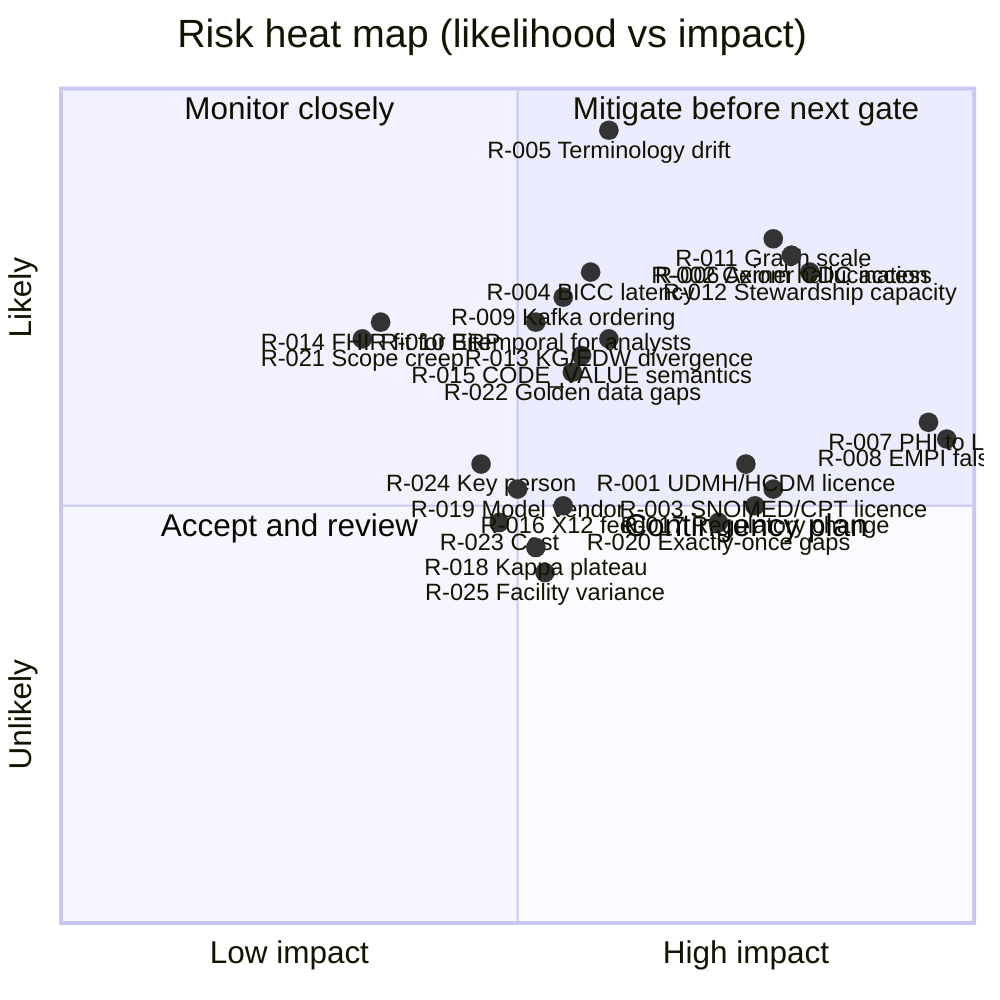

# Risks and Open Questions

The risk register is reviewed monthly by the programme steering committee and at every phase gate. Scores use
likelihood (1–5) × impact (1–5); any risk scoring ≥ 15 requires an approved mitigation plan before the next gate
(go-live checklist item 21 in RMP-02). Open questions carry a proposed default so work can proceed; a decision confirms
or overrides the default by the stated deadline.

## 1. Scoring scales

| Score | Likelihood | Impact |
|-------|-----------|--------|
| 1 | Rare (< 10 %) | Negligible: absorbed within sprint |
| 2 | Unlikely (10–30 %) | Minor: < 2 weeks slip or < 5 % budget |
| 3 | Possible (30–50 %) | Moderate: 2–6 weeks slip, one gate at risk |
| 4 | Likely (50–80 %) | Major: phase slip, goal measure missed |
| 5 | Almost certain (> 80 %) | Severe: regulatory breach, programme viability |

## 2. Risk register

| ID | Risk | Category | L | I | Score | Mitigation (RFC 2119) | Owner | Trigger / early warning |
|----|------|----------|---|---|-------|------------------------|-------|-------------------------|
| **RMP-RISK-001** | IBM UDMH and/or Teradata HCDM licences are delayed, restricted to named users, or prohibit derivative logical models in the form the EDW squad needs | Licensing | 3 | 4 | 12 | Procurement MUST confirm licence terms including derivative-model rights before Phase 0 week 6; the harmonisation method MUST record patterns, not copy content (ADR-05); if a licence is unavailable the DW squad MUST fall back to FHIR resource families + Kimball patterns for that group | Enterprise Architecture / Legal | Licence not countersigned by Phase 0 week 4 |
| **RMP-RISK-002** | Oracle Health contractual limits block CDC/LogMiner on the Millennium replica or restrict API call volumes | Source access | 4 | 4 | 16 | The programme MUST obtain written confirmation of permitted extraction methods in Phase 0; the thin slice MUST be designed to run on HL7 v2 alone; a FHIR API polling fallback with rate budgeting MUST be prototyped in Phase 0 | Integration lead / Vendor management | Replica access request unanswered after 4 weeks |
| **RMP-RISK-003** | SNOMED CT affiliate licence or AMA CPT licence scope does not cover analytic redistribution to the KG/EDW or to partners | Licensing | 3 | 4 | 12 | Legal MUST map each terminology's permitted uses to platform flows; CPT descriptions MUST be access-controlled and excluded from outbound unless the partner holds a licence; ICD-10 and LOINC (open) MUST be preferred where equivalent | Legal / Terminology steward | Licence review finds a prohibited flow |
| **RMP-RISK-004** | Oracle Fusion BICC extract latency and PVO coverage are worse than assumed (≤ 15 min, ≥ 90 % PVO coverage) | Source access | 4 | 3 | 12 | BICC schedules MUST be measured in Phase 0 on reference objects; REST fallback per object MUST be designed; ARC-NFR-001 batch bound of 15 min MAY be renegotiated for specific low-criticality objects via ADR | Oracle Fusion SME | Measured latency > 20 min on reference PVOs |
| **RMP-RISK-005** | Terminology drift: SNOMED/LOINC/RxNorm/CPT releases change codes, descriptions or hierarchies, breaking value sets, maps and DQ rules | Semantics | 5 | 3 | 15 | The terminology server MUST serve versioned code systems; every canonical record MUST carry CodeSystem version; `agent.terminology_steward` MUST run a release-impact analysis (retired codes, moved concepts) within 5 business days of each release and open change requests; value sets MUST be expansion-versioned | Terminology steward | Unmapped-code rate rises > 0.5 % after a release |
| **RMP-RISK-006** | Agent hallucination in ontology axioms: `agent.ontologist` proposes plausible but wrong classes, properties or disjointness that passes shallow review | Agents | 4 | 4 | 16 | `agent.ontologist` MUST remain at L1 until Phase 3; every axiom MUST cite evidence; the reasoner and SHACL MUST run on every proposal; adversarial seeds MUST be part of each evaluation cycle (RMP-ACC-104); human ontologist approval MUST be required for disjointness, equivalence and cardinality axioms | Head of Semantics | Any axiom reaching release without evidence reference |
| **RMP-RISK-007** | PHI leakage to LLMs: agent prompts or tool outputs include identifiable data sent to a model endpoint outside the covered-entity boundary | Privacy | 3 | 5 | 15 | Models MUST run under a BAA or inside the controlled boundary; `agent.privacy_guardian` MUST pre-screen prompts; agents MUST operate on metadata, codes and de-identified samples by default; tool-call audit sampling MUST verify ≤ 0.1 % violations (RMP-ACC §2.9); prompt/response logs MUST be classified as PHI-bearing and retained accordingly | Privacy & Security Officer | Any PHI detected in prompt audit sample |
| **RMP-RISK-008** | EMPI false merges: entity resolution merges two patients, propagating to KG, EDW and downstream partners | Clinical safety | 3 | 5 | 15 | No auto-merge in Phase 1 (RMP-PH1-007); auto-merge thresholds MUST be set from golden-pair evaluation with precision ≥ 0.995; merges MUST be bitemporal and reversible (unmerge as supersession); downstream consumers MUST subscribe to merge/unmerge events | HIM director / KG lead | False-merge rate > 1 per 100,000 or any clinical incident |
| **RMP-RISK-009** | Kafka ordering across facilities: the same patient's events arrive on different partitions/facility feeds out of order, producing wrong encounter state | Streaming | 4 | 3 | 12 | Partitioning MUST key on enterprise patient/encounter business key after resolution, with facility-keyed `raw`; Flink jobs MUST use event-time watermarks and allowed lateness; bitemporal storage MUST make out-of-order arrival a correction, not an error; ordering probe MUST run continuously | Streaming lead | Out-of-order rate > 0.01 % |
| **RMP-RISK-010** | Bitemporal complexity for analysts: as-of semantics misunderstood, leading to wrong reports (double counting, wrong snapshot) | Adoption | 4 | 3 | 12 | The EDW MUST expose current-state views and as-of helper functions beside `hist_*` tables; training and a query cookbook MUST be delivered before each group's GA; DQ MUST include plausibility checks on reports built from `hist_*` | DW architect / Analytics lead | Support tickets about temporal queries > 10 per month |
| **RMP-RISK-011** | Graph store scale: RDF-star with bitemporal annotation multiplies triple count; query latency and load throughput degrade beyond 1 B triples | Platform | 4 | 4 | 16 | Phase 1 MUST include a scale test at 10× projected G1/G2 volume; named-graph partitioning and compaction of superseded assertions MUST be designed; alternative stores MUST be benchmarked behind the SPARQL interface; cold history MAY be tiered to a columnar RDF archive | KG lead / SRE | p95 CQ query > 3 s at projected volume |
| **RMP-RISK-012** | Organisational change and stewardship capacity: stewards cannot keep up with proposals, approvals queue, autonomy cannot be granted safely | Organisation | 4 | 4 | 16 | Steward time MUST be budgeted (≥ 0.2 FTE per group) and named before Stage 1 starts; proposal batching and risk-tiered queues MUST be implemented; auto-approval targets MUST be tied to κ evidence, not queue pressure | CDO / Governance lead | Approval queue age p50 > 5 business days |
| **RMP-RISK-013** | Dual-projection divergence: KG and EDW drift apart (different business keys, late-arriving handling, bug in one sink) and consumers get conflicting answers | Architecture | 4 | 3 | 12 | Both sinks MUST consume the same canonical + DQ topics (ADR-07); nightly reconciliation MUST be a Phase 1 deliverable with ≤ 0.1 % variance gate; shared mapping library for business keys and temporal columns MUST be used by both sinks; divergence MUST open a P1 incident | DW + KG leads | Reconciliation variance > 0.1 % for 2 nights |
| **RMP-RISK-014** | FHIR fit for non-clinical ERP data: HEALIX-ERP extension profiles become bespoke and lose interoperability value | Interoperability | 4 | 2 | 8 | Profiles MUST reuse FHIR resources where they fit (Account, Invoice, ChargeItem, SupplyDelivery, Organization); extensions MUST be governed in the Ontology Registry and published as an IG; an ADR MUST approve each new extension family | Interop lead | > 20 % of G3/G4 elements in extensions |
| **RMP-RISK-015** | Cerner CODE_VALUE semantics are facility-specific or undocumented, making Stage 1 vocabulary slow and error-prone | Semantics | 4 | 3 | 12 | `agent.inventory` MUST harvest CODE_VALUE display, description and definition text per code set; HIM/clinical informatics MUST review per facility; local codes MUST be preserved as `urn:healix:cerner:code-set:<n>` with mappings rather than overwritten | Clinical informatics | Unmapped CODE_VALUE rate > 1 % at M1 |
| **RMP-RISK-016** | Clearinghouse X12 feed access or format variance (payer-specific companion guides) delays G3 | Source access | 3 | 3 | 9 | Phase 1 MUST secure a mirrored 837/835 feed agreement; companion-guide variations MUST be handled by configuration in the X12 parser; golden X12 set MUST include top-10 payers | RCM lead | Feed agreement not signed by M1.5 |
| **RMP-RISK-017** | Regulatory change (HIPAA Privacy Rule updates, 42 CFR Part 2 alignment, information-blocking rules) alters permitted flows mid-programme | Compliance | 3 | 4 | 12 | Policy MUST be encoded as data (module 11 policy matrices) so changes are configuration; a quarterly regulatory watch MUST be performed by the Privacy Officer; consent/segmentation design MUST assume Part 2 alignment | Privacy & Security Officer | Final rule published affecting data sharing |
| **RMP-RISK-018** | Evaluator agreement plateaus below κ 0.85, blocking autonomy targets (G-06) | Agents | 3 | 3 | 9 | Rubrics MUST be refined per change class each cycle; adjudication guidelines MUST be versioned; low-agreement classes MUST remain human-approved while others progress; model upgrades MUST be evaluated on the same suite before adoption | Agent operator | κ < 0.80 for two cycles |
| **RMP-RISK-019** | Model/vendor dependency: LLM provider changes behaviour, pricing or availability; non-determinism across versions | Agents | 3 | 3 | 9 | Agent manifests MUST pin model versions per environment; the evaluation suite MUST be re-run before any model change; prompts/tools MUST be provider-agnostic via MCP; a second provider MUST be qualified by Phase 3 | Agent platform lead | Provider deprecation notice |
| **RMP-RISK-020** | Exactly-once and idempotency gaps in sinks (triple store or EDW loader lacks transactional idempotent upsert) cause duplicates on replay | Streaming | 3 | 4 | 12 | Sinks MUST use idempotency keys (business key + valid time + source event id) and transactional batches; chaos tests MUST be in CI (RMP-ACC-072) | Streaming lead | Duplicate rate > 0 in chaos test |
| **RMP-RISK-021** | Scope creep from non-goals (CDS write-back to EHR, DICOM pixels, genomics) pulled in by stakeholders | Scope | 4 | 2 | 8 | Non-goals in VIS-00 §4 MUST be re-affirmed at each gate; change control MUST be via steering committee | PMO | Backlog item referencing a non-goal |
| **RMP-RISK-022** | Synthetic/golden data insufficiently representative, so tests pass but production fails (rare segments, Z-segments, repeating fields) | Quality | 4 | 3 | 12 | Golden corpora MUST be sampled from de-identified production traffic and refreshed quarterly; shadow mode MUST precede every interface go-live | Quality engineering | Production validator failures not reproduced in golden set |
| **RMP-RISK-023** | Cost overrun from triple store, EDW compute and LLM usage at scale | Financial | 3 | 3 | 9 | Cost per canonical resource MUST be reported monthly from Phase 1; budgets per agent class MUST be enforced; tiering/compaction MUST be designed in Phase 1 | PMO / SRE | Monthly spend > 110 % of plan |
| **RMP-RISK-024** | Key-person risk in ontology and Cerner/Fusion expertise | Organisation | 3 | 3 | 9 | Pairing and documentation MUST be required; agents MUST capture rationale in change requests (memory) so knowledge is externalised | PMO | Single named expert on a critical path |
| **RMP-RISK-025** | Multi-facility code-set and workflow variance makes "onboard by configuration" (RMP-PH1-012) unrealistic | Integration | 3 | 3 | 9 | Facility variance MUST be profiled by `agent.inventory` before onboarding; configuration schema MUST cover code-set maps, MLLP routes, local extensions; a second facility MUST be onboarded before M1.5 to prove the model | Integration lead | Second facility requires code change |

### 2.1 Heat map

### 2.2 Risks by phase (where mitigation must be in place)

| Phase | Risks that must have active mitigation before the gate |
|-------|--------------------------------------------------------|
| Phase 0 (M0) | 001, 002, 003, 004, 007, 019 |
| Phase 1 (M1, M1.5) | 005, 006, 008, 009, 011, 012, 013, 015, 020, 022, 025 |
| Phase 2 (M2) | 014, 016, 017, 023 |
| Phase 3 (M3) | 010, 018, 024 |
| Phase 4 (M4) | 021 and re-assessment of all |

## 3. Risk-management requirements

| ID | Priority | Verification | Requirement |
|----|----------|--------------|-------------|
| **RMP-RISK-100** | P0 | inspection | The risk register MUST be reviewed monthly and at every phase gate, with scores and mitigation status updated and minuted. |
| **RMP-RISK-101** | P0 | inspection | Any risk scoring ≥ 15 MUST have an approved mitigation plan with owner and date before the next phase gate; otherwise the gate MUST NOT be passed. |
| **RMP-RISK-102** | P1 | inspection | Every risk MUST name an early-warning trigger that is observable from platform metrics, registry data or programme tracking. |
| **RMP-RISK-103** | P1 | inspection | New risks raised by agents (e.g., `agent.dq_monitor` drift alerts, `agent.privacy_guardian` findings) MUST be triaged into the register within 5 business days. |
| **RMP-RISK-104** | P2 | inspection | Closed risks MUST be retained with closure rationale for programme audit. |

## 4. Open questions and decisions needed

Each question has a proposed default so that work proceeds; the decision body confirms or overrides by the deadline.

| ID | Question | Options | Proposed default | Decision body | Needed by |
|----|----------|---------|------------------|---------------|-----------|
| OQ-01 | Which triple store is the Phase 0 default, given RDF-star and bitemporal scale needs? | GraphDB, Stardog, Amazon Neptune, Virtuoso, other | Benchmark two candidates in Phase 0 on the bitemporal pattern at 10× G1/G2 volume; select by week 10 of Phase 0; interface remains SPARQL 1.2 + named graphs | Architecture board | M0 − 3 weeks |
| OQ-02 | Which EDW engine runs the Teradata-dialect reference DDL in production? | Teradata Vantage, Snowflake, Databricks SQL, BigQuery | Keep DDL Teradata-dialect with portable variant; choose the engine the organisation already licenses; dbt-style models abstract dialect | CDO / Architecture | M0 |
| OQ-03 | Is CDC on the Cerner Millennium replica contractually permitted, and with which tool? | Debezium LogMiner on standby; vendor-provided feed; HL7 v2 + FHIR API only | Assume HL7 v2 + FHIR API for the thin slice; CDC for `CODE_VALUE`, `PERSON`, `ENCOUNTER` if permitted by M0 | Vendor management / Legal | M0 |
| OQ-04 | Which LLM provider(s) and hosting model satisfy BAA and data-residency requirements for agents? | Vendor API under BAA; cloud-hosted model in VPC; on-prem open model | Vendor API under BAA for orchestration/critique; smaller models for high-volume classification; all PHI-bearing prompts blocked by `agent.privacy_guardian`; second provider qualified by Phase 3 | Privacy & Security Officer / CTO | M0 |
| OQ-05 | How is the master patient identifier assigned: reuse Cerner EMPI/enterprise MRN, or platform-minted enterprise ID? | Reuse Cerner EMPI; platform-minted ULID with crosswalk; hybrid | Platform-minted enterprise person ID with crosswalk to Cerner EMPI, MRN per facility and payer member IDs; Cerner EMPI merges consumed as evidence | HIM / Architecture | M1 |
| OQ-06 | Granularity of bitemporal annotation in the KG: per triple (RDF-star) or per named graph? | Per triple; per named graph; hybrid (graph = transaction batch, triple = valid time) | Hybrid: named graph carries transaction time and PROV activity for the batch; RDF-star annotations carry valid time and source event id per assertion | KG lead | M0 |
| OQ-07 | Should the EDW history be pure bitemporal (`hist_*`) or also maintain SCD2 current views? | Pure bitemporal; SCD2 only; both | Both: `hist_*` bitemporal as system of record, generated current-state views and SCD2-style dimension for analyst ergonomics (mitigates RMP-RISK-010) | DW architect | M1 |
| OQ-08 | Where do HEALIX-ERP extension profiles for GL journals, POs and positions live, and are they published as a FHIR IG? | Internal profiles only; published IG; adopt an existing community IG where one emerges | Publish as an internal FHIR IG from Phase 2 with public-ready structure; review community IGs each phase | Interop lead | M1.5 |
| OQ-09 | What is the SNOMED CT edition and release cadence to track? | US edition (March/September); International monthly | US edition, both releases per year, with impact analysis window of 5 business days | Terminology steward | M0 |
| OQ-10 | Which US Core version is the canonical base, and when do we move? | US Core 6.1 (per ADR-01); 7.0; 8.0 | Stay on 6.1 for first release; evaluate newer US Core at each major ontology release; R5 track separate (RMP-PH4-004) | Interop lead | M0; re-evaluate each gate |
| OQ-11 | Approval authority for autonomy level changes? | Steering committee; autonomy board; module owners | Autonomy board (CDO chair, Privacy Officer, Head of Semantics, Agent Operator, one steward per group) meeting each release cycle | CDO | M0 |
| OQ-12 | Retention for `raw` topics and audit logs beyond minimums? | 30 days raw / 6 years audit; longer | 30 days raw hot, 1 year raw cold archive; audit 6 years per HIPAA documentation retention; compacted canonical indefinitely | Privacy & Security Officer / SRE | M0 |
| OQ-13 | Do we de-identify non-prod by masking or by synthetic generation? | Masking of prod copies; fully synthetic; hybrid | Synthetic by default; masked prod samples only in `uat` under approval for interface shadow testing | Privacy & Security Officer | M0 |
| OQ-14 | Which workflow engine orchestrates agent change-request workflows and batch? | Temporal.io; Airflow; Flink-only | Temporal.io for change-request workflows (durable, human-in-the-loop steps), Airflow for scheduled batch, Flink for streaming | Agent platform lead | M0 |
| OQ-15 | Is 42 CFR Part 2 data in scope for the KG at all in first release? | Exclude entirely; include with segmentation; include only in EDW | Include with consent-based segmentation in KG and EDW from Phase 3; exclude in Phases 1–2 | Privacy & Security Officer / Compliance | M2 |
| OQ-16 | How many Cerner facilities are in the thin slice and in Phase 1? | 1 then all; 1 then 2 then all | 1 facility for the slice, second facility before M1.5 to prove configuration onboarding (RMP-RISK-025), remainder in Phase 2 by configuration | Integration lead | M0 |
| OQ-17 | What is the canonical representation for HL7 v2 fields with no FHIR home (Z-segments, Cerner-specific)? | Drop; FHIR extensions; retain only in `std` | Retain in `std`; promote to governed extension only when a competency question needs it | Interop lead / Semantics | M1 |
| OQ-18 | Should ontology IRIs be dereferenceable externally? | Internal only; dereferenceable within enterprise; public | Dereferenceable within the enterprise network with content negotiation (HTML/Turtle/JSON-LD); public exposure deferred | Head of Semantics | M1.5 |
| OQ-19 | Which measure set seeds G6 Population Health? | CMS eCQM subset; HEDIS subset; organisation's quality programme list | ≤ 10 measures chosen by the quality office, favouring those computable from G2 data already canonicalised | Quality office / Analytics | M2 |
| OQ-20 | Reconciliation tolerance of 0.1 % — per topic, per group or global? | Global; per group; per business-key family | Per business-key family (patient, encounter, claim, item...) with global roll-up; any family > 0.1 % fails the gate | DW + KG leads | M1 |

## 5. Decision log (to be maintained)

| Date | Question | Decision | Decided by | Reference |
|------|----------|----------|------------|-----------|
| — | — | — | — | — |

Decisions that change cross-module contracts are also recorded as ADRs in `01-architecture-overview.md` §7.
