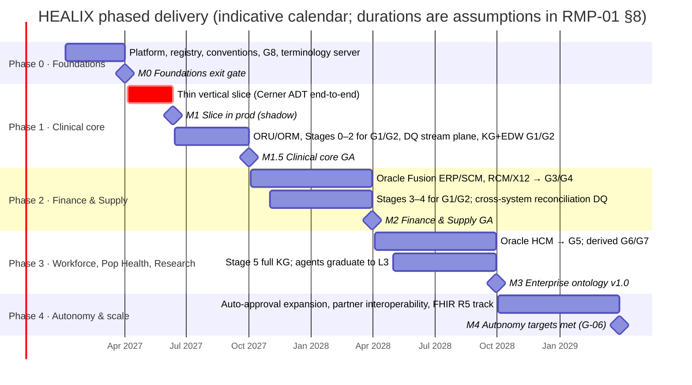

# Module 13 — Roadmap & Acceptance

This module turns the specification in modules 00–12 into a **deliverable programme**: the order in which capabilities
are built, the evidence required to call each one *done*, and the risks and open decisions that can change that order.
It owns no runtime component. Its artefacts are the phase plan, the acceptance test matrix, the go-live checklist and the
risk register, all of which `agent.orchestrator` and `agent.release_manager` read to decide what may be promoted to
`prod`.

## 1. Scope

| In scope | Out of scope |
|----------|--------------|
| Phased delivery plan (Phase 0–4) with entry/exit criteria, dependencies, team shape and duration assumptions | Detailed sprint plans, staffing names, vendor commercial terms |
| Acceptance criteria per module (02–12), traced to goals G-01..G-06 and NFRs ARC-NFR-001..007 | Unit-test specifications (owned by each module) |
| Test approach: conformance suites, golden datasets, synthetic FHIR bundles, SHACL/OWL checks, DQ backtests, agent evaluation suite, performance tests | Test-tool vendor selection |
| Go-live checklist and promotion gates | Operational runbooks (module 12) |
| Risk register, open questions and decisions needed, with proposed defaults | Enterprise risk management outside the HEALIX programme |

## 2. Documents in this module

| Doc id | File | Purpose |
|--------|------|---------|
| RMP-00 | `README.md` | Scope, delivery principles, phase overview |
| RMP-01 | [`01-phased-roadmap.md`](01-phased-roadmap.md) | Phases 0–4: scope by module, deliverables, entry/exit criteria, dependencies, team shape, durations, requirements `RMP-PHn-NNN` |
| RMP-02 | [`02-acceptance-criteria.md`](02-acceptance-criteria.md) | Acceptance per module tied to goals, test approach, go-live checklist, requirements `RMP-ACC-NNN` |
| RMP-03 | [`03-risks-and-open-questions.md`](03-risks-and-open-questions.md) | Risk register `RMP-RISK-NNN`, open questions, decisions needed, proposed defaults |

## 3. Delivery principles

1. **Thin vertical slice first.** The first production-shaped increment is **one Cerner ADT feed** (A01/A02/A03/A04/A08
   admit, transfer, discharge, register, update) carried end-to-end: MLLP → `hc.raw.cerner.adt.hl7v2.v1` →
   `hc.std.cerner.adt.v1` → `hc.canonical.party.patient.fhir.v1` + `hc.canonical.clinical.encounter.fhir.v1` →
   `hc.dq.*` → temporal knowledge graph (G1/G2 named graphs) → EDW (`edw_g1_party.dim_patient`,
   `edw_g2_clinical.fact_encounter`). Agents participate from day one but only at **L1/L2**:
   `agent.source_mapper` and `agent.vocabulary_curator` propose, `agent.evaluator` scores, humans approve. The slice
   exercises every layer and every cross-module contract in §6 of `01-architecture-overview.md` before any breadth is
   added, so integration risk is paid down early.
2. **Stages of the Ontology Pipeline are gates, not phases.** Stage 0 (metadata inventory) and Stage 1 (controlled
   vocabulary) must exist for a subject-area group before Stage 2 (taxonomy) is attempted for it; Stage 4 (ontology)
   axioms are promoted only from Stage 3 (thesaurus) relations that have been stable for one release cycle. The
   roadmap therefore advances groups G1–G9 through the stages in waves rather than attempting all stages for all
   groups at once.
3. **Breadth by subject-area group, depth by stage.** Each phase adds groups (G1/G2 → G3/G4 → G5–G7 → scale) and
   deepens the pipeline stages for groups already in scope.
4. **Dual projection from the start.** KG and EDW are populated from the same canonical topics from the first slice
   onward; nightly reconciliation (ADR-07) is a Phase 1 deliverable, not a hardening task.
5. **Autonomy is earned.** Agent autonomy levels rise only when the evaluation suite in `02-acceptance-criteria.md`
   demonstrates evaluator–human agreement and rollback rates within threshold for two consecutive release cycles.
6. **Compliance is in the slice.** PHI classification, topic ACLs, audit events and lineage (module 11) are acceptance
   criteria for the thin slice, so no later phase inherits an unclassified data flow.
7. **Executable specs gate promotion.** A module is promoted only when its machine-readable artefacts (topic catalog,
   DDL, SHACL, DQ rule packs, agent manifests) validate in CI; prose alone never satisfies an exit criterion.

## 4. Phase overview

| Phase | Name | Headline outcome | Groups | Ontology stages | Agent autonomy ceiling | Indicative duration |
|-------|------|------------------|--------|-----------------|------------------------|---------------------|
| 0 | Foundations | Platform, registries, conventions, G8 reference data, terminology server live in `dev`/`test` | G8, G9 (platform-generated) | Stage 0 (inventory) for Cerner | L1 | 13 weeks |
| 1 | Clinical core | Cerner ADT/ORU/ORM → G1/G2 canonical FHIR, DQ stream plane, KG + EDW for G1/G2 | G1, G2 | Stages 0–2 for G1/G2 | L2 | 26 weeks (thin slice at week 10) |
| 2 | Finance & Supply | Oracle Fusion ERP/SCM, RCM/X12 → G3/G4; cross-system reconciliation DQ | G3, G4 | Stages 3–4 for G1/G2; Stages 0–2 for G3/G4 | L2 (L3 for `agent.inventory`, `agent.dq_monitor`, `agent.kg_builder`) | 26 weeks |
| 3 | Workforce, Pop Health, Research | Oracle HCM → G5; derived G6/G7; Stage 5 full KG across groups | G5, G6, G7 | Stages 3–5 for G3/G4; Stage 5 across all groups | L3 for most agents | 26 weeks |
| 4 | Autonomy & scale | Auto-approval expansion, outbound interoperability to partners, FHIR R5 profile track | All | Continuous | L3/L4 per policy | 26 weeks, then steady state |

## 5. How goals map to phases

| Goal | Phase in which the first-release measure is met | Interim evidence |
|------|--------------------------------------------------|------------------|
| G-01 Enterprise ontology across G1–G9 | Phase 3 (M3) | Phase 1: G1/G2 Stage 2 taxonomy; Phase 2: G1/G2 OWL release, G3/G4 taxonomy |
| G-02 All events as FHIR R4 on Kafka | Phase 3 (M3), with partner outbound in Phase 4 | Phase 1: Cerner ADT/ORU/ORM; Phase 2: Fusion ERP/SCM, X12 |
| G-03 DQ at ingestion | Phase 2 (M2) for G1–G4; Phase 3 for all | Phase 1: DQ stream plane with ontology-derived rules for G1/G2 |
| G-04 EDW with grouped subject areas | Phase 3 (M3) | Phase 1: `edw_g1_*`, `edw_g2_*`; Phase 2: `edw_g3_*`, `edw_g4_*` |
| G-05 Bitemporal KG with provenance | Phase 1 (M1.5) for the G1/G2 graphs; holds thereafter | Thin slice demonstrates 100 % bitemporal assertions |
| G-06 Autonomy with gated approval | Phase 4 (M4) | Phase 2: ≥ 50 % auto-approval of low-risk changes; Phase 3: ≥ 65 % |

## 6. Interfaces with other modules

| This module consumes | From | This module produces | Consumed by |
|----------------------|------|----------------------|-------------|
| Goals, KPIs | VIS-00 | Phase gates and promotion decisions | `agent.orchestrator`, `agent.release_manager` (module 10) |
| NFRs, agent roster, group codes | ARC-01 | Acceptance thresholds per module | Every module's definition of done (CONVENTIONS §6) |
| Agent evaluation suite definition | module 10 | Autonomy graduation criteria | module 10 policy files |
| SLO tables | module 12 | Go-live checklist | module 12 release runbooks |
| PHI policy | module 11 | Risk register with owners | Programme steering committee |

## 7. Requirement ID scheme in this module

| Area | Pattern | Used in |
|------|---------|---------|
| Phase n requirements | `RMP-PH0-NNN` … `RMP-PH4-NNN` | RMP-01 |
| Acceptance requirements | `RMP-ACC-NNN` | RMP-02 |
| Risk entries and risk-management requirements | `RMP-RISK-NNN` | RMP-03 |

All requirements follow CONVENTIONS §2 (RFC 2119 keyword, priority P0/P1/P2, verification method).
