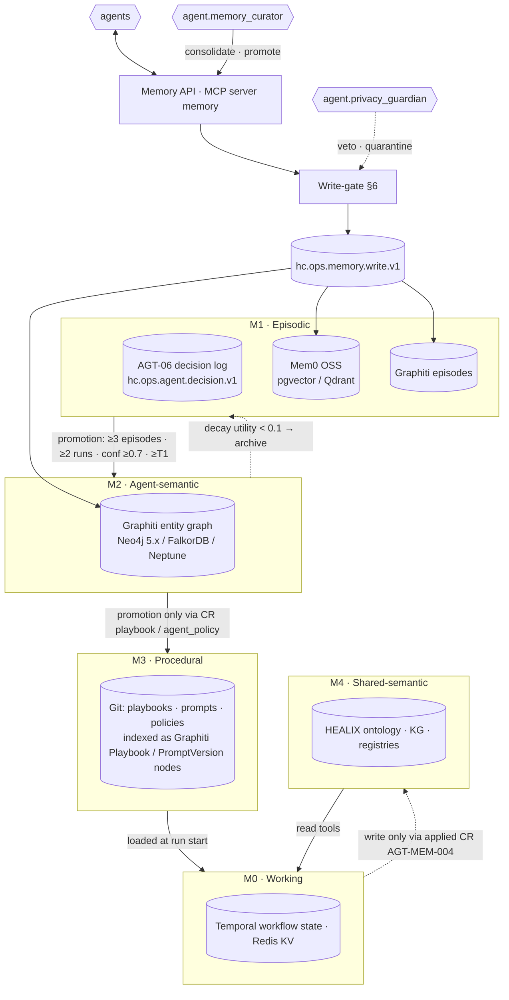
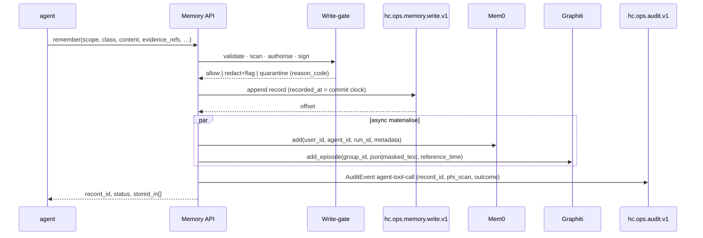

# Memory Architecture

This document specifies how HEALIX agents remember. It extends AGT-06 (working / episodic / semantic / procedural
tiers, the decision log on `hc.ops.agent.decision.v1`, AGT-MEM-001…013) with the stores named in ARC-01 §3
("Agent memory": **Mem0** for preferences and episodes, **Graphiti** for a bitemporal episodic/entity graph, the
HEALIX KG as shared semantic memory) under ADR-08. It defines the tier model M0–M4, scopes, the 14 memory record
classes, the Memory API, the single write-gate through which every long-term write passes, the read path with
memory-influence attribution, event sourcing and retention, and degraded operation. Graphiti internals are in
MEM-02; caches in MEM-03; how memory feeds healing and improvement in MEM-04/05; governance of learning in MEM-06.

**Hard rule (binding on every store in this document):**

> No tier of memory (M0–M4 as used by this module) and no cache tier (C0–C4) may hold content whose `hc-phi-class` is anything but `non-phi`/`internal` (steward preferences: `pii:workforce` with consent flag). This includes the C0 provider prompt cache: pseudonymised PHI is not permitted.

## 1. Design principles

| # | Principle | Consequence |
|---|-----------|-------------|
| 1 | **Memory is bitemporal** | Every record carries `valid_from/valid_to/recorded_at/superseded_at/change_kind` per TKG-01 §4/§9; as-of and as-known reads (TKG-01 §8) are first-class |
| 2 | **Memory is evidence, not instruction** | Recalled records enter the context as quoted, provenance-tagged *untrusted data*; they never become system instructions (AGT-SAFE prompt-injection posture) |
| 3 | **PHI never enters** | The hard rule above; enforced by the write-gate (§6), `agent.privacy_guardian` scans and PGV-012 |
| 4 | **Every write is provenance-bearing and event-sourced** | `prov_activity_iri` on every record; `hc.ops.memory.write.v1` appended before any store is touched; Mem0/Graphiti are derived state |
| 5 | **Learning must prove lift** | A scope that does not improve golden-set performance (memory-lift ablation, MEM-06 §8) is pruned, not kept "just in case" |
| 6 | **Vendor behind one API** | Agents call the MCP `memory` server only; Mem0, Graphiti, pgvector/Qdrant, Neo4j are swappable implementations |
| 7 | **Fail open to memoryless** | Memory outage degrades agents to AGT-06 behaviour with `memory_degraded=true`; it never blocks ingestion, DQ or healing |

## 2. Tier model

Relation to AGT-06: **M1** is the AGT-06 decision log *enriched* by Mem0 preferences and Graphiti episodes (the
decision log stays the system of record for consequential decisions, AGT-MEM-002); **M3** is the AGT-06 §1.4
playbook store (Git), indexed into Graphiti for retrieval; **M4** is AGT-06 §1.3 semantic memory, written only via
applied CRs (AGT-MEM-004). Nothing in this module adds a store that could drift from governed truth.

| Tier | Store | remember | recall | correct | forget | Latency target |
|------|-------|----------|--------|---------|--------|----------------|
| M0 | Temporal state / Redis KV | runtime | running agent | n/a (overwrite) | purge at run close (24 h max) | < 5 ms |
| M1 | decision log + Mem0 + Graphiti episodes | write-gate | Mem0 first, then episodes | `correct`/`retract` | tombstone | recall p95 < 150 ms |
| M2 | Graphiti entity graph | consolidation + write-gate | hybrid search (MEM-02 §7) | edge invalidation (`correction`/`new-version`) | tombstone | hybrid recall p95 < 400 ms |
| M3 | Git + object store (Graphiti index) | CR only | load at run start | new version via CR | retire via CR | < 50 ms |
| M4 | HEALIX triple store | applied CR only | read tools | CR | CR | per TKG-02 |
| — | write-gate (all tiers) | — | — | — | — | p95 ≤ 300 ms |

## 3. Scope model

Scope kinds: `global | env | tenant/facility | agent | group (G1–G9) | source | interface | steward (salted hash) |
run | purpose`. A record carries exactly one primary scope and MAY carry secondary scopes used as filters.

| Scope kind | Id pattern | Mem0 mapping | Graphiti `group_id` |
|------------|------------|--------------|---------------------|
| `global` | `global` | `metadata.scope = global` | `healix.<env>.global.all` |
| `env` | `dev|test|uat|prod` | from token | `healix.<env>.env.<env>` |
| `tenant/facility` | facility code (never name) | `metadata.scope = facility:<code>` | `healix.<env>.facility.<code>` |
| `agent` | `agent.<role>` | `agent_id` | `healix.<env>.agent.<role>` |
| `group` | `G1…G9` | `metadata.scope = group:<Gn>` | `healix.<env>.group.<Gn>` |
| `source` / `interface` | Source Registry id / interface id | `metadata.scope` | `healix.<env>.source.<id>` |
| `steward` | `steward:<hmac-sha256(salt_env, oidc_sub)>` | `user_id = steward:<hash>` | `healix.<env>.steward.<hash>` |
| `run` | `run_<ULID>` | `run_id` | not partitioned (episode attribute) |
| `purpose` | GOV-01 §4 purpose-of-use code | `metadata.purpose` | `healix.<env>.purpose.<code>` |

Rules: **no cross-env reads** (env is taken from the GOV-ACC-009 task token, never from the request); `prod`
memory reaches non-prod only as de-identified aggregates under AGT-MEM-013; multi-hospital estates partition
facility-scoped memory per facility so a Cerner multi-domain estate cannot leak one facility's operational
signatures into another's context; steward scopes use the environment salt so hashes are unlinkable across
environments (mirrors GOV-PHI-013). Mem0 `user_id` is `steward:<hash>` or `agent:<id>`; `agent_id`, `run_id` and
`metadata.scope` are mandatory on every Mem0 call.

## 4. Memory record classes

| Class | Tier | Default retention (§8) | Trust floor | Allowed writers | `untrusted_text` | Example (metadata only) | Promotable to |
|-------|------|------------------------|-------------|-----------------|------------------|-------------------------|---------------|
| `preference` | M1 (Mem0) | 365 d rolling | T1 | L2+ agents on steward feedback, HITL console | no | "steward:<hash> prefers SNOMED over local codes for G2 value sets" | — |
| `decision` | M1 | max(2,555 d, manifest) | T1 | runtime, cr-engine | no | CR id, disposition, rubric scores | semantic |
| `outcome` | M1 | max(2,555 d, manifest) | T1 | cr-engine, evaluator | no | "CR-… rolled back after dq_regression" | semantic |
| `observation` | M1 | 180 d | T0 | any agent | yes | "`$translate` miss rate 4.2× baseline on cs71" | hypothesis |
| `hypothesis` | M1 | 180 d | T0 | any agent, self_healer | yes | "LogMiner lag correlates with 02:00 Millennium batch" | semantic (after confirm) |
| `incident` | M1 | max(2,555 d, manifest) | T1 | self_healer, playbook engine | no | `INC-…`, fault class, severity, scope | semantic |
| `root_cause` | M1/M2 | max(2,555 d, manifest) | T2 | self_healer after verification, humans | yes (masked) | "archive-log gap on replica caused FLT-ING-007" | procedural (via CR) |
| `playbook_step` | M3 | indefinite (Git) | T2 | CR only | no | `PBK-ING-002` step 3 parameters | — |
| `evaluation_lesson` | M1 | max(2,555 d, manifest) | T1 | evaluator, improver (`reflect`) | yes (masked) | "rubric RUB-MAP-03 under-penalises unit drift" | semantic |
| `steward_feedback` | M1 (Mem0) | 365 d rolling | T3 | HITL console only | yes (masked) | rejection reason category + CR id | preference |
| `source_quirk` | M2 | 730 d | T1 | source_mapper, inventory, self_healer | no | "Interface X sends MSH-13 non-monotonic after engine restart" | procedural (via CR) |
| `mapping_rationale` | M2/M3 | indefinite (Git) | T2 | source_mapper, terminology_steward via CR | no | ConceptMap element IRI + reason code | — |
| `code_surge_signature` | M2 | 180 d | T0 | terminology_steward, self_healer | no | code system, hour-of-day histogram, count | source_quirk |
| `drift_signature` | M2 | 180 d | T0 | dq_monitor, self_healer | no | rule id, statistic deltas, window | source_quirk |

Records with `untrusted_text: true` are text reflections permitted *only* after PHI firewalling and GOV-LIN-015
masking; a structured-only absolute rule is **not** adopted, but unquoted injection of such text is forbidden (§7).

## 5. Mem0 layer

Mem0 OSS is self-hosted in-VPC (no SaaS). Vector store: pgvector (default) or Qdrant; embedding model per env via
`${MODEL_EMBED}`; LLM for extraction/update via `${MODEL_MEMORY_EXTRACT}` (Haiku-class) through the GOV-ACC-018
egress proxy under GOV-PHI-017 zero retention. **Graph memory is disabled** (`enable_graph: false`); Graphiti owns
all graph structure (MEM-02). Mem0 stores only classes `preference`, `decision`, `steward_feedback`; all classes
also become Graphiti episodes.

Custom prompts (normative text, versioned in Git as `prompts/memory/mem0_fact_extraction.vN.md` and
`mem0_update_memory.vN.md`):

> *fact extraction* — "Extract only operational preferences, decisions and feedback about HEALIX artefacts (change
> requests, rules, value sets, mappings, playbooks, agents, stewards by role). Output JSON facts with `class` ∈
> {preference, decision, steward_feedback}. NEVER output names, dates of birth, identifiers, addresses, clinical
> values, free text copied from messages or records, or anything that could identify a patient, employee or
> supplier. If the input contains such content, output `[]`. Do not infer facts about a different scope than the
> one given."

> *update memory* — "Merge only when `scope`, `env` and `class` are identical. Prefer the fact with the higher
> `trust_tier`; on equal tier prefer the newer `valid_from`. Never merge a steward scope with an agent scope. Emit
> `UPDATE` with `change_kind: correction` when the old fact was wrong, `new-version` when the world changed; emit
> `DELETE` only as a logical retraction."

Metadata filter contract: every Mem0 record carries `metadata{scope, env, class, trust_tier, phi_scan_version,
provenance{agent_id, run_id, prov_activity_iri}, record_id}`; recall filters on `env` and `scope` are injected
server-side and cannot be overridden by the caller. Dedupe runs per `(env, scope, class)` key only. `history()` is
exposed read-only as the Mem0 transaction-time audit and is reconciled nightly against `hc.ops.memory.write.v1`.

## 6. Write-gate (the only path)

```mermaid
flowchart LR
  S1[1 JSON-Schema<br/>memory-schema.yaml] --> S2[2 structural allowlist] --> S3[3 PHI scanner GOV-PHI-004<br/>+ LLM phi_scan judge] --> S4[4 k-anonymity n<11 suppress] --> S5[5 prompt_injection_scan<br/>untrusted_text quoting] --> S6[6 evidence-ref resolution ≥1] --> S7[7 scope / writer authz] --> S8[8 PROV-O activity + signature] --> S9[(9 write log)] --> S10[10 materialise Mem0 · Graphiti] --> S11[11 AuditEvent]
```

Stage 3 combines the deterministic scanner (18 HIPAA identifiers per GOV-01 §2 **plus** Cerner `MRN`, `FIN_NBR`,
`PERSON_ID`, `ENCNTR_ID` and Oracle Fusion `PERSON_NUMBER`, `PARTY_ID`, `ASSIGNMENT_ID` patterns; recall ≥ 0.98,
precision ≥ 0.90) with an LLM `phi_scan` judge (Haiku-class, in-VPC or via the GOV-ACC-018 proxy, GOV-PHI-017).
Either detector firing is a hit. Decision ∈ {`allow`, `redact+flag`, `quarantine`}: `redact+flag` is permitted only
for `untrusted_text` reflections where redaction leaves ≥ 1 evidence ref intact; any direct identifier hit is
`quarantine`.

| Reason code | Stage | Decision | Notes |
|-------------|-------|----------|-------|
| `PHI_DETECTED` | 3 | quarantine | PGV-012 trigger; Privacy Office alert; RT-11 |
| `NO_EVIDENCE` | 6 | reject | no resolvable `evidence_refs[]` |
| `SCOPE_DENIED` | 7 | reject | caller token scope ≠ record scope |
| `SIZE` | 1 | reject | text > 2,000 chars or json > 4 KiB |
| `INJECTION_SUSPECTED` | 5 | quarantine | `prompt_injection_scan` fail |
| `WRITER_NOT_AUTHORISED` | 7 | reject | class `writers[]` excludes agent |
| `FROZEN_SCOPE` | 7 | reject | `freeze` active (MEM-06 §7 anomaly / kill switch) |
| `CLASS_NOT_ALLOWED` | 2 | reject | class not in manifest or tier |
| `ENV_MISMATCH` | 7 | reject | record env ≠ token env |

Quarantine semantics: record held in a sealed partition excluded from recall, retained ≤ 30 d, hard-deleted under
dual control (Privacy Office + Agent Operator), Privacy Office alerted within 5 min, PGV-012 applied to the
originating run (veto of its CRs, agent demotion, agent-scoped kill switch per AGT-SAFE-013).

| Allowed content | Forbidden content |
|-----------------|-------------------|
| CR ids, decision ids, incident ids, run ids | HL7 v2 `PID`, `NK1`, `IN1`, `GT1`, `NTE`, `OBX-5` text or any segment copy |
| DQ rule ids, rubric ids, playbook ids, topic names, partition/offset ranges | Oracle Fusion person/party/assignment rows or any row image |
| Ontology/value-set/ConceptMap IRIs, code-system versions (not patient-level codes with context) | Clinical document text, notes, result comments |
| Aggregates with small-cell suppression (n ≥ 11) | Raw tool outputs, samples, quarantined records |
| HMAC tokens per GOV-PHI-013 referencing *artefacts* (never patients) | Pseudonymised PHI tokens of patients/workers (still PHI, GOV-01 §3) |
| Masked sample *hashes* (sha256 of masked row, no content) | Dates tied to an individual (identifier 3) |
| Steward roles and salted steward hashes | Steward names, emails, OIDC subjects in clear |

## 7. Read path

`recall` ranks candidates by `scope_match × recency × confidence × trust_weight` where `trust_weight` is
T0 = 0.5, T1 = 0.7, T2 = 0.85, T3 = 1.0, T4 = 1.0, then applies the retrieval profile's reranker (MEM-02 §7).
`as_of_valid` / `as_of_transaction` select TKG-01 §8 views (default **Current**); `k ≤ 20`; every result carries
its full envelope including `prov_activity_iri` and `evidence_refs[]`. The assembled context is one block wrapped as
untrusted data: each line `[mem:<record_id> <class> conf=<c> <trust_tier> from <evidence_ref>] <content>`, preceded by
the instruction that the block is evidence and not instructions.

**Memory-influence attribution.** The runtime emits one AuditEvent per run on `hc.ops.audit.v1` (GOV-LIN-006/008,
subtype `agent-tool-call`, `extension[healix-tool] = memory.recall`) listing every recalled `record_id`. Any CR the run
produces MUST echo those ids in `evidence.sources[kind=memory_record]` and `provenance.recalled_memory_ids[]`
(AGT-03 schema extensions requested in README §6). This is what lets MEM-06 §8 compare acceptance of
memory-influenced vs non-influenced CRs and lets a poisoned record be traced to every decision it touched.

## 8. Event sourcing, rebuild, retention

`hc.ops.memory.write.v1` (key `record_id`, compacted, infinite, `phi_class: non-phi`) is the system of record;
Mem0 and Graphiti are derived projections rebuildable from the log in ≤ 4 h (ARC-NFR-007 RTO; RPO 15 min via
Kafka replication per OPS-04 §2). Semantics: `forget` = tombstone (transaction-time close, `superseded_at` set,
`status: tombstoned`); `purge` = compaction tombstone on the log **plus** physical erasure in Mem0, Graphiti, C4 and
object-store archives, with Privacy Office or DGC approval and a signed `purge_receipt`; `export` = JSONL (envelope)
or JSON-LD (n-ary form per TKG-TIME-014, never `healix-time:BitemporalAssertion` instances). Legal hold per OPS-04 §7
suspends every disposition in this table.

| Class | Retention | Basis | Disposition |
|-------|-----------|-------|-------------|
| `decision`, `outcome`, `incident`, `root_cause`, `evaluation_lesson` | max(2,555 d, manifest `episodic_retention_days`) | AGT-MEM-007; OPS-04 §6 audit class | tombstone; log retained |
| `preference`, `steward_feedback` | 365 d rolling; `pii:workforce` with consent flag; in-region for EU/UK stewards (GOV-PHI-020) | consent / GDPR storage limitation | purge-on-request ≤ 24 h |
| `observation`, `hypothesis`, `drift_signature`, `code_surge_signature` | 180 d, then archive if utility < 0.1 | operational | archive JSON-LD to object store |
| `source_quirk` | 730 d | reproducing legacy behaviour across Fusion quarterly cycles | archive |
| `playbook_step`, `mapping_rationale` | indefinite (Git, ARC-NFR-006) | reproducibility | retire via CR |
| M0 working | 24 h max (run close) | AGT-MEM-001 | purge |
| Graphiti hot window | 400 d, then object-store archive (JSON-LD), still rebuildable | query performance | archive |
| Quarantine partition | ≤ 30 d | §6 | hard delete, dual control |

Manifest minimum for `episodic_retention_days` is 30 d; orchestrator, evaluator and privacy_guardian are fixed at
2,555 d. A class never retains *less* than its row above because a manifest asks for less.

## 9. Isolation and environments

Each of `dev`, `test`, `uat`, `prod` runs its own Mem0, Graphiti, Redis and write-log topic; tokens bind env.
DR: all memory stores meet RPO 15 min / RTO 4 h (OPS-04 §2, ARC-NFR-007) via write-log replication plus daily
store snapshots; rebuild from the log is the universal recovery path (mirrors OPS-04 §4.3). Promotion of procedural
memory to `prod` happens only through the Git path (CR `playbook`/`agent_policy`, signed tag); no store-to-store copy
between environments is permitted (AGT-MEM-013).

## 10. Degraded operation and fail-open contracts

| Mode | Detection SLO | Behaviour | Provenance / signal |
|------|---------------|-----------|---------------------|
| Mem0 unavailable | ≤ 60 s (`memory.health`) | agents run memoryless (AGT-06 precedents only); writes buffered on write log | `memory_degraded=true` in CR provenance; `healix.memory.degraded{tier=M1}` |
| Graphiti unavailable | ≤ 60 s | healing continues from Git playbooks only (MEM-04 §1); `playbook_match` returns Git index results | `memory_degraded=true`; FLT-PLAT-003 |
| Write log (Kafka) degraded | ≤ 30 s | API accepts writes into a local durable buffer ≥ 24 h, replays in order; no materialisation until appended | `write_buffered=true` on response |
| Redis (C1/C2/C4) unavailable | ≤ 50 ms per call | cache bypass (MEM-03 §8); recall served from stores | `cache_bypass` counter |
| Write-gate scanner unavailable | immediate | **writes refused** (fail closed for writes), reads continue | reason `SCANNER_UNAVAILABLE` (mapped to `PHI_DETECTED` class of alert) |
| Kill switch (module-14 scope) | ≤ 30 s | memory writes, consolidation stop; reads continue | MEM-06 §9 hierarchy |

Reads fail open; writes fail closed only where PHI safety would otherwise be unverifiable.

## 11. Observability

Metrics (`healix.memory.*`, labels `env`, `tier`, `class`, `agent_id`): `writes_total{result}`, `write_gate_latency`,
`recall_latency`, `scanner_hits{detector}`, `quarantine_total`, `records_active`, `stale_ratio` (records past
retention not yet disposed), `influence_rate` (runs with ≥ 1 recall / runs), `rebuild_duration`, `degraded{tier}`.
SLOs: write availability 99.9 %; recall p95 ≤ 200 ms (API, excluding Graphiti graph-heavy profiles bounded in
MEM-02 §7); write-gate p95 ≤ 300 ms. Dashboards: panels added to the Agent Operator and Privacy & Security Officer
dashboards of OPS-03 §5; alerts `MemoryWriteGateDown`, `MemoryQuarantineNonZero` (SEV2), `MemoryRebuildOverdue`.

## 12. Requirements

### 12.1 Tiers, scope, API (MEM-ARCH-001…014)

> **MEM-ARCH-001** (P0, test) — Every memory write MUST carry `valid_from`, `recorded_at` (server commit clock), `prov_activity_iri`, `scope`, `trust_tier` and `change_kind` from the TKG-01 §4 SKOS scheme; the write-gate MUST reject records lacking any of them.

> **MEM-ARCH-002** (P0, test) — All writes to M1–M3 MUST pass through the write-gate of §6; no component MAY hold write credentials to Mem0, Graphiti or the write log other than the Memory API.

> **MEM-ARCH-003** (P0, test) — Every record MUST carry ≥ 1 `evidence_refs[]` entry that resolves (CR, incident, run, artefact IRI, rule id or topic) at write time; unresolved refs MUST yield `NO_EVIDENCE`.

> **MEM-ARCH-004** (P0, test) — `recall` MUST reject or silently scope out any request whose scope env differs from the token env; a cross-env read attempt MUST produce an AuditEvent with `outcome=4`.

> **MEM-ARCH-005** (P0, test) — The runtime MUST emit exactly one AuditEvent per run on `hc.ops.audit.v1` listing every recalled `record_id` (GOV-LIN-006/008).

> **MEM-ARCH-006** (P0, test) — A CR produced by a run that recalled memory MUST echo the recalled ids in `evidence.sources[kind=memory_record]` and `provenance.recalled_memory_ids[]`; cr-engine MUST reject a CR whose echoed ids differ from the run's recall AuditEvent.

> **MEM-ARCH-007** (P0, test) — The Memory API MUST append the record to `hc.ops.memory.write.v1` and receive the broker acknowledgement before materialising into Mem0 or Graphiti.

> **MEM-ARCH-008** (P1, test) — `rebuild` from the write log MUST reproduce Mem0 and Graphiti with record counts ±0 and identical `record_id` sets within 4 h for a one-year production-sized log.

> **MEM-ARCH-009** (P0, test) — Content of records with `untrusted_text: true` MUST never be injected into a prompt outside the quoted untrusted block of §7; the context assembler MUST fail the run rather than emit it unquoted.

> **MEM-ARCH-010** (P1, test) — Retention jobs MUST honour the per-class table of §8 and each agent's `episodic_retention_days`, taking the longer; legal holds MUST suspend disposition.

> **MEM-ARCH-011** (P0, test) — M4 MUST be written only via applied CRs or `kg_builder.load_batch` (AGT-MEM-004); the `memory` server MUST expose no operation that writes to the ontology registry, terminology service or HEALIX KG.

> **MEM-ARCH-012** (P1, test) — Latency targets of §2 (M0 < 5 ms, M1 recall p95 < 150 ms, M2 hybrid recall p95 < 400 ms, M3 < 50 ms, write-gate p95 ≤ 300 ms) MUST be met on the `uat` load profile.

> **MEM-ARCH-013** (P0, test) — `remember` MUST accept `trust_tier` T0–T2 only; T2 and T3 MUST be reached only through `confirm` by `agent.evaluator` or a human principal, and T4 MUST be unreachable through the API.

> **MEM-ARCH-014** (P1, test) — `correct` with `change_kind: correction` MUST leave the superseded record's valid time untouched and set `superseded_at`; `retract` MUST set `superseded_at`/`expired_at` and `change_kind: retraction` and MUST never physically delete (TKG-01 §6).

### 12.2 Mem0 layer (MEM-ARCH-015…024)

> **MEM-ARCH-015** (P0, test) — Mem0 graph memory MUST be disabled in every environment; a configuration with `enable_graph: true` MUST fail deployment.

> **MEM-ARCH-016** (P0, inspection) — Mem0 MUST run self-hosted in-VPC with pgvector or Qdrant; no Mem0 SaaS endpoint or external vector store MAY be configured.

> **MEM-ARCH-017** (P0, test) — The custom fact-extraction and update-memory prompts of §5 MUST be in effect; a conformance suite of 200 inputs containing identifiers, clinical text and cross-scope facts MUST yield zero extracted facts and zero merges.

> **MEM-ARCH-018** (P1, test) — Mem0 dedupe MUST never merge records across different `(env, scope, class)` keys, including steward and agent scopes with identical content.

> **MEM-ARCH-019** (P1, test) — Every Mem0 record MUST carry the metadata keys of §5; server-side `env` and `scope` filters MUST be applied on every search and MUST not be overridable by the caller.

> **MEM-ARCH-020** (P1, test) — Mem0 `history()` MUST be exposed read-only as transaction-time audit and MUST reconcile nightly with `hc.ops.memory.write.v1` with zero unexplained differences.

> **MEM-ARCH-021** (P1, test) — Only classes `preference`, `decision` and `steward_feedback` MAY be materialised into Mem0; other classes MUST be Graphiti-only.

> **MEM-ARCH-022** (P2, test) — The embedding model MUST be pinned per environment (`${MODEL_EMBED}`); a model change MUST trigger a full re-embed from the write log and a C4 purge before the new index serves recall.

> **MEM-ARCH-023** (P1, test) — Steward scopes MUST use `hmac-sha256(salt_env, oidc_sub)`; no record MAY contain a steward's name, email or OIDC subject in clear, and hashes MUST differ across environments.

> **MEM-ARCH-024** (P1, test) — Mem0-backed recall for `steward_preferences` MUST meet p95 < 150 ms at k = 5 under the `uat` load profile.

### 12.3 PHI firewall, write-gate, event sourcing, degraded operation (MEM-ARCH-025…040)

> **MEM-ARCH-025** (P0, test) — In the module-15 red-team run, 0 of 10,000 honeytoken probes (synthetic MRNs, FINs, names, DOBs, Fusion person numbers embedded in otherwise valid writes) MUST be stored in any tier or cache.

> **MEM-ARCH-026** (P0, test) — The write-gate scanner MUST detect the 18 GOV-01 §2 identifier classes plus Cerner `MRN`/`FIN_NBR`/`PERSON_ID`/`ENCNTR_ID` and Fusion `PERSON_NUMBER`/`PARTY_ID`/`ASSIGNMENT_ID` patterns with recall ≥ 0.98 and precision ≥ 0.90 (GOV-PHI-004), and MUST run the LLM `phi_scan` judge on every text field.

> **MEM-ARCH-027** (P0, test) — Quarantined records MUST be excluded from recall and hard-deleted within 30 d under dual control (Privacy Office + Agent Operator), with a `purge_receipt` and AuditEvent.

> **MEM-ARCH-028** (P0, test) — Aggregates in any record MUST be suppressed when the underlying cell count is < 11; the gate MUST reject or redact violating content.

> **MEM-ARCH-029** (P0, test) — Every rejection MUST carry one reason code from §6 and MUST produce an AuditEvent on `hc.ops.audit.v1`; `PHI_DETECTED` and `INJECTION_SUSPECTED` MUST additionally alert the Privacy Office within 5 min.

> **MEM-ARCH-030** (P0, inspection) — Embedding, fact extraction and `phi_scan` inference MUST run in-VPC or through the GOV-ACC-018 egress proxy under GOV-PHI-017 zero-retention terms; no memory content MAY reach a provider without the proxy's DLP pass.

> **MEM-ARCH-031** (P0, test) — The forbidden-content list of §6 (HL7 segment copies, Fusion row images, document text, raw tool outputs, pseudonymised patient/worker tokens) MUST be rejected by the structural allowlist before scanning.

> **MEM-ARCH-032** (P0, test) — A confirmed PHI finding in any tier MUST trigger PGV-012 (veto of the originating run's CRs, agent demotion, agent-scoped kill switch) and a module-11 reportable incident (AGT-05 RT-11).

> **MEM-ARCH-033** (P1, test) — When Kafka is unavailable the Memory API MUST buffer accepted writes durably for ≥ 24 h and replay them in order without materialising first.

> **MEM-ARCH-034** (P0, test) — When Mem0 or Graphiti is unavailable, agents MUST continue memoryless and every CR produced MUST carry `provenance.memory_degraded = true`; detection MUST occur within 60 s.

> **MEM-ARCH-035** (P1, test) — With Graphiti unavailable, `search_playbooks` MUST return results from the Git procedural index so healing continues (MEM-04); shadow and autonomous playbook execution MUST not depend on Graphiti availability.

> **MEM-ARCH-036** (P1, test) — A steward purge request MUST remove all `preference` and `steward_feedback` records for that steward hash from every tier, cache and archive within 24 h and return a `purge_receipt` (GOV-PHI-020).

> **MEM-ARCH-037** (P1, test) — `purge` MUST write a compaction tombstone to the write log and physically erase from Mem0, Graphiti, C4 and object-store archives; it MUST require Privacy Office or DGC approval recorded in the AuditEvent.

> **MEM-ARCH-038** (P1, test) — Within 7 d of a PHI scanner release (`scanner_version` change) all M1–M3 tiers and archives MUST be re-scanned and findings quarantined; the re-scan MUST be recorded as a `decision`-class record with counts.

> **MEM-ARCH-039** (P1, test) — All memory stores MUST meet RPO ≤ 15 min and RTO ≤ 4 h in the OPS-04 §9 DR test, demonstrated by rebuild from the write log.

> **MEM-ARCH-040** (P1, test) — The `healix.memory.*` metrics and SLOs of §11 MUST be exported and registered with module 12 (OPS-03), and `MemoryQuarantineNonZero` MUST page at SEV2.

## 13. Traceability

| MEM-ARCH | Depends on / realises |
|----------|----------------------|
| 001, 014 | TKG-01 §4, §6, §9 (C1–C6); CONVENTIONS §4 |
| 002, 007, 008, 033, 039 | ARC-NFR-007; OPS-04 §2, §4.3, §9; STR-02 (`hc.ops.memory.write.v1` request) |
| 003, 006 | AGT-03 CR schema (`evidence.sources`, `provenance`); GOV-LIN-006/008 |
| 004, 019, 023 | GOV-ACC-009; GOV-PHI-013; AGT-MEM-013 |
| 005, 029, 032 | GOV-03 §5 AuditEvent; AGT-05 PGV-012, RT-11, AGT-SAFE-004/012/013/014 |
| 009 | AGT-03 `evidence.sources[].untrusted_text`; AGT-05 prompt-injection controls |
| 010, 036, 037 | AGT-MEM-007; OPS-04 §6/§7; GOV-PHI-020; GOV-LIN-010 |
| 011 | AGT-MEM-004; GOV-ACC-011 |
| 013 | MEM-06 §2 trust tiers |
| 015–018, 020–022, 024 | ARC-01 §3 "Agent memory"; ADR-08 |
| 025, 026, 028, 030, 031 | GOV-PHI-004/011/012/017; GOV-ACC-018; GOV-01 §2/§3; AGT-MEM-003/005/006 |
| 027, 038 | GOV-PHI-021; AGT-MEM-011 |
| 034, 035 | ADR-09; MEM-04 §1; AGT-MEM-008 |
| 040 | OPS-03 §3/§5 |
