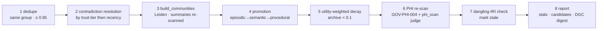

# Graphiti Temporal Memory

This document specifies the **M1 episodic / M2 agent-semantic** layer of module 14: a Graphiti (Zep) temporal knowledge
graph that remembers *what the agent layer observed, decided and learned* about sources, mappings, DQ rules, incidents
and playbooks, with bitemporal edges aligned to TKG-01. It is the memory *of the agents*, not a second clinical graph.
Memory tiers, scope model, record classes, the write-gate and the Memory API are defined in MEM-01 and contract A of the
module README (MEM-00 §5.1); this document defines only what is Graphiti-specific and cites the rest by id.

**Hard rule:** No tier of memory (M0–M4 as used by this module) and no cache tier (C0–C4) may hold content whose
`hc-phi-class` is anything but `non-phi`/`internal` (steward preferences: `pii:workforce` with consent flag). This
includes the C0 provider prompt cache: pseudonymised PHI is not permitted.

## 1. Why Graphiti

| Option | What it gives | Why rejected / accepted |
|---|---|---|
| Mem0 alone (vector-only, M1) | Fast preference and episode recall by similarity | Accepted *for* preferences/decisions, but it cannot answer "which playbook resolved MSH-13 gaps on the Cloverleaf-fronted ADT feed *as we knew it in March*"; no edge validity, no graph traversal, no community summaries |
| Write agent memory into the HEALIX KG (M4) | One graph, one time model | **Rejected**: PHI blast radius (agent reflections next to `phi:direct` named graphs), governance coupling (every lesson would need an ontology CR, AGT-MEM-004), store contention at 10 B triples (TKG-02 §1) |
| Custom bitemporal store on PostgreSQL | Full control | Rejected: re-implements episode ingestion, entity resolution, edge invalidation and hybrid search that Graphiti ships; no ecosystem |
| **Graphiti on Neo4j 5.x** | Episodes → LLM-extracted entities/edges with `valid_at/invalid_at/created_at/expired_at`, hybrid search (BM25 + vector + BFS), communities, custom Pydantic entity types, `group_id` partitioning | **Accepted**: bitemporal edges map 1:1 onto TKG-01 §4; custom types let us *forbid* Patient/Person; `group_id` gives env × scope isolation; it stays a derived, rebuildable store behind the Memory API (MEM-ARCH-007/008) |

Graphiti's role is therefore **episodic + entity memory of the agent layer** (M1 episodes, M2 entity graph, index of M3
procedural artefacts). Everything the organisation *knows about healthcare data* stays in M4 (ontology/KG); Graphiti holds
only metadata, identifiers, IRIs, decisions, outcomes and masked reflections (MEM-01 §6 allowed/forbidden table).

## 2. Deployment

| Concern | Default | Notes |
|---|---|---|
| Backend | Neo4j 5.x Enterprise, causal cluster, one database per environment | FalkorDB or Amazon Neptune swappable behind the Graphiti driver abstraction; conformance = fixtures in §5/§7, not brand |
| Extraction LLM | `${MODEL_MEMORY_EXTRACT}` (Haiku-class) | All calls through the GOV-ACC-018 egress proxy under GOV-PHI-017 zero-retention terms; proxy DLP blocks `phi:direct` patterns as second line behind the write-gate |
| Embedder / reranker | `${MODEL_EMBED}` per env (MEM-01 §5); cross-encoder reranker in-VPC | Embeddings are derived state; rebuilt from the write log on model change |
| Partitioning | `group_id = healix.<env>.<scope-kind>.<scope-id>` (MEM-01 §3) | No query spans environments; multi-facility estates get `facility` scope groups |
| Episode types | `text` (masked reflections), `json` (structured events), `message` (steward ↔ agent review threads, masked) | JSON preferred for every machine event; text permitted only with `untrusted_text: true` |
| Ingestion | Asynchronous from `hc.ops.memory.write.v1`; `remember` returns before extraction completes; episode visible in recall ≤ 60 s p95 | Backlog ≥ 10 min ⇒ `health` reports `graphiti: degraded` (MEM-01 §10) |
| Cost envelope | ≤ 2 % of the platform's daily agent token budget (sum of manifest `daily_token_cap`) | Exceeding ⇒ extraction paused for low-value classes (observation, hypothesis) first |
| Sizing (year 1) | ≤ 50 M nodes / 500 M edges hot; 400-day hot window then JSON-LD archive | ≈ 2,000 agent runs/day × ~15 episodes × ~8 edges |

## 3. Entity model

Entity types are Graphiti custom Pydantic models registered per environment; the registry is `memory-schema.yaml`
`graphiti.entity_types[]` (MEM-A1). Any change is a `policy`-class CR (GOV-00 §2.2) owned by the Privacy Office and DGC.


Relations between these types are the edge types of §4.

**Attribute rules.** Every type carries only identifiers, versions, IRIs, codes, enumerations and aggregates. `Steward`
holds a salted HMAC of the workforce identity (GOV-PHI-013 token rules) plus a role — never a name, e-mail or employee
number (`pii:workforce` consent flag per MEM-01 §8). `Facility` is a code from the Source Registry, never an address.
`RootCause`, `Hypothesis`, `Lesson` `summary_masked` fields are produced from GOV-LIN-015 masked transcripts and are
always `untrusted_text: true`.

**Forbidden types** (extraction rejects, write-gate counts `CLASS_NOT_ALLOWED`): `Patient`, `Person`, `Encounter`,
`Claim`, `Worker` (as an individual), `Practitioner` (as an individual), `Location` (as an address), `Document`.
**Forbidden attributes on any type**: free-text names, dates of birth, MRN/FIN/PERSON_ID, Fusion PERSON_NUMBER/PARTY_ID,
addresses, phone/e-mail, account/claim numbers, segment text from PID/NK1/IN1/NTE/OBX-5, raw tool outputs. Entities the
LLM extracts that match no registered type are **dropped and counted** (`healix.memory.graphiti.unknown_entity_total`),
never auto-created; a sustained rate > 5 % of extractions opens a `FLT-PLAT-007`-class memory anomaly incident (MEM-04).

## 4. Edge model

| Edge | Domain → Range | Fact template | Validity semantics |
|---|---|---|---|
| `EXHIBITED_SYMPTOM` | Incident → Symptom | "{incident} exhibited {signal} {comparator} {value}" | valid while symptom observed |
| `CAUSED_BY` | Incident → RootCause | "{incident} was caused by {category}" | corrected if post-mortem changes cause |
| `RESOLVED_BY` | Incident → Playbook | "{incident} resolved by {playbook}@{version}" | set on `resolved`; expired on `rolled_back` |
| `APPLIED_ACTION` | PlaybookRun → Action | "{run} applied {action} (ladder {L}, class {c})" | instant |
| `PRODUCED_OUTCOME` | Action → Outcome | "{action} produced {status}" | instant |
| `PREFERS` / `REJECTED` / `APPROVED` | Steward → MappingRule \| DQThreshold \| ValueSet \| ChangeRequest | "steward {hash} {verb} {artefact}" | valid until steward changes mind (`new-version`) |
| `DRIFTED_TO` | SchemaVersion \| DQThreshold → SchemaVersion \| DQThreshold | "{a} drifted to {b} observed at {t}" | valid from observation |
| `SUGGESTED_MAPPING` | Agent → MappingRule | "{agent} suggested {rule} with evaluator {score}" | expired when rule superseded |
| `THRESHOLD_SET` | DQRule → DQThreshold | "{rule} threshold set to {v}" | closed by next threshold (`new-version`) |
| `SUPERSEDES` | any → same type | "{new} supersedes {old} ({change_kind})" | instant; mirrors `healix-time:supersededBy` |
| `DERIVED_FROM` | Playbook \| PromptVersion \| Lesson → Incident \| Lesson \| EvaluationRun | recursion lineage (MEM-06 §5) | permanent |
| `CONFIRMED_BY` / `CONTRADICTED_BY` | Lesson \| Hypothesis → EvaluationRun \| Steward \| Outcome | trust evidence | permanent |
| `LEARNED_FROM` | Lesson → Incident \| PlaybookRun \| ChangeRequest | "{lesson} learned from {source}" | permanent |
| `APPLIES_TO` | Playbook \| DQRule \| MappingRule → Interface \| Topic \| DataElement \| SourceSystem | scope binding | valid while artefact version active |
| `EVALUATED_BY` | ChangeRequest \| PromptVersion → EvaluationRun | "{cr} scored {score} on {rubric}" | instant |
| `PROMOTED_FROM` | Lesson (semantic) → Lesson (episodic) \| Playbook → Lesson | consolidation lineage (§8) | permanent |
| `DEPENDS_ON` | Topic \| Connector \| Interface → SchemaVersion \| CodeSystem \| Connector | dependency for blast-radius reasoning | valid while declared |
| `OWNED_BY` | DataElement \| DQRule \| ValueSet → Steward (role) \| SubjectAreaGroup | stewardship | valid while assigned |
| `OBSERVED_ON` | Symptom \| Hypothesis → Interface \| Topic \| Environment \| Facility | where it happened | instant |

**Required facts on every edge** (`memory-schema.yaml graphiti.edge_types[].required_facts`): `confidence` (0–1),
`evidence_refs[]` (≥ 1, kinds `cr_id|incident_id|run_id|artefact_iri|rule_id|topic`), `trust_tier` (T0–T4, MEM-06 §2),
plus the four timestamps and `change_kind` of §5. Edges whose range is a forbidden type are rejected with the episode.

## 5. Bitemporal alignment (normative)

Graphiti natively stamps every edge with `valid_at`, `invalid_at`, `created_at`, `expired_at`. The Memory API **owns**
the mapping to TKG-01; Graphiti's own LLM-based invalidation heuristics are inputs, never the authority on `change_kind`.

| Graphiti field | TKG-01 term | Contract clause | Rule |
|---|---|---|---|
| `valid_at` | `healix-time:validFrom` | C1 | Inclusive; from the episode's `reference_time` or an explicit temporal statement; `xsd:dateTime` UTC |
| `invalid_at` | `healix-time:validTo` | C2 | **Exclusive**, null = open |
| `created_at` | `healix-time:recordedAt` | C3 | Set by the **Memory API commit clock** at write-log append, not by the ingestion worker's wall clock |
| `expired_at` | `healix-time:supersededAt` | C4 | **Exclusive**, null = current; set by `graph.invalidate_edge`, `correct`, `retract` |
| edge attr `change_kind` | `healix-time:changeKind` | C6 | SKOS values `new`, `new-version`, `correction`, `retraction`, `merge`, `unmerge` — set by Memory API only |
| edge attr `prov_activity_iri` | `prov:wasGeneratedBy` | C5 | PROV-O activity minted by the write-gate (MEM-01 §6 step 8) |
| edge attr `valid_time_precision` | `healix-time:validTimePrecision` | — | `instant|day|month|year|approximate`; `approximate` for LLM-inferred `valid_at` |
| edge attr `source_tz` | `healix-time:sourceTimeZone` | C12 | Always `UTC` for agent events; source zone kept when the fact is about a source clock (ING-016) |

Mapping of Graphiti behaviours to `change_kind`: Graphiti's automatic edge invalidation on a contradicting episode ⇒
`correction` (valid time untouched, `expired_at` set, `SUPERSEDES` edge from new to old); an explicit temporal statement
("threshold raised to 0.97 from 2026-11-01") ⇒ `new-version` (`invalid_at` of old = `valid_at` of new, `expired_at`
set); `retract` ⇒ `retraction` (`expired_at` set, `valid_at/invalid_at` preserved, **never a delete**, TKG-01 §6.3);
entity dedupe that merges two nodes ⇒ `merge` edge events, never rewriting edge endpoints (TKG-01 §6.4). Intervals are
half-open UTC. Memory records are **not** `healix-time:BitemporalAssertion` instances (they live outside the KG); they
export in the n-ary form of TKG-TIME-014 so module 11 audit tooling reads them identically.

```mermaid
stateDiagram-v2
  [*] --> Current: add_episode (created_at = commit clock, change_kind = new)
  Current --> Superseded_NewVersion: explicit temporal statement (invalid_at = new valid_at; expired_at set)
  Current --> Superseded_Correction: contradicting episode / correct (valid time kept; expired_at set)
  Current --> Retracted: retract (expired_at set; valid time kept; never deleted)
  Current --> Merged: entity dedupe (merge edge; endpoints unchanged)
  Superseded_NewVersion --> [*]
  Superseded_Correction --> [*]
  Retracted --> [*]
  Merged --> [*]
```



**Skew guard** (analogue of TKG-TIME-012): an episode whose `reference_time` is missing, more than 24 h ahead of the
Memory API clock, or earlier than the earliest retained write-log offset is rejected with reason `TEMPORAL_SKEW` and
counted; it is never silently clamped. Agent-event episodes use the event's `hc-event-time` as `reference_time`.

## 6. Ingestion

Every agent event becomes one JSON episode; reflections become masked text episodes. Episode design per source:

| Event | Episode `source` | `reference_time` | Entities created / edges asserted |
|---|---|---|---|
| CR state transition (AGT-03) | `json` from `hc.ops.agent.changerequest.v1` | transition time | ChangeRequest, Agent, target artefact (MappingRule/DQRule/ValueSet…); `SUGGESTED_MAPPING`, `APPROVED`/`REJECTED` (steward hash), `EVALUATED_BY` |
| Evaluation (AGT-05 rubric run) | `json` from `hc.ops.agent.evaluation.v1` | eval time | EvaluationRun, Rubric; `EVALUATED_BY`, `CONFIRMED_BY`/`CONTRADICTED_BY` on prior Lesson |
| Incident transition (MEM-04 §6) | `json` from `hc.ops.healing.incident.event.v1` | transition time | Incident, Symptom, Signal, Interface/Topic; `EXHIBITED_SYMPTOM`, `OBSERVED_ON`, later `CAUSED_BY`, `RESOLVED_BY` |
| Playbook run / action | `json` from `hc.ops.healing.playbookrun.event.v1` | step time | PlaybookRun, Action, Outcome; `APPLIED_ACTION`, `PRODUCED_OUTCOME` incl. blast-radius budget result |
| Steward decision (HITL console) | `message` (masked, `untrusted_text`) | decision time | Steward (hash+role); `PREFERS`/`REJECTED`/`APPROVED`, `THRESHOLD_SET` |
| Canary verdict (MEM-05) | `json` from `hc.ops.improvement.canary.event.v1` | verdict time | PromptVersion/PolicyVersion, EvaluationRun; `SUPERSEDES`, `DERIVED_FROM` (compiled_from lessons) |
| Terminology release (IOP-04) | `json` from TS release event | release time | CodeSystem/ValueSet versions; `DRIFTED_TO`, `DEPENDS_ON` refresh |
| Policy/prompt release | `json` from `hc.ops.agent.policy.v1` | release time | PromptVersion, PolicyVersion, Playbook@version; `SUPERSEDES`, `APPLIES_TO` |
| Reflexion lesson (`reflect`) | `text` masked per GOV-LIN-015, `untrusted_text: true` | run end | Lesson (T1), Hypothesis; `LEARNED_FROM` |

```mermaid
sequenceDiagram
  participant A as agent (hexagon)
  participant M as Memory API
  participant W as write-gate
  participant K as hc.ops.memory.write.v1
  participant G as Graphiti worker
  participant N as Neo4j
  A->>M: remember(scope, class, json|text, entities[], relations[], evidence_refs[])
  M->>W: validate · PHI scan · k-anon · injection scan · evidence resolve · authz
  W-->>M: allow | redact+flag | quarantine
  M->>K: append record (recorded_at = commit clock)
  M-->>A: record_id, accepted
  K->>G: consume
  G->>G: resolve entities IRI/id-first; LLM extract only unresolved (via proxy)
  G->>N: add_episode(group_id, reference_time) · edges with 4 timestamps + change_kind
  G->>M: AuditEvent hc.ops.audit.v1 (GOV-LIN-006/008)
```

**Entity resolution is identifier-first.** When an episode carries `entities[]{type,id}` (CR ids, rule ids, HEALIX
IRIs, topic names, playbook ids) the worker binds to existing nodes by exact id before any embedding similarity; LLM
extraction runs only for residual mentions in masked text, and its output is filtered through §3. Graphiti's name-based
dedupe is **disabled across `group_id`s** (MEM-ARCH-018) and runs with a 0.95 similarity floor within a group.

**Linking to HEALIX without PHI.** Graphiti nodes for DataElement, CodeSystem, ValueSet, MappingRule and SubjectAreaGroup
store the **ontology/registry IRI** (`https://ontology.healix.example.org/...`, `<base>scheme/...`) as `registry_iri`;
they never store instance IRIs (`<base>id/<entity>/<source>/<natural-id>`), which denote patients, workers or claims.
A nightly link check resolves every `registry_iri` against the Ontology Registry and Source Registry; unresolvable IRIs
mark the node `stale: true` (recall down-weights ×0.5, consolidation reviews for retraction) and are reported.

## 7. Retrieval

Agents call `recall` with a **retrieval profile**; the Memory API translates it into a Graphiti search recipe. Agents
never query Neo4j directly (`graph-query` MCP server is the HEALIX KG, not memory).

| Profile | Agents | Graphiti recipe | Reranker | Center-node strategy | top_k | Token budget |
|---|---|---|---|---|---|---|
| `mapping_context` | source_mapper, terminology_steward | `EDGE_HYBRID_SEARCH_NODE_DISTANCE` + `NODE_HYBRID_SEARCH_RRF` | node_distance | Interface or CodeSystem of the target element | 20 | ≤ 2,000 |
| `dq_tuning` | dq_author, dq_monitor | `EDGE_HYBRID_SEARCH_RRF` filtered to DQRule/DQThreshold/Steward edges | rrf | — | 15 | ≤ 1,500 |
| `incident_triage` | self_healer | `EDGE_HYBRID_SEARCH_CROSS_ENCODER` over Incident/Symptom/RootCause edges | cross_encoder | Interface or Topic emitting the signal | 10 | ≤ 1,500 |
| `evaluation_memory` | evaluator | `EDGE_HYBRID_SEARCH_EPISODE_MENTIONS` (recency-weighted) | episode_mentions | target ChangeRequest | 10 | ≤ 1,200 |
| `steward_preferences` | L2 agents | Mem0 first (MEM-01 §5); Graphiti `PREFERS/REJECTED/APPROVED` edges as fallback | mmr | Steward (role) | 5 | ≤ 500 |
| `improvement_evidence` | improver | `COMMUNITY_HYBRID_SEARCH_RRF` summaries + `CONTRADICTED_BY` edges | rrf | Agent under optimisation | 8 | ≤ 1,500 |
| `playbook_match` | self_healer | `search_playbooks`: Symptom → `RESOLVED_BY` → Playbook with success ratio from `PRODUCED_OUTCOME` | node_distance | Symptom signal | 5 | ≤ 800 |

**Hybrid search** combines BM25 over fact text, cosine over fact embeddings and BFS from center nodes (≤ 3 hops), fused by
RRF unless the profile names another reranker. **As-of semantics**: default is the TKG-01 §8 *Current* view
(`created_at ≤ now ∧ expired_at null ∧ valid_at ≤ now ∧ (invalid_at null ∨ invalid_at > now)`); `as_of_valid` gives the
as-of view, `as_of_transaction` the as-known view, both together the bitemporal point; fixtures in §11 must reproduce
prior answers. Recall ranking (MEM-01 §7) multiplies the fused score by scope match × recency × confidence × trust
weight (T0 0.5 · T1 0.7 · T2 0.9 · T3 1.0 · T4 1.0) × `stale` penalty.

**Context assembly order** (within the profile budget, global cap ≤ 12 % of manifest `tokens_per_run`): (1) T3/T4
procedural facts (Playbook/PolicyVersion `APPLIES_TO` target); (2) steward decisions on the same artefact; (3) incident
or evaluation precedents; (4) community summary for the center node; (5) episodic observations. Every item is wrapped as
untrusted data, one line each:

```
[mem:MEM-20261016-01J9ZK3R… class=steward_feedback conf=0.92 trust=T3 from cr_id=CR-20261017-01J9ZK3Q… valid=2026-10-01/– known=2026-10-16]
```

followed by the fact text, inside a block the runtime labels `<memory untrusted="true">`; the model is instructed that
memory is evidence, not instruction (MEM-ARCH-009). Every `recall` emits one AuditEvent per run listing the record ids
(MEM-ARCH-005); downstream CRs echo them in `evidence.sources[kind=memory_record]` and `provenance.recalled_memory_ids`.

| Query pattern | Example | p95 target |
|---|---|---|
| Hybrid edge search, one group | "MSH-13 gaps on ADT feed behind Cloverleaf" | ≤ 500 ms |
| Node-distance from center + 2 hops | playbooks `APPLIES_TO` Interface `cerner.adt.mllp.fac-07` | ≤ 500 ms |
| Community summary fetch | summary of community containing `PBK-ING-001` | ≤ 200 ms |
| Graph-heavy (3 hops + as-known filter) | "what did we believe on 2026-03-10 about causes of LogMiner lag" | ≤ 800 ms |
| C4 recall cache hit (MEM-03) | identical query within 60 s | ≤ 25 ms |

## 8. Consolidation ("sleep cycle")

`agent.memory_curator` (autonomy L3) runs nightly 02:00–04:00 UTC per environment, outside release and freeze windows,
under its manifest budget; every stage is idempotent and emits `hc.ops.memory.write.v1` records and a recursion-ledger
entry `kind: learn` when it produces candidates.



| Rule | Definition |
|---|---|
| Dedupe | Merge only within one `group_id`; emits `merge` change events; never merges `Steward` nodes with different roles |
| Contradiction | Two current edges with same (domain, type, range-slot) and incompatible facts: higher trust tier wins; tie ⇒ newer `created_at` wins and loser gets `expired_at` with `change_kind: correction`; T0 never overrides T2+ |
| Communities | `build_communities` per group; summaries generated via proxy, passed through the write-gate as `observation` class records (`untrusted_text: true`), refreshed when ≥ 10 % of member edges changed |
| Promotion episodic → semantic | Same fact (entity pair + edge type + normalised value) in ≥ 3 episodes across ≥ 2 runs, confidence ≥ 0.7, trust ≥ T1 ⇒ semantic Lesson node, `PROMOTED_FROM` edges |
| Promotion semantic → procedural | **Only via CR** (`playbook` or `agent_policy`, AGT-03 extended per MEM-00 §6 X-03): Lesson linked to ≥ 3 resolved incidents **or** ≥ 5 CRs with evaluator ≥ 0.85, trust ≥ T2; curator calls `promote(to_tier: procedural)` which files the CR; the Lesson is `DERIVED_FROM`-linked to the resulting artefact |
| Decay | `utility = recalls × outcome_correlation × 2^(−age_days/half_life)`; half-life 90 d episodic, 365 d semantic; `utility < 0.1` ⇒ archive to JSON-LD in object store; archival is a storage move, not a belief change, so edges keep `expired_at` null and `change_kind` unchanged and are excluded from hot search via `archived: true` |
| Caps | ≤ 5 `playbook` and ≤ 10 `agent_policy` candidate CRs per day per environment (MEM-06 §5); excess candidates queue with their evidence |
| Protected | Curator never edits `limits`/`guards`, rubrics, golden sets or manifests (MEM-06 §4 fixed-point list); it may prune, never promote without CR |

## 9. Memory metrics

`healix.memory.graphiti.*`: `nodes{group,type}`, `edges{group,type,status}`, `growth_rate_7d`, `episodes_ingested_total`,
`ingest_lag_s` (p95 ≤ 60 s), `unknown_entity_total`, `forbidden_type_rejections_total` (target 0 post-adversarial-suite),
`contradiction_rate_weekly` (< 2 %), `recall_precision_at_10` (≥ 0.6 on monthly steward spot-check of 200 results,
MEM-GOV-011), `memory_lift` (≥ +0.03 nightly ablation, MEM-06 §8), `extraction_tokens_total` (≤ 2 % envelope),
`stale_iri_ratio` (< 1 %), `consolidation_duration_s` (≤ 7,200), `archive_bytes`. Dashboards register in OPS-03 §5 via
request X-06.

## 10. Operations

Backup and PITR follow OPS-04 (RPO ≤ 15 min, RTO ≤ 4 h): Neo4j online backups every 15 min plus the write log as the
authoritative replay source; `rebuild(scope, from_offset)` reconstructs any group from `hc.ops.memory.write.v1` in ≤ 4 h
with node/edge counts matching ±0 (MEM-ARCH-008). Export is JSON-LD per group with the §5 time mapping and n-ary
provenance (TKG-TIME-014); `as_known_at` export supports legal hold snapshots (OPS-04 §7). `purge` erases nodes, edges,
embeddings, community summaries and archives for the listed record ids under Privacy Office/DGC approval and writes a
purge receipt. Graphiti unavailable ⇒ `health` sets `graphiti: down`; agents run on Mem0 + Git only, CRs carry
`provenance.memory_degraded: true`, self-healing continues from Git playbooks (MEM-01 §10, MEM-HEAL-014).

## 11. Requirements

### 11.1 Graph model and bitemporal alignment (MEM-GRA-001…018)

> **MEM-GRA-001** (P1, inspection) — Graphiti MUST be deployed as a derived store behind the Memory API with one Neo4j 5.x database per environment; FalkorDB or Neptune MAY replace it only if the fixtures of MEM-GRA-002, 009 and 012 pass unchanged.

> **MEM-GRA-002** (P0, test) — Every edge MUST carry `valid_at`, `invalid_at`, `created_at`, `expired_at` mapped per §5 and a `change_kind` from the TKG-01 §4 SKOS scheme; an edge missing any of them MUST be rejected at ingestion.

> **MEM-GRA-003** (P1, test) — `created_at` MUST equal the Memory API commit clock recorded in `hc.ops.memory.write.v1`, never the ingestion worker clock; drift > 1 s between the two MUST be alerted.

> **MEM-GRA-004** (P1, test) — Every node and edge MUST belong to exactly one `group_id` of the form `healix.<env>.<scope-kind>.<scope-id>`; dedupe and search MUST never cross `group_id`s of different environments.

> **MEM-GRA-005** (P0, test) — Episodes that would create entities of a forbidden type or populate a forbidden attribute (§3) MUST be rejected with reason `CLASS_NOT_ALLOWED` and counted; the adversarial episode suite (module 15) MUST yield 0 forbidden nodes.

> **MEM-GRA-006** (P1, test) — Entities extracted by the LLM that match no registered custom type MUST be dropped and counted, never auto-created; a rate > 5 % over 1 h MUST open a memory-anomaly incident.

> **MEM-GRA-007** (P0, test) — All extraction, embedding, reranking and community-summary LLM calls MUST egress through the GOV-ACC-018 proxy under GOV-PHI-017 zero-retention terms, and every text episode MUST be masked per GOV-LIN-015 before leaving the Memory API.

> **MEM-GRA-008** (P1, test) — `change_kind` MUST be set by the Memory API from the operation (`correct`, `retract`, explicit temporal statement, dedupe merge); Graphiti's heuristic invalidation MUST map to `correction` and MUST NOT alter `valid_at`/`invalid_at` of the superseded edge.

> **MEM-GRA-009** (P1, test) — `retract` and `graph.invalidate_edge` MUST set `expired_at` and preserve `valid_at`/`invalid_at`; no operation other than `purge` MAY physically delete a node, edge or episode.

> **MEM-GRA-010** (P1, test) — Episodes whose `reference_time` is missing, > 24 h ahead of the Memory API clock or earlier than the retained write-log window MUST be rejected with `TEMPORAL_SKEW` and never clamped.

> **MEM-GRA-011** (P1, inspection) — Every edge type MUST be declared in `memory-schema.yaml graphiti.edge_types[]` with domain, range, fact template and required facts `confidence`, `evidence_refs[]`, `trust_tier`; a schema change MUST be a `policy`-class CR.

> **MEM-GRA-012** (P1, test) — Bitemporal fixtures MUST show that `as_of_valid`, `as_of_transaction` and their combination reproduce the answers recall returned at those points after later corrections, new versions and retractions.

> **MEM-GRA-013** (P1, test) — Entity resolution MUST bind by exact identifier or IRI before any similarity method; within-group similarity dedupe MUST use a floor ≥ 0.95 and MUST emit `merge` change events rather than rewriting edge endpoints.

> **MEM-GRA-014** (P0, test) — Graphiti nodes MUST reference HEALIX ontology and registry IRIs only (`<base>scheme/…`, `<base>…/<Class|property>`, registry element IRIs) and MUST never store instance IRIs of the form `<base>id/<entity>/<source>/<natural-id>`.

> **MEM-GRA-015** (P1, test) — A nightly link check MUST resolve every `registry_iri`; unresolvable nodes MUST be marked `stale: true`, down-weighted in recall and listed in the consolidation report.

> **MEM-GRA-016** (P1, inspection) — `Steward` nodes MUST hold only a salted HMAC (GOV-PHI-013) and a role; `Facility` nodes MUST hold only a Source Registry code.

> **MEM-GRA-017** (P1, test) — Ingestion MUST be asynchronous from `hc.ops.memory.write.v1`; an episode MUST be recallable ≤ 60 s p95 after append, and a backlog ≥ 10 min MUST set `graphiti: degraded` in `health`.

> **MEM-GRA-018** (P2, analysis) — Extraction cost MUST stay ≤ 2 % of the platform daily agent token budget; on breach the worker MUST pause extraction for `observation` and `hypothesis` classes first and report.

### 11.2 Retrieval (MEM-GRA-019…030)

> **MEM-GRA-019** (P0, test) — `recall` MUST apply environment and scope filters before ranking; a request naming a `group_id` of another environment MUST be rejected with `ENV_MISMATCH` (MEM-ARCH-004).

> **MEM-GRA-020** (P1, test) — Each retrieval profile in §7 MUST be declared in `memory-schema.yaml retrieval_profiles[]` with recipe, reranker, center-node strategy, `top_k` and token budget; agents MUST select profiles by name and MUST NOT pass raw Cypher.

> **MEM-GRA-021** (P0, test) — Every recalled item MUST be rendered inside the untrusted memory block with the provenance header of §7 (record id, class, confidence, trust tier, evidence ref, valid and known intervals); fuzzing MUST show no path by which memory text reaches the model unwrapped.

> **MEM-GRA-022** (P1, test) — Default recall MUST use the TKG-01 §8 Current view; `as_of_valid` and `as_of_transaction` MUST be honoured when supplied.

> **MEM-GRA-023** (P1, test) — Hybrid search p95 MUST be ≤ 500 ms and graph-heavy (3-hop, as-known) queries ≤ 800 ms at year-1 sizing (§2) with 50 concurrent recalls.

> **MEM-GRA-024** (P1, test) — Assembled memory context MUST not exceed the profile budget and MUST not exceed 12 % of the calling agent's manifest `tokens_per_run`; overflow MUST truncate lowest-ranked items, never the provenance headers.

> **MEM-GRA-025** (P1, test) — Ranking MUST multiply the fused search score by scope match, recency, confidence and the trust weights of §7, and MUST apply the ×0.5 `stale` penalty.

> **MEM-GRA-026** (P1, test) — `search_playbooks` MUST rank Playbooks by success ratio derived from `RESOLVED_BY` and `PRODUCED_OUTCOME` edges in the Current view and MUST exclude `retired` playbook versions.

> **MEM-GRA-027** (P1, test) — Context assembly MUST follow the §7 order (procedural → steward decisions → precedents → community summary → observations).

> **MEM-GRA-028** (P1, test) — Every `recall` MUST produce one AuditEvent on `hc.ops.audit.v1` listing recalled record ids (MEM-ARCH-005, GOV-LIN-006/008), and C4 cache hits MUST still be audited.

> **MEM-GRA-029** (P2, test) — The `steward_preferences` profile MUST query Mem0 first and fall back to Graphiti preference edges only when Mem0 returns fewer than `top_k` results or is degraded.

> **MEM-GRA-030** (P2, test) — Community summaries returned by `improvement_evidence` MUST themselves be write-gate records (`observation`, `untrusted_text: true`) and MUST carry the member edge count and freshness timestamp.

### 11.3 Consolidation (MEM-GRA-031…040)

> **MEM-GRA-031** (P0, test) — Nightly consolidation MUST complete all eight §8 stages within 2 h per environment; a run exceeding 2 h or skipping a stage MUST be reported and MUST NOT leave partially merged state (each stage idempotent and resumable).

> **MEM-GRA-032** (P1, test) — Dedupe MUST operate within a single `group_id`, MUST never merge `Steward` nodes of different roles, and MUST emit `merge` change events.

> **MEM-GRA-033** (P0, test) — Promotion to procedural memory MUST occur only by filing a `playbook` or `agent_policy` CR through `cr-engine`; no code path MAY write to Git, prompts, policies or playbooks directly from consolidation.

> **MEM-GRA-034** (P1, test) — Contradiction resolution MUST prefer the higher trust tier, then the newer `created_at`; a T0 edge MUST never expire a T2 or higher edge.

> **MEM-GRA-035** (P1, test) — Episodic → semantic promotion MUST require the same fact in ≥ 3 episodes across ≥ 2 runs with confidence ≥ 0.7 and trust ≥ T1, and MUST link the semantic node to its sources with `PROMOTED_FROM`.

> **MEM-GRA-036** (P1, test) — Consolidation MUST file no more than 5 `playbook` and 10 `agent_policy` candidate CRs per day per environment; excess candidates MUST queue with evidence intact.

> **MEM-GRA-037** (P1, test) — Utility decay MUST use `recalls × outcome_correlation × 2^(−age/half_life)` with half-lives 90 d (episodic) and 365 d (semantic); items < 0.1 MUST be archived to JSON-LD with bitemporal fields intact and MUST remain rebuildable.

> **MEM-GRA-038** (P1, analysis) — Decay half-lives, promotion thresholds and per-day caps MUST be reviewed quarterly by the DGC against memory-lift and acceptance data (MEM-06 §12) and changed only via `policy`-class CR.

> **MEM-GRA-039** (P1, test) — The PHI re-scan stage MUST re-run the current GOV-PHI-004 scanner and `phi_scan` judge over every node, edge fact, episode and community summary; any hit MUST quarantine the record, alert the Privacy Office and trigger PGV-012.

> **MEM-GRA-040** (P2, inspection) — The consolidation report MUST include counts deduped, invalidated, promoted, archived, communities rebuilt, stale IRIs and candidate CRs, and MUST be published as a decision-log record and included in the monthly DGC report.

## 12. Traceability

| MEM-GRA | Depends on / realises |
|---|---|
| 002, 003, 008, 009, 012, 022 | TKG-01 §4 vocabulary, §6 change semantics, §8 views, §9 C1–C6/C12; TKG-TIME-014 |
| 010 | TKG-TIME-012 analogue |
| 004, 019 | MEM-ARCH-004, AGT-MEM-013 |
| 005, 007, 014, 016, 039 | GOV-PHI-004/012/013/017, GOV-ACC-018, GOV-LIN-015, PGV-012, AGT-SAFE-004, MEM-ARCH-025/030 |
| 021, 024, 027, 028 | MEM-ARCH-005/009, GOV-LIN-006/008, GOV-03 §5, AGT-MEM-008 |
| 033, 036, 038 | AGT-03 CR schema (+ X-03), AGT-MEM-009, MEM-GOV-001/002/004, MEM-06 §4–§5 |
| 017, 031, 037 | MEM-ARCH-007/008, OPS-04 §2/§6, ARC-NFR-007 |
| 026 | MEM-04 §8–§9 playbook lifecycle and recursive learning |
