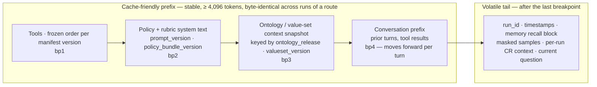
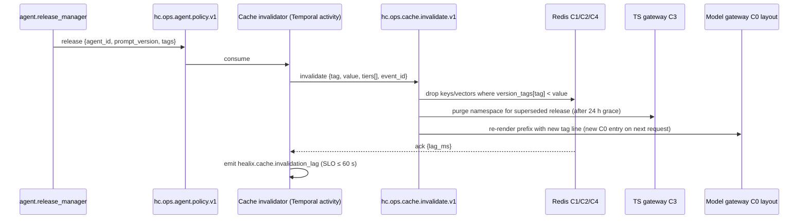

# Caching Strategy

This document specifies the five cache tiers named in ARC-01 §3 ("Caching": provider prompt caching for stable policy
prompts and ontology context; semantic response cache with Redis vector + exact-match tiers for terminology lookups,
mapping suggestions and evaluator rubrics; HTTP/materialised caches for FHIR TS `$expand`/`$translate`). Caches are
**correctness-neutral accelerators and shock absorbers**: they lower token cost and latency, absorb bursts (a Cerner
`CODE_VALUE` surge, a Fusion quarterly update, a terminology release), and keep the pipeline moving when the
Terminology Service is briefly unavailable. A cache is **never a learning store**: nothing is promoted from a cache
into memory tiers M1–M4 (MEM-01 §2), nothing in a cache is evidence for a change request, and every entry can be
dropped at any instant without changing any decision. Memory records and their governance are in MEM-01/MEM-02; the
`cache-policy.yaml` artefact (MEM-A2) is the machine-readable form of this document.

**Hard rule (binding on every tier in this document):**

> No tier of memory (M0–M4 as used by this module) and no cache tier (C0–C4) may hold content whose `hc-phi-class` is anything but `non-phi`/`internal` (steward preferences: `pii:workforce` with consent flag). This includes the C0 provider prompt cache: pseudonymised PHI is not permitted.

## 1. Goals and numbers

| # | Goal | Target (first release) | Measured by |
|---|------|------------------------|-------------|
| 1 | Input-token cost reduction for `agent.source_mapper`, `agent.terminology_steward` and `agent.evaluator` routes | ≥ 40 % versus uncached baseline, per month | `fact_cache_stats` (§9), `usage.cache_read_input_tokens` |
| 2 | C0 cache-read ratio (`cache_read_input_tokens / (input_tokens + cache_creation_input_tokens + cache_read_input_tokens)`) | ≥ 70 % on orchestrator/evaluator routes; ≥ 85 % on mapping/classification loops; alert when < 50 % for 1 h | model-gateway counters per route |
| 3 | Lookup latency | C1 p95 < 5 ms; C2 p95 < 25 ms (embedding reuse, no re-embedding on hit); C3 p95 ≤ 5 ms (IOP-04 §8 cache budget); C4 p95 < 5 ms | Redis client histograms |
| 4 | Stale-hit rate (entry served after its version tag was superseded) | < 0.5 % of hits per tier | invalidation lag × shadow recompute |
| 5 | Correctness neutrality | shadow-recompute divergence ≤ 2 % (§7) | 1 % sampled recompute |
| 6 | Availability contract | Redis outage ⇒ bypass within 50 ms; pipeline latency ARC-NFR-001 unaffected | chaos test (§8) |
| 7 | Invalidation propagation | release event → all tiers ≤ 60 s | `hc.ops.cache.invalidate.v1` lag |

Caches are **model-scoped, environment-scoped and tenant-scoped** by construction (§6, §8); a hit is never shared
across `dev`/`test`/`uat`/`prod` or across facilities in a multi-hospital estate.

## 2. Tier table C0–C4

| Tier | What is cached | Key composition | TTL | Invalidation events | PHI rule | Failure mode | Owner |
|---|---|---|---|---|---|---|---|
| **C0** provider prompt cache | Stable prompt prefix: frozen tool list, policy + rubric system text, ontology / value-set context snapshot, conversation prefix (§3). Marked with `cache_control: {type: ephemeral}`; ≤ 4 breakpoints per request; **model-scoped** (a model switch is a full miss) | provider-side exact byte prefix up to each breakpoint; implicit `model_id` | 5 min default (refreshed on every read); 1 h for low-frequency routes (`ttl: "1h"`); 1-h entries MUST precede 5-m entries | `hc.ops.agent.policy.v1` (prompt/policy/tool-manifest release), ontology release, model change, thinking/effort change | `none` — nothing after bp3 may carry PHI; no pseudonymised PHI (GOV-PHI-013 tokens are *not* a licence) | provider miss ⇒ full-price input, no functional change | Agent Platform |
| **C1** exact-match | Deterministic tool/LLM results: `$validate-code`, `$lookup`, incident-fingerprint → diagnosis, playbook-runner read-only probes, schema-registry lookups | `sha256(env\|tenant\|model_id\|prompt_version\|tool_manifest_hash\|normalised_input)` + `version_tags{}` (§6) | per namespace: 10 min–24 h; negative results 10 min (IOP-04 §8) | tag fan-out on `hc.ops.cache.invalidate.v1`; namespace purge | `none`; `policy_check` refuses `put` when `phi_class ≠ none` | Redis unavailable ⇒ bypass ≤ 50 ms | Agent Platform / SRE |
| **C2** semantic | Near-duplicate LLM outputs where the task is paraphrase-tolerant: terminology lookup explanations, mapping suggestions, classification, evaluator rubric *explanations* (§4) | C1 key for exact pass; then `embedding(normalised_input)` in a Redis vector index per namespace, cosine ≥ task threshold, filtered by `version_tags{}` | 1–24 h per namespace; `stale_while_revalidate` ≤ 60 s | same as C1 plus `rule_pack_version`, `conceptmap_version`, `ontology_release` | `none`; free-text labels and anything `phi_access ≠ none` ineligible | bypass ≤ 50 ms | Agent Platform |
| **C3** materialised FHIR TS | `$expand` pages, `$translate` results, `$validate-code` results, `$lookup` results, `$closure` tables for the pinned TS release (IOP-TS-014) | `(operation, system, code, version, target, release_id)` keyed by ValueSet / CodeSystem / ConceptMap **version IRI** and `expansion.identifier` | until next release (IOP-04 §8); hard max 30 d; stale-serve ≤ 24 h during TS outage (§5) | TS release event (`hc.canonical.reference.<resource>.fhir.v1`, `valueset_version`, `conceptmap_version`) | `none` (terminology is G8 reference data, `hc-phi-class` ≤ `internal`) | TS down ⇒ serve `stale=true` ≤ 24 h, then miss | Terminology Stewardship / Agent Platform |
| **C4** recall-result | Memory API `recall` results for identical `(scopes, query, retrieval_profile, as_of_valid, as_of_transaction, filters, top_k)` within one run burst | `sha256(env\|agent_id\|scope_set\|retrieval_profile\|as_of\|normalised_query\|filters)` | 60 s fixed | any accepted `remember`/`correct`/`retract`/`forget` on an overlapping scope; `scanner_version` | `none` (memory records are already non-PHI by MEM-ARCH-002) | bypass ⇒ live recall | Agent Platform |

C1/C2/C4 share one Redis Cluster per environment with separate keyspaces (`rc.*`, `sc.*`, `mc.*`); C3 uses the
HEALIX TS gateway cache described in IOP-04 §8 (in-process LRU + shared Redis-compatible tier, `ts.*` keyspace).
`provider_prompt_layout`, `tiers[]` and `namespaces[]` in `cache-policy.yaml` hold the per-namespace values.

## 3. C0 prompt layout

Provider caching is a **prefix match** over the rendered request in the order `tools → system → messages`; any byte
change at position *N* invalidates every breakpoint at or after *N*. The minimum cacheable prefix is model-dependent
(512–4,096 tokens across the models configurable per environment in ARC-01 §3); below the minimum a marked prefix
silently fails to cache. **Policy: every stable prefix MUST be ≥ 4,096 tokens** so it caches on any configured model
without per-model tuning. Writes cost ≈ 1.25× input price (5-min TTL) or ≈ 2× (1-h TTL); reads cost ≈ 0.1× (lower on
the newest models). A read refreshes the entry's timer at no extra cost, measured start-to-start.

Rules for the layout:

1. **bp1 tools.** Tool definitions are serialised from the agent manifest in a frozen, name-sorted order; the hash of
   that serialisation is `tool_manifest_hash`. Adding, removing or reordering a tool is a release (`hc.ops.agent.policy.v1`), not a runtime choice. Per-request `tool_choice` changes do not break the tools+system cache.
2. **bp2 policy/rubric text.** The system prompt holds only versioned text (`PromptVersion`, `PolicyVersion`,
   `RUB-*`). No date, run id, steward name, environment banner or "mode" string. Operator instructions that must change
   mid-conversation are appended as a mid-conversation `{"role": "system", ...}` message in `messages[]` (supported
   models only; falls back to a user-turn text block), never by editing the top-level `system`.
3. **bp3 ontology/value-set snapshot.** The context block is rendered from the Ontology Registry and TS by release id;
   its first line is the release tag so that an ontology release deterministically starts a new entry.
4. **bp4 conversation prefix.** Explicit marker on the last block of the most recently appended turn (or top-level
   automatic caching where available). In long tool loops the marker MUST stay within 20 positions of the previous
   turn's cached block; place an intermediate breakpoint every ≈ 15 positions (consecutive `tool_use` / `tool_result`
   runs collapse to one position).
5. **Volatile tail.** Memory recall (`assembled_context` from MEM-01 §7, already wrapped as untrusted), masked sample
   hashes, run ids and timestamps go after the last breakpoint. Memory text above a breakpoint is a lint failure (§3.2).
6. **Pinned thinking/effort per route.** Thinking configuration and `output_config.effort` are part of the rendered
   prompt; they are fixed in the manifest route and never varied per request.

### 3.1 TTL selection by start-to-start gap

| Start-to-start gap between requests sharing the prefix | TTL | Example route |
|---|---|---|
| < 5 min | 5-min default; traffic keeps it warm | mapper/classification loops, DQ monitor bursts, evaluator during CR queues |
| 5–60 min | `ttl: "1h"` **or** 5-min TTL plus a `max_tokens: 0` keep-alive (non-streaming, no structured output) shortly before expiry — cheaper on models with very low read prices | orchestrator planning routes, self-healer diagnosis prompts |
| > 1 h | scheduled pre-warm (`max_tokens: 0`) at the start of a known window (nightly consolidation 02:00, BICC extract window, release gate) or accept the cold miss | memory_curator, improver compile runs, release_manager |

`cache-policy.yaml provider_prompt_layout.ttl_by_gap` holds this table; `keepalive: none|max_tokens_0` is chosen per
namespace. 1-h markers MUST appear before any 5-m marker in the same request.

### 3.2 Silent-invalidator CI lint (fails the build)

| Lint rule | What it catches | Fix |
|---|---|---|
| `no-timestamp-in-prefix` | dates, clocks, `now()` in `tools`/`system`/bp3 | move after last breakpoint |
| `sorted-json` | unsorted or non-deterministic JSON serialisation anywhere before bp4 | canonical JSON (sorted keys, fixed separators) |
| `frozen-toolset` | tool set or order differs from manifest hash; conditional tools | release via `hc.ops.agent.policy.v1` |
| `pinned-model` | model id or `fallback_ref` switch mid-route without new namespace | model change = `model_id` tag bump, all C0 entries miss |
| `pinned-thinking-effort` | thinking type / effort changed between requests of the same route | pin in manifest |
| `memory-after-breakpoint` | memory recall text, masked samples or `untrusted_text` above the last breakpoint | move to volatile tail |
| `no-run-ids-in-prefix` | `run_id`, `cr_id`, `incident_id`, trace ids in prefix | volatile tail |
| `operator-instruction-channel` | top-level `system` edited mid-conversation | mid-conversation `system` message |
| `min-prefix-4096` | stable prefix below 4,096 tokens (measured with the token-count endpoint for every configured model) | pad with rubric/context or merge routes |
| `breakpoint-budget` | > 4 breakpoints; 5-m marker before 1-h marker | reorder/merge |
| `lookback-20` | a single turn can append > 20 positions without an intermediate marker | intermediate breakpoint |

Verification is by `usage.cache_read_input_tokens` on golden runs (MEM-CACHE-010/013). In `test` the provider
cache-diagnostics beta is enabled on every request so the first divergent segment (model, tools, system, messages) is
named server-side; payload diffing of adjacent requests (markers stripped) is the fallback in other environments.

## 4. Semantic cache (C2) rules

C2 is consulted only after a C1 miss and only for tasks on the eligibility list. A semantic hit is a *candidate*; the
namespace's `verify_on_hit` decides whether it may be served.

| Task | Eligible | Similarity threshold | Verify on hit | Extra condition |
|---|---|---|---|---|
| Terminology lookup explanation (`$lookup` enrichment text, designation choice) | ✔ | 0.92 | `terminology-service.$validate-code` on the cached code against the pinned release | result tagged with `valueset_version`/`conceptmap_version` |
| Mapping suggestion (local code → enterprise code, HL7 v2 field → FHIR element) | ✔ | 0.95 | mandatory re-validate via `terminology-service.$translate`/`$validate-code`; FHIR path check via `fhir-validator` | cached **only** when the originating CR's evaluator score ≥ the auto-approve threshold (AGT-05 §6); never cached from rejected or vetoed CRs |
| Evaluator rubric **explanations** | ✔ | 0.95 | rubric id + `prompt_version` equality | **verdicts and scores are never cached** — every CR is scored live |
| Classification (DQ dimension, subject-area group, element category, PHI-class *suggestion* for review) | ✔ | 0.93 | label ∈ closed enum of the current `rule_pack_version`/ontology release | PHI-class suggestion is advisory; `agent.privacy_guardian` decision itself is bypass-listed (§7) |
| Self-healing diagnosis | C1 only | — | — | keyed by incident fingerprint `(fault_class, interface, symptom_hash, playbook_version)`; semantic matching of incidents belongs in Graphiti (MEM-02 §7 `incident_triage`), not in a cache |
| Anything with `phi_access ≠ none` on the tool binding (AGT-01) | ✘ | — | — | inputs could carry PHI into the key or embedding |
| Free-text label / description classification (Cerner `CODE_VALUE.DESCRIPTION`, Fusion `FND_LOOKUP_VALUES.MEANING`, document titles) | ✘ | — | — | injection surface (AGT-05 RT-01); cached text would replay an injected instruction |
| Privacy-guardian decisions, evaluator verdicts, `policy`-class content | ✘ | — | — | §7 bypass list |

**Key recipe (C1 and C2 exact pass):**
`sha256(env | tenant | model_id | prompt_version | tool_manifest_hash | normalised_input)` where `normalised_input` is
canonical JSON of the tool/LLM input with whitespace collapsed, Unicode NFC, code systems expressed as canonical URIs
and any `run_id`/timestamps removed. C2 embeds the same `normalised_input` with the environment's `${MODEL_EMBED}`
(in-VPC or via the GOV-ACC-018 proxy under GOV-PHI-017). The embedding model id is part of the namespace; a change
starts a new index.

Entry rules: max entry 64 KB (larger results are not cached); every entry stores `version_tags{}`, `verified_by`,
`created_at`, `model_id`, `source_run_id`; `stale_while_revalidate` ≤ 60 s serves the old entry once while the
recompute runs; a semantic hit whose verification fails is deleted and counted as `divergence`.

## 5. C3 Terminology Service cache

C3 materialises the pinned TS release so that mapping functions, the DQ engine and agents never block on
`$expand`/`$translate` at ingest time (ARC-NFR-001, OPS-03 S20).

- **Pre-warm on release.** When a TS release id is promoted (IOP-04 §6), the gateway runs `$expand` for every
  enterprise ValueSet, `$translate` for every active ConceptMap element and `$closure` rebuild (IOP-TS-007) into the new
  release namespace before the pointer flips; the old namespace is retained 24 h for in-flight consumers, then purged.
- **Hit ratio ≥ 95 %** for `$validate-code`/`$translate` on the hot path; misses are logged per code system and fed to
  `PBK-SEM-001` (unmapped-code surge) as a signal.
- **Stale-serve during TS outage.** If the TS is unavailable (FLT-SEM-003), C3 continues to serve entries of the pinned
  release for **≤ 24 h** with the response flag `stale=true` and header `hc-ts-stale: true`; the DQ engine marks every
  dependent result `suspect` (DQ-FW-007 non-blocking forwarding) so that scorecards and downstream consumers can
  distinguish them; after 24 h C3 returns misses and the mapping function applies the ValueSet `unmappedPolicy`
  (IOP-TS-003). Stale-served records are re-validated by replay when the TS returns (IOP-TS-013 pattern).
- **Poisoning detection.** Every hour the gateway replays **100 golden lookups** (fixed codes with known expected
  results across SNOMED CT, LOINC, RxNorm, ICD-10-CM, CPT, Cerner `CODE_VALUE` maps and Fusion lookup maps) against C3
  and against the TS origin. Any mismatch ⇒ automatic purge of the affected namespace, re-warm from origin, and an
  incident `INC-<yyyymmdd>-<ULID>` with fault class FLT-SEM-001 routed to the self-healer and Terminology Manager.
- **Never a private code table.** C3 holds TS responses only (IOP-TS-002); no agent may write a terminology fact into
  C3 directly — `put` on `ts.*` namespaces is reserved for the gateway identity.

## 6. Invalidation matrix

Version tags are the only invalidation vocabulary; every entry carries the tags that produced it and every release
event names the tags it bumps. Fan-out is via `hc.ops.cache.invalidate.v1` (key `tag`, 7 d), consumed by every cache
node; propagation SLO ≤ 60 s end to end.

**Version-tag vocabulary:** `ontology_release`, `valueset_version`, `conceptmap_version`, `prompt_version`,
`model_id`, `policy_bundle_version`, `playbook_version`, `rule_pack_version`, `scanner_version`.

| Event | Source (module / topic) | Tags bumped | C0 | C1 | C2 | C3 | C4 |
|---|---|---|---|---|---|---|---|
| Ontology release | module 02 release event (Ontology Registry) | `ontology_release` | bp3 and later re-rendered (new entry) | namespaces tagged | mapping, classification | `$expand` of value sets bound to changed concepts | — |
| Prompt / policy / tool-manifest release | `hc.ops.agent.policy.v1` | `prompt_version`, `policy_bundle_version` | bp2 and later (tool change ⇒ bp1, all) | all namespaces of that agent | all namespaces of that agent | — | — |
| Model change (route `model_ref`/`fallback_ref`, embedding model) | manifest release | `model_id` | all C0 entries miss by construction | all keyed on `model_id` | all (new vector index) | — | — |
| DQ rule-pack release | `hc.dq.rule-activation.v1` (DQ-PIPE-013) | `rule_pack_version` | — | DQ classification | evaluator explanations for `dq_rule` CRs, classification | — | — |
| Terminology (TS) release | `hc.canonical.reference.<resource>.fhir.v1`, TS release id | `valueset_version`, `conceptmap_version` | bp3 snapshot | `$validate-code`/`$lookup` | terminology lookup, mapping | pre-warm new release, purge old after 24 h | — |
| Playbook release | `hc.ops.agent.policy.v1` (`playbook` CR applied) | `playbook_version` | — | `rc.heal_diagnosis`, playbook-runner probes | — | — | — |
| PHI scanner release | GOV-PHI-004 scanner version | `scanner_version` | — | — | — | — | all (recall results re-scanned) |
| Memory write on scope | `hc.ops.memory.write.v1` | — | — | — | — | — | overlapping scope keys |
| **PHI incident** (PGV-012, honeytoken hit, RT-11) | privacy_guardian / kill switch | — | **scoped purge: all tiers**, all namespaces of the affected agent/tenant; 1-h C0 entries left to expire are logged as an exception | purge | purge | purge if scope touched TS gateway | purge |

Invalidation is idempotent (`event_id`) and ordered per tag; a cache node that missed events (restart) replays the 7-day
topic from its last committed offset before serving.

## 7. Bypass rules

`cache-policy.yaml bypass_when[]` is evaluated by `cache.policy_check(namespace, risk_class, change_class, phi_class,
canary_cohort, injection_flag)` before every `get`/`put`; a `bypass` result means compute live and do not store.

| Condition | Tiers bypassed | Rationale |
|---|---|---|
| CR `risk_class ∈ {high, phi_affecting}` (AGT-03) | C1, C2, C4 | human-gated changes must be computed fresh with current context |
| `change_class = policy` (GOV-00 §2.2) | C1, C2, C4 | policy artefacts are fixed-point protected (MEM-06 §4) |
| Evaluator **verdicts**/scores | C1, C2 | every CR scored live; only explanations cacheable (§4) |
| `agent.privacy_guardian` decisions and PGV rule evaluations | C1, C2, C4 | veto authority is never replayed from cache |
| Canary cohort traffic (MEM-05 §4) | C1, C2, C4 | a candidate prompt version must be measured on live computation |
| Inputs flagged by `prompt_injection_scan` or carrying `untrusted_text` from quarantine | C1, C2 | an injected instruction must not be stored or replayed |
| `phi_class ≠ none` on the input or tool binding | all (refuse `put`; `get` bypass) | hard rule |
| Kill switch active for the agent/module/platform (MEM-06 §9) | C1, C2, C4 writes | caches keep serving reads (bypass-capable) but accept no new entries |

**Shadow recompute.** 1 % of C1/C2 hits (per namespace, deterministic sample on key hash) are recomputed live and
compared; a divergence rate > 2 % over 1 h raises `CacheDivergenceHigh` → `PBK-AGT-001` and disables the namespace
until a human re-enables it. C0 has no divergence concept (provider prefix caching is byte-exact).

## 8. Resilience and degraded operation

| Scenario | Detection | Behaviour | Flag / metric |
|---|---|---|---|
| Redis Cluster unavailable or slow (FLT-PLAT-001) | client timeout 20 ms, circuit opens after 5 consecutive failures | **bypass within 50 ms** per call; pipeline and agents proceed uncached; half-open probe every 10 s | `healix.cache.bypass_total{tier,reason}`; `cache_bypass=true` on run telemetry |
| Single shard loss | cluster topology event | Redis Cluster across 3 AZs, 1 replica per shard, automatic failover ≤ 30 s | `healix.cache.failover_total` |
| Hot key (one code system or one prefix hashed by thousands of workers) | per-key QPS > 5,000/s | client-side micro-cache 1 s for C1/C3 reads; request coalescing (single-flight) on miss; key sharding by `tenant` | `healix.cache.hotkey_total` |
| TS outage | S20 availability, FLT-SEM-003 | C3 stale-serve ≤ 24 h with `stale=true`, DQ `suspect` (§5) | `healix.cache.stale_served_total{tier=C3}` |
| Provider cache cold (deploy, model switch, TTL gap) | C0 read ratio drop | pre-warm job on deploy; `AgentPromptCacheCollapse` alert < 50 % for 1 h → `PBK-AGT-001` (FLT-AGT-006) | `healix.cache.c0_read_ratio{route}` |
| Invalidation topic lag > 60 s | consumer lag | affected namespaces switch to `verify_on_hit` for all entries until lag clears | `healix.cache.invalidation_lag_seconds` |
| Namespace poisoning suspected (golden mismatch, divergence) | §5, §7 | namespace purge + re-warm + incident | `healix.cache.purge_total{reason}` |

Isolation: one Redis Cluster per environment; keyspace prefix `<tier>.<namespace>:<tenant>:<purpose>`; ACL users per
agent identity (GOV-ACC-009) limited to their namespaces; cross-tenant `get` is a denied call and audited. Encryption
in transit (mTLS) and at rest (AES-256 under KMS keys, GOV-ACC-013) for every tier, including C3 snapshots and the
vector index files. Caches are **not** backed up or replicated across environments: they are rebuilt from origin.

## 9. Observability and economics

Metrics (`healix.cache.*`, labels `tier`, `namespace`, `env`, `tenant`, `route`): `hits_total`, `misses_total`,
`stale_served_total`, `divergence_total`, `bypass_total{reason}`, `invalidation_lag_seconds` (p95 ≤ 60 s),
`c0_read_ratio`, `c0_cache_creation_tokens`, `c0_cache_read_tokens`, `entries_active`, `evictions_total`,
`policy_check_total{result}`, `golden_lookup_mismatch_total`, `usd_saved_daily` (computed from provider price list ×
`cache_read_input_tokens` versus uncached). Alerts: `AgentPromptCacheCollapse` (C0 < 50 % for 1 h),
`CacheDivergenceHigh` (> 2 %), `CacheInvalidationLag` (> 60 s), `TSCacheStaleServing` (> 15 min), `CacheGoldenMismatch`
(any) — all routed to `PBK-AGT-001` or the SRE on-call per OPS-03 §4.2 and carrying `runbook_url` (OPS-OBS-004).
Daily aggregates land in `edw_g9_governance.fact_cache_stats` (per tier × namespace × day: hits, misses, stale,
divergence, tokens read/written, USD saved) with TKG-01 §9 columns via `agent.kg_builder` from `hc.ops.*` topics.

**Worked example (C0).** `agent.evaluator` runs 2,000 evaluations/day with a 40,000-token stable prefix (tools 3k,
rubrics + policy 12k, ontology/value-set snapshot 25k) and a ≈ 6,000-token volatile tail. Uncached prefix input:
80 M tokens/day. With 5-min TTL kept warm by the CR queue (read ratio 90 %): 72 M tokens read at ≈ 0.1× and 8 M tokens
written at ≈ 1.25× ⇒ 7.2 M + 10 M = 17.2 M token-equivalents, a **78 % reduction** on prefix cost and ≈ 70 % on the
whole request including the tail. At an orchestration/critique model priced at $10 per million input tokens this is
≈ $800/day → ≈ $172/day, ≈ $19k/month saved on one agent route; on models with lower read prices the saving is larger.
Mapping loops on a Haiku-class model see smaller absolute savings but the higher (≥ 85 %) read ratio because the
bp1–bp3 prefix is shared by thousands of near-identical short tasks.

## 10. Requirements

> **MEM-CACHE-001** (P0, test) — No cache tier (C0–C4) MUST store content whose `hc-phi-class` is anything but `non-phi`/`internal`; this includes the C0 provider prompt cache, and pseudonymised or GOV-PHI-013-tokenised PHI is not permitted. Verified by the module-15 honeytoken suite (0 of 10,000 probes retrievable from any tier) and by `policy_check` refusing every `put` with `phi_class ≠ none`.

> **MEM-CACHE-002** (P0, test) — The `bypass_when[]` list of `cache-policy.yaml` MUST be enforced by `cache.policy_check` before every `get` and `put`: CR `risk_class ∈ {high, phi_affecting}`, `policy`-class changes, evaluator verdicts, privacy-guardian decisions, canary-cohort traffic and injection-flagged inputs MUST bypass C1/C2/C4.

> **MEM-CACHE-003** (P0, test) — Every C2 mapping-suggestion hit MUST be re-validated against the Terminology Service (`$translate`/`$validate-code` on the pinned release) before it is returned, and a mapping suggestion MUST be cached only when its originating CR's evaluator score met the auto-approve threshold.

> **MEM-CACHE-004** (P0, test) — When Redis is unavailable or exceeds its timeout, every cache call MUST return `bypass` within 50 ms, the pipeline MUST continue uncached, and ARC-NFR-001 latency MUST remain within target in the chaos test.

> **MEM-CACHE-005** (P1, test) — C0 TTL MUST be selected per namespace from the start-to-start gap table (§3.1): 5-min default for gaps < 5 min, 1-h or `max_tokens: 0` keep-alive for 5–60 min, scheduled pre-warm or accepted miss beyond 1 h; a 5-m marker MUST NOT precede a 1-h marker.

> **MEM-CACHE-006** (P0, test) — Ontology, terminology, prompt/policy, rule-pack, playbook and model release events MUST invalidate all entries carrying the superseded tag in every affected tier within 60 s via `hc.ops.cache.invalidate.v1`.

> **MEM-CACHE-007** (P1, test) — C2 MUST apply the per-task similarity thresholds of §4 (terminology 0.92, mapping 0.95, evaluator explanations 0.95, classification 0.93) and MUST refuse semantic matching for self-healing diagnoses, free-text label classification and any task with `phi_access ≠ none`.

> **MEM-CACHE-008** (P0, test) — Cache keys and namespaces MUST include `env` and `tenant`; a `get` from another environment or tenant MUST miss, be denied by Redis ACL and be audited on `hc.ops.audit.v1`.

> **MEM-CACHE-009** (P1, test) — C1/C2 keys MUST be `sha256(env|tenant|model_id|prompt_version|tool_manifest_hash|normalised_input)` with canonical-JSON normalisation; two semantically identical inputs differing only in whitespace, key order or `run_id` MUST produce the same key.

> **MEM-CACHE-010** (P1, test) — On the evaluator golden-run suite, `usage.cache_read_input_tokens` MUST yield a C0 cache-read ratio ≥ 70 %.

> **MEM-CACHE-011** (P1, test) — Hot-key protection (1 s client micro-cache, single-flight coalescing, tenant sharding) MUST hold Redis per-key QPS below 5,000/s in the surge test (50k identical `$validate-code` requests in 10 s).

> **MEM-CACHE-012** (P0, test) — The CI lint of §3.2 MUST fail the build on any silent invalidator: timestamps or run ids in the prefix, unsorted JSON, tool-set or order change, model or thinking/effort change mid-route, memory text above the last breakpoint, or top-level `system` edits mid-conversation.

> **MEM-CACHE-013** (P1, test) — Mapping/classification loops MUST reach a C0 cache-read ratio ≥ 85 % on their golden runs, and `AgentPromptCacheCollapse` MUST fire when any route's ratio stays below 50 % for 1 h.

> **MEM-CACHE-014** (P1, inspection) — Every production prompt route MUST place volatile content (memory recall, masked samples, run ids, timestamps) after the last breakpoint and MUST have a stable prefix ≥ 4,096 tokens as measured against every configured model.

> **MEM-CACHE-015** (P1, test) — Evaluator verdicts and scores MUST never be served from any cache; only rubric explanations MAY be cached, and a cached explanation MUST carry the `prompt_version` and rubric id that produced it.

> **MEM-CACHE-016** (P1, test) — During a Terminology Service outage, C3 MUST serve the pinned release for ≤ 24 h with `stale=true`, the DQ engine MUST mark dependent results `suspect`, and after 24 h C3 MUST return misses.

> **MEM-CACHE-017** (P1, test) — On promotion of a TS release id, C3 MUST be pre-warmed for every enterprise ValueSet expansion, active ConceptMap element and closure table before the release pointer flips, and MUST sustain ≥ 95 % hit ratio on `$validate-code`/`$translate`.

> **MEM-CACHE-018** (P1, test) — 100 golden lookups per hour MUST be replayed against C3 and the TS origin; any mismatch MUST purge the affected namespace, re-warm it and open an incident within 5 min.

> **MEM-CACHE-019** (P2, test) — Cache entries MUST be ≤ 64 KB, carry `version_tags{}`, `verified_by`, `model_id` and `source_run_id`, and `stale_while_revalidate` MUST serve a superseded entry at most once and for ≤ 60 s.

> **MEM-CACHE-020** (P1, test) — Runs assigned to a canary cohort (MEM-05 §4) MUST bypass C1, C2 and C4, and their results MUST NOT be written to any cache.

> **MEM-CACHE-021** (P1, test) — 1 % of C1/C2 hits per namespace MUST be recomputed live (deterministic sample on key hash) and compared, with the comparison result published to `fact_cache_stats`.

> **MEM-CACHE-022** (P1, test) — Shadow-recompute divergence MUST remain ≤ 2 % per namespace over any 1-h window; exceeding it MUST raise `CacheDivergenceHigh` and disable writes to the namespace until re-enabled by a human.

> **MEM-CACHE-023** (P1, inspection) — Every tier MUST be encrypted in transit (mTLS) and at rest (AES-256, KMS-managed keys, GOV-ACC-013); Redis MUST run as a 3-AZ cluster with per-agent ACL users limited to their namespaces.

> **MEM-CACHE-024** (P1, test) — C4 MUST key recall results on `(env, agent_id, scope_set, retrieval_profile, as_of_valid, as_of_transaction, normalised_query, filters)` with a fixed 60 s TTL, and any accepted memory write on an overlapping scope MUST evict the affected entries.

> **MEM-CACHE-025** (P1, test) — `put` into `ts.*` namespaces MUST be accepted only from the TS gateway identity; no agent MAY write a terminology result into C3 directly (IOP-TS-002).

> **MEM-CACHE-026** (P1, test) — Requests MUST use ≤ 4 C0 breakpoints, place the conversation marker within 20 positions of the previous turn's cached block, and order 1-h markers before 5-m markers; the request builder MUST reject layouts violating these rules.

> **MEM-CACHE-027** (P2, analysis) — Monthly, Agent Platform MUST report input-token cost reduction per agent route from `fact_cache_stats`; `agent.source_mapper`, `agent.terminology_steward` and `agent.evaluator` MUST show ≥ 40 % reduction versus the uncached baseline or a remediation plan MUST be filed.

> **MEM-CACHE-028** (P1, test) — A PHI incident (PGV-012 veto, honeytoken hit, RT-11 finding) MUST trigger a scoped purge of every tier and namespace of the affected agent/tenant within 5 min, with a purge receipt on `hc.ops.audit.v1`.

> **MEM-CACHE-029** (P2, test) — In `test`, the provider cache-diagnostics beta MUST be enabled on every request of every route so the first divergent prompt segment is reported; in other environments the gateway MUST retain adjacent request payload fingerprints (markers stripped) for 24 h to localise invalidators.

> **MEM-CACHE-030** (P1, inspection) — `cache-policy.yaml` MUST validate against `cache-policy.schema.json`; every namespace MUST declare tier, tenant/purpose isolation, version tags, thresholds and owner; and no code path MAY read a cache entry as evidence for a memory write or a change request (caches are never a learning store).

## 11. Traceability

| MEM-CACHE | Depends on / refines |
|---|---|
| 001, 028 | GOV-01 §3 `hc-phi-class`, GOV-PHI-004/013/017, AGT-05 PGV-012 / RT-11, MEM-ARCH-002/025 |
| 002, 015, 020 | AGT-03 `risk_class`, GOV-00 §2.2 `policy` class, AGT-05 §6 auto-approval, MEM-05 §4 canary, MEM-06 §4 fixed-point list |
| 003, 007, 016, 017, 018, 025 | IOP-04 §3/§6/§8, IOP-TS-002/003/007/013/014, DQ-FW-007, OPS-03 S20 |
| 004, 008, 011, 023 | ARC-NFR-001/003, GOV-ACC-009/013, OPS-03 S21, FLT-PLAT-001 (MEM-04 §2) |
| 005, 010, 012, 013, 014, 026, 029 | ARC-01 §3 model baseline, AGT-01 manifests (`model_ref`, `fallback_ref`, budgets), AGT-04 tool bindings, FLT-AGT-006 |
| 006, 009, 019, 024 | STR-02 `hc.ops.*` topic conventions, `hc.ops.agent.policy.v1`, `hc.ops.cache.invalidate.v1`, DQ-PIPE-013, MEM-01 §7 recall |
| 021, 022, 027, 030 | OPS-03 §4.2 alert catalogue, OPS-OBS-004, EDW `edw_g9_governance.fact_cache_stats`, TKG-01 §9 |
