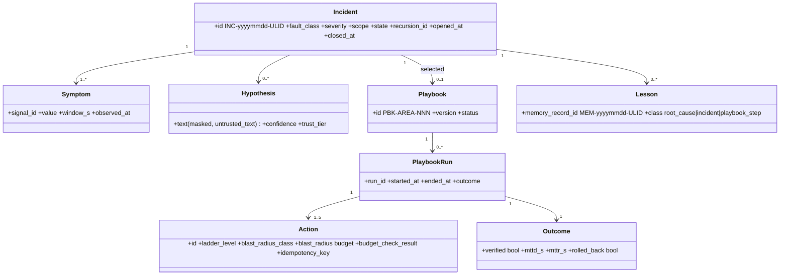
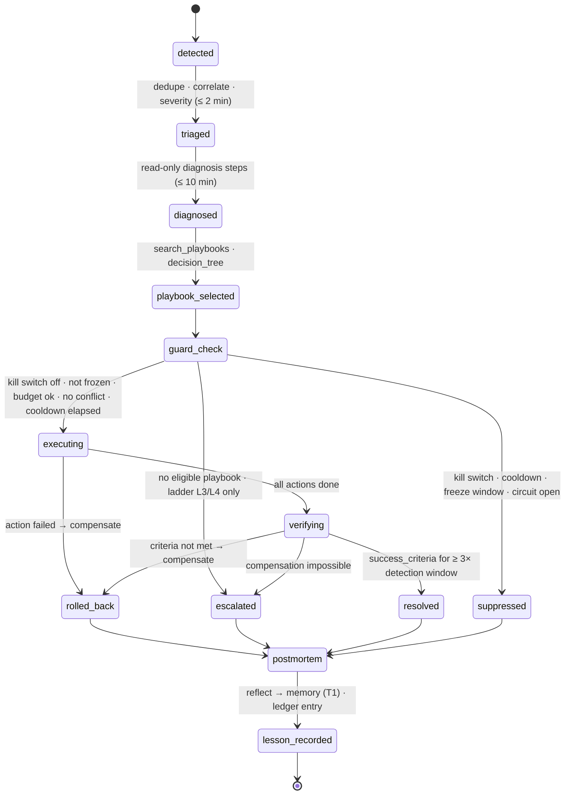
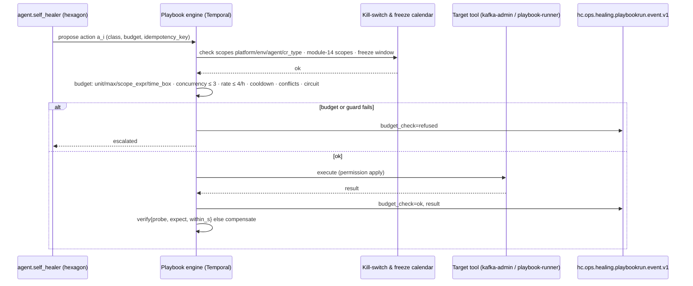
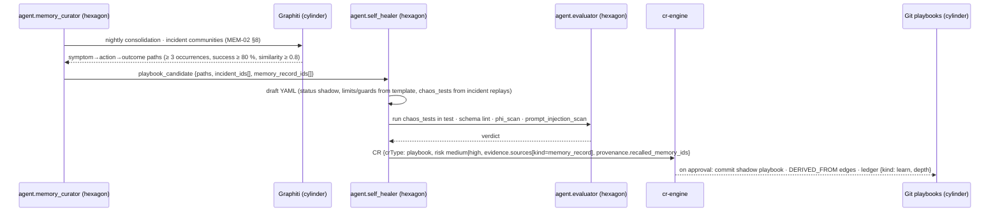

# Self-Healing — Fault Taxonomy, Healing Engine and Playbook Learning

This document specifies how `agent.self_healer` (ARC-01 §5, autonomy L3) detects, diagnoses, heals and learns from
faults in the HEALIX pipeline under ADR-09. It defines the fault taxonomy (`FLT-*`), the signals consumed from module
12, the incident model, the Temporal-enforced healing state machine, blast-radius classes and machine-checked budgets,
the playbook artefact and its lifecycle, recursive playbook learning through `agent.memory_curator`, the chaos suite,
escalation to humans, and requirements MEM-HEAL-001…060. Seed playbooks live in `healing-playbooks/` (MEM-A3) and
cite MEM-HEAL-036…050. Memory stores used by healing are specified in MEM-01/MEM-02; caches in MEM-03; governance of
learning (recursion ledger, kill-switch hierarchy, fixed-point list) in MEM-06.

**Hard rule (binding on every store touched by healing):**

> No tier of memory (M0–M4 as used by this module) and no cache tier (C0–C4) may hold content whose `hc-phi-class` is anything but `non-phi`/`internal` (steward preferences: `pii:workforce` with consent flag). This includes the C0 provider prompt cache: pseudonymised PHI is not permitted.

## 1. Philosophy and scope — "heal the pipe, never the data"

Self-healing restores the *flow* of the platform; it never changes what the data says. The self-healer MAY restart,
replay, reroute, reconfigure within bounds, quarantine, pin to a previous released version, suppress notifications and
propose change requests. It MUST NEVER:

| Forbidden | Anchor |
|---|---|
| Send HL7 v2, FHIR writes or CCL updates into Cerner Millennium, or any write into Oracle Fusion | SRC-CER-024, SRC-OFC-001 (extract-only) |
| Write directly to `canonical`, `kg` or `edw` topics, DDL or graph assertions | GOV-ACC-011 |
| Alter clinical result values, medication doses, GL amounts, or merge/unmerge identities | DQ-REM-005 |
| Widen any ACL, token scope or PHI access; change `hc-phi-class` tags | GOV-ACC-009/010, GOV-PHI-003 |
| Raise `tokens_per_run`, `runs_per_day`, `daily_token_cap` or `max_concurrent_runs` (budgets are `policy` class, human-only) | AGT-ARCH-008, GOV-00 §2.2, MEM-06 §4 |
| Edit manifests, prompts or rubrics of `agent.evaluator`, `agent.privacy_guardian`, `agent.improver`, `agent.memory_curator` or itself | MEM-06 §4 fixed-point list |
| Execute an action of blast-radius class `schema` or `data_mutation` autonomously | §7, MEM-HEAL-001 |

All actions run through the **playbook engine** — a Temporal workflow outside the agent process — which checks
guards, budgets, kill switches and freeze windows before every step. The agent reasons; the engine acts.

## 2. Fault taxonomy

Classes are `FLT-<AREA>-NNN`, AREA ∈ {ING, SEM, DQ, SINK, AGT, PLAT}. Ladder: **L0** observe/annotate · **L1** safe
automatic (idempotent, reversible, no data mutation) · **L2** automatic after dry-run + blast-radius check · **L3**
propose CR/ticket · **L4** page human. Severity defaults follow OPS-00 §7 (SEV1–SEV4). `Pri` is the class priority
used by the coverage KPI; `manual` means detection exists but healing is a human runbook (module 12) with an L3 ticket.

| Id | Pri | Symptom | Typical legacy cause | Detection signal (module 12 / topic) | Ladder max | Playbook | MTTD | MTTR | SEV |
|---|---|---|---|---|---|---|---|---|---|
| FLT-ING-001 | P0 | MLLP connection drop / listener down | Hospital network change, engine restart, firewall rule rotation | S3, `SourceSilent`, connector task state (STR-OPS-006) | L1 | PBK-ING-001 | 120 s | 900 s | SEV2 |
| FLT-ING-002 | P0 | MSH-13 sequence gap | Interface-engine replay/misordering, dual listeners | Sequence-gap counter per channel (STR-CDC-008), `hc.ops.dlq.connect.v1` | L1 | PBK-ING-001 | 120 s | 900 s | SEV3 |
| FLT-ING-003 | P0 | ACK timeout / `AE`/`AR` NAK storm | Produce-ack latency, engine retry loop | STR-OPS-007 ACK error rate; `hc.ops.outbound.hl7v2.ack.v1` for outbound | L1 | PBK-ING-001 | 60 s | 600 s | SEV2 |
| FLT-ING-004 | P1 | Parse-failure spike (malformed Z-segment, encoding incl. EBCDIC mainframe batch) | Site-specific Z-segments, code-page mismatch | `hc.ops.dlq.processor.v1` rate per source | L3 | manual | 300 s | — | SEV3 |
| FLT-ING-005 | P0 | Interface engine (Cloverleaf/Rhapsody) queue backlog masking source ACKs | Engine thread exhaustion, downstream route down | Engine heartbeat/queue depth vs S1; silence > 2× p99 inter-arrival | L1 | PBK-ING-001 | 300 s | 1,800 s | SEV2 |
| FLT-ING-006 | P0 | Debezium LogMiner lag | Millennium batch windows, replica apply lag | STR-OPS-006 seconds-behind-source, `hc.ops.processor.checkpoint.v1`, S1/S6 | L1 | PBK-ING-002 | 600 s | 1,800 s | SEV2 |
| FLT-ING-007 | P0 | Archive-log gap / SCN not mineable / supplemental logging lost | DBA housekeeping, replica rebuild | SCN gap on checkpoint topic, connector error class | L4 | PBK-ING-002 | 300 s | manual | SEV1 |
| FLT-ING-008 | P0 | LogMiner redo-volume ceiling / DDL mid-stream | Month-end batch, Millennium code upgrade DDL | Redo rate metric, STR-CDC-005 `schema.evolve` event | L2 | PBK-ING-002 | 600 s | 3,600 s | SEV2 |
| FLT-ING-009 | P1 | BICC extract late / manifest stale | ESS job queue, OCI object-store throttling | STR-OPS-008, S2, `hc.ops.connector.bicc.manifest.v1` age | L1 | manual | 900 s | — | SEV3 |
| FLT-ING-010 | P0 | BICC VO column add/remove/type change | Fusion patch, custom flexfield | Manifest column set ≠ registry; `hc.ops.schema.change.v1` | L2 | PBK-ING-003 | 900 s | 3,600 s | SEV2 |
| FLT-ING-011 | P1 | Oracle Fusion quarterly-update window (pre-emptive) | Vendor release calendar | Change-freeze calendar (module 12) T−14 d | L0 | PBK-ING-003 | — | — | SEV4 |
| FLT-ING-012 | P0 | BICC `LAST_UPDATE_DATE` nulls (silent delta loss) | Seeded/migrated rows, bulk loaders bypassing audit columns | SRC-OFC-002 daily PK diff; null-rate metric on manifest | L1 | PBK-ING-003 | 86,400 s | 172,800 s | SEV2 |
| FLT-ING-013 | P1 | SFTP/file feed late or malformed | Vendor cron drift, partial upload | File-poller freshness, checksum mismatch, `hc.ops.dlq.connect.v1` | L1 | manual | 1,800 s | — | SEV3 |
| FLT-ING-014 | P1 | VPN/tunnel flap to vendor-hosted peripheral | ISP failover, IKE rekey | S3 flapping (≥ 3 up/down in 10 min), connector restart count | L1 | manual | 120 s | 1,800 s | SEV3 |
| FLT-ING-015 | P1 | Duplicate MRN across facilities / EMPI collision surge | Multi-domain Cerner, facility merger | Entity-resolution collision rate (module 08), DQ uniqueness rules on `hc.dq.issue.v1` | L3 | manual | 900 s | — | SEV2 |
| FLT-ING-016 | P1 | Clock skew > 5 s / multi-domain Cerner time-zone misalignment | Unsynced NTP on engine, local-time timestamps without offset | TKG-TIME-012 DLQ `TEMPORAL_SKEW`, `hc-source-time` − `hc-event-time` histogram | L3 | manual | 300 s | — | SEV2 |
| FLT-ING-017 | P0 | Schema Registry compatibility failure | Producer deploy without GitOps, BICC type change | `hc.ops.schema.change.v1` compat failure, producer 409 rate | L1 | PBK-ING-003 | 60 s | 1,800 s | SEV2 |
| FLT-SEM-001 | P1 | Terminology release lag | TS release job stuck, licence refresh | IOP-04 release-event age, C3 version ≠ TS version | L1 | PBK-SEM-001 | 3,600 s | 7,200 s | SEV3 |
| FLT-SEM-002 | P0 | Unmapped-code surge | New `CODE_VALUE`/`NOMENCLATURE` rows (SRC-CER-007), local codes | `$translate` miss rate > 3σ vs 7-d baseline | L3 | PBK-SEM-001 | 600 s | 3,600 s | SEV3 |
| FLT-SEM-003 | P0 | Value-set expansion failure / TS unavailable | TS pod OOM on large `$expand`, licence outage | S20 availability/latency | L1 | manual | 60 s | 900 s | SEV2 |
| FLT-SEM-004 | P1 | Reasoner timeout / ontology release inconsistency | Axiom explosion, HermiT timeout | Reasoner job metrics, `owl_consistency` check failures | L3 | manual | 600 s | — | SEV3 |
| FLT-SEM-005 | P1 | Mapping regression after release | Mapping deploy vs profile version mismatch | S4 drop > 0.5 pp, `mapping_golden_tests` failures | L1 | manual | 600 s | 1,800 s | SEV2 |
| FLT-DQ-001 | P0 | Rule storm | Upstream release, drift or connector incident surfacing as DQ | `hc.dq.issue.v1` rate; ≥ 20 rules or ≥ 30 % of a topic's rules breaching | L1 | PBK-DQ-001 | 600 s | 1,800 s | SEV2 |
| FLT-DQ-002 | P1 | Threshold drift / false-positive surge | Seasonal volume, new facility | DQ-PIPE-011 drift issues, steward dismiss rate > 30 % | L3 | PBK-DQ-001 | 3,600 s | 86,400 s | SEV3 |
| FLT-DQ-003 | P1 | Profiling job failure | Warehouse lock, spill | Job status, S8 coverage dip | L1 | manual | 900 s | 3,600 s | SEV3 |
| FLT-DQ-004 | P1 | DQ detection latency breach | Consumer lag on DQ group, rule-pack size | S7, S6 (DQ group), `ConsumerLagHigh` | L1 | manual | 900 s | 1,800 s | SEV2 |
| FLT-DQ-005 | P1 | Remediation cap exhaustion | Systemic mapping fault behind many records | DQ-REM-010 cap counters | L3 | manual | 300 s | — | SEV3 |
| FLT-SINK-001 | P0 | SHACL batch failure | Alignment mapping vs ontology release mismatch | SHACL violation rate > 5 %, `hc.kg.dlq.v1` | L1 | PBK-SINK-001 | 300 s | 1,800 s | SEV2 |
| FLT-SINK-002 | P0 | Graph store unavailable / load receipt missing | Store compaction, disk full, failover | S9/S10, `KGLoadStalled`, `hc.kg.load-receipt.v1` absent > 15 min | L2 | PBK-SINK-001 | 900 s | 3,600 s | SEV2 |
| FLT-SINK-003 | P1 | KG DLQ growth | Temporal skew, unresolvable IRIs | `hc.kg.dlq.v1` growth rate | L1 | PBK-SINK-001 | 900 s | 3,600 s | SEV3 |
| FLT-SINK-004 | P1 | EDW load lock / batch late | Long-running analyst query, dbt dependency failure | S11, EDW sink span, dbt run metrics | L1 | manual | 900 s | 3,600 s | SEV2 |
| FLT-SINK-005 | P1 | KG–EDW reconciliation mismatch | Replay on one sink only, late-arriving retraction | S13, `hc.ops.kg-edw-reconciliation.v1` (TKG-04 §7) | L3 | PBK-SINK-001 | 86,400 s | 86,400 s | SEV3 |
| FLT-AGT-001 | P0 | Budget exhaustion | Cache invalidation storm, runaway trigger | `hc.ops.agent.decision.v1` budget stops, `BudgetAnomaly` | L1 | PBK-AGT-001 | 300 s | 3,600 s | SEV3 |
| FLT-AGT-002 | P0 | Agent loop (repeated identical tool calls / idempotency re-proposal) | Tool returning non-deterministic errors, stale memory | Decision-log idempotency re-proposals > 3×, identical tool-call hash streak | L1 | PBK-AGT-001 | 300 s | 900 s | SEV3 |
| FLT-AGT-003 | P1 | Tool failure / gateway denial spike | ACL drift, token expiry, injection attempt | S16, `AgentDenialSpike` | L4 | manual | 60 s | — | SEV2 |
| FLT-AGT-004 | P1 | Evaluator disagreement spike / calibration drift | Rubric change, new CR type, steward turnover | S15, `EvaluatorDrift` | L3 | manual | 86,400 s | — | SEV2 |
| FLT-AGT-005 | P0 | Model provider 429/5xx/refusal spike | Provider incident, rate-limit tier | Model-gateway counters (`healix.agent.provider.*`) | L1 | PBK-AGT-001 | 120 s | 900 s | SEV3 |
| FLT-AGT-006 | P1 | Prompt-cache hit-ratio collapse | Silent invalidator shipped, model switch | MEM-03 §9 C0 hit ratio < 50 % for 1 h | L1 | PBK-AGT-001 | 3,600 s | 3,600 s | SEV4 |
| FLT-PLAT-001 | P1 | Redis down | Cluster failover, AZ loss | Cache health; bypass counter (MEM-03 §8) | L1 | manual | 60 s | 900 s | SEV3 |
| FLT-PLAT-002 | P1 | Mem0 down | pgvector/Qdrant outage | Memory API `health` (MEM-01 §10) | L1 | manual | 60 s | 3,600 s | SEV3 |
| FLT-PLAT-003 | P1 | Graphiti down | Neo4j outage, episode queue overflow | Memory API `health`; episode backlog | L1 | manual | 60 s | 3,600 s | SEV3 |
| FLT-PLAT-004 | P0 | Temporal unavailable | Persistence DB outage | Workflow-engine health, task-queue age | L4 | manual | 60 s | 3,600 s | SEV1 |
| FLT-PLAT-005 | P1 | Certificate expiry (TLS / mTLS / MLLP) | Manual cert renewals on hospital interface engines | `CertificateExpiring` (< 14 d) | L3 | manual | 14 d lead | — | SEV3 (SEV1 if expired) |
| FLT-PLAT-006 | P0 | Egress proxy / LLM provider unreachable | Proxy allow-list change, DNS | Gateway 5xx/timeouts, GOV-ACC-018 proxy health | L1 | PBK-AGT-001 | 120 s | 900 s | SEV2 |
| FLT-PLAT-007 | P0 | Memory write-rate anomaly (poisoning signal) | Compromised tool output, injection campaign | `healix.memory.writes_total` > 5× baseline (MEM-GOV-006) | L4 | manual | 300 s | — | SEV2 |

**Coverage KPI.** 21 classes are P0; 18 carry a seed playbook (86 %). Target: ≥ 80 % of P0 classes have an *active*
(post-shadow) playbook by first release; **100 %** of all 45 classes have a registered detection rule (MEM-HEAL-051/052).
New classes enter the taxonomy only through a `policy`-class CR (MEM-HEAL-058).

## 3. Legacy-estate outliers

| Outlier (Fortune-100 estate) | Class | How detected | Playbook may | Playbook may not | Stays manual |
|---|---|---|---|---|---|
| Interface engine (Cloverleaf/Rhapsody) acknowledges to Cerner while its outbound queue to HEALIX backs up — source looks healthy, HEALIX sees silence | FLT-ING-005 | Engine queue-depth/heartbeat probe vs S1; silence > 2× p99 inter-arrival per facility | Reconnect listener; request retransmit by MSH-13 range from the engine; replay `hc.raw.*` | Touch engine routes/thread pools; send anything to Cerner | Engine capacity change by hospital IT |
| Multiple Cerner domains with different time zones; local timestamps without offset | FLT-ING-016 | TKG-TIME-012 DLQ `TEMPORAL_SKEW`; per-domain `hc-source-time` offset histogram | Annotate incident, open `mapping` CR to `agent.source_mapper` for `source_tz` default | Rewrite timestamps or re-drive DLQ with guessed offsets | Domain-to-tz mapping sign-off by Integration Engineer |
| Oracle Fusion quarterly update (2-week lead, mandatory) | FLT-ING-011 | Freeze calendar T−14 d | Pre-emptive dry-run of `PBK-ING-003` against the preview pod manifest; pre-warm registry with announced VO changes as `discovered` | Apply breaking changes; start any canary (MEM-05) | Fusion admin confirms update window |
| LogMiner redo-volume ceilings during Millennium batch windows; DDL mid-stream from code upgrades | FLT-ING-008 | Redo rate, STR-CDC-005 `schema.evolve` | Tune `log.mining.batch.size.*` within bounds; scale tasks ≤ 2×; incremental re-snapshot ≤ 1 table/day with dry-run row estimate | Re-snapshot `PERSON`/`ENCOUNTER`/`CLINICAL_EVENT` without a human; change supplemental logging | DBA actions on the replica |
| BICC `LAST_UPDATE_DATE` nulls on seeded/migrated rows (deltas silently lost) | FLT-ING-012 | SRC-OFC-002 daily PK diff; null-rate on manifest | Trigger PK diff; flag freshness `suspect`; schedule weekly full extract reconcile (SRC-OFC-003) | Patch source rows; invent timestamps | Fusion data-fix ticket |
| Duplicate MRNs across facilities / EMPI collisions after mergers | FLT-ING-015 | Entity-resolution collision rate; DQ uniqueness rules | Annotate, aggregate into one DQ issue per facility pair, ticket to G1 steward | Merge/unmerge identities (DQ-REM-005) | Steward adjudication |
| Clock skew > 5 s on interface engines | FLT-ING-016 | Header diff histogram; NTP probe | Ticket to hospital IT with offending host list (PHI-free) | Shift event times | NTP fix |
| VPN flaps to vendor-hosted peripherals (LIS, dictation, payer portals) | FLT-ING-014 | S3 flapping, connector restart count | Back-off restarts (≤ 3/h), extend ACK timeout within bounds | Change tunnel/IKE config | Network team |
| EBCDIC/fixed-width mainframe batch files (legacy claims, payroll) | FLT-ING-004 / FLT-ING-013 | `hc.ops.dlq.processor.v1` encoding errors; checksum mismatch | Quarantine file, request re-send from vendor SFTP by ticket | Guess code page and re-parse | Code-page registration via `mapping` CR |
| Certificate expiry on MLLP/TLS endpoints renewed by hand in hospitals | FLT-PLAT-005 | `CertificateExpiring` 14 d lead | Ticket with endpoint list; pre-stage reconnect playbook | Install certs | Hospital IT renewal |

## 4. Signal contract

The self-healer consumes signals **by id**; it never scrapes dashboards. Module 12 exposes the catalogue as a
machine-readable registry (README §6 request). Thresholds and windows per class are in the fault table (§2) and in each
playbook's `triggers[]`.

| Signal family | Ids / topics | Used by classes |
|---|---|---|
| OPS-03 §3 SLIs | S1, S2, S3, S4, S6, S7, S8, S9, S10, S11, S13, S15, S16, S20 | ING, SEM, DQ, SINK, AGT |
| OPS-03 §4.2 alerts | `SourceSilent`, `ConsumerLagHigh`, `KGLoadStalled`, `AgentDenialSpike`, `EvaluatorDrift`, `CertificateExpiring`, `BudgetAnomaly` | as mapped in §2 |
| Streaming ops topics (STR-02) | `hc.ops.schema.change.v1`, `hc.ops.processor.checkpoint.v1`, `hc.ops.connector.bicc.manifest.v1`, `hc.ops.outbound.hl7v2.ack.v1`, `hc.ops.dlq.connect.v1`, `hc.ops.dlq.processor.v1`, `hc.ops.replay.request.v1` | ING |
| KG topics | `hc.kg.load-receipt.v1`, `hc.kg.dlq.v1`, `hc.ops.kg-edw-reconciliation.v1` | SINK |
| DQ topics | `hc.dq.result.v1`, `hc.dq.issue.v1`, `hc.dq.rule-activation.v1` | DQ, SEM |
| Agent decision log | `hc.ops.agent.decision.v1` (budget stops, idempotency re-proposals) | AGT |
| Gateways | model-gateway counters, MCP gateway denials (GOV-ACC-010), GOV-ACC-018 egress-proxy health | AGT, PLAT |
| Memory & cache | `healix.memory.*` (MEM-01 §11), cache metrics (MEM-03 §9) | PLAT, AGT-006 |
| Calendar | change-freeze calendar service (module 12; release windows, Fusion quarterly update, Millennium code upgrades) | guards in every playbook |

Signals carrying `phi` or `phi-limited` payloads (DLQ topics, `hc.dq.result.v1`) are consumed **by headers and
counts only**; the self-healer's tools return topic/partition/offset pointers and aggregates, never record bodies.

## 5. Incident model



Every state transition is published on `hc.ops.healing.incident.event.v1` (key `incident_id`) and every action on
`hc.ops.healing.playbookrun.event.v1` (key `incident_id|step`) with the budget-check result. Both are mirrored
bitemporally into `edw_g9_governance.fact_healing_incident` / `fact_healing_action` with TKG-01 §9 columns, mirroring
DQ-REM-009, and reach the KG only via `agent.kg_builder`. Incidents, runs and lessons are also recorded as Graphiti
episodes (`record_incident`, `record_playbook_run`, MEM-02 §6) in scope `healix.<env>.interface.<id>` or
`healix.<env>.agent.<id>`; hypotheses are masked per GOV-LIN-015 and flagged `untrusted_text: true`.

## 6. Healing state machine (Temporal workflow, outside the agent)



`Incident{id, fault_class, severity, scope, symptoms[], hypotheses[], playbook_id?, runs[], budget_checks[], outcome,
lesson_ids[], recursion_id}`. Timers: triage ≤ 2 min, diagnosis ≤ 10 min, verification window ≥ 3× the trigger's
detection window. In `shadow` status the workflow stops at `playbook_selected` and records the recommendation; in
`assisted` it waits for a human at `guard_check`. Every transition emits the topic event, an AuditEvent on
`hc.ops.audit.v1` (GOV-03 §5) and, when the incident was raised by another healing run, a recursion-ledger entry
(MEM-06 §5) with `depth` ≤ 2.

## 7. Blast radius — class plus machine-checked budget

| Class | Examples | Autonomous | Notes |
|---|---|---|---|
| `observe` | annotate, open issue, aggregate | yes (L0) | no side effect on pipeline |
| `restart` | connector task, listener, processor | yes (L1) | idempotent, bounded per hour |
| `reconfigure` | batch size, timeout, effort tier, fallback model | yes (L1) within `candidate_for_tuning[]` bounds | never budgets, ACLs or `limits`/`guards` |
| `reroute` | pause partition, route to DLQ/quarantine, suppress notifications | yes (L1/L2) | ≤ 10 % partitions of one topic |
| `replay` | re-drive DLQ batch, replay `hc.raw.*` range, incremental re-snapshot | L1 for ≤ 50k msgs; L2 (dry-run) above / for re-snapshot | ≤ 500k records/action, ≤ 1 table/day |
| `schema` | register element, change registry subject, DDL | **never** | L3 CR only |
| `data_mutation` | change a value, merge identities, delete results | **never** | forbidden outright (DQ-REM-005, DQ-PIPE-014) |

Every action carries a **blast-radius budget** `{unit ∈ connector|partition|table|facility|records|agent|tokens, max,
scope_expr, time_box_s}`; checked by the playbook engine before each action; result logged on
`hc.ops.healing.playbookrun.event.v1`; exceeding ⇒ action refused, incident `escalated`. Defaults (tightened, never
loosened, by a playbook): ≤ 1 connector, ≤ 10 % partitions of one topic, ≤ 1 table re-seed/day, ≤ 500k records
replayed/action, ≤ 1 facility, `time_box_s` ≤ 1,800. Engine-wide limits: ≤ 3 concurrent healing actions platform-wide;
≤ 4 executions/h/playbook; cooldown ≥ 15 min per target; ≤ 5 actions per incident; one playbook per target at a time;
idempotency key per action; circuit breaker = 3 consecutive failures ⇒ playbook disabled 24 h + page; oscillation
detector > 3 restarts/h on one target ⇒ `escalated`. Healing recursion depth ≤ 2 and a child incident never re-triggers
its parent's playbook.



**Conflict matrix** (mutually exclusive on the same target; precedence resolves which may run): `PBK-ING-002` ×
`PBK-ING-003` on the same Fusion/Millennium connector (ING-003 wins when a schema event is present); `PBK-SINK-001`
× `PBK-DQ-001` when both target the same topic partition (SINK first, DQ waits); `PBK-ING-001` × `PBK-ING-002`
share no target; `PBK-AGT-001` × any playbook whose actions call the same agent (AGT-001 reduces concurrency first).
**Suppression** applies only to notifications, never to evaluation or detection, is time-boxed ≤ 60 min, and is
visible on the incident. The change-freeze calendar (release windows, Fusion quarterly update, Millennium code upgrades)
is a guard in every playbook's `limits`; during a freeze only L0/L1 `observe`/`restart` actions run.

## 8. Playbook artefact and lifecycle

Playbooks are Git-versioned YAML (M3 procedural memory, indexed as Graphiti `Playbook` nodes) validated against
`playbook.schema.json` (contract B, copied here verbatim; field reference in MEM-A3):

```
id: PBK-<AREA>-<NNN>            # AREA ∈ ING|SEM|DQ|SINK|AGT|PLAT
name, version (semver), status: shadow|assisted|autonomous|retired
owners[], fault_classes[]: [FLT-*], severity_default: S1..S4 (OPS-00 SEV1–4), risk_class, autonomy_required: L3
mttd_target_s, mttr_target_s
scope: {environments[], source_systems[], interfaces[], groups[], facilities[]}
triggers[]: {signal, source_module|topic|metric, comparator, threshold, window_s, min_occurrences, for_s}
dedupe_key, correlation_window_s
preconditions[]: {check, tool{server,operation}, expect, on_fail: skip|escalate}
diagnosis[]: {step, tool{server,operation}, params, read_only: true, timeout_s, record_as: symptom|hypothesis|<var>}
decision_tree[]: {when, then_actions[]}
actions[]: {id, ladder_level: L0|L1|L2|L3, blast_radius_class: observe|restart|reconfigure|reroute|replay|schema|data_mutation,
            autonomous_allowed (false for schema/data_mutation),
            blast_radius: {unit: connector|partition|table|facility|records|agent|tokens, max, scope_expr, time_box_s},
            requires_dry_run, tool{server,operation,permission}, params, idempotency_key_recipe, timeout_s, retries,
            verify{probe, expect, within_s}, on_failure: continue|abort|compensate|escalate,
            compensating_action|rollback{tool,params}, emits_cr?{cr_type, risk_class, gates_required[]}}
verification: {probes[], duration_s, success_criteria}
limits: {max_runs_per_hour (≤4), cooldown_s (≥900), max_actions_per_incident (≤5), max_concurrent_per_target (1),
         circuit_breaker: {consecutive_failures: 3, open_for_s: 86400, page: true},
         change_freeze_calendar_ref, recursion: {max_depth: 2, may_trigger[]}}     # fixed-point protected
guards: {kill_switch_paths[], phi_ceiling: none, data_mutation: none, requires_dry_run_in: [test]}  # fixed-point protected
suppression: {notifications_only: true, max_s: 3600}
conflicts_with[]: [PBK-*]
escalation: {to[], after_s, sla_minutes, ticket_template (PHI-free), page: bool, on_failure}
learning: {memory_classes_written[], lesson_template, record_episode: true, emit_reflexion: true,
           candidate_for_tuning[], graduation{shadow_matches_required: 10, min_agreement: 0.9}}
references: {requirements[] (OPS-/STR-/DQ-/TKG-/SRC-/IOP-/GOV-/MEM- ids), runbooks[], slo_ids[], topics[], connector_manifest}
chaos_tests[]: {id, injection, expected_mttd_s, expected_mttr_s, blast_radius_assert}
phi: none
change_request: {type: playbook, risk_class}
provenance: {created_by, compiled_from_incidents[], approved_cr_id}
```

Linter: every action has class + budget + (compensation or provable idempotency); `data_mutation: none`;
`status ≠ shadow` requires `provenance.approved_cr_id`; references resolve; `limits`/`guards` unchanged by automated
CRs; ≥ 1 chaos test per trigger. Files are named `<domain>-<fault>-<qualifier>.yaml`.

**Lifecycle:** `shadow (recommend-only) → assisted (human approves each run) → autonomous → retired`. Graduation to the
next status requires ≥ 10 consecutive shadow (or assisted) matches with ≥ 90 % agreement between recommendation and the
human's chosen action and 0 harmful recommendations; demotion one step is automatic on any `rolled_back` run or
circuit-breaker trip. All seven seeds ship `shadow`. Promotion is a `playbook` CR (AGT-03 schema with the requested
`crType`), risk `medium`, or `high` when the playbook contains ladder-L2 actions; approvers are Platform SRE and the
Agent Operator with `privacy_review` by `agent.privacy_guardian`. Changes to `limits`/`guards` are `policy` class and
can never arrive through an automated CR (MEM-06 §4).

## 9. Recursive playbook learning



Rules: a learned playbook is **always** born `shadow`; the recursion ledger records `kind: learn` with
`parent_id` = the consolidation run; `DERIVED_FROM` edges link the playbook node to the incidents and lessons it was
compiled from (`provenance.compiled_from_incidents[]`); candidate CRs are capped at ≤ 5 `playbook` per day
(MEM-GRA-036); a learned playbook may itself spawn learned changes only after it has been `autonomous` and STABLE ≥ 14 d
(MEM-06 §5 dwell); `limits`/`guards` are copied from the governed template and are not tunable by the learner.
Parameter tuning of existing playbooks (within `learning.candidate_for_tuning[]`) flows through `agent.improver`
(MEM-05 §1), never through the self-healer.

## 10. Chaos and fault-injection suite

Every seed playbook carries `chaos_tests[]`; the suite runs in `test` on every playbook change and quarterly as a game
day in `uat` with the Cerner interface team and Fusion admins participating.

| Injection | Classes exercised | Acceptance |
|---|---|---|
| Kill MLLP listener; inject MSH-13 gap; delay ACKs to force `AE` | ING-001/002/003 | detect ≤ MTTD, heal ≤ MTTR, ≤ 1 connector touched, Cerner receives nothing |
| Stall LogMiner (hold archive log); emit synthetic DDL | ING-006/007/008 | lag < 60 s within 30 min or DBA paged ≤ 5 min; no re-snapshot of `PERSON` |
| Mutate BICC VO (add, rename, type-change); null `LAST_UPDATE_DATE` on 1 % rows | ING-010/012/017 | breaking change paused and quarantined, never auto-applied; PK diff raised |
| Replay a LOINC release; stale C3 version | SEM-001/002 | miss rate < 1.5× baseline; one `value_set` CR per code system per hour |
| Flip a DQ threshold to 0 | DQ-001/002 | storm aggregated to one parent; prior rule version re-activated (DQ-FW-010); no result deleted |
| Corrupt a SHACL batch; drop load receipt | SINK-001/002/003 | batch isolated by ULID; re-drive succeeds; reconciliation drift ≤ 0.01 % |
| Zero a token budget; loop a tool with identical errors | AGT-001/002 | fallback route used; budget **not** raised; loop halted ≤ 15 min |
| Oscillation: alternate up/down every 2 min | ING-014 | detector trips at > 3 restarts/h and escalates, no 4th restart |
| Conflicting playbooks on one partition | SINK-001 × DQ-001 | precedence honoured, second playbook waits |
| Kill switch mid-execution (scopes `agent`, module 14) | all | executing runs halt ≤ 30 s; evidence preserved |

Module DoD requires every seed's chaos tests to pass in `test` with blast radius never exceeded and rollback verified;
results are registered in module 13 acceptance evidence.

## 11. Escalation and humans

Escalation maps to the manifest `escalation` block (AGT-01) and the OPS-03 §4.3 rotations: Platform SRE primary (all
pages), stream & semantic engineering (connectors, TS, ontology registry), store engineering (KG, EDW, reconciliation),
Agent Operator (agent runtime), Privacy on-call (PLAT-007, any PHI suspicion), Cerner interface team (MLLP sources,
per hospital rota), DBA (LogMiner, archive logs), Fusion admins (BICC, quarterly update), G8 terminology steward
(SEM-*). Ticket packets contain ids, counts, topic/partition/offset pointers and masked hypotheses only; they pass
`phi_scan` before leaving the engine.

| SEV (OPS-00 §7) | Page | Ack | Heal-or-escalate | Postmortem | Aligned with |
|---|---|---|---|---|---|
| SEV1 | immediate, 24×7 | ≤ 15 min | ladder L4 immediately; L1 actions continue in parallel | 5 business days | DQ-SCORE-006 blocker |
| SEV2 | yes | ≤ 30 min | autonomous ≤ MTTR, else escalate at `escalation.after_s` (default 15 min) | 5 business days | DQ-SCORE-006 critical |
| SEV3 | ticket; page after 2 failed runs | ≤ 4 h | autonomous; ticket if unresolved after 2 runs | optional | DQ-SCORE-006 major |
| SEV4 | ticket | next business day | L0/L1 only | none | DQ-SCORE-006 minor |

## 12. Observability

Metrics `healix.healing.*`: `incidents_total{fault_class,state}`, `mttd_s`, `mtta_s`, `mttr_s` per class,
`auto_resolved_ratio`, `false_positive_ratio`, `budget_refusals_total`, `circuit_trips_total`,
`recursion_depth` histogram, `coverage_ratio{pri}`, `shadow_agreement_ratio{playbook}`. Targets: auto-resolution
≥ 60 % of P1 ops incidents by phase 2; false positives ≤ 5 %; recursion depth > 2 = 0; coverage per §2. Dashboards in
OPS-03 §5 (SRE and Agent Operator personas); monthly figures feed the DGC autonomy report (MEM-06 §12).

## 13. Requirements

### 13.1 Engine, state machine, blast radius, chaos, kill switch (MEM-HEAL-001…035)

> **MEM-HEAL-001** (P0, test) — The playbook engine MUST refuse autonomous execution of any action whose `blast_radius_class` is `schema` or `data_mutation`; such actions MUST only emit a CR or ticket.

> **MEM-HEAL-002** (P0, test) — The engine MUST evaluate the blast-radius budget `{unit, max, scope_expr, time_box_s}` of every action before execution, log the result on `hc.ops.healing.playbookrun.event.v1`, and on exceedance refuse the action and move the incident to `escalated`.

> **MEM-HEAL-003** (P0, test) — Every executed action MUST carry an idempotency key, be re-executable without additional effect, and emit an AuditEvent on `hc.ops.audit.v1` (GOV-03 §5) naming the incident, playbook, action and target.

> **MEM-HEAL-004** (P0, test) — The engine MUST enforce per-playbook `limits`: ≤ 4 runs/h, cooldown ≥ 900 s per target, ≤ 5 actions per incident, and a circuit breaker that disables the playbook for 24 h and pages after 3 consecutive failed runs.

> **MEM-HEAL-005** (P0, test) — No more than 3 healing actions MAY execute concurrently platform-wide; a fourth MUST queue and MUST be refused if its incident's triage timer would be exceeded.

> **MEM-HEAL-006** (P0, test) — Suppression MUST affect notifications only, never detection or evaluation, MUST be time-boxed ≤ 3,600 s and MUST be visible on the incident record and topic event.

> **MEM-HEAL-007** (P0, demo) — A kill switch at any scope covering the run (`cr-engine.kill_switch` platform/environment/agent/cr_type, or module-14 playbook/module scopes, MEM-06 §9) MUST halt executing playbook runs within 30 s, preserving evidence and emitting an AuditEvent.

> **MEM-HEAL-008** (P0, test) — The self-healer and the engine MUST hold no credential that writes to Cerner Millennium or Oracle Fusion (SRC-CER-024) or to `canonical`, `kg`, `edw` topics, DDL or graph assertions (GOV-ACC-011); attempts MUST be denied at the MCP gateway and alerted.

> **MEM-HEAL-009** (P0, test) — Healing recursion depth MUST be ≤ 2; a child incident MUST NOT trigger its parent's playbook; every child-triggered transition MUST write a recursion-ledger entry (MEM-06 §5).

> **MEM-HEAL-010** (P1, test) — During a change-freeze window (release, Fusion quarterly update, Millennium code upgrade) the engine MUST execute only `observe` and `restart` actions and MUST record `suppressed` with reason `freeze` for anything else.

> **MEM-HEAL-011** (P1, test) — An oscillation detector MUST escalate and block further restarts when a target is restarted more than 3 times in one hour across all playbooks.

> **MEM-HEAL-012** (P0, test) — Only playbooks with `status: autonomous` MAY execute actions; `shadow` playbooks MUST stop at `playbook_selected` and record the recommendation; `assisted` playbooks MUST wait for a human decision at `guard_check`.

> **MEM-HEAL-013** (P0, test) — Every seed playbook's `chaos_tests[]` MUST pass in `test` with detection ≤ `expected_mttd_s`, healing ≤ `expected_mttr_s`, `blast_radius_assert` satisfied and rollback verified.

> **MEM-HEAL-014** (P0, test) — When Mem0 or Graphiti is unavailable the healing workflow MUST continue using Git-indexed playbooks only, flag the incident `memory_degraded=true`, and MUST NOT block on recall.

> **MEM-HEAL-015** (P0, test) — The self-healer MUST have no tool or CR path that raises `tokens_per_run`, `runs_per_day`, `daily_token_cap` or `max_concurrent_runs`; any such proposal MUST be rejected by cr-engine as `policy` class from an unauthorised proposer.

> **MEM-HEAL-016** (P1, test) — The workflow MUST enforce triage ≤ 2 min and diagnosis ≤ 10 min; a timer expiry MUST move the incident to `escalated` with the partial diagnosis attached.

> **MEM-HEAL-017** (P0, test) — Every state transition of §6 MUST emit an event on `hc.ops.healing.incident.event.v1` and an AuditEvent; an incident with a gap in its transition sequence MUST fail the nightly integrity check.

> **MEM-HEAL-018** (P1, test) — Incidents, runs and actions MUST be persisted bitemporally in `edw_g9_governance.fact_healing_incident` / `fact_healing_action` with TKG-01 §9 columns and PROV-O activity, mirroring DQ-REM-009.

> **MEM-HEAL-019** (P1, test) — Diagnosis steps MUST be executed with `read` permission only; a diagnosis tool call at `propose` or `apply` permission MUST be denied by the gateway and fail the playbook lint.

> **MEM-HEAL-020** (P1, test) — The engine MUST enforce `conflicts_with[]` and the §7 conflict matrix: two mutually exclusive playbooks MUST NOT run on the same target, and the lower-precedence one MUST wait or be `suppressed` with reason `conflict`.

> **MEM-HEAL-021** (P1, test) — At most one playbook run MAY be active per target (connector, partition set, table, agent) at any time.

> **MEM-HEAL-022** (P1, test) — Verification MUST hold `success_criteria` for ≥ 3× the trigger's `window_s` before `resolved`; earlier criteria failure MUST trigger compensation and `rolled_back`.

> **MEM-HEAL-023** (P0, test) — On action failure with `on_failure: compensate` or on verification failure, the engine MUST execute the declared `compensating_action`/`rollback` and MUST NOT mark the incident `resolved`.

> **MEM-HEAL-024** (P1, test) — A `rolled_back` or `escalated` outcome MUST produce a postmortem record and a `reflect` call producing T1 lessons flagged `untrusted_text: true` (MEM-01 §4).

> **MEM-HEAL-025** (P1, test) — Graduation from `shadow` or `assisted` MUST require ≥ 10 consecutive matches with ≥ 90 % agreement and 0 harmful recommendations, computed from `shadow_agreement_ratio` and human dispositions.

> **MEM-HEAL-026** (P0, test) — Any `rolled_back` run or circuit-breaker trip MUST demote the playbook one lifecycle step automatically within 60 s and emit a `playbook` release event on `hc.ops.agent.policy.v1`.

> **MEM-HEAL-027** (P1, test) — Lifecycle promotion MUST occur only through a `playbook` CR approved by Platform SRE and the Agent Operator with `privacy_review` cleared; risk MUST be `high` when the playbook contains ladder-L2 actions.

> **MEM-HEAL-028** (P1, test) — `agent.memory_curator` MUST emit a `playbook_candidate` only for symptom→action→outcome paths with ≥ 3 occurrences, success ≥ 80 % and similarity ≥ 0.8, and MUST record a recursion-ledger entry `kind: learn`.

> **MEM-HEAL-029** (P0, test) — A learned playbook MUST enter the library only via a `playbook` CR whose chaos tests, `phi_scan` and `prompt_injection_scan` passed, and MUST be committed with `status: shadow` and `DERIVED_FROM` edges to its source incidents.

> **MEM-HEAL-030** (P1, test) — Candidate `playbook` CRs MUST be capped at 5 per day platform-wide (MEM-GRA-036); excess candidates MUST be queued, not dropped.

> **MEM-HEAL-031** (P1, demo) — A game day exercising the §10 suite MUST be executed quarterly in `uat` with the Cerner interface team and Fusion admins; the signed record MUST be registered in module 13.

> **MEM-HEAL-032** (P1, test) — Escalation MUST follow the §11 SLA table and the playbook `escalation` block; SEV1/SEV2 incidents MUST page the OPS-03 §4.3 rotation within 60 s of entering `escalated`.

> **MEM-HEAL-033** (P0, test) — Ticket packets and page payloads MUST pass `phi_scan` and MUST contain only ids, counts, pointers and masked hypotheses; a failed scan MUST quarantine the packet and page Privacy on-call.

> **MEM-HEAL-034** (P1, test) — The `healix.healing.*` metrics of §12 MUST be exported per fault class and registered with module 12; auto-resolution ≥ 60 % of P1 ops incidents MUST be demonstrable by phase 2.

> **MEM-HEAL-035** (P1, analysis) — False-positive healing incidents (opened, no fault confirmed) MUST stay ≤ 5 % per month; a breach MUST open a `playbook` CR adjusting triggers, never `limits`/`guards`.

### 13.2 Playbook artefact rules (MEM-HEAL-036…050; cited by healing-playbooks/README.md)

> **MEM-HEAL-036** (P0, test) — Every playbook MUST validate against `playbook.schema.json`; CI MUST reject a merge of any non-validating file.

> **MEM-HEAL-037** (P0, test) — Every new playbook MUST be committed with `status: shadow`; a first commit with any other status MUST fail lint.

> **MEM-HEAL-038** (P0, test) — Every action MUST declare `blast_radius_class`, a `blast_radius` budget and either a `compensating_action`/`rollback` or a provably idempotent `idempotency_key_recipe`.

> **MEM-HEAL-039** (P1, test) — Playbook files MUST be named `<domain>-<fault>-<qualifier>.yaml` and ids MUST match `PBK-<AREA>-<NNN>` with AREA ∈ {ING, SEM, DQ, SINK, AGT, PLAT}; duplicates MUST fail lint.

> **MEM-HEAL-040** (P1, analysis) — Every playbook MUST reference ≥ 1 OPS-, STR-, DQ-, TKG- or SRC- requirement id in `references.requirements[]` that constrains its actions.

> **MEM-HEAL-041** (P1, test) — Every trigger MUST have ≥ 1 corresponding `chaos_tests[]` entry whose injection reproduces the trigger.

> **MEM-HEAL-042** (P0, test) — The `limits` and `guards` blocks MUST be fixed-point protected: cr-engine MUST reject any automated CR (proposer is an agent) that changes them, and only a `policy`-class CR by DGC/Privacy Office MAY.

> **MEM-HEAL-043** (P0, test) — Every playbook MUST carry `phi: none` and `guards.data_mutation: none`; lint MUST reject any other value.

> **MEM-HEAL-044** (P1, test) — A playbook with `status ≠ shadow` MUST carry `provenance.approved_cr_id` resolving to an applied `playbook` CR.

> **MEM-HEAL-045** (P1, test) — Every `diagnosis[]` step MUST set `read_only: true` and reference a tool whose manifest permission is `read`.

> **MEM-HEAL-046** (P1, test) — Actions with `retries > 0` MUST declare `idempotency_key_recipe`; actions with `blast_radius_class: replay` MUST set `requires_dry_run: true` when `blast_radius.max` exceeds 50,000 records.

> **MEM-HEAL-047** (P1, inspection) — `escalation.to[]` MUST resolve to OPS-03 §4.3 rotations or registered steward roles and `ticket_template` MUST contain no free-text fields sourced from record bodies.

> **MEM-HEAL-048** (P1, test) — Any change to `limits`, `guards`, `actions[].blast_radius_class` or `actions[].blast_radius` MUST bump the playbook major version and MUST be `policy` class.

> **MEM-HEAL-049** (P1, test) — All ids in `references` (requirements, SLOs, topics, connector manifest) MUST resolve against the repository and STR-02 catalogue at lint time.

> **MEM-HEAL-050** (P2, inspection) — `learning.candidate_for_tuning[]` MUST name only trigger thresholds, windows, timeouts and tuning parameters; it MUST NOT name any field under `limits`, `guards`, `blast_radius` or `blast_radius_class`.

### 13.3 Fault taxonomy and legacy-outlier coverage (MEM-HEAL-051…060)

> **MEM-HEAL-051** (P0, analysis) — 100 % of fault classes in §2 MUST have a registered detection rule (signal id, threshold, window) in module 12's machine-readable catalogue.

> **MEM-HEAL-052** (P1, analysis) — ≥ 80 % of P0 fault classes MUST have an `autonomous` playbook by first release; the ratio MUST be reported monthly.

> **MEM-HEAL-053** (P1, inspection) — Every legacy-estate outlier in §3 MUST map to ≥ 1 fault class with its detection, permitted actions and manual residue documented.

> **MEM-HEAL-054** (P1, analysis) — MTTD and MTTR per fault class MUST be measured monthly against the §2 targets; a class missing its target for 2 consecutive months MUST open a reliability-backlog item.

> **MEM-HEAL-055** (P1, test) — Detection thresholds and windows per class MUST be registered as versioned configuration; a change MUST be a `playbook` or `policy` CR and MUST emit on `hc.ops.agent.policy.v1`.

> **MEM-HEAL-056** (P1, analysis) — The coverage KPI, auto-resolution ratio and false-positive ratio MUST be included in the monthly DGC autonomy and recursion report (MEM-06 §12).

> **MEM-HEAL-057** (P1, demo) — Each quarterly game day MUST exercise ≥ 1 scenario per AREA (ING, SEM, DQ, SINK, AGT, PLAT) including one kill-switch and one conflicting-playbook scenario.

> **MEM-HEAL-058** (P2, analysis) — New fault classes MUST be added through a `policy`-class CR with detection rule, ladder ceiling, MTTD/MTTR targets and severity default; the taxonomy MUST be versioned with this document.

> **MEM-HEAL-059** (P1, test) — At T−14 d before each Oracle Fusion quarterly update window the engine MUST run `PBK-ING-003` pre-emptively in dry-run against the preview manifest and MUST block canary starts (MEM-05 §4) until the window closes.

> **MEM-HEAL-060** (P2, analysis) — Incidents not attributable to any fault class MUST stay < 10 % per quarter; the annual taxonomy review MUST reclassify or add classes for the residue.

## 14. Traceability

| MEM-HEAL | Depends on / realises |
|---|---|
| 001, 002, 008, 015, 023, 038, 042, 043, 048 | ADR-09; GOV-ACC-009/010/011; SRC-CER-024; SRC-OFC-001; DQ-REM-005; DQ-PIPE-014; AGT-ARCH-008; GOV-00 §2.2 `policy`; MEM-06 §4 |
| 003, 017, 018, 033 | GOV-03 §5 AuditEvent; GOV-LIN-006/008/015; DQ-REM-009; TKG-01 §9; EDW-01 `edw_g9_governance`; STR-02 (requested `hc.ops.healing.*` topics) |
| 004, 005, 006, 011, 020, 021, 022 | OPS-03 §4.1 alert design; STR-OPS-006…009; DQ-REM-010; DQ-FW-007/010 |
| 007 | AGT-05 kill switch, AGT-SAFE-012/013; MEM-06 §9 |
| 009, 028, 029, 030 | MEM-06 §5 recursion ledger; MEM-GRA-033/036; MEM-02 §8 consolidation; AGT-03 CR schema (`crType: playbook`, `evidence.sources[kind=memory_record]`) |
| 010, 059 | OPS-02 release windows / freeze calendar; SRC-OFC-001…003; MEM-05 §4 |
| 012, 025, 026, 027, 037, 044 | AGT-03 §4 gates; AGT-SAFE-014; AGT-01 `graduation`; MEM-06 §6 |
| 013, 031, 041, 057 | OPS-04 §9 DR test cadence; AGT-SAFE-017; module 13 acceptance; module 15 red-team |
| 014 | MEM-01 §10; MEM-02 §10; AGT-MEM-008 |
| 016, 019, 024, 045, 046 | AGT-04 permission levels; GOV-ACC-009; MEM-01 §4 `untrusted_text` |
| 032, 047 | OPS-00 §7; OPS-03 §4.3; DQ-SCORE-006; AGT-01 `escalation` |
| 034, 035, 054, 056 | OPS-03 §3/§5; VIS-00 §8 autonomy KPIs; MEM-06 §12 |
| 036, 039, 040, 049, 050 | CONVENTIONS §2/§3/§6; MEM-A3 linter; STR-02 catalogue |
| 051, 052, 053, 055, 058, 060 | OPS-03 S1–S22, §4.2; STR-CDC-005/007/008; TKG-TIME-012; TKG-STORE-004/007; TKG-INGEST-003; TKG-04 §7; SRC-CER-007; IOP-04; module 15 legacy outliers |
