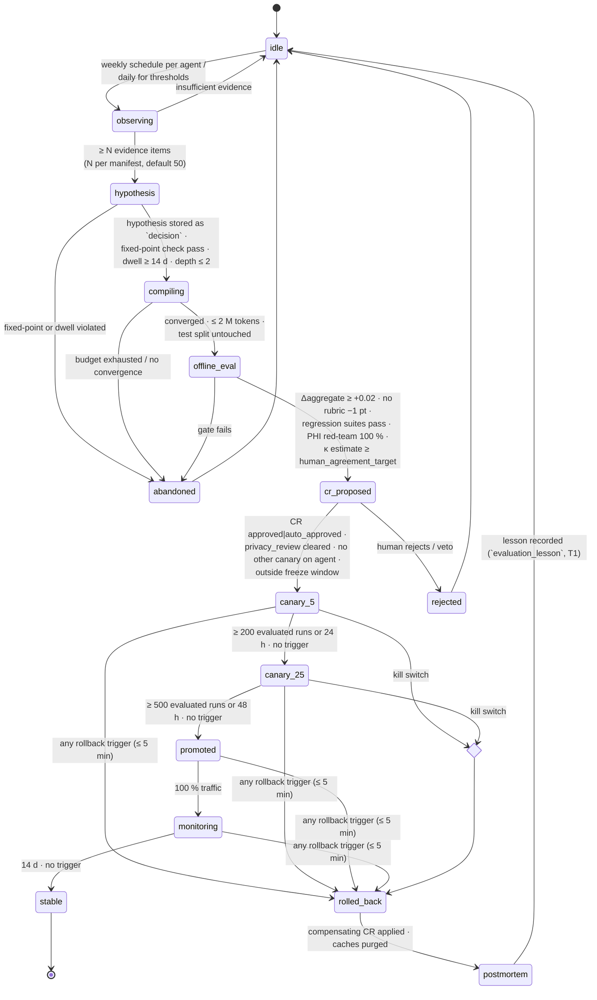

# Self-Improvement Loop

This document specifies the **closed loop** by which the agent layer improves its own prompts, few-shot exemplars,
retrieval profiles, thresholds and tool policies under ADR-09: traces, evaluator scores and human overrides are
collected into versioned evaluation datasets; `agent.improver` (autonomy **L1**, ARC-01 §5) compiles candidate
artefacts (DSPy-style bootstrap + instruction search, Reflexion-style lessons, bandit over prompt variants); each
candidate is evaluated offline on held-out data, filed as a change request (`agent_policy` or `playbook`, AGT-03
schema extensions in README §6), rolled out per agent through a **canary controller with evaluator gates**, and
either promoted or **automatically rolled back** within five minutes. Nothing in this loop may touch Cerner
Millennium, Oracle Fusion or canonical/KG/EDW data; it changes only how agents reason and decide, and only through
the CR engine. Autonomy graduation (06 §6) is the outcome of the loop, never a side effect of it.

The healing ladder L0–L4 of MEM-04 and the autonomy levels L1–L4 of ARC-01 §5 are distinct scales; this document
always writes "autonomy L1" when it means the improver's level.

**Hard rule:** No tier of memory (M0–M4 as used by this module) and no cache tier (C0–C4) may hold content whose
`hc-phi-class` is anything but `non-phi`/`internal` (steward preferences: `pii:workforce` with consent flag). This
includes the C0 provider prompt cache: pseudonymised PHI is not permitted. Evaluation datasets, Reflexion traces and
compiled artefacts are M3 procedural memory and fall under this rule.

## 1. What is improvable

| Artefact | Owner agent (proposer) | CR type | Risk-class ceiling | Approval gate (AGT-03 §4) | Constraint |
|---|---|---|---|---|---|
| Prompts / instructions of pipeline agents (orchestrator, inventory, vocabulary_curator, taxonomist, thesaurus_editor, ontologist, kg_builder, source_mapper, terminology_steward, schema_architect, dq_author, dq_monitor, remediator, interop_engineer, release_manager, self_healer) | `agent.improver` | `agent_policy` | `medium` | improver is L1 ⇒ `steward_approval` (Agent Operator) + `privacy_review`; canary gates §4 | Fixed-point list (06 §4) excludes evaluator, privacy_guardian, improver, memory_curator |
| Few-shot exemplars (bootstrapped from accepted CRs; masked, metadata-only) | `agent.improver` | `agent_policy` | `low` | as above | Each exemplar cites an `applied`/`released` CR id; `phi_scan` clean |
| Retrieval profiles (MEM-02 §7: recipe, reranker, `top_k`, token budget) | `agent.improver` | `agent_policy` | `low` | as above | Global cap ≤ 12 % of `tokens_per_run` (MEM-GRA-024) is not tunable |
| Auto-approve thresholds (`evaluation.auto_approve_threshold`) | `agent.improver` | `agent_policy` | `medium` | Agent Operator; **raise only** (AGT-SAFE-010) | Lowering is `policy` class, DGC only |
| DQ thresholds | `agent.improver` → `agent.dq_author` (hands evidence; dq_author proposes) | `dq_rule` | `low` (±5 %) / `medium` | Group steward (GOV-00 §2.2) | Improver never files `dq_rule` itself |
| Playbook parameters listed in `learning.candidate_for_tuning[]` (timeouts, retry counts, trigger windows) | `agent.improver` or `agent.self_healer` | `playbook` | `medium` | SRE + Agent Operator | `limits`/`guards` blocks never (MEM-HEAL-042) |
| Tool descriptions and parameter hints in manifests | `agent.improver` | `agent_policy` | `low` | Agent Operator | Allow-list widening is `phi-affecting` (OPS-02 §7), out of scope |
| Routing / model selection per task class (within `model_ref`/`fallback_ref` already in the manifest) | `agent.improver` | `agent_policy` | `low` | Agent Operator | New model ids are `policy` class |
| Cache thresholds (`similarity_threshold`, TTL by gap) within `cache-policy.yaml` ranges | `agent.improver` | `agent_policy` | `low` | Agent Operator | `bypass_when[]` and `phi_allowed` never (MEM-CACHE-002) |

**Not improvable by automation** (06 §4 fixed-point list, enforced at `cr-engine`): manifests and prompts of
`agent.evaluator`, `agent.privacy_guardian`, `agent.improver`, `agent.memory_curator`; rubrics `RUB-*`; golden
sets; budgets (`tokens_per_run`, `runs_per_day`, `daily_token_cap`); autonomy levels and `autonomy_ceiling`;
module-14 YAML artefacts; playbook `limits`/`guards`; PGV rules; PHI taxonomy. All are `policy` class owned by the
DGC or Privacy Office.

## 2. Evidence sources

| Source | Form | Signal used by the improver | Trust tier (MEM-01 §4) |
|---|---|---|---|
| Evaluator runs (`hc.ops.agent.evaluation.v1`) | Per-CR rubric scores, `aggregate_score`, automated-check results | Primary fitness; per-rubric weak spots | T2 |
| Human disagreements | Steward decision ≠ evaluator verdict on sampled CRs (AGT-SAFE-016, S15) | Cohen's κ per CR type; disagreement clusters | T3 |
| Privacy vetoes (PGV-*) | `privacy_review.decision = vetoed` | Hard negative; any veto on a canary cohort ⇒ rollback | T3 |
| Rollbacks (AGT-ORCH-016, MEM-04 `rolled_back`) | CR `rollback.trigger`, incident lessons | Hard negative; failure categories | T2 |
| Steward edit distance | Normalised Levenshtein / structural diff between proposed and approved payload | Proxy for "accepted but wrong"; metric-gaming detector (§6) | T3 |
| Incident lessons (`evaluation_lesson`, `root_cause` records, Graphiti `Lesson`/`LEARNED_FROM`) | Masked, `untrusted_text` | Reflexion seeds; playbook tuning hypotheses | T1 |
| Cache and cost metrics (MEM-03 §9, OPS-03 §6) | C0 hit ratio, tokens per CR, `$`/auto-approved change | Cost objective; routing decisions | T2 |
| Memory-lift ablation (06 §8) | Nightly memory-on vs memory-off on golden sets | Retrieval-profile fitness | T2 |
| DQ feedback loop (DQ-05 §7) | Remediation outcomes, rule false-positive labels | DQ-threshold hypotheses handed to `dq_author` | T3 |

All evidence is read through the Memory API `recall` (profile `improvement_evidence`, MEM-02 §7) and the
evaluation store; the improver has **no** write access to any of these sources (manifest: `memory` read only).

## 3. The loop



The state machine is **owned and enforced by a Temporal workflow** (`improvement-candidate-v1`) that runs outside
the improver's process. The improver is a worker invoked for `observing`, `hypothesis` and `compiling` only; every
guard below is evaluated by the workflow from data it reads itself (evaluation store, cr-engine, freeze calendar,
recursion ledger), so the improver can neither skip nor shorten a gate. Every transition is published on
`hc.ops.improvement.canary.event.v1` (key `candidate_id`), audited on `hc.ops.audit.v1` (GOV-03 §5) and, when the
candidate descends from a lesson or incident, recorded in the recursion ledger with `kind: improve` (06 §5).

### 3.1 Entry and exit conditions per state

| State | Entry | Work performed | Exit guard (workflow-evaluated) |
|---|---|---|---|
| `observing` | Weekly cron per agent (Mon 05:00 UTC, after the evaluator's Sunday calibration, AGT-01 §4); daily 05:30 for threshold-only candidates | Improver recalls evidence (§2) for one target agent; computes per-rubric deficit, κ, cost and latency baselines over the trailing 28 d | ≥ N evidence items (manifest `improvement.min_evidence`, default 50) and no `frozen` scope |
| `hypothesis` | — | **Reflexion**: for each failure cluster, failure → reflection → lesson; lesson is masked (GOV-LIN-015), written via `reflect` as `evaluation_lesson` with `untrusted_text: true`, T1; hypothesis written as a `decision` record with `evidence_refs[]` | Fixed-point list check passes; dwell rule satisfied (parent change `stable` ≥ 14 d); recursion depth ≤ 2; artefact not changed in the last 7 d (cooling-off) |
| `compiling` | Hypothesis recorded | **DSPy-style compile**: bootstrap few-shot from accepted CRs + instruction search over the frozen train split; **bandit** (Thompson sampling) over ≤ 8 prompt variants scored on the validation split; metric = weighted aggregate of the agent's `rubric_ids`; deterministic seed; dataset fingerprint (sha256 of split manifest) pinned; all LLM calls via the GOV-ACC-018 proxy under GOV-PHI-017 zero retention; inputs pseudonymised (OPS-02 §6) or synthetic only | Converged (validation gain < 0.002 for 3 rounds) or ≤ 2 M tokens; test split never read (audit join on proxy logs) |
| `offline_eval` | Candidate artefact + `compiled_from` | Evaluator (not improver) scores candidate vs baseline on the held-out test split, the agent's `golden_sets`, `regression_suites`, the PHI red-team suite (module 15) and a prompt-injection suite | Δaggregate ≥ +0.02; no single rubric regresses > 1 pt; regression suites pass; red-team 100 %; estimated κ ≥ `human_agreement_target`; cost/latency within envelope (§6) |
| `cr_proposed` | Offline gate passed | CR `agent_policy`/`playbook`, `risk_class` per §1, `evidence.sources[]` incl. `kind: memory_record`, `provenance.recalled_memory_ids[]`, payload = Git diff of PromptVersion/PolicyVersion + `ImprovementCandidate` | CR `approved|auto_approved`; `privacy_review` ∈ {`cleared`, `cleared_with_conditions`}; no active canary on the target agent; platform-wide active canaries < 3; not in a freeze window (OPS-02 §7, change-freeze calendar) |
| `canary_5` / `canary_25` | Release event on `hc.ops.agent.policy.v1` with `stage` | Controller assigns cohort (§4); evaluator scores every cohort run; metrics compared with the control cohort over the same window | Stage minimums met and no rollback trigger |
| `promoted` | — | 100 % traffic; version tagged `promoted` | Immediately enters `monitoring` |
| `monitoring` | — | 14 d watch on the same triggers at promoted traffic | 14 d without trigger ⇒ `stable`; graduation statistics updated (06 §6) |
| `rolled_back` | Any trigger | Compensating CR, cache purge, controller revert (§5) within 5 min | Postmortem opened |
| `postmortem` | — | Improver writes `evaluation_lesson` (masked, T1); `rollback.trigger` and metrics attached; `IMP-*` marked `outcome: rolled_back` | Lesson recorded ⇒ `idle` |

### 3.2 Offline versus online learning

| Mode | What changes | Where | Gate |
|---|---|---|---|
| **Offline** (default) | Prompts, exemplars, retrieval profiles, routing, thresholds compiled against frozen datasets | `test` compile workers; artefacts land in Git | Full loop §3 |
| **Online, bounded** | Bandit arm *selection* among already-promoted variants of the same PromptVersion family; per-arm traffic share only | Canary controller | Arms must each be `stable`; share changes ≤ 10 pp/day; any arm regressing −0.02 is retired; no new content is created online |
| **Forbidden** | Any live edit of a prompt, threshold or policy from feedback without a CR | — | MEM-IMP-001 |

## 4. Canary controller and numbers

The canary controller is a component of the Temporal workflow and the model gateway, not of any agent.

| Parameter | Value |
|---|---|
| Stage 1 traffic / minimum | 5 % of the target agent's runs; ≥ 200 evaluated runs **or** 24 h, whichever is later |
| Stage 2 traffic / minimum | 25 %; ≥ 500 evaluated runs **or** 48 h |
| Promotion | 100 %; `monitoring` 14 d → `stable` |
| Assignment | **Deterministic**: `cohort = hash(run_id ‖ candidate_id) mod 10,000 < stage × 100`, **stratified by facility/tenant** so that no stratum exceeds 2× its share of baseline traffic and every stratum with ≥ 20 runs/day contributes ≥ 5 runs per stage before promotion; assignment logged in CR `provenance` and in the run's decision-log entry (AGT-06) |
| Cache behaviour | Cohort runs bypass C1/C2/C4 and never write to any cache (MEM-CACHE-020); C0 is model-scoped and keyed by the candidate's `prompt_version`, so cohort and control never share a prefix |
| Concurrency | ≤ 1 active canary per agent; ≤ 3 platform-wide; a `playbook` canary and an `agent_policy` canary on the same agent are mutually exclusive |
| Freeze guard | Canary start and each promotion step are paused (not cancelled) inside OPS-02 §7 release windows, the Oracle Fusion quarterly-update window (T−14 d to T+2 d), Millennium code-upgrade windows and any OPS-SLO-012 error-budget freeze |
| Incident guard | Canary paused while a SEV1/SEV2 incident (OPS-00 §7) is open on the target agent or on a component it writes CRs for; paused time does not count toward stage minimums |
| Control cohort | Same stratification, same window, current `stable` version; all comparisons are cohort-vs-control, never cohort-vs-history |

**Rollback triggers** (any one, evaluated every 60 s on the trailing stage window; rollback complete ≤ 5 min):

| Trigger | Threshold | `rollback.trigger` value |
|---|---|---|
| Aggregate evaluator score | cohort − control ≤ −0.02 | `canary_regression` |
| Human agreement | cohort κ − control κ ≤ −0.03 on the sampled review set (S15) | `canary_regression` |
| PHI | any `phi_scan` `fail` on a cohort CR, or any PGV-012 finding attributable to the cohort | `privacy_guardian` |
| Veto | any `privacy_review.decision = vetoed` on a cohort CR | `privacy_guardian` |
| Cost | cohort tokens per evaluated CR ≥ control + 25 % | `budget_exhaustion` |
| Latency | cohort p95 run latency ≥ control + 30 % | `canary_regression` |
| Downstream DQ | `dq_regression` attributed by `agent.dq_monitor` to a cohort release (AGT-ORCH-016) | `dq_regression` |
| Kill switch | `cr-engine.kill_switch` at scopes `platform`/`environment`/`agent`/`cr_type` or module-14 scope `improvement` (06 §9) | `kill_switch` |
| Human | Agent Operator or Privacy Office `rollback` command | `human` |

Every evaluation tick, trigger check and stage transition is an event on `hc.ops.improvement.canary.event.v1` with
`{candidate_id, state, stage, runs, strata[], metrics{score, kappa, cost, p95_ms, phi_fail, vetoes}, trigger?}`.

## 5. Versioning, policy registry and rollback

- **Registry.** Every prompt, exemplar set, retrieval profile, routing table and threshold bundle is a
  `PromptVersion` or `PolicyVersion`: semver in Git (`10/agents/prompts/<agent>/`, `policies/<agent>/`), signed
  tag `<agent>/prompt/v<semver>` (ARC-NFR-006), prompt hash recorded in PROV (OPS-02 §7), indexed as Graphiti M3
  nodes with `SUPERSEDES`, `COMPILED_FROM` (`DERIVED_FROM`) and `EVALUATED_BY` edges (MEM-02 §3–§4), and projected
  to `edw_g9_governance.dim_prompt_version` and `fact_policy_release` with TKG-01 §9 columns.
- **Provenance.** `compiled_from{lessons[], evaluation_runs[], memory_record_ids[], dataset_fingerprint, optimiser
  {method, seed, train_set, validation_set}}` is mandatory on every version that did not originate from a human
  commit; `compiled_from.memory_record_ids[]` are echoed in the CR (`evidence.sources[kind=memory_record]`,
  `provenance.recalled_memory_ids[]`, MEM-ARCH-006).
- **Release event.** Applying the CR emits `hc.ops.agent.policy.v1` (key `agent_id|prompt_version`) with `{stage,
  from_version, to_version, cr_id, candidate_id, signed_tag}`; MEM-03 §6 consumes it to invalidate C0 bp2, C1 and
  C2 within 60 s via `hc.ops.cache.invalidate.v1`.
- **Rollback** = compensating CR (`rollback.compensating_cr_id`) re-releasing `from_version`, controller revert of
  cohort assignment, purge of cache namespaces tagged with the candidate's `prompt_version`, and a `rolled_back`
  release event. The previous version is never deleted; `superseded_at` is set on the Graphiti node.

```mermaid
sequenceDiagram
  participant IMP as agent.improver
  participant TW as Temporal improvement workflow
  participant EV as agent.evaluator
  participant CRE as cr-engine
  participant REL as agent.release_manager
  participant CC as Canary controller
  participant K as hc.ops.agent.policy.v1 / cache.invalidate.v1
  IMP->>TW: ImprovementCandidate (compiled_from, offline_eval request)
  TW->>EV: offline_eval(candidate, held-out test, golden, regression, red-team)
  EV-->>TW: baseline vs candidate scores
  TW->>CRE: propose CR agent_policy (payload = Git diff, evidence incl. memory_record)
  CRE-->>TW: approved | auto_approved (+ privacy_review cleared)
  TW->>REL: release to_version stage=canary_5 (signed tag)
  REL->>K: policy release event → C0/C1/C2 invalidation
  TW->>CC: assign cohort 5 % stratified; bypass C1/C2/C4
  loop every 60 s
    CC->>EV: cohort vs control metrics
    EV-->>TW: no trigger | trigger
  end
  alt trigger
    TW->>CRE: compensating CR (rollback.trigger)
    TW->>REL: re-release from_version; purge namespaces
    REL->>K: rolled_back event
  else stage minimum met
    TW->>REL: release stage=canary_25 → promoted → monitoring → stable
  end
```

## 6. Evaluation contracts

- **Rubrics and sets** come from AGT-05 §4: the agent's `evaluation.rubric_ids` (`RUB-*`), `golden_sets`,
  `regression_suites` and `human_agreement_target` are read from the manifest; all are read-only to every agent
  including the improver (MEM-IMP-003) and change only by `policy`-class CR.
- **Splits.** Each evaluation dataset `EVD-<agent>-<yyyymm>` is partitioned 60/20/20 train/validation/test by
  stratified hash of the CR id; the **test split is never exposed to the optimiser** (separate object-store prefix,
  deny ACL for `agent.improver`, proxy audit join proves zero reads); splits rotate quarterly with the golden-set
  refresh cadence and the dataset fingerprint changes accordingly.
- **Calibration guard.** If the evaluator's weekly κ for the target CR type is < 0.90 (AGT-SAFE-009) the loop
  halts at `observing` for that agent: an uncalibrated judge must not drive optimisation.
- **Anti-Goodhart multi-objective fitness.** `fitness = 0.45·quality + 0.25·human_agreement + 0.15·dq_downstream
  + 0.10·(1 − cost_norm) + 0.05·(1 − latency_norm)`; a candidate must not regress any component by more than 1 pt
  to pass `offline_eval`, regardless of aggregate gain.
- **Metric-gaming detector.** If evaluator score rises ≥ 0.02 while steward edit distance rises ≥ 10 % or
  κ falls ≥ 0.02 on the same window, the candidate is `abandoned`, the rubric is flagged for human review
  (`EvaluatorDrift` ticket, OPS-03 §4.2) and the improver's next cycle for that agent is skipped.
- **Stop rule.** When marginal `fitness` gain is < 0.5 pt for three consecutive cycles on an agent, the weekly
  cycle for that agent drops to monthly until new evidence clusters appear (κ drop, rollback, incident lesson).
- **Metrics reported** per agent and per candidate: acceptance rate of auto-proposed CRs, rollback rate, κ vs
  humans, tokens and `$` per evaluated CR, p95 latency, canary duration, candidates per outcome
  (`stable|rolled_back|abandoned|rejected`), metric-gaming flags. Targets: rollback rate < 10 % of promoted
  candidates per quarter; κ never below the manifest target after promotion; cost per auto-approved change
  non-increasing quarter over quarter (OPS-03 §6).

## 7. Human-in-the-loop and cadence

| Activity | Cadence | Humans | Automation |
|---|---|---|---|
| Improvement cycle per agent | Weekly (Mon 05:00 UTC) | — | observing → compiling |
| Threshold-only candidates | Daily 05:30 UTC | — | raise-only auto-approve thresholds; DQ evidence to `dq_author` |
| CR approval (improver is autonomy L1) | Per candidate | Agent Operator (`steward_approval`); Privacy Office for `cleared_with_conditions` | cr-engine gates |
| Weekly improvement review | Thu | Agent Operator, Platform SRE, group steward delegate | Dashboard of active canaries, rollbacks, κ, cost |
| Monthly DGC autonomy & recursion report (06 §12) | Monthly | DGC | generated from `fact_policy_release`, canary events |
| Graduation of the improver itself | ≥ 90 d of evidence per 06 §6 | DGC via `policy` CR | improver may reach autonomy L2 for `low` risk classes only; never auto-applies `medium` |

## 8. Requirements

> **MEM-IMP-001** (P0, test) — No prompt, exemplar set, retrieval profile, routing table, threshold or playbook parameter MUST reach `prod` except through an `agent_policy`, `playbook` or `dq_rule` CR that passed `offline_eval` and the canary stages of §3; the model gateway MUST refuse a `prompt_version` that has no `hc.ops.agent.policy.v1` release event.

> **MEM-IMP-002** (P0, test) — The improvement state machine (contract D) MUST be enforced by the Temporal workflow `improvement-candidate-v1`; `agent.improver` MUST have no tool that transitions state, shortens a stage minimum or alters a rollback trigger (verified by manifest allow-list and a negative test).

> **MEM-IMP-003** (P0, test) — Rubrics `RUB-*`, golden sets, regression suites and `human_agreement_target` MUST be read-only to every agent; a write attempt by `agent.improver` MUST be denied, audited (GOV-LIN-006) and counted toward `AgentDenialSpike`.

> **MEM-IMP-004** (P0, test) — On any rollback trigger of §4 the controller MUST complete the compensating CR, cache-namespace purge and cohort revert within 5 minutes, and MUST record `rollback.trigger` and `rollback.compensating_cr_id` on the CR.

> **MEM-IMP-005** (P0, test) — The optimiser MUST NOT read the held-out test split; the proxy/object-store audit join MUST show zero reads of the test prefix by `agent.improver` for every candidate, and a candidate with any such read MUST be `abandoned`.

> **MEM-IMP-006** (P0, test) — At most one canary MUST be active per target agent and at most three platform-wide; a fourth candidate MUST wait in `cr_proposed`.

> **MEM-IMP-007** (P0, test) — Cohort assignment MUST be deterministic from `hash(run_id ‖ candidate_id)` and stratified by facility/tenant such that no stratum exceeds twice its baseline share and every stratum with ≥ 20 runs/day contributes ≥ 5 cohort runs per stage; assignment MUST be reproducible from the decision log.

> **MEM-IMP-008** (P0, test) — Canary-cohort runs MUST bypass C1, C2 and C4 and MUST NOT write to any cache tier (MEM-CACHE-020); C0 prefixes MUST be keyed by `prompt_version` so cohort and control never share a cached prefix.

> **MEM-IMP-009** (P0, test) — Compile and offline-evaluation inputs MUST be pseudonymised per OPS-02 §6 or synthetic, MUST pass the GOV-PHI-004 scanner, and all LLM calls MUST traverse the GOV-ACC-018 proxy under GOV-PHI-017 zero-retention terms.

> **MEM-IMP-010** (P1, test) — Every promoted PromptVersion/PolicyVersion MUST carry `compiled_from` lineage (lessons, evaluation runs, memory record ids, dataset fingerprint, optimiser method and seed) and a signed Git tag (ARC-NFR-006); a release event without both MUST be rejected by `agent.release_manager`.

> **MEM-IMP-011** (P1, test) — Compilation MUST be reproducible: the same seed, dataset fingerprint, model id and optimiser version MUST yield an artefact with the same content hash in `test`.

> **MEM-IMP-012** (P1, test) — Canary start and each promotion step MUST pause inside OPS-02 §7 release windows, the Oracle Fusion quarterly-update window, Millennium code-upgrade windows and OPS-SLO-012 freezes; paused time MUST NOT count toward stage minimums.

> **MEM-IMP-013** (P0, inspection) — Reflexion traces and lessons MUST be stored masked per GOV-LIN-015, as `evaluation_lesson` records with `untrusted_text: true` and trust tier T1, and MUST never be injected into a prompt unquoted (MEM-ARCH-009).

> **MEM-IMP-014** (P2, analysis) — The Agent Platform MUST review quarterly whether optimiser fitness movements correlate with VIS-00 §8 autonomy KPIs (acceptance rate, rollback rate, evaluator–human agreement) and record the review in the DGC report (06 §12).

> **MEM-IMP-015** (P1, analysis) — The rollback rate of promoted candidates MUST be < 10 % per quarter per agent; exceeding it MUST suspend the weekly cycle for that agent pending Agent Operator review.

> **MEM-IMP-016** (P1, inspection) — The improvable-artefact table of §1 MUST be the complete allow-list of `agent.improver` CR targets; a CR targeting any other artefact MUST be rejected by `cr-engine` as fixed-point protected (MEM-GOV-002).

> **MEM-IMP-017** (P1, test) — Auto-approve thresholds MUST only be raised by automated CRs (AGT-SAFE-010); a candidate lowering a threshold MUST be rejected at `hypothesis`.

> **MEM-IMP-018** (P1, test) — Playbook candidates MUST change only keys listed in `learning.candidate_for_tuning[]`; any diff touching `limits`, `guards`, `blast_radius` or `autonomous_allowed` MUST be rejected (MEM-HEAL-042).

> **MEM-IMP-019** (P1, test) — `offline_eval` MUST require Δaggregate ≥ +0.02 over the current `stable` version, no rubric regressing > 1 pt, all `regression_suites` passing, the PHI red-team suite at 100 % and estimated κ ≥ `human_agreement_target`; otherwise the candidate MUST be `abandoned`.

> **MEM-IMP-020** (P1, test) — The loop MUST halt at `observing` for any agent whose CR type has evaluator κ < 0.90 in the latest weekly calibration (AGT-SAFE-009).

> **MEM-IMP-021** (P1, test) — The metric-gaming detector MUST abandon a candidate whose evaluator score rises ≥ 0.02 while steward edit distance rises ≥ 10 % or κ falls ≥ 0.02 over the same window, and MUST raise an `EvaluatorDrift` ticket.

> **MEM-IMP-022** (P1, test) — Compilation MUST stop at 2 M tokens per candidate or on convergence; token usage MUST be charged to the improver's `daily_token_cap`, never to the target agent.

> **MEM-IMP-023** (P1, test) — Every state transition, trigger evaluation and cohort metric sample MUST be published on `hc.ops.improvement.canary.event.v1` and mirrored to `fact_policy_release`/`fact_memory_event` with TKG-01 §9 columns.

> **MEM-IMP-024** (P1, test) — Online learning MUST be limited to traffic-share selection among already-`stable` variants of one PromptVersion family, with share changes ≤ 10 pp/day; no artefact content MUST be created or edited online.

> **MEM-IMP-025** (P1, test) — Canaries MUST pause while a SEV1/SEV2 incident is open on the target agent or on a component it files CRs for, and MUST resume only after the incident is `resolved` (MEM-04 §6).

> **MEM-IMP-026** (P1, inspection) — The improver's few-shot exemplars MUST each cite an `applied` or `released` CR id, MUST be metadata-only and MUST pass `phi_scan` before inclusion.

> **MEM-IMP-027** (P1, test) — A candidate whose parent change (recursion ledger `parent_id`) is not `stable` for ≥ 14 d, or whose artefact changed within the last 7 d, MUST be refused at `hypothesis` (MEM-GOV-005).

> **MEM-IMP-028** (P2, demo) — A canary rollback drill (synthetic −0.03 score regression injected in `uat`) MUST be executed before first `prod` enablement and quarterly thereafter, demonstrating rollback ≤ 5 min and cache purge ≤ 60 s.

> **MEM-IMP-029** (P2, analysis) — The weekly improvement review MUST record acceptance rate, rollback rate, κ, cost and latency per agent; three consecutive cycles with fitness gain < 0.5 pt MUST move that agent to a monthly cadence.

> **MEM-IMP-030** (P1, test) — DQ-threshold hypotheses MUST be handed to `agent.dq_author` as evidence (`evaluation_lesson` + `hypothesis` records); `agent.improver` MUST never file a `dq_rule` CR itself.

## 9. Traceability

| MEM-IMP | Depends on / verifies against |
|---|---|
| 001, 002, 004, 006, 012, 023, 025 | ADR-09; AGT-03 §3 states and `rollback`; AGT-ORCH-016; OPS-02 §7; OPS-SLO-012; OPS-00 §7; contract D |
| 003, 016, 017, 018, 027 | 06 §4 fixed-point list; MEM-GOV-002/005; AGT-SAFE-010; MEM-HEAL-042; GOV-00 §2.2 `policy` class |
| 005, 009, 013, 026 | GOV-PHI-004/017; GOV-ACC-018; GOV-LIN-015; OPS-02 §6; MEM-ARCH-009/030; module 15 red-team suites |
| 007, 008 | AGT-06 decision log; MEM-CACHE-002/020; MEM-03 §3 C0 keying |
| 010, 011, 022 | ARC-NFR-006; OPS-02 §7 prompt hash in PROV; MEM-02 §3 `PromptVersion`/`PolicyVersion`; AGT-01 `budgets` |
| 014, 015, 019, 020, 021, 029 | AGT-05 §4 rubrics and golden sets; AGT-SAFE-009/016; OPS-03 S15, `EvaluatorDrift`, §6 cost; VIS-00 §8 |
| 024, 028, 030 | MEM-03 §6 invalidation SLO; DQ-05 §7 feedback loop; GOV-00 §2.2 steward decision rights |
