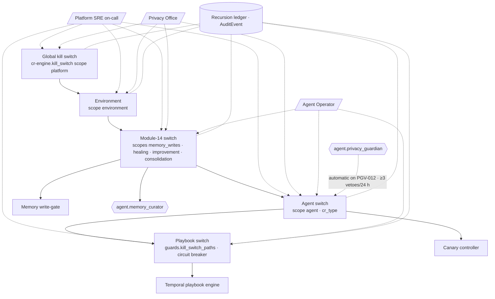

# Recursive Learning Governance

MEM-01…MEM-05 give the agent layer memory, caches, a healing engine and an improvement loop. This document says
**what the agent layer may change about itself, what it may never change, how deep and how fast it may recurse, and
how humans stop it**. It is the module's alignment with module 11: every learned artefact is a governed change in a
GOV-00 §2.2 class, every self-modification has a proposer, an evaluator, a privacy reviewer, an approver, an applier
and an auditor that are never the same principal, and everything that *defines the rules of learning* — permission
matrices, risk-class gates, the privacy guardian, rubrics, golden sets, budgets, autonomy levels and the blast-radius
policy — is a **fixed point** that automation cannot move. ADR-09 ("closed-loop but gated") and VIS-00 §7 principle 7
("agents do the work; people hold the authority") are the design stance; G-06 is the goal this governance protects
rather than slows.

The healing ladder L0–L4 of MEM-04 and the autonomy levels L1–L4 of ARC-01 §5 are distinct scales; this document
always writes "ladder L2" or "autonomy L3".

**Hard rule:** No tier of memory (M0–M4 as used by this module) and no cache tier (C0–C4) may hold content whose
`hc-phi-class` is anything but `non-phi`/`internal` (steward preferences: `pii:workforce` with consent flag). This
includes the C0 provider prompt cache: pseudonymised PHI is not permitted. Governance artefacts produced here —
recursion-ledger entries, ablation reports, DGC reports, audit samples — are themselves memory records and obey it.

## 1. Why govern learning

A self-improving agent layer fails in characteristic ways. Each threat below is matched to the control that bounds
it and the requirement ids that make the control testable.

| Threat | How it would manifest in HEALIX | Controls | Ids |
|---|---|---|---|
| **Goodhart / evaluator capture** | `agent.improver` compiles prompts that score well on `RUB-*` while steward edit distance rises; or a learned change drifts the evaluator itself | Multi-objective fitness and metric-gaming detector (MEM-05 §6); evaluator and rubrics on the fixed-point list (§4); evaluator never evaluates changes to itself (§3); weekly κ calibration gate (AGT-SAFE-009) | MEM-GOV-002/003/016, MEM-IMP-021 |
| **Poisoning / prompt injection via memory** | A Cerner `CODE_VALUE.DESCRIPTION` or Fusion lookup meaning carrying instruction-like text is remembered, recalled and acted on; or a flood of T0 writes shifts consolidation | Trust tiers with influence ceilings (§2); `untrusted_text` quarantine before promotion; write-rate anomaly freeze; honeytokens; poisoning drill (§7) | MEM-GOV-001/006/009/023/026/027 |
| **Runaway recursion** | Healing playbook A triggers B which re-triggers A; a learned playbook spawns a learned playbook nightly; improvement of the improver | Recursion ledger with depth ≤ 2, parent-retrigger ban, improve-never-triggers-improve, 14-day dwell, daily caps (§5) | MEM-GOV-004/005/019/020/024 |
| **PHI creep** | Reflections or lessons gradually carry masked-sample fragments; scanner version lag | Write-gate (MEM-01 §6); nightly re-scan (PGV-012, AGT-SAFE-004); scanner re-scan SLA ≤ 7 d; automatic demotion on any finding | MEM-GOV-008/029, MEM-ARCH-025/038 |
| **Autonomy creep** | An agent effectively acts above its level through learned playbooks or raised thresholds; `autonomy_ceiling` eroded by small CRs | Symmetric graduation/demotion tied to manifest `graduation` (§6); ceilings enforced by cr-engine and gateway; learner × target matrix (§5.3); AGT-SAFE-018 split detection | MEM-GOV-008/017/018 |
| **Budget spirals** | Compile loops, consolidation and healing consume token budgets; self_healer "fixes" exhaustion by raising caps | Budgets are `policy` class, humans only (MEM-HEAL-015); change budget per period (§5.2); `budget_exhaustion` rollback trigger; charge-back to the learner's own cap (MEM-IMP-022) | MEM-GOV-019/039 |
| **Cross-environment leakage** | `prod` memory compiled into `test` prompts or vice versa; store-to-store copies | No cross-env reads (MEM-ARCH-004); Git-only promotion path (AGT-MEM-013); de-identified aggregates only | MEM-GOV-025 |
| **Silent self-modification** | A change reaches an agent without a CR, a signed tag or a release event | Every learned artefact audited (§5.4); signature verification at load (§7); `hc.ops.agent.policy.v1` release events | MEM-GOV-021/028 |

## 2. Trust tiers T0–T4 and what each may influence

Trust tiers are stamped at write time (MEM-01 §4) and may only rise along the paths below; they never rise by recall
frequency or age. **T4 is never produced by `remember`.**

| Tier | Meaning | Produced by | May influence | May never influence | Rises to |
|---|---|---|---|---|---|
| **T0** data-derived (untrusted) | Facts extracted from data text: labels, lookup meanings, NTE/OBX-5-derived observations (masked), free-text reflections | `remember` with `untrusted_text: true`; Graphiti extraction from text episodes | Context as a quoted `[mem:…]` block (MEM-02 §7); `hypothesis` records; corroboration counts | Prompts, exemplars, retrieval profiles, thresholds, playbooks, routing, cache thresholds, any CR `evidence.sources` as sole evidence | T1 by curator corroboration: same fact in ≥ 3 episodes across ≥ 2 runs (MEM-02 §8) |
| **T1** agent-observed | Structured observations, decisions, incidents, playbook runs written by an agent with evidence refs | `remember` by any agent; `reflect` lessons | Recall ranking; CR evidence (`memory_record`, echoed per MEM-ARCH-006); episodic → semantic promotion (M2); `hypothesis` for the improver | Procedural artefacts (M3) directly | T2 by `confirm(by: agent.evaluator)` after an evaluation run cites it |
| **T2** evaluator-confirmed | Lessons and outcomes confirmed by an evaluation run or a resolved incident postmortem | `confirm` by `agent.evaluator`; Temporal healing workflow at `lesson_recorded` | Semantic → procedural promotion **via CR only** (MEM-GRA-033); playbook `candidate_for_tuning[]` via `playbook` CR; improver `compiling` inputs | `limits`/`guards`, rubrics, golden sets, budgets, autonomy | T3 by `confirm(by: human:<id>)` |
| **T3** human-confirmed | Steward/operator-confirmed lessons, approved CR rationales, steward feedback | `confirm` by an authenticated human (AGT-SAFE-016) | Few-shot exemplars (MEM-IMP-026); contradiction resolution winner; graduation evidence | Anything on the fixed-point list without a `policy` CR | — (T4 is not a confirmation step) |
| **T4** policy | The rules of learning themselves: fixed-point artefacts, thresholds floors, this document's numbers | `policy`-class CR approved by DGC / Privacy Office (GOV-00 §2.2); loaded from Git, never from memory stores | Everything | — | — |

Contradiction resolution (MEM-02 §8) is tier-ordered: a T0 edge never expires a T2+ edge; a T4 statement is not an
edge at all but a loaded policy that filters recall.

## 3. Separation-of-duties matrix

Rows are the six duties; columns are the self-modification kinds this module produces. Cells name the agent or the
GOV-00 §2.1 body. `cr-engine` evaluates the invariants below on every CR at `created` and again at `approved`.

| Duty | Healing action (ladder L1/L2) | Playbook promotion / new playbook | Prompt / policy change (`agent_policy`) | Auto-approve threshold raise | Consolidation & promotion | Purge | Budget change | Golden-set change | Rubric change | Manifest change (level, tools, ceiling) |
|---|---|---|---|---|---|---|---|---|---|---|
| **Proposer** | `agent.self_healer` (playbook selection) | `agent.self_healer` or `agent.memory_curator` (candidate) | `agent.improver` | `agent.improver` (raise only, AGT-SAFE-010) | `agent.memory_curator` | Steward, Privacy Office or curator (retention) | **Human only** (Agent Operator) | Dataset owner (AGT-05 §5), human | Human (Agent Operations, Clinical Informatics) | Orchestrator graduation job (level) or human |
| **Evaluator** | Temporal playbook engine budget check (contract G); dry-run for ladder L2 | `agent.evaluator` (chaos tests, RUB-OPS-01) | `agent.evaluator` (offline eval, MEM-05 §3) | `agent.evaluator` (κ ≥ 0.90 for type) | Write-gate + trust-tier rules | Legal-basis check (automated) | — | Retrospective rescoring (AGT-MEM-012) | Retrospective rescoring by **previous pinned evaluator version** + human adjudication | `agent.evaluator` evidence summary (AGT-MEM-010) |
| **Privacy reviewer** | `agent.privacy_guardian` (PHI-free packet, automated) | `agent.privacy_guardian` | `agent.privacy_guardian` (`privacy_review`) | `agent.privacy_guardian` | `agent.privacy_guardian` nightly scan (PGV-012) | Privacy Office | Privacy Office | Privacy & Security Office (PHI-free attestation, AGT-SAFE-011) | Privacy Office | `agent.privacy_guardian` |
| **Approver** | Pre-approved policy envelope (`status: autonomous` via earlier `playbook` CR); human per run when `assisted` | Platform SRE + Agent Operator (medium; high if ladder L2 actions) | Agent Operator (improver autonomy L1); auto for `low` only after graduation to L2 | Agent Operator | Manifest policy envelope (curator L3); procedural promotion ⇒ CR approver of that type | Privacy Office **and** DGC (dual control) | **DGC** (`policy` class) | Dataset owner + Agent Operations; DGC if used for graduation | **DGC** (`policy` class) | Agent Operator within `autonomy_ceiling`; DGC for ceiling, tools, budgets |
| **Applier** | Temporal playbook engine (never the agent) | `cr-engine` (Git merge, signed tag) | `cr-engine` → `agent.release_manager` → canary controller | `cr-engine` (manifest) | Memory API (`consolidate`/`promote`) | Memory API admin, executed by Platform SRE | `cr-engine` (manifest CR) | Git, human | Git, human; red-team gate (AGT-SAFE-017) | `cr-engine` |
| **Auditor** | `hc.ops.healing.playbookrun.event.v1` + AuditEvent; Platform SRE weekly | DGC monthly report (§12) | Agent Platform weekly improvement review (MEM-05 §7) | DGC monthly report | Human memory audit ≥ 200 records/month (§7) | GOV-03 AuditEvent; monthly disposition report | DGC | Autonomy board (RMP-01 §9) | Autonomy board | Quarterly access review (GOV-02) |

**Invariants (machine-checked per CR, MEM-GOV-003):** (i) no principal appears as both proposer and approver; (ii)
`agent.evaluator` and `agent.privacy_guardian` never evaluate or review a change whose target is their own manifest,
prompt or rubric — such CRs are evaluated by the previous pinned version plus human adjudication and gated by
AGT-SAFE-017; (iii) the applier is always `cr-engine`, the Temporal engine or a human, never an LLM agent; (iv) a
proposer agent holds no `apply` permission on the target's store (GOV-ACC-010/011); (v) ACLs implementing (i)–(iv)
are reviewed quarterly under GOV-02 and any drift is a `policy`-class finding.

## 4. Fixed-point protection list

The following are **fixed points of self-modification**: `cr-engine` rejects any CR whose `proposer` is an agent and
whose target resolves to one of them (reason `FIXED_POINT_TARGET`), the MCP gateway rejects any `apply` on their
stores, and the documentation linter rejects any module-14 YAML change outside a `policy`-class CR. All are owned by
the DGC and the Privacy Office under GOV-00 §2.2 class `policy`.

| # | Fixed point | Why | Owner |
|---|---|---|---|
| F-1 | Manifests and prompts of `agent.evaluator`, `agent.privacy_guardian`, `agent.improver`, `agent.memory_curator` | The judges and the learners must not learn themselves | DGC + Privacy Office |
| F-2 | Rubrics `RUB-*` (AGT-05 §4.3) | Fitness function of every loop | DGC |
| F-3 | Golden sets, regression suites, red-team suites, `human_agreement_target` | Ground truth of every loop (MEM-IMP-003) | Dataset owners under DGC |
| F-4 | Budgets (`budgets.*` in every manifest), `daily_token_cap`, cache cost ceilings | Budget spirals (MEM-HEAL-015) | DGC |
| F-5 | Autonomy levels, `autonomy_ceiling`, `graduation`, `demotion_triggers` | Autonomy creep; changed only by the graduation CR of §6 | Agent Operator within ceiling; DGC above |
| F-6 | Risk-class gates and auto-approval thresholds **floors** (AGT-05 §6; raises allowed, lowering is a PRD revision) | Gate integrity | DGC |
| F-7 | Permission matrices: manifest tool allow-lists, GOV-02 access matrix rows for memory scopes and cache namespaces, PGV rules | No agent widens access | Privacy Office |
| F-8 | Module-14 YAMLs: `memory-schema.yaml` (incl. `consolidation`, `phi_firewall`, `trust_tiers`), `cache-policy.yaml` (`bypass_when[]`, `defaults`), `playbook.schema.json` | The rules of learning | DGC |
| F-9 | Playbook `limits` and `guards` blocks, `blast_radius` and `autonomous_allowed` on every action (MEM-HEAL-042) | Blast-radius policy | Platform SRE + DGC |
| F-10 | Kill-switch wiring and release conditions (§9), recursion parameters of §5 (depth, dwell, caps) | Last line of defence | Privacy Office + Platform SRE |

What remains improvable by automation is exactly MEM-05 §1 (specialist prompts and exemplars, retrieval profiles,
threshold raises, playbook keys in `candidate_for_tuning[]`, tool descriptions, routing, cache thresholds).

## 5. Recursion rules and ledger

### 5.1 Ledger (contract F, verbatim)

`{recursion_id, parent_id, depth, kind: heal|learn|improve, trigger, agent_id, budget_used{tokens, actions}, outcome, created_at}`;
invariants: heal depth ≤ 2, child ≠ parent playbook, improve never triggers improve, learn only via CR, dwell 14 d,
daily caps.

Ledger ids are `REC-<yyyymmdd>-<ULID>`. An entry is written **before** the child workflow starts, as a `decision`-class
memory record in scope `global` (so it passes the write-gate and lands on `hc.ops.memory.write.v1`), mirrored to
`fact_memory_event`, and linked in Graphiti by a `DERIVED_FROM` edge from the child artefact/incident to its parent.
Depth 0 is a run started by an external signal, schedule or human; depth 1 is a child of such a run; depth 2 is the
last depth automation may start. A would-be depth-3 entry is written with `outcome: blocked_pending_review` and raised
to the DGC digest; nothing executes.

```mermaid
stateDiagram-v2
  [*] --> root : signal · schedule · human (depth 0)
  root --> child : ledger entry (depth 1)<br/>parent_id set · caps checked
  child --> grandchild : ledger entry (depth 2)<br/>child ≠ parent playbook
  grandchild --> blocked : any further trigger<br/>outcome blocked_pending_review
  blocked --> root : DGC review approves<br/>new root, depth 0
  child --> dwell : kind learn|improve promoted
  dwell --> child : parent STABLE ≥ 14 d<br/>and artefact idle ≥ 7 d
```

### 5.2 Rules

| Rule | Statement | Enforced by |
|---|---|---|
| Healing depth | `heal` chains ≤ 2 deep; a child incident may never re-trigger the playbook that spawned it (`conflicts_with` + ledger check) | Temporal healing workflow (MEM-HEAL-009) |
| Improvement non-recursion | An `improve` entry may never have an `improve` parent; the improver's own artefacts are fixed points (F-1) | Temporal improvement workflow (MEM-IMP-002) |
| Learning only via CR | incident → lesson → `playbook_candidate` → `playbook` CR → `shadow` → … ; no step writes M3 directly (MEM-GRA-033); a learned playbook's first autonomous run is a new depth-0 root | `cr-engine`, Memory API `promote` |
| **14-day stability dwell** | A learned change (`learn` or `improve`) may become the `parent_id` of a further learned change only after it has been `stable` (MEM-05 contract D) for ≥ 14 d | Temporal guard at `hypothesis` (MEM-IMP-027) |
| Cooling-off | One promoted change per artefact (PromptVersion family, playbook id, retrieval profile) per 7 d | `cr-engine` target lock |
| Daily candidate caps | ≤ 5 `playbook` and ≤ 10 `agent_policy` candidate CRs per day per environment, all learners combined (MEM-GRA-036) | `cr-engine` quota |
| **Change budget per period** | Per agent ≤ 4 promoted `agent_policy` versions / 30 d; per playbook ≤ 2 versions / 30 d; module-wide ≤ 20 learned promotions / 30 d; exhaustion ⇒ candidates wait in `cr_proposed` and any in-flight canary that needs a follow-up fix is rolled back with `rollback.trigger: budget_exhaustion` | Canary controller + `cr-engine` quota |
| Freeze windows | No learned promotion, canary step or playbook graduation inside OPS-02 §7 release windows, the Oracle Fusion quarterly-update window (T−14 d to T+7 d) or Millennium code-upgrade windows | Freeze-calendar guard (request X-06) |
| Review threshold | Any ledger entry at depth 2 whose `budget_used.tokens` > 25 % of the agent's `daily_token_cap`, or any blocked depth-3 attempt, appears in the next DGC digest | Reporting (§12) |

### 5.3 Learner × target matrix

✔ = may propose via CR of the stated type · ◐ = may act within policy envelope without CR · ✘ = rejected at cr-engine/gateway.

| Learner → target | Specialist prompts / exemplars | Own prompt / manifest | Rubrics, golden sets | Playbook keys in `candidate_for_tuning[]` | Playbook `limits`/`guards`, blast-radius policy | Threshold raise | Budgets, autonomy, ceilings | Memory records (prune, archive, consolidate) | Procedural promotion | Module-14 YAMLs |
|---|---|---|---|---|---|---|---|---|---|---|
| `agent.improver` | ✔ `agent_policy` | ✘ | ✘ | ✔ `playbook` | ✘ | ✔ `agent_policy` (raise only) | ✘ | ✘ (read only) | ✘ | ✘ |
| `agent.self_healer` | ✘ | ✘ | ✘ | ✔ `playbook` (author new playbooks, tune keys) | ✘ | ✘ | ✘ (never raises budgets) | ◐ `record_incident`, `record_playbook_run` | ✘ | ✘ |
| `agent.memory_curator` | ✘ | ✘ | ✘ | ✘ | ✘ | ✘ | ✘ | ◐ dedupe, decay, archive, quarantine | ✔ files `playbook`/`agent_policy` CR via `promote`; never applies | ✘ |
| `agent.evaluator` / `agent.privacy_guardian` | ✘ (confirm/veto only) | ✘ | ✘ | ✘ | ✘ | ✘ | ✘ | ◐ `confirm`, `quarantine` | ✘ | ✘ |
| `agent.orchestrator` | ✘ | ✘ | ✘ | ✘ | ✘ | ✘ | ✔ level change within ceiling via governance CR with evidence (AGT-MEM-010) | ✘ | ✘ | ✘ |
| Humans (Agent Operator, DGC, Privacy Office) | ✔ | ✔ | ✔ `policy` | ✔ | ✔ `policy` | ✔ (lowering = PRD revision) | ✔ `policy` (DGC) | ✔ incl. `purge` (dual control) | ✔ | ✔ `policy` |

### 5.4 Audit of every learned artefact

Every PromptVersion, PolicyVersion, playbook version and retrieval-profile version that reaches any environment above
`dev` carries: the approving `cr_id` and its `automated_checks[]` results (`phi_scan`, `prompt_injection_scan`,
`idempotency_check`), `compiled_from` (lessons, evaluation runs, `memory_record_ids[]`, dataset fingerprint, optimiser
method and seed — MEM-IMP-010), its `recursion_id` and `parent_id`, a signed Git tag (ARC-NFR-006), a release event
on `hc.ops.agent.policy.v1`, a GOV-03 §5 AuditEvent and a row in `fact_policy_release` with TKG-01 §9 columns. An
artefact lacking any item is refused at load (§7, signature) and reported as `AgentPolicyUnsigned` (SEV2).

## 6. Autonomy graduation and demotion

Graduation and demotion are **symmetric, automatic and data-driven**, computed from the same episodic statistics
(AGT-06 §6) by the weekly graduation job, applied through the manifest `graduation` block and never by a learned
artefact. Playbook lifecycle (`shadow → assisted → autonomous`, MEM-04 §8) is the healing-side expression of the same
rule.

| Direction | Trigger (all over the stated window) | Effect | Mechanism |
|---|---|---|---|
| **Graduate** one level | 90 d at current level with: CR acceptance ≥ 90 %; rollback ≤ 2 % (RMP-ACC-102); evaluator–human agreement κ ≥ 0.85 (RMP-ACC-100); zero PHI findings; zero depth-3 attempts; `autonomy_ceiling` not reached | Manifest `autonomy_level` +1 via governance CR carrying the evidence summary (AGT-MEM-010); autonomy board informed (RMP-01 §9) | Orchestrator graduation job; Agent Operator approves within ceiling |
| **Demote** one level (automatic, before next run — AGT-SAFE-014) | Any PHI finding in memory or decision log (PGV-012); rollback > 5 % in 30 d; ≥ 3 circuit-breaker trips on the agent's playbooks in 30 d; κ < 0.80 for the agent's main CR type; write-rate anomaly freeze (§7) attributed to the agent | `autonomy_level` −1 (self_healer: all its `autonomous` playbooks → `assisted`); open CRs held; kill switch (agent scope) on PGV-012 | `demotion_triggers` evaluated every run |
| **Ceiling** | `autonomy_ceiling` is F-5; `agent.improver` ceiling is L2 and only for `low` risk classes; `agent.self_healer` ceiling L3 with ladder L2 actions max; `agent.memory_curator` ceiling L3 | A graduation CR above ceiling is rejected (`AUTONOMY_CEILING`) | `cr-engine` |
| **Re-graduation after demotion** | Same criteria, window restarts; two demotions in 180 d require DGC review before any re-graduation | — | Ledger + DGC digest |

## 7. Poisoning and injection defences

| Defence | Rule |
|---|---|
| Provenance-weighted trust | Recall ranking multiplies by trust tier weight (T0 0.25, T1 0.5, T2 0.8, T3 1.0); T0 results are capped at 20 % of `budget_tokens` in any assembled context |
| Quarantine of `untrusted_text`-derived memories | Records with `untrusted_text: true` are ineligible for promotion to M2/M3 until corroborated to T1 and confirmed to T2; they never appear as a CR's sole evidence source |
| Canary honeytokens | ≥ 50 synthetic honeytoken records (fake rule ids, fake IRIs, fake "instructions") are planted per environment by module 15; any appearance of a honeytoken in a CR text field, prompt, playbook or tool call raises `MemoryHoneytokenRecalled` (SEV2) and freezes the recalling scope |
| Write-rate anomaly freeze | Memory writes per (scope, writer) > 5× the 7-day baseline over 15 min (FLT-PLAT-007) ⇒ `freeze(scope)`, recall from that scope excluded, incident `INC-*`, Privacy Office and Agent Operator notified; release requires human review of a 200-record sample |
| Signed procedural memory | Prompts, policies, playbooks and retrieval profiles load into M0 only if the Git tag signature verifies against the release key and the version matches the latest `hc.ops.agent.policy.v1` event; mismatch ⇒ agent runs on the previous `stable` version and `AgentPolicyUnsigned` fires |
| Poisoning drill | Quarterly in `test`: module 15 injects 1,000 adversarial episodes (instruction-like text, contradictory facts, fake outcomes) across scopes; measured influence on golden-set decisions must be ≤ 1 % (decision flips vs. clean run) |
| Human memory audit sampling | ≥ 200 records/month sampled stratified by class, scope and trust tier, reviewed by Agent Operator and Privacy Office; precision@10 ≥ 0.6 (MEM-02 §9); any PHI finding ⇒ PGV-012 path |
| Scanner re-scan SLA | Within 7 d of any `scanner_version` change, all M1–M3 tiers, archives and C1–C4 contents are re-scanned (MEM-ARCH-038); findings quarantined, counts reported |
| Feedback authenticity | Human feedback used as T3 or as calibration labels is accepted only from authenticated reviewers (AGT-SAFE-016); reviewers whose disagreement pattern deviates > 3σ from the role's distribution are excluded from compile inputs pending review |

## 8. Memory-lift ablation protocol

Nightly, after consolidation (02:00–04:00 UTC), the evaluator re-runs the golden sets referenced by each learning
agent's manifest twice in `test` — **memory-on** (normal recall) and **memory-off** (`recall` disabled, `memory_degraded`
provenance) — on the same frozen validation split, seed and model. `lift = aggregate_on − aggregate_off` per agent and
per scope. Required lift ≥ +0.03 at agent level; a scope whose lift is < 0 on 3 consecutive nights is flagged
`prune_candidate` for the curator (archive, not purge) and listed in the DGC digest; an agent whose lift is < +0.03 for
14 consecutive nights has its improvement loop held at `observing` until reviewed. Monthly, the Agent Platform compares
acceptance and rollback rates of memory-influenced CRs (`provenance.recalled_memory_ids[]` non-empty) against
non-influenced CRs of the same type and risk class; a negative delta beyond −0.02 opens a review of the retrieval
profile. Results are `evaluation_lesson` records (T2) and rows in `fact_memory_recall`.

## 9. Kill-switch hierarchy and degraded modes



Pulling a switch at any level implies every level beneath it. All switches propagate within 30 s (stricter than
AGT-SAFE-012's 60 s because healing actions are in flight), are idempotent, and emit an AuditEvent plus a ledger entry
`kind: heal, trigger: kill_switch`.

| Scope | Keeps running | Stops | Who may pull | Release conditions |
|---|---|---|---|---|
| Playbook | Detection, diagnosis (read-only), recommendations | Actions of that playbook; it drops to `shadow` | Platform SRE, Agent Operator; automatic on circuit breaker | Postmortem filed; `playbook` CR re-promotes |
| Agent | Proposals (evidence not lost, AGT-05 §8), recall | Auto-approvals and applies of that agent; its canaries roll back; its healing actions abort | Agent Operator, Privacy Office, Platform SRE; automatic (PGV-012, ≥ 3 vetoes/24 h) | Agent Operator + Privacy Office if privacy-triggered |
| Module 14 | Ingestion, DQ measurement, cache **serving** (bypass-capable), memory **reads** | Healing actions (ladder ≥ L1), canaries (all roll back), memory writes (buffer on write log), consolidation, ablation | Platform SRE, Privacy Office, Agent Operator | Root cause recorded; 24 h clean memory scan; DGC informed |
| Environment | Pipeline data flow | All agent applies/auto-approvals, all module-14 loops in that env | Platform SRE, Privacy Office | Per AGT-05 §8 |
| Global | Pipeline data flow, caches in bypass | Everything agentic platform-wide | Platform SRE on-call, Privacy Office | Agent Operator + Privacy & Security Officer; DGC emergency session within 2 business days |

**Break-glass** (used only when a switch cannot be released through the normal path or a learned artefact must be
hot-reverted during a SEV1):

| Action | Who | Controls |
|---|---|---|
| Force-revert an agent to a prior `stable` PromptVersion | Agent Operator + Platform SRE (dual control) | Time-boxed ≤ 4 h then automatic re-evaluation; compensating CR filed within 24 h; AuditEvent + ledger |
| Disable a fixed-point check (F-x) to apply an emergency `policy` change | DGC chair + Privacy Office | Time-boxed ≤ 4 h; every CR applied under it listed in the DGC digest; auto-re-enable |
| Manual `purge` outside dual control | Never | — |
| Release a kill switch without root cause | Never | — |

## 10. Rights and retention

Memory classes retain per MEM-01 §8; this section governs the rights that cut across them. A steward (workforce
member, `pii:workforce`) may request access, rectification or erasure of their `preference`/`steward_feedback`
records: export (JSONL) ≤ 30 d and purge ≤ 24 h (MEM-ARCH-036), in-region processing for EU/UK stewards
(GOV-PHI-020), consent flag required for the class to be written at all (request X-05). Learned artefacts
(prompts, playbooks, lessons) are *not* personal data but their `compiled_from` may cite a steward hash; purge
rewrites the citation to a tombstone id without altering the artefact. Legal hold (OPS-04 §7) suspends every
disposition — tombstone, archive, purge, decay — for records, ledger entries and learned artefacts in scope, and the
preservation copy includes the `hc.ops.memory.write.v1` offsets. Audit records of every self-modification are kept
≥ 6 years (GOV-LIN-010); recursion-ledger entries follow the `decision` class (2,555 d).

## 11. Red-team and assurance

Three suites, owned by module 15 (request X-08), run in `test` on every change adjacent to the evaluator or the
privacy guardian (AGT-SAFE-017) and quarterly in `uat`: (a) **PHI-in-memory** — 10,000 honeytoken probes through
`remember`, `reflect`, Graphiti extraction and consolidation summaries, pass = 0 stored (MEM-ARCH-025); (b) **playbook
adversarial** — oscillation (restart loops), alert storms across ≥ 3 facilities, conflicting playbooks on one target,
parent-retrigger attempts, freeze-window violations, budget-exhaustion attempts, pass = blast radius never exceeded,
depth never > 2, no `schema`/`data_mutation` executed; (c) **improvement-loop attacks** — poisoned human feedback,
test-split exfiltration attempts, metric gaming, fixed-point targeting, threshold lowering, pass = every attempt
rejected at the stated gate. Findings are filed in the module-15 register with the `MEM-GOV-*` id they test; any
failure blocks promotion of the triggering change and, for (a), is a reportable incident under module 11.

## 12. Reporting

The **monthly DGC "autonomy & recursion report"** (produced by the Agent Platform from `fact_memory_event`,
`fact_memory_recall`, `fact_healing_incident`, `fact_policy_release` and the ledger; PHI-free by construction) contains:
memory growth per tier and scope; memory-lift per agent and prune flags; rollbacks and `rollback.trigger` mix;
auto-resolved share of P1 ops incidents; playbooks graduated/demoted; PHI quarantine count (target 0) and scanner
re-scan status; recursion-depth histogram and blocked depth-3 attempts; memory-influenced vs non-influenced CR
acceptance; kill-switch and break-glass events; change-budget utilisation; SoD invariant violations (target 0);
open cross-module requests (MEM-00 §6). A weekly digest goes to the Agent Operator (MEM-05 §7); the fortnightly DGC
meeting receives the running digest; the annual roll-up is an input to the GOV-PHI-023 risk analysis and the autonomy
board's phase decisions (RMP-01 §9).

## 13. Requirements

> **MEM-GOV-001** (P0, test) — Memory records at trust tier T0 MUST NOT influence any procedural artefact: a `promote`, `playbook` CR, `agent_policy` CR or compile input citing only T0 records MUST be rejected, and T0 content MUST appear in context only inside the untrusted wrapper of MEM-02 §7.

> **MEM-GOV-002** (P0, test) — `cr-engine` MUST reject with reason `FIXED_POINT_TARGET` any agent-proposed CR whose target resolves to an item of the §4 list (F-1…F-10), and the MCP gateway MUST deny and audit any `apply` on those stores by any agent.

> **MEM-GOV-003** (P0, test) — The separation-of-duties invariants of §3 MUST be evaluated by `cr-engine` at `created` and `approved` for every CR of type `agent_policy`, `playbook`, `dq_rule` or governance; a violation MUST block the transition and emit an AuditEvent.

> **MEM-GOV-004** (P0, test) — Every child workflow started by `agent.self_healer`, `agent.memory_curator` or `agent.improver` MUST have a ledger entry (contract F) written before it starts; the engine MUST refuse `heal` depth > 2, any child whose playbook equals its parent's, any `improve` entry with an `improve` parent, and any entry exceeding the §5.2 daily caps.

> **MEM-GOV-005** (P0, test) — A learned change MUST NOT be the `parent_id` of a further learned change until it has been `stable` for ≥ 14 d; the Temporal guard at `hypothesis` MUST refuse earlier attempts and record them in the ledger with `outcome: dwell_refused`.

> **MEM-GOV-006** (P0, test) — Memory writes per (scope, writer) exceeding 5× the 7-day baseline over 15 min MUST trigger `freeze(scope)`, exclude the scope from recall, open an incident and notify the Privacy Office and Agent Operator; release MUST require human review of a ≥ 200-record sample.

> **MEM-GOV-007** (P0, test) — Each kill switch of §9 MUST stop healing actions, canaries (with rollback), memory writes and consolidation at its scope within 30 s, MUST imply every lower level, MUST be idempotent and MUST emit an AuditEvent and a ledger entry.

> **MEM-GOV-008** (P0, test) — Demotion MUST be automatic before the agent's next run on any of: PHI finding (PGV-012), rollback > 5 % in 30 d, ≥ 3 circuit-breaker trips in 30 d, κ < 0.80 for the agent's main CR type, or an attributed write-rate freeze; `autonomous` playbooks of a demoted `agent.self_healer` MUST drop to `assisted`.

> **MEM-GOV-009** (P0, test) — The quarterly poisoning drill (1,000 adversarial episodes in `test`) MUST show ≤ 1 % decision flips on golden sets relative to a clean run; exceeding it MUST hold all learning loops at `observing` until the Privacy Office releases them.

> **MEM-GOV-010** (P1, demo) — A steward erasure request MUST remove all `preference` and `steward_feedback` records for that steward hash from every tier, cache and archive within 24 h and return a `purge_receipt`; `compiled_from` citations MUST be rewritten to tombstone ids.

> **MEM-GOV-011** (P1, inspection) — At least 200 memory records per month, stratified by class, scope and trust tier, MUST be reviewed by the Agent Operator and the Privacy Office with recorded verdicts; precision@10 MUST be ≥ 0.6 and any PHI finding MUST follow the PGV-012 path.

> **MEM-GOV-012** (P1, test) — Every CR produced by a run that performed `recall` MUST echo the recalled record ids in `evidence.sources[kind=memory_record]` and `provenance.recalled_memory_ids[]` (MEM-ARCH-006); a CR lacking them when the run's recall AuditEvent is non-empty MUST fail `cr-engine` validation.

> **MEM-GOV-013** (P1, analysis) — The monthly DGC autonomy & recursion report of §12 MUST be produced with every listed metric; a missing month MUST hold graduation CRs for all learning agents.

> **MEM-GOV-014** (P1, test) — The memory-lift ablation of §8 MUST run nightly per learning agent and scope; a scope with lift < 0 on 3 consecutive nights MUST be flagged `prune_candidate` and an agent below +0.03 for 14 nights MUST have its improvement loop held at `observing`.

> **MEM-GOV-015** (P1, demo) — A kill-switch drill MUST be executed quarterly at every level of §9 in `uat`, demonstrating ≤ 30 s propagation, canary rollback, write buffering and clean release; results MUST be recorded in the DGC report.

> **MEM-GOV-016** (P0, inspection) — `agent.improver` MUST hold no tool permission and no CR path that can modify its own prompt, manifest, the rubrics `RUB-*`, golden sets or `human_agreement_target`; the manifest linter MUST fail any allow-list granting them.

> **MEM-GOV-017** (P0, test) — The learner × target matrix of §5.3 MUST be enforced: `agent.self_healer` MUST NOT change `limits`, `guards`, `blast_radius` or `autonomous_allowed`; `agent.memory_curator` MUST NOT promote to procedural memory without a CR; every ✘ cell MUST be rejected at `cr-engine` or the gateway with an audited reason.

> **MEM-GOV-018** (P0, test) — No graduation CR MUST exceed the manifest `autonomy_ceiling`; `agent.improver` MUST NOT exceed autonomy L2 and at L2 MUST auto-apply only `low` risk-class `agent_policy` CRs.

> **MEM-GOV-019** (P0, test) — The change budget of §5.2 (≤ 4 `agent_policy` promotions per agent / 30 d; ≤ 2 versions per playbook / 30 d; ≤ 20 learned promotions module-wide / 30 d) MUST be enforced by the canary controller and `cr-engine`; exhaustion MUST queue candidates and set `rollback.trigger: budget_exhaustion` on any canary requiring a follow-up fix.

> **MEM-GOV-020** (P1, test) — At most one promoted change per artefact (PromptVersion family, playbook id or retrieval profile) MUST be allowed per 7 d; a second candidate MUST wait in `cr_proposed`.

> **MEM-GOV-021** (P0, test) — Every learned artefact version above `dev` MUST carry the items of §5.4 (approving `cr_id` with check results, `compiled_from`, `recursion_id`, signed tag, release event, AuditEvent, `fact_policy_release` row); an artefact lacking any MUST be refused at load.

> **MEM-GOV-022** (P1, test) — Behavioural drift on learned behaviour MUST be detected weekly per agent: population-stability index of evaluator scores > 0.2, CR-type mix shift > 20 pp, tool-call profile shift > 20 pp, or steward edit distance +10 % MUST freeze that agent's learning loop at `observing` and open a review ticket.

> **MEM-GOV-023** (P0, test) — Trust tiers MUST rise only along §2 paths (T0→T1 by corroboration, T1→T2 by `agent.evaluator` confirm, T2→T3 by human confirm); no agent MUST be able to write or confirm T4, and `remember` MUST reject `trust_tier` > T2.

> **MEM-GOV-024** (P1, test) — A child workflow without a resolvable `recursion_id` and `parent_id` MUST be refused by the engine; a depth-3 attempt MUST be recorded with `outcome: blocked_pending_review` and MUST NOT execute.

> **MEM-GOV-025** (P1, test) — No learned artefact MUST be compiled from memory of another environment except de-identified aggregates (AGT-MEM-013), and promotion between environments MUST occur only through the signed Git path; a compile citing cross-env `memory_record_ids` MUST be refused.

> **MEM-GOV-026** (P0, test) — Records with `untrusted_text: true` MUST be ineligible for promotion to M2 or M3 and MUST NOT be a CR's sole evidence source until corroborated to T1 and confirmed to T2.

> **MEM-GOV-027** (P1, test) — At least 50 honeytoken memory records per environment MUST be maintained; any honeytoken appearing in a CR text field, prompt, playbook or tool call MUST raise `MemoryHoneytokenRecalled` and freeze the recalling scope.

> **MEM-GOV-028** (P0, test) — Prompts, policies, playbooks and retrieval profiles MUST load into working memory only when the Git tag signature verifies and the version matches the latest `hc.ops.agent.policy.v1` event; on mismatch the agent MUST run the previous `stable` version and `AgentPolicyUnsigned` MUST fire.

> **MEM-GOV-029** (P1, test) — Within 7 d of a `scanner_version` change, all M1–M3 tiers, archives and C1–C4 contents MUST be re-scanned, findings quarantined and counts reported in the DGC report (MEM-ARCH-038).

> **MEM-GOV-030** (P1, inspection) — The human review cadence MUST be: weekly improvement review by the Agent Operator, fortnightly DGC digest, monthly report (§12), quarterly access review of SoD ACLs (GOV-02), quarterly kill-switch drill and red-team run, annual GOV-PHI-023 input; evidence of each MUST be retained 6 years.

> **MEM-GOV-031** (P1, test) — Break-glass actions of §9 MUST require dual control, MUST be time-boxed ≤ 4 h with automatic re-enablement of the bypassed control, MUST emit AuditEvents and ledger entries, and MUST produce a compensating CR within 24 h.

> **MEM-GOV-032** (P1, test) — Kill-switch release MUST satisfy the §9 conditions for its scope (root cause recorded; 24 h clean scan for module-14 scope; Privacy Office concurrence when privacy-triggered); a release without them MUST be rejected and audited.

> **MEM-GOV-033** (P1, test) — An active legal hold (OPS-04 §7) MUST suspend tombstone, archive, decay and purge of in-scope memory records, ledger entries and learned artefacts, and the preservation copy MUST include `hc.ops.memory.write.v1` offsets.

> **MEM-GOV-034** (P1, test) — A steward access request MUST produce a JSONL export of all records keyed by that steward hash within 30 d (GOV-PHI-020), processed in-region for EU/UK stewards.

> **MEM-GOV-035** (P1, test) — The three red-team suites of §11 MUST run in `test` on every change to evaluator- or guardian-adjacent artefacts and quarterly in `uat`; any failure MUST block promotion of the triggering change and be filed in the module-15 register with the tested `MEM-GOV-*` id.

> **MEM-GOV-036** (P1, test) — No playbook MUST reach `autonomous` until the playbook-adversarial suite (oscillation, storms across ≥ 3 facilities, conflicts, parent re-trigger, freeze-window and budget attempts) passes with blast radius never exceeded and depth never > 2.

> **MEM-GOV-037** (P1, test) — Human feedback used as T3 confirmation or compile input MUST come from authenticated reviewers (AGT-SAFE-016); reviewers deviating > 3σ from their role's disagreement distribution MUST be excluded from compile inputs pending review.

> **MEM-GOV-038** (P2, analysis) — The recursion-depth histogram and the memory-influenced vs non-influenced acceptance comparison MUST be published monthly and summarised annually as input to GOV-PHI-023 and RMP-01 §9 phase decisions.

> **MEM-GOV-039** (P0, inspection) — Every numeric governance parameter in this document and in module-14 YAMLs (depth, dwell, caps, change budgets, trust weights, drill thresholds, graduation numbers) MUST be classified `policy` under GOV-00 §2.2 and changed only by a DGC-approved CR; no agent MUST hold a path to change them.

> **MEM-GOV-040** (P1, test) — The orchestrator MUST classify every learned change into a GOV-00 §2.2 class before routing: `agent_policy` for specialist prompts = `low`/`medium`; `playbook` with ladder L2 actions = `high`; anything on the §4 list = `policy`; misclassification detected by `cr-engine` MUST veto the CR rather than re-class it (mirroring PGV-008).

## 14. Traceability

| MEM-GOV ids | Verified against / implements |
|---|---|
| 001, 023, 026, 027 | MEM-ARCH-009, MEM-GRA-021/033, AGT-SAFE-005/006, RT-01, RT-11 |
| 002, 016, 017, 018, 039, 040 | AGT-MEM-009, AGT-SAFE-010/017/018, MEM-IMP-003/016/018, MEM-HEAL-042, GOV-00 §2.2, GOV-ACC-010/011 |
| 003, 030, 031, 032 | GOV-00 §2.1/§3, GOV-02 access review, GOV-LIN-006/008, AGT-SAFE-007 |
| 004, 005, 019, 020, 024, 025 | MEM-HEAL-009, MEM-IMP-002/006/027, MEM-GRA-036, AGT-MEM-013, contract F |
| 006, 009, 011, 029, 035, 036, 037 | MEM-ARCH-025/038, PGV-012, AGT-SAFE-004/016/017, RMP-ACC-104, FLT-PLAT-007 |
| 007, 015 | AGT-SAFE-012/013, MEM-HEAL-007, MEM-ARCH-034, OPS-00 §7 |
| 008 | AGT-SAFE-014, RMP-ACC-100/102, AGT-MEM-010, RMP-01 §9 |
| 010, 033, 034 | MEM-ARCH-036, GOV-PHI-020, OPS-04 §6/§7, GOV-LIN-010 |
| 012, 013, 014, 022, 038 | MEM-ARCH-005/006, MEM-GRA-039, GOV-LIN-006/008, GOV-PHI-023, AGT-SAFE-020, OPS-03 S15 |
| 021, 028 | ARC-NFR-006, MEM-IMP-010, GOV-03 §5, `fact_policy_release` (MEM-00 §9) |
