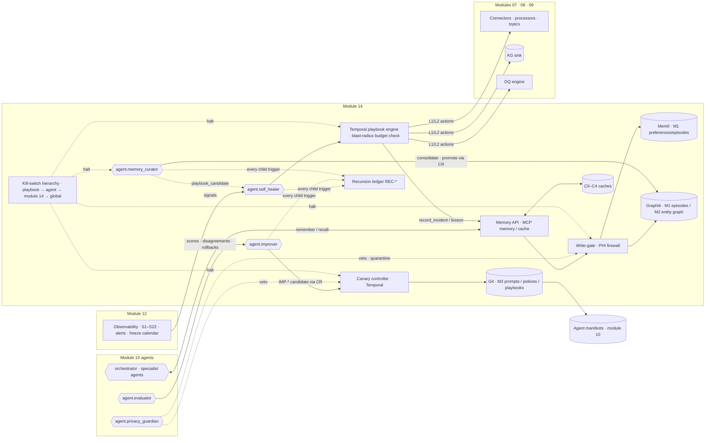

# Agent Memory, Caching & Self-Improvement — Module Overview

## 1. Purpose and scope

ADR-08 layers agent memory (Mem0 for preferences/episodes, Graphiti for a bitemporal episodic + entity graph, the
HEALIX KG as shared semantic memory) and forbids PHI in any of it; ADR-09 closes the loop on healing and
self-modification but gates it (ladder-bounded playbooks, canary + evaluator thresholds + automatic rollback). This
module turns both decisions into contracts so that G-06 (≥ 80 % of vocabulary/mapping/DQ-rule changes auto-approved
after evaluation, **zero** unreviewed PHI-affecting changes) is reachable without the agent layer becoming an
ungoverned store of knowledge, an ungoverned actor on the pipeline, or an ungoverned editor of itself. Every memory
record, cache entry, healing action and self-modification produced here is a **governed G9 data product**: bitemporal,
provenance-bearing, auditable, retained per class, and reachable in the EDW/KG only through the same sinks as any other
governance fact.

| In scope | Out of scope (owned elsewhere; referenced by id) |
|---|---|
| Memory tiers M0–M4 as used by agents, the Memory API, Mem0 and Graphiti layers, write-gate and PHI firewall | HEALIX KG content and the bitemporal model itself (module 08, TKG-01) |
| Cache tiers C0–C4, cache policy, invalidation, bypass and degraded modes | Observability mechanics, SLI computation, alert routing (module 12, OPS-03) |
| Self-healing engine, fault taxonomy, playbook format and seed playbooks | PHI taxonomy and `hc-phi-class` tags (module 11, GOV-01 §3) |
| Self-improvement loop, canary controller, prompt/policy versioning | Change-request engine and CR schema (module 10, AGT-03; extended, not redefined) |
| Recursion governance, trust tiers, fixed-point protection, kill-switch hierarchy, memory-lift ablation | Decision-log mechanics and AGT-MEM-001…013 (AGT-06; extended, not redefined) |
| Memory governance: retention per class, purge, legal hold, steward rights | Red-team execution and findings register (module 15) |

**Hard rule (binding on every document in this module):** No tier of memory (M0–M4 as used by this module) and no
cache tier (C0–C4) may hold content whose `hc-phi-class` is anything but `non-phi`/`internal` (steward preferences:
`pii:workforce` with consent flag). This includes the C0 provider prompt cache: pseudonymised PHI is not permitted.

## 2. Memory tiers

| Tier | Store | Scope key | Writer | Reader | Retention basis (MEM-01 §8) | PHI | Bitemporal | Event-sourced topic | Governing doc |
|---|---|---|---|---|---|---|---|---|---|
| **M0** working | Temporal workflow state · Redis KV | `run` | runtime | running agent only | 24 h, purged at run close (AGT-MEM-001) | none | yes (run clock) | — | AGT-06 §1.1, MEM-01 §2 |
| **M1** episodic | AGT-06 decision log (`hc.ops.agent.decision.v1`) + Mem0 OSS on pgvector/Qdrant + Graphiti episodes | `agent`, `steward` (salted hash), `run`, `env` | Memory API write-gate only | all agents, evaluator, HITL console, curator | per class: decision/outcome/incident 2,555 d; preference 365 d rolling; observation 180 d | none | yes | `hc.ops.memory.write.v1` | MEM-01, MEM-02 |
| **M2** agent-semantic | Graphiti entity graph on Neo4j 5.x (FalkorDB / Neptune swappable) | `group_id = healix.<env>.<scope-kind>.<scope-id>` | `agent.memory_curator` consolidation; Memory API episodes (async extraction) | retrieval profiles (MEM-02 §7) | hot 400 d then JSON-LD archive; utility decay | none | yes (TKG-01 §4 aligned) | `hc.ops.memory.write.v1` | MEM-02 |
| **M3** procedural | Git (playbooks, prompts, policies, rubrics) + object store; indexed as Graphiti `Playbook`/`PromptVersion` nodes | `agent`, `global` | humans and `playbook`/`agent_policy` CRs only (AGT-MEM-009) | loaded into M0 at run start | indefinite, signed tags (ARC-NFR-006) | none | yes (release events) | `hc.ops.agent.policy.v1` | MEM-04, MEM-05 |
| **M4** shared-semantic | HEALIX ontology/KG triple store | ontology IRIs, named graphs | `cr-engine` applying approved CRs only (AGT-MEM-004) | everyone via read tools | module 08 / 02 releases | none (KG PHI governed by 08/11, not by agents) | yes | `hc.kg.*` | TKG-01, AGT-06 §1.3 |

## 3. Learning loops

Healing runs L0–L4 on the healing ladder inside Temporal (never inside the agent's prompt); improvement runs
`idle → … → canary_5 → canary_25 → promoted → monitoring → stable` under the same engine; consolidation runs nightly.
All three write back to memory through the single write-gate and are recorded in the recursion ledger.

## 4. Document map

| Doc / artefact | doc_id | Area | Range | P0 (indicative) | Validation |
|---|---|---|---|---|---|
| `README.md` (this) | MEM-00 | `MEM-IDX` | 001–010 | 4 | id linter, depends_on resolver |
| `01-memory-architecture.md` | MEM-01 | `MEM-ARCH` | 001–040 | 20 | write-gate tests, honeytoken probes, rebuild drill |
| `02-graphiti-temporal-memory.md` | MEM-02 | `MEM-GRA` | 001–040 | 16 | bitemporal fixtures, adversarial episodes, consolidation run |
| `03-caching-strategy.md` | MEM-03 | `MEM-CACHE` | 001–030 | 14 | CI lint, invalidation timing, Redis chaos |
| `04-self-healing.md` | MEM-04 | `MEM-HEAL` | 001–060 | 28 | chaos suite, kill-switch demo, blast-radius assertions |
| `05-self-improvement-loop.md` | MEM-05 | `MEM-IMP` | 001–030 | 14 | canary drill, held-out leakage test, reproducibility |
| `06-recursive-learning-governance.md` | MEM-06 | `MEM-GOV` | 001–040 | 18 | SoD/fixed-point tests, poisoning drill, DGC report |
| `memory-schema.yaml` | MEM-A1 | — | cites MEM-ARCH/MEM-GRA via `x-requirements` | — | `memory-schema.schema.json` |
| `cache-policy.yaml` | MEM-A2 | — | cites MEM-CACHE | — | `cache-policy.schema.json` |
| `healing-playbooks/README.md` | MEM-A3 | — | cites MEM-HEAL-036…050 | — | linter rules |
| `healing-playbooks/*.yaml` (7 seeds) | `PBK-<AREA>-<NNN>` | — | cite MEM-HEAL + sibling ids | — | `playbook.schema.json`, chaos fixtures |

Total ≈ 114 P0 across the module. Sub-block allocation: ARCH 001–014 tiers/scope/API, 015–024 Mem0, 025–040 PHI
firewall/write-gate/event sourcing/degraded ops; GRA 001–018 graph model/time, 019–030 retrieval, 031–040
consolidation; HEAL 001–035 engine/state machine/blast radius/chaos/kill switch, 036–050 playbook artefact rules,
051–060 fault taxonomy and legacy coverage.

## 5. Interfaces

### 5.1 Provided (ARC-01 §6 rows "Memory API & cache policy", "Healing playbooks")

**Memory API** — MCP server `memory`. Permission mapping: read = `recall`/`lineage`/`stats`/`health`/`search_playbooks`;
propose = `remember`/`reflect`/`correct`/`retract`/`record_*`; apply = `confirm`/`forget`/`consolidate`/`promote`/
`quarantine`/`release`/`pin`; admin = `purge`/`freeze`/`unfreeze`/`export`/`rebuild`. All ops: agent identity per
GOV-ACC-009, env from token, `phi_access: none`, AuditEvent on `hc.ops.audit.v1` (GOV-LIN-006/008) + OpenLineage facet,
`idempotency_key`, reason-coded errors. Full operation table in MEM-01 §2 and contract A of the module outline; summary:

| Op | Inputs (abridged) | Output | Rule that matters most |
|---|---|---|---|
| `remember` | scope, memory_class, content (text ≤ 2,000 chars or json ≤ 4 KiB), entities[], relations[], confidence, trust_tier T0–T2, provenance, evidence_refs[] ≥ 1, untrusted_text, idempotency_key | record_id, accepted\|rejected, reason_code?, phi_scan, stored_in[] | write-gate mandatory; append `hc.ops.memory.write.v1` before materialising |
| `recall` | scopes[], query, retrieval_profile, as_of_valid?, as_of_transaction?, filters, budget_tokens, top_k ≤ 20, rerank, center_nodes[] | memories[], assembled_context (untrusted block), usage | env filter; C4 60 s; one AuditEvent per run listing record ids |
| `reflect` / `correct` / `retract` / `confirm` | run outcome · memory_id + change_kind · memory_id + reason · memory_id + by + T2\|T3 | lesson_candidates[] · new_memory_id · ok · ok | reflections masked (GOV-LIN-015) and `untrusted_text`; retraction sets `expired_at`, never deletes |
| `forget` / `purge` / `quarantine` / `release` / `freeze` / `unfreeze` | selector + reason · record_ids + legal_basis + approver · memory_id + reason · scope + reason | tombstones · purge_receipt · ok | `forget` = transaction-time close; `purge` = physical erasure under Privacy Office/DGC approval |
| `consolidate` / `promote` | scope, mode, stages[] · memory_id, to_tier | report · cr_id? | curator only; procedural promotion always creates a `playbook`/`agent_policy` CR |
| `lineage` / `search_playbooks` / `record_incident` / `record_playbook_run` / `stats` / `export` / `rebuild` / `health` | per contract A | PROV chain · ranked playbooks · ids · counts · job id · job id · tier status | `rebuild` from `hc.ops.memory.write.v1` ≤ 4 h; `health` drives degraded modes |

Graphiti sub-ops on the same server: `graph.add_episode`, `graph.search(…, as_of?, as_known_at?)`,
`graph.invalidate_edge(edge_id, invalid_at, change_kind, reason)`, `graph.entities`.

**Cache API** — MCP server `cache`: `get(namespace, key|embedding, version_tags{})`, `put(namespace, key, value,
version_tags, ttl?, verified_by)`, `invalidate(tags{}|namespace, event)`, `warm(namespace)`, `stats(namespace)`,
`policy_check(namespace, risk_class, change_class, phi_class, canary_cohort, injection_flag) → allow|bypass`. All
fail-open (bypass ≤ 50 ms). **Cache policy** (`cache-policy.yaml`, MEM-A2): `defaults{phi_allowed: false,
model_scoped: true, failure_mode: bypass}`, `version_tags`, `tiers[] C0–C4`, `namespaces[]`, `provider_prompt_layout`
(4 breakpoints, `min_prefix_tokens: 4096`), `bypass_when[]` (risk_class ∈ {high, phi_affecting}, `policy` change class,
evaluator verdicts, guardian decisions, canary cohort, injection-flagged), `shadow_recompute_sample: 0.01`,
`golden_lookups`, `invalidation_events[]` (≤ 60 s), `ci_lint`, `alerts[]`.

**Healing playbook format** (`playbook.schema.json`, contract B): `id: PBK-<AREA>-<NNN>`, `status:
shadow|assisted|autonomous|retired`, `fault_classes[]: [FLT-*]`, `triggers[]`, `preconditions[]`, `diagnosis[]`
(`read_only: true`), `decision_tree[]`, `actions[]` each with `ladder_level`, `blast_radius_class`
(`observe|restart|reconfigure|reroute|replay|schema|data_mutation`; `autonomous_allowed: false` for the last two),
`blast_radius{unit, max, scope_expr, time_box_s}`, `idempotency_key_recipe`, `verify{}`, `compensating_action|rollback`;
`verification`, `limits` (≤ 4 runs/h, cooldown ≥ 900 s, ≤ 5 actions/incident, circuit breaker 3 → 86,400 s, recursion
`max_depth: 2`) and `guards` (`phi_ceiling: none`, `data_mutation: none`) — both fixed-point protected;
`suppression{notifications_only: true, max_s: 3600}`, `conflicts_with[]`, `escalation`, `learning`, `references`,
`chaos_tests[]` (≥ 1 per trigger), `phi: none`, `change_request{type: playbook}`, `provenance{approved_cr_id}`.

**Topics requested from module 07** (STR-02 catalog; `layer: ops`, `domain: governance`, `group: G9`,
`phi_class: non-phi`, `compatibility: BACKWARD`, JSON Schema values):

| Topic | Key | Retention | Purpose |
|---|---|---|---|
| `hc.ops.memory.write.v1` | `record_id` | infinite, compacted | event-sourced memory write log; Mem0/Graphiti are derived state |
| `hc.ops.healing.incident.event.v1` | `incident_id` | 30 d (mirrored to `fact_healing_incident`) | every healing state transition |
| `hc.ops.healing.playbookrun.event.v1` | `incident_id\|step` | 30 d | every action/step with blast-radius budget check result |
| `hc.ops.improvement.canary.event.v1` | `candidate_id` | 30 d | improvement state transitions, canary metrics, rollbacks |
| `hc.ops.agent.policy.v1` | `agent_id\|prompt_version` | 30 d, compacted | prompt/policy/playbook release events; C0/C1/C2 invalidation source |
| `hc.ops.cache.invalidate.v1` | `tag` | 7 d | version-tag invalidation fan-out |

Versioning: a breaking change to the Memory API, `memory-schema.yaml`, `cache-policy.yaml`, `playbook.schema.json` or
any topic value schema is a major bump and a new `vN` (CONVENTIONS §5).

### 5.2 Consumed

TKG-01 §4 time vocabulary (`healix-time:validFrom/validTo/recordedAt/supersededAt/changeKind`, SKOS values `new`,
`new-version`, `correction`, `retraction`, `merge`, `unmerge`), §6 change semantics, §8 views, §9 columns · AGT-01
manifests (`memory`, `budgets`, `escalation`, `evaluation`, `graduation`, `autonomy_ceiling`), AGT-03 CR schema
1.0.0, rubrics `RUB-*`, golden sets, regression suites, AGT-04 MCP server enum, AGT-05 PGV-001…014 / kill switch / RT-11,
AGT-06 tiers and decision log · GOV-01 §3 `hc-phi-class` tags, GOV-PHI-003/004/011/012/013/017/020/021/023,
GOV-LIN-002/005/006/008/010/015, GOV-ACC-009/010/011/013/018, GOV-03 §5 AuditEvent profile · OPS-03 S1–S22 and §4.2
alerts, OPS-00 §7 SEV1–SEV4, OPS-04 §6 retention / §7 legal hold / RPO 15 min RTO 4 h, OPS-02 freeze calendar ·
DQ topics `hc.dq.result.v1`, `hc.dq.issue.v1`, `hc.dq.rule-activation.v1` (DQ-03, DQ-05) · IOP-04 TS operations and
release events · STR-02 existing `hc.ops.*` topics, STR-04 connector manifests.

## 6. Cross-module extension requests (open items)

Module 14 stays in **shadow/degraded** modes until each row lands; MEM-IDX-003 tracks closure.

| # | Module | Request | Status | Interim behaviour until landed |
|---|---|---|---|---|
| X-01 | 10 (`agent.schema.json`) | `tools[].server` enum += `memory`, `cache`, `playbook-runner`, `observability` | open | memory calls routed through `graph-query`-style generic MCP shim; manifests fail lint and stay unregistered |
| X-02 | 10 (`agents/`) | manifests for `agent.memory_curator`, `agent.self_healer`, `agent.improver` (§7) | open | agents run in `test` only, `shadow`/recommend-only |
| X-03 | 10 (`change-request.schema.json`) | `crType` += `agent_policy`, `playbook`; `evidence.sources[].kind` += `memory_record`; `rollback.trigger` += `canary_regression`, `playbook_regression`, `budget_exhaustion`; `provenance` += `memory_degraded`, `recalled_memory_ids[]`; `automated_checks[].check` reused as-is | open | prompt/playbook changes filed as `topic`-typed governance CRs with free-text evidence; no canary promotion to `prod` |
| X-04 | 07 (STR-02) | six topics in §5.1 | open | events buffered to object store; no event-sourced rebuild guarantee |
| X-05 | 11 | access-matrix rows for memory scopes and cache namespaces; retention rows for memory classes; `pii:workforce` consent flag | open | steward preferences disabled (no M1 preference class writes) |
| X-06 | 12 | S1–S22 and alert names machine-readable; memory/cache SLOs registered; freeze calendar as queryable service; kill-switch hierarchy wiring | open | self_healer consumes alerts by name from a static copy; freeze windows hard-coded in `limits` |
| X-07 | 05 | `edw_g9_governance` additions (§9) | open | G9 facts stay on topics only; no EDW reporting |
| X-08 | 15 | red-team suites: PHI-in-memory, poisoning, playbook adversarial scenarios | open | module DoD items 3 and 9 cannot close |

## 7. Module-14 agent manifests (to be added by module 10)

Required fields on all three: `memory.phi_retention: none`, `memory.semantic_write: false`, `memory.procedural: true`,
`memory.episodic_retention_days: 2555`, `budgets` (tokens_per_run, daily_token_cap, runs_per_day, max_concurrent_runs),
`escalation` (to Agent Operator + Platform SRE; Privacy Office for any PHI finding), `graduation` with MEM-06 §6 numbers
(90 d, acceptance ≥ 90 %, rollback ≤ 2 %, human agreement ≥ 0.85, zero PHI findings; automatic demotion on PGV-012,
rollback > 5 %/30 d, ≥ 3 circuit-breaker trips/30 d), `autonomy_ceiling`.

| Agent | Autonomy (ARC-01 §5) | Tool allow-list (`server`: permission) | Ceiling |
|---|---|---|---|
| `agent.memory_curator` | L3 | `memory`: apply (incl. `consolidate`, `promote`); `cr-engine`: propose | L3 |
| `agent.self_healer` | L3 | `memory`: propose; `playbook-runner`: apply; `observability`: read; `kafka-admin`: read; `cr-engine`: propose; `ticketing`: apply | L3 (ladder L2 actions max) |
| `agent.improver` | L1 | `memory`: read; `git`: read; `cr-engine`: propose; `observability`: read | L2 for `low` risk classes only |

## 8. Requirement index

Authoritative requirement text lives in the owning document; anchor requirements are summarised individually and the
remaining ids within each sub-block are listed by range so every id is accounted for (MEM-IDX-001).

| ID(s) | P | Summary | Doc |
|---|---|---|---|
| MEM-IDX-001…010 | P0–P2 | index integrity, depends_on resolution, cross-module closure, no-PHI sentence lint (§12) | MEM-00 |
| MEM-ARCH-001 | P0 | every write carries valid_from, recorded_at, prov ref, scope, trust_tier, change_kind | MEM-01 |
| MEM-ARCH-002 / 003 | P0 | all long-term writes pass the write-gate; ≥ 1 resolvable evidence ref | MEM-01 |
| MEM-ARCH-004 / 005 / 006 | P0 | reject cross-env reads; recall AuditEvent per run; memory-influenced CRs echo record ids | MEM-01 |
| MEM-ARCH-007 / 008 / 009 / 010 | P0/P1 | write log before materialisation; rebuild ≤ 4 h ±0; `untrusted_text` never unquoted; retention per class honoured | MEM-01 |
| MEM-ARCH-011…014 | P1/P2 | scope model, record classes, read-path ranking and as-of support, export formats | MEM-01 |
| MEM-ARCH-015 / 018 | P0/P1 | Mem0 graph memory disabled; dedupe never merges across scopes | MEM-01 |
| MEM-ARCH-016, 017, 019…024 | P1/P2 | Mem0 custom prompts, metadata filter contract, `history()` audit, embedding model per env, latency targets | MEM-01 |
| MEM-ARCH-025 / 027 / 030 | P0 | 0/10,000 honeytokens stored; quarantine hard delete ≤ 30 d dual control; extraction in-VPC or GOV-ACC-018 proxy, zero retention | MEM-01 |
| MEM-ARCH-034 / 036 / 038 | P0/P1 | memoryless degraded mode flags provenance; steward purge ≤ 24 h; re-scan all tiers ≤ 7 d of scanner release | MEM-01 |
| MEM-ARCH-026, 028, 029, 031…033, 035, 037, 039, 040 | P1/P2 | rejection reason codes, k-anonymity n < 11, injection scan, degraded-mode detection SLOs, `healix.memory.*` metrics, DR | MEM-01 |
| MEM-GRA-002 / 005 / 007 | P0 | four timestamps + change_kind on every edge; forbidden entity types rejected; extraction via proxy, masked text | MEM-02 |
| MEM-GRA-009 / 012 | P1 | retraction sets expired_at, never deletes; as-of/as-known fixtures reproduce prior answers | MEM-02 |
| MEM-GRA-001, 003, 004, 006, 008, 010, 011, 013…018 | P1/P2 | entity/edge model, Neo4j deployment, group_id partitioning, skew guard, episode design, dangling-IRI check | MEM-02 |
| MEM-GRA-019 / 021 / 024 | P0/P1 | recall honours scope/env filters; injected memory wrapped untrusted with provenance; token cap ≤ 12 % | MEM-02 |
| MEM-GRA-020, 022, 023, 025…030 | P1/P2 | retrieval profiles, rerankers, query p95 ≤ 500/800 ms, context assembly order | MEM-02 |
| MEM-GRA-031 / 033 / 036 / 038 | P0/P1 | nightly consolidation ≤ 2 h; promotion to procedural only via CR; candidate-CR per-day caps; decay parameters reviewed quarterly | MEM-02 |
| MEM-GRA-032, 034, 035, 037, 039, 040 | P1/P2 | dedupe, contradiction resolution by trust tier, community summaries, utility decay, memory metrics | MEM-02 |
| MEM-CACHE-001 / 002 / 003 / 004 | P0 | no tier stores PHI-class content (incl. C0); bypass list enforced; mapping hits re-validated via TS; Redis failure ⇒ bypass ≤ 50 ms | MEM-03 |
| MEM-CACHE-006 / 008 / 012 | P0 | release events invalidate ≤ 60 s; env/tenant isolation; CI lint blocks silent invalidators | MEM-03 |
| MEM-CACHE-010 / 014 / 016 / 018 / 020 / 022 | P1 | C0 hit ≥ 70 % on evaluator golden runs; stable prefix ≥ 4,096 tokens; stale-serve flags `stale=true` + DQ `suspect`; hourly golden lookups + auto-purge; canary bypasses C1/C2/C4; divergence ≤ 2 % | MEM-03 |
| MEM-CACHE-005, 007, 009, 011, 013, 015, 017, 019, 021, 023…030 | P1/P2 | TTL by start-to-start gap, semantic thresholds per task, key recipe, hot-key protection, metrics and economics | MEM-03 |
| MEM-HEAL-001 / 002 / 003 / 004 / 005 | P0 | no autonomous schema/data_mutation; budget checked before every action; idempotent actions + AuditEvent; circuit breaker and rate caps; global concurrency ≤ 3 | MEM-04 |
| MEM-HEAL-006 / 007 / 008 / 009 | P0 | suppression notifications-only ≤ 60 min; kill switch halts runs ≤ 30 s; no writes to Cerner/Fusion/canonical/kg/edw; recursion depth ≤ 2, no parent re-trigger | MEM-04 |
| MEM-HEAL-010 / 011 / 012 / 013 / 014 / 015 | P0/P1 | freeze calendar honoured; oscillation detector > 3 restarts/h; shadow only recommends; chaos suite passes; degraded mode when Mem0/Graphiti down; self-healer never raises budgets | MEM-04 |
| MEM-HEAL-016…035 | P1/P2 | state machine timers, incident model, conflict matrix, playbook lifecycle and graduation, recursive playbook learning, escalation SLAs, MTTD/MTTR observability | MEM-04 |
| MEM-HEAL-036 / 037 / 038 / 042 | P0 | playbook validates against schema; new playbooks start `shadow`; every action has class + budget + rollback/compensation; `guards`/`limits` fixed-point protected | MEM-04 |
| MEM-HEAL-039, 040, 041, 043…050 | P1/P2 | ≥ 1 OPS/STR/DQ/TKG/SRC reference per playbook; naming; chaos tests per trigger; PHI-free ticket packets | MEM-04, MEM-A3 |
| MEM-HEAL-051 / 052 / 053 | P0/P1 | 100 % fault classes have detection rule; ≥ 80 % P0 classes have active playbook; legacy outliers mapped | MEM-04 |
| MEM-HEAL-054…060 | P1/P2 | fault-class MTTD/MTTR targets, coverage KPI reporting, game days | MEM-04 |
| MEM-IMP-001…009 | P0 | CR + canary only path to prod; Temporal-enforced state machine; golden sets read-only; rollback ≤ 5 min; held-out never seen; 1 canary/agent, 3 platform; stratified deterministic assignment; canary bypasses caches; compile data pseudonymised/synthetic, zero retention | MEM-05 |
| MEM-IMP-010 / 011 / 012 / 013 / 014 / 015 | P0–P2 | `compiled_from` lineage + signed tag; compile reproducibility; freeze calendar; Reflexion traces masked `untrusted_text`; quarterly metric-vs-KPI review; rollback rate < 10 %/quarter | MEM-05 |
| MEM-IMP-016…030 | P1/P2 | improvable-artefact table, evidence sources, anti-Goodhart fitness, metric-gaming detector, stop rule, weekly cadence | MEM-05 |
| MEM-GOV-001…009 | P0 | T0 never influences procedural; fixed-point list at cr-engine; SoD per CR; recursion ledger caps; 14-day dwell; write anomaly > 5× freezes; kill switches ≤ 30 s audited; automatic demotion; poisoning drill ≤ 1 % | MEM-06 |
| MEM-GOV-010…016 | P0/P1 | steward purge ≤ 24 h; ≥ 200 records/month audit; attribution on every CR; monthly DGC report; nightly lift ablation; quarterly kill-switch drill; improver cannot modify own prompt/rubrics | MEM-06 |
| MEM-GOV-017…040 | P1/P2 | threat controls, trust-tier influence matrix, learner × target matrix, break-glass, rights and retention, red-team cadence, reporting | MEM-06 |

## 9. EDW / KG footprint (G9)

Schema `edw_g9_governance` (module 05, request X-07): `dim_playbook`, `dim_prompt_version`, `dim_memory_scope`,
`fact_memory_event`, `fact_memory_recall` (aggregated per run), `fact_healing_incident`, `fact_healing_action`,
`fact_policy_release`, `fact_cache_stats`. Every table carries TKG-01 §9 columns `valid_from, valid_to, recorded_at,
superseded_at, prov_activity_iri, change_kind, source_tz`. KG named-graph prefix
`<base>graph/healix-memory/<env>/<yyyy-mm-dd>/<batch-ulid>`. Both projections are reached **only** via
`agent.kg_builder` and the EDW sink consuming the `hc.ops.*` topics in §5.1; this module never writes to KG or EDW
(GOV-ACC-011). Memory records are not `healix-time:BitemporalAssertion` instances; they export in n-ary form
(TKG-TIME-014).

## 10. Definition of done

CONVENTIONS §6 plus: (1) every P0 verification artefact referenced by id; (2) `memory-schema.yaml`, `cache-policy.yaml`
and all playbooks validate against their JSON Schemas; (3) PHI-firewall red-team (module 15) reports 0 leaks on
10,000 honeytoken probes; (4) memory-lift ablation ≥ +0.03 on golden sets; (5) every seed playbook's `chaos_tests[]`
pass in `test` with blast radius never exceeded; (6) one quarterly game day executed; (7) one canary rollback drill
in `uat`; (8) kill-switch drill executed at every hierarchy level; (9) 30 consecutive days of zero PHI findings in the
memory scanner; (10) recursion ledger shows no depth > 2 without DGC review; (11) all §6 requests closed.

## 11. Glossary pointers

**Episode** (MEM-02 §6) · **Community** (MEM-02 §8) · **Consolidation / sleep cycle** (MEM-02 §8) · **Trust tier T0–T4**
(MEM-06 §2) · **Blast-radius class vs budget** (MEM-04 §7, contract G) · **Canary** (MEM-05 §4) · **Shadow mode**
(MEM-04 §8) · **Healing ladder L0–L4** — distinct from autonomy levels L1–L4 of ARC-01 §5; always write "ladder L2"
vs "autonomy L3" (MEM-04 §1) · **Recursion ledger `REC-*`** (MEM-06 §5, contract F) · **Dwell** — 14-day stability
period before a learned change may spawn further learned changes (MEM-06 §5) · **Fixed-point protection** (MEM-06 §4).
Identifier forms: `FLT-<AREA>-NNN`, `PBK-<AREA>-<NNN>`, `INC-<yyyymmdd>-<ULID>`, `MEM-<yyyymmdd>-<ULID>`,
`REC-<yyyymmdd>-<ULID>`, `IMP-<yyyymmdd>-<ULID>`; AREA ∈ {ING, SEM, DQ, SINK, AGT, PLAT}.

## 12. Requirements (MEM-IDX)

> **MEM-IDX-001** (P0, inspection) — Every `MEM-<AREA>-NNN` identifier in this module MUST be unique and MUST fall
> within the range reserved for its owning file in §4; the id linter MUST fail the build on any collision or stray id.

> **MEM-IDX-002** (P0, inspection) — Every `depends_on` entry in every module-14 document MUST resolve to an existing
> `doc_id` in this repository; placeholder or speculative ids MUST NOT appear.

> **MEM-IDX-003** (P0, analysis) — Each cross-module extension request in §6 MUST be tracked to closure (landed in the
> owning module or formally rejected with a documented interim) before any module-14 document moves to `status: approved`.

> **MEM-IDX-004** (P1, test) — The documentation linter MUST verify that the no-PHI rule sentence of §1 appears
> verbatim in `01-memory-architecture.md`, `02-graphiti-temporal-memory.md`, `03-caching-strategy.md` and `04-self-healing.md`.

> **MEM-IDX-005** (P0, inspection) — Every requirement in this module MUST carry a priority (P0/P1/P2), a verification
> method (`test|inspection|demo|analysis`) and at least one RFC 2119 keyword, in the CONVENTIONS §2 format.

> **MEM-IDX-006** (P1, inspection) — The requirement index in §8 MUST account for every id in every sub-block of §4; a
> new id added to any module-14 document without a corresponding index entry MUST fail the linter.

> **MEM-IDX-007** (P1, inspection) — Every shared contract (Memory API operations, Cache API, playbook schema, blast-radius
> budget, recursion ledger, state machines) MUST be defined once and cited by id elsewhere; divergent re-definitions
> across module-14 documents MUST be treated as defects.

> **MEM-IDX-008** (P1, analysis) — The P0 counts in §4 MUST be reconciled against the owning documents at every version
> bump and the module DoD (§10) MUST reference a verification artefact for each P0.

> **MEM-IDX-009** (P2, inspection) — Every Mermaid diagram in this module MUST follow CONVENTIONS §7 shapes (hexagons for
> agents, cylinders for stores, rectangles for components, parallelograms for external systems).

> **MEM-IDX-010** (P2, analysis) — Module 14 MUST publish a glossary delta to `99-appendices/` for every term introduced
> in §11 that is not already defined there.
