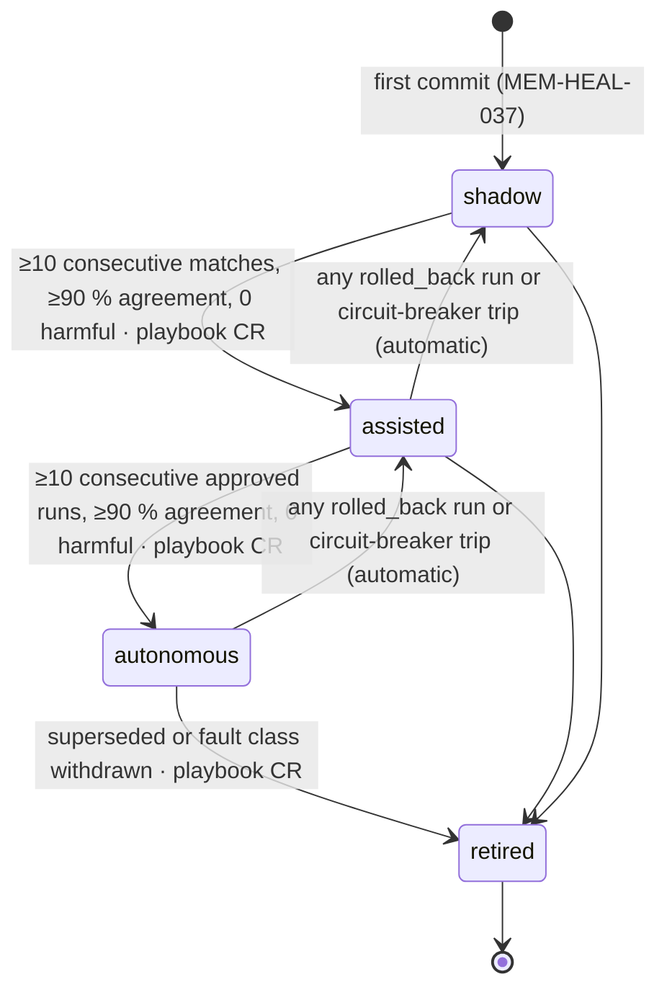

# Healing Playbooks — Format Specification and Library Index

This folder is the **M3 procedural memory** of `agent.self_healer` (ARC-01 §5, autonomy L3; ADR-09): Git-versioned
YAML playbooks, each validated against `playbook.schema.json` (contract B of the module outline, copied verbatim in §2)
and indexed as a Graphiti `Playbook` node (MEM-02 §3). This README is artefact **MEM-A3**. It defines **no new
requirement ids**; every rule below is a restatement of, or a linter for, **MEM-HEAL-036…050** (MEM-04 §13.2) and the
engine rules of MEM-04 §7–§10. Where this README and MEM-04 disagree, MEM-04 wins and this file is corrected.

**Hard rule (binding on every store touched by a playbook, including this folder and the Graphiti index of it):**

> No tier of memory (M0–M4 as used by this module) and no cache tier (C0–C4) may hold content whose `hc-phi-class` is anything but `non-phi`/`internal` (steward preferences: `pii:workforce` with consent flag). This includes the C0 provider prompt cache: pseudonymised PHI is not permitted.

Playbooks therefore contain ids, counts, topic/partition/offset pointers, metric names and thresholds only. A playbook
that embeds a message sample, a `PERSON_ID`, an MRN pattern with real values, or free text copied from a record body
fails lint (MEM-HEAL-043, MEM-HEAL-047).

## 1. Purpose and relation to MEM-04

| MEM-04 section | What it fixes | What this folder adds |
|---|---|---|
| §7 Blast radius | Class vocabulary (`observe … data_mutation`), budget object `{unit, max, scope_expr, time_box_s}`, engine-wide limits, conflict rules | Every `actions[]` entry carries both; the conflict matrix for the seven seeds (§7 below) is the machine source of each seed's `conflicts_with[]` |
| §8 Playbook artefact and lifecycle | Schema (contract B), linter, `shadow → assisted → autonomous → retired`, graduation and demotion numbers | Field-by-field reference (§2), authoring checklist (§4), naming (§5), library index (§6) |
| §9 Recursive playbook learning | Curator mining → self_healer draft → evaluator chaos run → `playbook` CR → shadow | §8 below describes how a learned file lands in this folder and what `provenance` it must carry |
| §10 Chaos suite | Injection catalogue, acceptance (detect ≤ MTTD, heal ≤ MTTR, blast radius never exceeded, rollback verified) | `chaos_tests[]` per trigger (MEM-HEAL-041) and the CI pipeline that runs them (§9) |

The playbook **engine** is a Temporal workflow outside the agent (MEM-04 §6, contract E). The agent selects and
proposes; the engine checks kill switches, freeze calendar, budgets, concurrency, cooldown, conflicts and the circuit
breaker before every action (MEM-HEAL-002…006), and logs the check on `hc.ops.healing.playbookrun.event.v1`. Nothing
in a YAML file can widen what the engine permits; a playbook can only tighten it.

## 2. `playbook.schema.json` field reference

### 2.1 Contract B (verbatim)

```
id: PBK-<AREA>-<NNN>            # AREA ∈ ING|SEM|DQ|SINK|AGT|PLAT
name, version (semver), status: shadow|assisted|autonomous|retired
owners[], fault_classes[]: [FLT-*], severity_default: S1..S4 (OPS-00 SEV1–4), risk_class, autonomy_required: L3
mttd_target_s, mttr_target_s
scope: {environments[], source_systems[], interfaces[], groups[], facilities[]}
triggers[]: {signal, source_module|topic|metric, comparator, threshold, window_s, min_occurrences, for_s}
dedupe_key, correlation_window_s
preconditions[]: {check, tool{server,operation}, expect, on_fail: skip|escalate}
diagnosis[]: {step, tool{server,operation}, params, read_only: true, timeout_s, record_as: symptom|hypothesis|<var>}
decision_tree[]: {when, then_actions[]}
actions[]: {id, ladder_level: L0|L1|L2|L3, blast_radius_class: observe|restart|reconfigure|reroute|replay|schema|data_mutation,
            autonomous_allowed (false for schema/data_mutation),
            blast_radius: {unit: connector|partition|table|facility|records|agent|tokens, max, scope_expr, time_box_s},
            requires_dry_run, tool{server,operation,permission}, params, idempotency_key_recipe, timeout_s, retries,
            verify{probe, expect, within_s}, on_failure: continue|abort|compensate|escalate,
            compensating_action|rollback{tool,params}, emits_cr?{cr_type, risk_class, gates_required[]}}
verification: {probes[], duration_s, success_criteria}
limits: {max_runs_per_hour (≤4), cooldown_s (≥900), max_actions_per_incident (≤5), max_concurrent_per_target (1),
         circuit_breaker: {consecutive_failures: 3, open_for_s: 86400, page: true},
         change_freeze_calendar_ref, recursion: {max_depth: 2, may_trigger[]}}     # fixed-point protected
guards: {kill_switch_paths[], phi_ceiling: none, data_mutation: none, requires_dry_run_in: [test]}  # fixed-point protected
suppression: {notifications_only: true, max_s: 3600}
conflicts_with[]: [PBK-*]
escalation: {to[], after_s, sla_minutes, ticket_template (PHI-free), page: bool, on_failure}
learning: {memory_classes_written[], lesson_template, record_episode: true, emit_reflexion: true,
           candidate_for_tuning[], graduation{shadow_matches_required: 10, min_agreement: 0.9}}
references: {requirements[] (OPS-/STR-/DQ-/TKG-/SRC-/IOP-/GOV-/MEM- ids), runbooks[], slo_ids[], topics[], connector_manifest}
chaos_tests[]: {id, injection, expected_mttd_s, expected_mttr_s, blast_radius_assert}
phi: none
change_request: {type: playbook, risk_class}
provenance: {created_by, compiled_from_incidents[], approved_cr_id}
```

Linter: every action has class + budget + (compensation or provable idempotency); `data_mutation: none`;
`status ≠ shadow` requires `provenance.approved_cr_id`; references resolve; `limits`/`guards` unchanged by automated
CRs; ≥ 1 chaos test per trigger.

### 2.2 Block-by-block reference and lint rules

| Block | Meaning and allowed values | Lint rule (source) |
|---|---|---|
| `id`, `name`, `version` | `PBK-<AREA>-<NNN>`, AREA ∈ {ING, SEM, DQ, SINK, AGT, PLAT}; semver. Major bump mandatory when `limits`, `guards`, any `blast_radius_class` or `blast_radius` changes | unique id and file name (MEM-HEAL-039); major bump + `policy` class on those fields (MEM-HEAL-048) |
| `status` | `shadow` (recommend-only) · `assisted` (human approves each run) · `autonomous` · `retired` | first commit must be `shadow` (MEM-HEAL-037); `≠ shadow` requires `provenance.approved_cr_id` resolving to an applied `playbook` CR (MEM-HEAL-044) |
| `owners[]` | OPS-03 §4.3 rotation names or registered steward roles | must resolve (MEM-HEAL-047) |
| `fault_classes[]` | `FLT-*` ids from MEM-04 §2 only | every id must exist in the taxonomy (MEM-HEAL-049) |
| `severity_default` | `S1..S4` mapped 1:1 to OPS-00 §7 SEV1–SEV4 | enum |
| `risk_class`, `autonomy_required` | AGT-01 risk classes; always `L3` for the self-healer | `autonomy_required` must equal the roster level (ARC-01 §5) |
| `mttd_target_s`, `mttr_target_s` | Numbers from MEM-04 §2 for the primary fault class | must be ≥ the strictest class target; `chaos_tests[].expected_*` must be ≤ these |
| `scope` | `environments[]` ⊆ {dev, test, uat, prod}; `source_systems[]`, `interfaces[]`, `facilities[]` as codes only | facility codes, never names |
| `triggers[]` | One per detection signal; `signal` is an OPS-03 SLI id, alert name or `hc.*` topic; `comparator` ∈ {`>`, `>=`, `<`, `<=`, `==`, `absent_for`}; `window_s`, `for_s` | ≥ 1 `chaos_tests[]` entry per trigger (MEM-HEAL-041); thresholds are versioned config, changed only by `playbook`/`policy` CR (MEM-HEAL-055) |
| `dedupe_key`, `correlation_window_s` | Template over scope fields, e.g. `{{facility}}|{{interface}}`; window ≤ `limits.cooldown_s` | required |
| `preconditions[]` | Read-only checks that gate the whole run (`on_fail: skip|escalate`) | tool permission must be `read` |
| `diagnosis[]` | Read-only probes recorded as `symptom`, `hypothesis` or a named variable used by `decision_tree[]` | `read_only: true` and `tool` permission `read` (MEM-HEAL-045) |
| `decision_tree[]` | Ordered `when` expressions over diagnosis variables → `then_actions[]` by action id | every referenced action id exists; first match wins |
| `actions[]` | See §2.3 | MEM-HEAL-038, MEM-HEAL-046, MEM-HEAL-001 |
| `verification` | Probes polled for `duration_s` (≥ 3× the widest trigger `window_s`, MEM-04 §6) with `success_criteria` | required for any action above L0 |
| `limits` | Engine caps; a playbook may tighten, never loosen (`max_runs_per_hour ≤ 4`, `cooldown_s ≥ 900`, `max_actions_per_incident ≤ 5`, `max_concurrent_per_target = 1`, breaker 3 → 86,400 s + page, `recursion.max_depth ≤ 2`, `change_freeze_calendar_ref` mandatory) | fixed-point protected: automated CRs touching it are rejected at cr-engine (MEM-HEAL-042, MEM-GOV-002) |
| `guards` | `kill_switch_paths[]` (cr-engine scopes `platform/environment/agent/cr_type` plus module-14 scopes, MEM-06 §9), `phi_ceiling: none`, `data_mutation: none`, `requires_dry_run_in: [test]` | fixed-point protected (MEM-HEAL-042); `data_mutation: none` and `phi: none` literal (MEM-HEAL-043) |
| `suppression` | `notifications_only: true`, `max_s ≤ 3600`; never suppresses evaluation or detection | enum-locked (MEM-HEAL-006) |
| `conflicts_with[]` | Mutually exclusive playbooks on the same target; must mirror §7 | symmetric: if A lists B, B lists A |
| `escalation` | `to[]` rotations, `after_s` (default 900), `sla_minutes` per SEV (MEM-04 §11), `ticket_template` with ids/counts/pointers only, `page`, `on_failure` | no free-text fields sourced from record bodies; packet passes `phi_scan` (MEM-HEAL-033, MEM-HEAL-047) |
| `learning` | `memory_classes_written[]` ⊆ {incident, root_cause, playbook_step, outcome, drift_signature, code_surge_signature, observation}; `lesson_template` masked; `candidate_for_tuning[]` names tunables only | `candidate_for_tuning[]` may not name anything under `limits`, `guards`, `blast_radius`, `blast_radius_class` (MEM-HEAL-050); graduation numbers fixed at 10 / 0.9 |
| `references` | `requirements[]` (OPS-/STR-/DQ-/TKG-/SRC-/IOP-/GOV-/MEM-), `runbooks[]`, `slo_ids[]` (S1–S22), `topics[]` (STR-02), `connector_manifest` | ≥ 1 OPS/STR/DQ/TKG/SRC id constraining actions (MEM-HEAL-040); all ids resolve (MEM-HEAL-049) |
| `chaos_tests[]` | `injection` from the MEM-04 §10 catalogue or a new fixture; `blast_radius_assert` is an expression the engine evaluates after the run | ≥ 1 per trigger (MEM-HEAL-041); all pass in `test` before merge (MEM-HEAL-013) |
| `phi`, `change_request`, `provenance` | `phi: none`; `change_request.type: playbook`, `risk_class` medium, or high when any action is ladder L2; `provenance.created_by` (`human:<role>` or `agent.self_healer`), `compiled_from_incidents[]`, `approved_cr_id` | literals enforced (MEM-HEAL-043, MEM-HEAL-044) |

### 2.3 `actions[]` in detail

| Field | Rule |
|---|---|
| `ladder_level` | `L0` observe/annotate · `L1` safe automatic (idempotent, reversible, no data mutation) · `L2` automatic after dry-run + blast-radius check · `L3` propose CR/ticket. `L4` (page) is expressed through `escalation`, not as an action. Always "ladder L2", never "autonomy L2" |
| `blast_radius_class` | `observe | restart | reconfigure | reroute | replay | schema | data_mutation`. `schema` and `data_mutation` MUST set `autonomous_allowed: false` and may only appear with `emits_cr` (L3); the engine refuses them otherwise (MEM-HEAL-001) |
| `blast_radius` | `{unit ∈ connector|partition|table|facility|records|agent|tokens, max, scope_expr, time_box_s}`. Defaults it may only tighten: ≤ 1 connector, ≤ 10 % partitions of one topic, ≤ 1 table re-seed/day, ≤ 500k records/action, ≤ 1 facility, `time_box_s ≤ 1800`. Checked by the engine before execution (MEM-HEAL-002); exceeding ⇒ action refused, incident `escalated` |
| `requires_dry_run` | Mandatory for ladder L2, for `replay` with `max > 50000` records, and for any incremental re-snapshot (MEM-HEAL-046) |
| `tool` | `{server, operation, permission}`; `server` from the AGT-04 enum plus the requested `playbook-runner`, `memory`, `cache`, `observability`. Permission `apply` only on `playbook-runner`, `ticketing` and `kafka-admin` within the self-healer allow-list (module README §7) |
| `idempotency_key_recipe` | Template such as `{{incident_id}}|{{action_id}}|{{target}}|{{window_start}}`; mandatory when `retries > 0` (MEM-HEAL-046) and whenever no `compensating_action`/`rollback` is given (MEM-HEAL-038) |
| `verify` | `{probe, expect, within_s}`; failure triggers `on_failure` |
| `on_failure` | `continue | abort | compensate | escalate`; `compensate` requires `compensating_action` or `rollback` |
| `emits_cr` | `{cr_type ∈ mapping|dq_rule|value_set|edw_ddl|playbook, risk_class, gates_required[]}` per AGT-03; the CR carries `evidence.sources[kind=memory_record]` and `provenance.recalled_memory_ids[]` when memory was recalled (MEM-GOV-012) |

## 3. Lifecycle



- **shadow** — the engine runs triggers, preconditions and diagnosis, then *recommends*; it records the human's
  chosen action and whether it matched. Nothing above L0 executes (MEM-HEAL-012).
- **assisted** — each run pauses at `guard_check` for a human approval (Platform SRE or Agent Operator) before
  `executing`.
- **autonomous** — the engine executes within `limits`/`guards`; still subject to kill switches, freeze calendar,
  budgets and conflicts.
- **Graduation** — ≥ 10 consecutive shadow (or assisted) matches with ≥ 90 % agreement between recommendation and the
  human's action and 0 harmful recommendations (`learning.graduation`); promotion is a `playbook` CR, risk `medium`
  (`high` if any ladder-L2 action), approvers Platform SRE + Agent Operator, `privacy_review` by
  `agent.privacy_guardian` (MEM-04 §8).
- **Demotion** — one step, automatic, on any `rolled_back` run or circuit-breaker trip; all `autonomous` playbooks drop
  to `assisted` when `agent.self_healer` itself is demoted (MEM-GOV-008).
- **Retirement** — a `playbook` CR; the file stays in Git with `status: retired`; the Graphiti `Playbook` node gets
  `expired_at` set (never deleted, MEM-GRA-009).

## 4. Authoring checklist

Tick every line before opening the `playbook` CR. CI (§9) checks the ones marked ⚙ mechanically.

1. ⚙ **Read-only diagnosis first.** Every `diagnosis[]` step has `read_only: true` and a `read`-permission tool
   (MEM-HEAL-045). No action runs before at least one symptom is recorded.
2. ⚙ **Class + budget on every action** — `blast_radius_class` and `blast_radius{unit, max, scope_expr, time_box_s}`
   (MEM-HEAL-038); budgets at or below the §2.3 defaults.
3. ⚙ **Idempotency keys** — `idempotency_key_recipe` on every action with `retries > 0`, and on every action without
   compensation (MEM-HEAL-046, MEM-HEAL-038).
4. ⚙ **Compensation** — `compensating_action` or `rollback{tool, params}` for every `reconfigure`, `reroute` and `replay`
   action; `on_failure` set deliberately, never defaulted.
5. ⚙ **`phi: none`, `guards.phi_ceiling: none`, `guards.data_mutation: none`** as literals (MEM-HEAL-043).
6. ⚙ **No `schema`/`data_mutation` action executes autonomously** — they appear only as L3 `emits_cr` (MEM-HEAL-001).
7. **Heal the pipe, never the data** — no action targets Cerner Millennium or Oracle Fusion (SRC-CER-024,
   SRC-OFC-001), no action writes `canonical`/`kg`/`edw` topics, DDL or graph assertions (GOV-ACC-011), no action
   alters values or merges identities (DQ-REM-005), deletes DQ results (DQ-PIPE-014) or widens an ACL (GOV-ACC-009/010).
8. **Never raise budgets** — `tokens_per_run`, `runs_per_day`, `daily_token_cap`, `max_concurrent_runs` are `policy`
   class, human-only (MEM-HEAL-015, MEM-06 §4). A playbook may lower them temporarily with a compensating restore.
9. ⚙ **References resolve** — ≥ 1 OPS/STR/DQ/TKG/SRC requirement constraining the actions (MEM-HEAL-040); every id,
   SLO, topic and connector manifest resolves (MEM-HEAL-049).
10. ⚙ **Chaos tests** — ≥ 1 per trigger with `expected_mttd_s ≤ mttd_target_s`, `expected_mttr_s ≤ mttr_target_s` and a
    `blast_radius_assert` (MEM-HEAL-041); all pass in `test`.
11. ⚙ **`limits`/`guards` copied from the governed template** unchanged; never tuned by a learner (MEM-HEAL-042,
    MEM-HEAL-050).
12. **Escalation packet is PHI-free** — ids, counts, pointers, masked hypotheses; rotations from OPS-03 §4.3
    (MEM-HEAL-033, MEM-HEAL-047).
13. **Freeze calendar honoured** — `limits.change_freeze_calendar_ref` set; only L0/L1 `observe`/`restart` during a
    freeze (MEM-HEAL-010); Fusion quarterly window pre-emption for `PBK-ING-003` (MEM-HEAL-059).
14. **Conflicts declared** — `conflicts_with[]` mirrors §7 symmetrically.
15. **Learning scoped** — `learning.memory_classes_written[]` from the MEM-01 §4 classes; `lesson_template` masked
    per GOV-LIN-015 and flagged `untrusted_text`; `candidate_for_tuning[]` names thresholds/windows/timeouts only.
16. ⚙ **Born `shadow`** with `provenance.created_by` and, for learned playbooks, `compiled_from_incidents[]`
    (MEM-HEAL-037, MEM-04 §9).

## 5. Naming

Files are `<domain>-<fault>-<qualifier>.yaml` in lower-kebab-case (MEM-HEAL-039): `domain` names the component or
pipeline segment (`connector`, `cdc`, `schema`, `terminology`, `dq`, `kg`, `agent`, `cache`, `memory`), `fault` the
failure mode (`sequence-gap`, `lag`, `drift`, `surge`, `storm`, `load-failure`, `budget-exhaustion`), `qualifier` the
system or scope that disambiguates (`mllp`, `millennium`, `fusion-bicc`, …). The `id` inside the file follows
`PBK-<AREA>-<NNN>` with the same AREA set as fault classes; `NNN` is allocated sequentially per AREA by the CR that
introduces the playbook. One playbook per file; one file per id; the Graphiti `Playbook` node id equals the YAML `id`.

## 6. Library index (seed playbooks)

All seven seeds ship `status: shadow`, `phi: none`, `guards.data_mutation: none`, `autonomy_required: L3`,
`change_request.type: playbook`. "Ladder max" shows the highest level that executes autonomously once `autonomous`,
then the highest level the playbook proposes or pages.

| Id | File | Fault classes | Ladder max (auto / propose) | Blast-radius summary | MTTD / MTTR (s) | Status | Owner(s) | Referenced requirements |
|---|---|---|---|---|---|---|---|---|
| `PBK-ING-001` | `connector-mllp-sequence-gap.yaml` | FLT-ING-002, FLT-ING-003, FLT-ING-005 | L1 / L3 ticket | `restart` 1 connector ≤ 3/h; `reroute` retransmit by MSH-13 range from interface engine; `replay` `hc.raw.cerner.*` ≤ 50k msgs; 1 facility | 120 / 900 | shadow | Platform SRE; Cerner interface team | IOP-V2-002/009, STR-CDC-007/008, STR-OPS-007, SRC-CER-001/024, ARC-NFR-001, MEM-HEAL-036…050 |
| `PBK-ING-002` | `cdc-lag-millennium.yaml` | FLT-ING-006, FLT-ING-007, FLT-ING-008 | L2 (dry-run re-snapshot) / L4 page DBA | `restart` 1 connector; `reconfigure` `log.mining.batch.size.*` within bounds, tasks ≤ 2×; `reroute` suppress timeliness notifications ≤ 60 min; `replay` incremental re-snapshot ≤ 1 table/day, never `PERSON`/`ENCOUNTER`/`CLINICAL_EVENT` without a human | 600 / 1,800 | shadow | Platform SRE; DBA | STR-CDC-001/002/005, STR-OPS-006, SRC-CER-003, ARC-NFR-001/005, MEM-HEAL-036…050 |
| `PBK-ING-003` | `schema-drift-fusion-bicc.yaml` | FLT-ING-010, FLT-ING-011, FLT-ING-012, FLT-ING-017 | L2 (register `discovered` element) / L3 `mapping` CR, hold `edw_ddl` | `reroute` pause one PVO `std` processor to `hc.ops.dlq.processor.v1`/quarantine; `observe` daily PK diff; 1 view object; breaking changes never auto-applied | 900 / 3,600 | shadow | Integration Engineer; Fusion admins; group steward | SRC-OFC-001/002/003, STR-OPS-008, STR-SR compatibility, GOV-PHI-003, MEM-HEAL-059, MEM-HEAL-036…050 |
| `PBK-SEM-001` | `unmapped-code-surge.yaml` | FLT-SEM-002, FLT-SEM-001 | L1 / L3 `value_set` CR | `reconfigure` purge/pre-warm C3 for one stale version; `reroute` tag `unmapped` + quarantine with reason (never guess); `observe` dedupe DQ issues non-blocking; 1 code system | 600 / 3,600 | shadow | G8 terminology steward; stream & semantic engineering | SRC-CER-007, IOP-04 TS operations, DQ-FW-007, DQ-REM-004, MEM-CACHE-016/018, MEM-HEAL-036…050 |
| `PBK-DQ-001` | `dq-rule-storm.yaml` | FLT-DQ-001, FLT-DQ-002 | L1 / L3 `dq_rule` CR, L4 if clinical-critical | `observe` aggregate under one parent, mark `suspect`; `reroute` suppress notifications only ≤ 60 min; `reconfigure` freeze `agent.remediator` auto-fix, re-activate prior immutable rule version; 1 rule pack; never deletes results | 600 / 1,800 | shadow | DQ engineering; data stewards | DQ-FW-010, DQ-REM-010, DQ-PIPE-011/013/014, DQ-SCORE-006, MEM-HEAL-036…050 |
| `PBK-SINK-001` | `kg-load-failure.yaml` | FLT-SINK-001, FLT-SINK-002, FLT-SINK-003, FLT-SINK-005 | L2 (pause sink partition ≤ 10 %) / L3 CR on shape–ontology mismatch | `restart` retry ≤ 5 with backoff; `reroute` isolate batch to `<base>graph/dlq/<batch-ulid>`, pin alignment to previous mapping version; `replay` re-drive by batch ULID, split batch; `reconfigure` pause/rebuild current view; never mutates assertions or drops DLQ | 900 / 3,600 | shadow | Store engineering; Platform SRE | TKG-STORE-004/007, TKG-INGEST-003, TKG-04 §7, OPS-03 S9/S13, MEM-HEAL-036…050 |
| `PBK-AGT-001` | `agent-budget-exhaustion.yaml` | FLT-AGT-001, FLT-AGT-002, FLT-AGT-005, FLT-AGT-006 | L1 / L3 ticket to Agent Operator | `reconfigure` switch low-risk routes to `fallback_ref`, lower effort tier, reduce `max_concurrent_runs`; `reroute` defer schedule-triggered runs; 1 agent; **never raises budgets** | 300 / 3,600 | shadow | Agent Operator; Agent Platform | AGT-01 §3.6, AGT-ARCH budgets, OPS-03 `BudgetAnomaly`, MEM-CACHE alerts (MEM-03 §9), MEM-HEAL-015, MEM-HEAL-036…050 |

Coverage: the seven seeds cover 18 of the 21 P0 fault classes (86 %; MEM-04 §2). P0 classes without a seed
(FLT-ING-001 is covered by `PBK-ING-001` triggers; FLT-SEM-003, FLT-PLAT-004, FLT-PLAT-006 partially via `PBK-AGT-001`,
FLT-PLAT-007) have detection rules and module-12 runbooks and are candidates for the §8 learning path.

## 7. Conflict matrix

Pairs marked here are the single source for each seed's `conflicts_with[]`; the engine enforces one playbook per
target (MEM-04 §7). Legend: **—** no shared target, both may run · **A▶B** mutually exclusive on a shared target, A has
precedence and B waits in `playbook_selected` until A reaches `verifying` · **corr** both may run, the second links
its incident `CAUSED_BY`/`CONTRADICTED_BY` to the first (MEM-02 §4) rather than acting twice.

| | ING-001 | ING-002 | ING-003 | SEM-001 | DQ-001 | SINK-001 | AGT-001 |
|---|---|---|---|---|---|---|---|
| **PBK-ING-001** | · | — | — | ING-001▶SEM-001 (same facility while `replay` executes) | ING-001▶DQ-001 (same topic while `replay` executes) | — | AGT-001▶ING-001 (same agent) |
| **PBK-ING-002** | — | · | ING-003▶ING-002 (same connector when a schema event is present) | — | ING-002▶DQ-001 (same table's topic during re-snapshot) | — | AGT-001▶ING-002 |
| **PBK-ING-003** | — | ING-003▶ING-002 | · | — | ING-003▶DQ-001 (topics fed by a paused PVO) | — | AGT-001▶ING-003 |
| **PBK-SEM-001** | ING-001▶SEM-001 | — | — | · | corr | — | AGT-001▶SEM-001 |
| **PBK-DQ-001** | ING-001▶DQ-001 | ING-002▶DQ-001 | ING-003▶DQ-001 | corr | · | SINK-001▶DQ-001 (same topic partition) | AGT-001▶DQ-001 |
| **PBK-SINK-001** | — | — | — | — | SINK-001▶DQ-001 | · | AGT-001▶SINK-001 |
| **PBK-AGT-001** | AGT-001▶… | AGT-001▶… | AGT-001▶… | AGT-001▶… | AGT-001▶… | AGT-001▶… | · |

Rules behind the matrix: ingestion playbooks precede DQ on the same topic because replays and re-snapshots produce
transient DQ bursts that `PBK-DQ-001` would otherwise aggregate and act on; `PBK-SINK-001` precedes `PBK-DQ-001`
because a stalled sink is the more likely root cause (MEM-04 §7); `PBK-AGT-001` precedes every playbook whose actions
call the same agent because reducing concurrency first prevents the healing action itself from exhausting the budget.
`PBK-ING-001` and `PBK-ING-002` share no target (MLLP interfaces vs CDC connectors). A waiting playbook is not
suppressed: its detection and evaluation continue and the wait is visible on its incident (MEM-HEAL-006). The
quarterly game day exercises at least one conflicting-playbook scenario (MEM-HEAL-057).

## 8. How new playbooks arrive

1. **Human-authored** — an SRE or Integration Engineer writes the file against the governed template, runs the §9
   pipeline locally, and opens a `playbook` CR (AGT-03 schema with the requested `crType`, risk `medium`, or `high`
   when any action is ladder L2). The file is born `shadow` (MEM-HEAL-037).
2. **Learned (MEM-04 §9)** — `agent.memory_curator` mines Graphiti incident communities during the nightly
   consolidation (MEM-02 §8) for symptom → action → outcome paths with ≥ 3 occurrences, success ≥ 80 % and similarity
   ≥ 0.8, and hands `agent.self_healer` a `playbook_candidate`. The self-healer drafts the YAML with `limits`/`guards`
   copied from the template and `chaos_tests[]` built from incident replays; `agent.evaluator` runs the chaos suite,
   schema lint, `phi_scan` and `prompt_injection_scan`; the self-healer files the `playbook` CR with
   `evidence.sources[kind=memory_record]` and `provenance.recalled_memory_ids[]`. On approval the file is committed
   `shadow`, `DERIVED_FROM` edges link the `Playbook` node to its incidents and lessons, and the recursion ledger records
   `kind: learn` (contract F). Caps: ≤ 5 `playbook` candidate CRs per day per environment (MEM-GRA-036); a learned
   playbook may spawn further learned changes only after it has been `autonomous` and stable ≥ 14 d (MEM-GOV-005).
3. **Parameter tuning of an existing playbook** — only within `learning.candidate_for_tuning[]`, only through
   `agent.improver` (MEM-05 §1) and the canary path, never through the self-healer or the curator; `limits`, `guards`,
   `blast_radius` and `blast_radius_class` are `policy` class owned by DGC/Privacy Office (MEM-HEAL-042/048, MEM-GOV-017).
4. **New fault classes** — a `policy`-class CR adds the class to MEM-04 §2 first (MEM-HEAL-058); a playbook may only
   cite classes that exist.

## 9. Validation and CI

```mermaid
flowchart LR
  A[playbook YAML in PR] --> B[schema lint<br/>playbook.schema.json<br/>MEM-HEAL-036/039/043]
  B --> C[reference resolver<br/>FLT-, OPS-, STR-, DQ-, TKG-, SRC-, IOP-, GOV-, MEM- ids, S1–S22, STR-02 topics<br/>MEM-HEAL-040/049]
  C --> D[action linter<br/>class + budget + compensation or idempotency, read-only diagnosis, dry-run rules<br/>MEM-HEAL-038/045/046]
  D --> E[fixed-point diff<br/>limits and guards vs governed template; major-bump check<br/>MEM-HEAL-042/048/050]
  E --> F[status and provenance<br/>first commit shadow; non-shadow needs approved_cr_id<br/>MEM-HEAL-037/044]
  F --> G[phi_scan + prompt_injection_scan<br/>on file, ticket_template, lesson_template<br/>MEM-HEAL-033/047]
  G --> H[chaos fixtures in test<br/>one per trigger; MTTD/MTTR; blast_radius_assert; rollback verified<br/>MEM-HEAL-013/041]
  H --> I[dry-run in test<br/>engine executes with requires_dry_run_in: test, no side effects]
  I --> J[conflict-matrix symmetry<br/>conflicts_with mirrors §7]
  J --> K{all green?}
  K -- yes --> L[playbook CR created<br/>evidence attached]
  K -- no --> M[merge blocked<br/>reason codes on PR]
```



| Stage | Tooling | Fails the build when |
|---|---|---|
| Schema lint | JSON Schema validation of every `*.yaml` against `playbook.schema.json` | any violation; `phi ≠ none`; `guards.data_mutation ≠ none`; id/file-name mismatch or duplicate |
| Reference resolver | Repository id index + STR-02 `topics.yaml` + module-12 signal catalogue | any unresolved id; no OPS/STR/DQ/TKG/SRC requirement in `references.requirements[]` |
| Action linter | Static rules over `actions[]` and `diagnosis[]` | missing class/budget; budget above defaults; no compensation and no idempotency recipe; `retries > 0` without recipe; `replay` > 50k records without `requires_dry_run`; `schema`/`data_mutation` with `autonomous_allowed: true`; diagnosis step not `read_only` |
| Fixed-point diff | Diff of `limits`/`guards`/`blast_radius*` against the governed template and the previous version | any change without a major version bump and a `policy`-class CR; any change proposed by an agent |
| Status and provenance | Git history + cr-engine lookup | first commit not `shadow`; `status ≠ shadow` without an applied `playbook` CR in `provenance.approved_cr_id` |
| PHI and injection scan | GOV-PHI-004 scanner + `phi_scan`/`prompt_injection_scan` automated checks (AGT-03) | any hit in the file, `ticket_template`, `lesson_template` or chaos fixtures |
| Chaos fixtures | Engine in `test` with the MEM-04 §10 injections | a trigger without a fixture; detection > `mttd_target_s`; heal > `mttr_target_s`; `blast_radius_assert` false; rollback not verified |
| Dry-run | Engine executes the playbook end-to-end in `test` with every action in dry-run mode | any attempted side effect outside `observe`; any call to a Cerner/Fusion endpoint or to `canonical`/`kg`/`edw` |
| Conflict symmetry | Cross-file check | A lists B but B does not list A; a pair in §7 missing from either file |

Validation evidence (lint report, chaos results, dry-run trace) is attached to the `playbook` CR as `evidence.sources`
and registered in module 13 acceptance evidence. Every chaos suite also runs on a schedule in `test` and quarterly as a
game day in `uat` with the Cerner interface team and Fusion admins (MEM-HEAL-031, MEM-HEAL-057).

## 10. Requirement citations

This artefact defines no requirement ids. It implements and is verified against: **MEM-HEAL-036** (schema validation),
**MEM-HEAL-037** (born `shadow`), **MEM-HEAL-038** (class + budget + compensation/idempotency), **MEM-HEAL-039**
(naming), **MEM-HEAL-040** (constraining references), **MEM-HEAL-041** (chaos test per trigger), **MEM-HEAL-042**
(fixed-point `limits`/`guards`), **MEM-HEAL-043** (`phi: none`, `data_mutation: none`), **MEM-HEAL-044**
(`approved_cr_id` for non-shadow), **MEM-HEAL-045** (read-only diagnosis), **MEM-HEAL-046** (idempotency and dry-run
thresholds), **MEM-HEAL-047** (escalation targets and PHI-free templates), **MEM-HEAL-048** (major bump + `policy`
class for blast-radius changes), **MEM-HEAL-049** (references resolve), **MEM-HEAL-050** (`candidate_for_tuning[]`
scope). Engine behaviour the seeds rely on: MEM-HEAL-001…015 (MEM-04 §13.1); governance of learning: MEM-GOV-002,
MEM-GOV-004, MEM-GOV-005, MEM-GOV-008, MEM-GOV-012, MEM-GOV-017 (MEM-06); candidate caps: MEM-GRA-036 (MEM-02).
