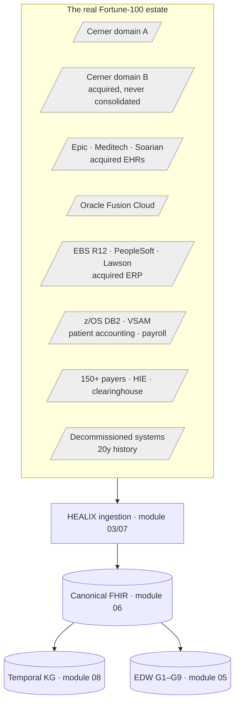

# Fortune-100 Legacy, Tech-Debt, M&A and Scale Outliers

This is the focused catalogue of the **messy realities a Fortune-100 health system actually runs into** — the ones the
thin-slice demo never shows and the ones that break a design that quietly assumes a single clean Cerner estate. It is
derived from the `ADV-LEG`, `ADV-SCALE`, and the multi-instance/terminology-churn findings in ADV-REG, re-framed as
"here is the outlier, here is how HEALIX must handle it, here is what changes."

A Fortune-100 integrated delivery network is not one hospital on one Cerner build. It is the **sediment of twenty years
of mergers**: several Millennium domains that were never consolidated, acquired hospitals still on Epic / Meditech /
Soarian, finance split across Oracle Fusion and legacy EBS / PeopleSoft / Lawson, revenue and payroll still running on
a z/OS mainframe, 150+ payers each with their own X12 dialect, and decades of history in systems being decommissioned.
The platform's stated mission — *one trusted definition across the estate* — is tested hardest exactly here.

Each entry: **O-id · the outlier · what the PRD does today · how the platform MUST handle it (RFC 2119) · change
targets (findings + modules)**. The handling statements are normative requirements of this module.

## 1. Estate shape — more than one of everything

### ADV-OUT-001 · Multiple Cerner Millennium domains (never consolidated)
- **Outlier:** Two+ Millennium domains coexist for years after a merger. `CODE_SET 71 / value 309` means one thing in domain A, a site-added "Hospice" in domain B; `NOMENCLATURE_ID`s, alias pools and facility mnemonics are domain-local and collide.
- **Today:** The local-terminology URI `urn:healix:cs:cerner:code-value|<set>`, SRC-CER-005/006, the registry example (`cerner-millennium-prod`) and TKG-03 source IRIs all assume one domain; `§4.2` overclaims `CDF_MEANING` as "stable across sites." The roadmap's "additional Cerner by configuration" scopes only *facilities within one domain*. `14/04` knows the estate is multi-domain but only operationally (tz, MRN adjudication, memory partitioning).
- **MUST handle:** The local-terminology URIs and source-record IRIs **MUST** carry the Millennium *domain/instance* as a first-class namespace component (`urn:healix:cs:cerner:<domain>:code-value|<set>`; `id/patient/cerner/<domain>/<facility>/<mrn>`). A conflict-detection + reconciliation step **MUST** fire when the same `(set, value)` or `NOMENCLATURE_ID` resolves to different concepts across domains. A facility-mnemonic uniqueness guard **MUST** run at IRI mint. The roadmap **MUST** distinguish "facility within a domain" (by configuration) from "additional Millennium domain" (requires the namespace component + terminology reconciliation).
- **Change targets:** ADV-LEG-002, ADV-INT-005, ADV-SEM-005-sibling · modules 03, 06, 08, 13, CONVENTIONS.

### ADV-OUT-002 · Co-existing non-Cerner EHRs from acquisitions (Epic, Meditech, Soarian, Allscripts)
- **Outlier:** An acquisition brings Epic; a regional group is on Meditech MAGIC/Expanse; a decade-old Soarian is pending sunset. All feed HEALIX clinical data for years during consolidation to Cerner.
- **Today:** The generic capability exists — `03/README` is a vendor-neutral Source Registry (`system_class: ehr`, `fhir_api`/`$export`, `cdc_log` for Clarity/Caboodle, `file_drop` for Meditech NPR/DR, local-code-as-CodeSystem harvesting), and `06` FHIR R4 is the cross-vendor canonical layer. But `00 §6`'s scope matrix lists only Cerner, there is no worked non-Cerner adapter, and cross-EHR clinical entity resolution is deferred past Phase 1.
- **MUST handle:** The PRD **MUST** state in `00 §6` whether a second clinical EHR is in first-release scope (resolving the internal inconsistency between the Cerner-only scope matrix and the UX/self-healing/prototype modules that assume M&A legacy EHRs coexist). At least one **worked reference adapter** (e.g. Epic via `fhir_api`/`$export` + `CodeSystem` harvest of EAP/.1 masterfiles) **MUST** instantiate the generic contract. Cross-EHR clinical identity resolution **MUST** be phased, not open-ended, because EMPI-collision self-healing (FLT-ING-015) already assumes merged-facility identity work is live.
- **Change targets:** ADV-LEG-001 · modules 00, 03, 06, 08, 13.

### ADV-OUT-003 · Legacy ERP coexisting with Oracle Fusion (EBS R12, PeopleSoft, Lawson)
- **Outlier:** Corporate on Fusion Cloud; two acquired entities on on-prem EBS R12; a legacy hospital on PeopleSoft/Lawson for payroll. GL, AP, suppliers and workers must consolidate across all three during a multi-year window with divergent charts of accounts.
- **Today:** The extraction capability exists (`cdc_log` = Debezium/LogMiner/GoldenGate covers on-prem EBS/PeopleSoft; `system_class: erp|hcm|scm` allows a second ERP; onboarding step 2 handles source overlap; Stage-3 ConceptMaps are the crosswalk mechanism). But SoR is hard-coded to Fusion in prose (`03/02`, `04/01`, `04/02`, TKG-03 §5.1 "Oracle Fusion only"/"Oracle item master").
- **MUST handle:** Survivorship **MUST** express configurable system-of-record precedence across ERP sources (the TKG-03 §5.1 packs parameterized, the absolute "Fusion is the system of record" struck in favor of per-entity SoR in the registry). A cross-ERP COA / natural-account ConceptMap crosswalk **MUST** be a required Stage-3 deliverable triggered when a second finance source registers. Each legacy ERP **MUST** register as its own `erp` source with its own COA/lookup CodeSystems. No new extraction pattern or source model is needed.
- **Change targets:** ADV-LEG-003 · modules 03, 04, 05, 08.

### ADV-OUT-004 · Mainframe batch — z/OS DB2 / VSAM / COBOL copybooks / EBCDIC / COMP-3
- **Outlier:** Legacy patient accounting/self-pay, home-grown claims adjudication and payroll run on z/OS, emitting nightly EBCDIC fixed-width files with COMP-3 packed-decimal amounts described by COBOL copybooks.
- **Today:** Acknowledged only as a self-healing parse failure (FLT-ING-004) with a recovery of "guess the code page and re-parse" — which is operationally wrong (EBCDIC code pages cannot be inferred; COMP-3 is binary), so it silently corrupts financial amounts. `file_drop` is "CSV/Parquet/fixed" with no copybook/EBCDIC handling; there is no z/OS DB2 CDC connector.
- **MUST handle:** The extraction taxonomy **MUST** add `copybook_fixed` and a z/OS DB2 change-capture pattern. The COBOL copybook **MUST** be a first-class SRC-REG artifact (field offsets, PIC clauses, COMP-3 sign nibble, OCCURS DEPENDING ON, REDEFINES); the source code page **MUST** be declared in the interface record and transcoded deterministically at ingest, never inferred; COMP-3 money **MUST** be parsed-or-failed. A real z/OS DB2 CDC channel **MUST** be named (IBM IIDR / Q Replication, or GoldenGate for DB2 z/OS). If the org mandates upstream ASCII transcoding before HEALIX, that **MUST** be stated as an explicit ingestion assumption.
- **Change targets:** ADV-LEG-004 · modules 03, 06, 14.

## 2. Identity, M&A onboarding and historical data

### ADV-OUT-005 · Blank / colliding HL7 assigning authorities from acquired facilities
- **Outlier:** A newly acquired facility's interface engine emits PID-3/PV1-19 with empty/defaulted CX-4, or two facilities both emit `...^^^^MR` with overlapping ranges. The strict reject/quarantine rules (SRC-CER-016, IOP-V2-011, SRC-PER-035) quarantine the whole feed on day one of onboarding.
- **Today:** No per-`(source,facility)` default assigning authority, no MSH-4 fallback, no collision DQ rule — onboarding is blocked rather than inferred-and-reviewed.
- **MUST handle:** The Source Registry **MUST** support an optional, steward-approved per-`(source_id, facility)` `default_assigning_authority`; when CX-4/PV1-19 is blank the mapper **MUST** namespace the identifier with it (Provenance note + DQ flag) rather than fail — but inference is permitted **only** where a steward-approved default exists; an unregistered-and-no-default authority **MUST** still quarantine. A DQ rule **MUST** detect assigning-authority collision across facilities, and suspected collisions **MUST** route to the TKG-03 §8 human review queue. Until built, acquired feeds with unpopulated CX-4 require the integration team to populate the authority upstream (the current de-facto workaround).
- **Change targets:** ADV-LEG-007 · modules 03, 06, 08, 09.

### ADV-OUT-006 · Duplicate MRNs and EMPI collisions across merged facilities
- **Outlier:** After a merger two facilities' MRN ranges overlap; the same person exists under different MRNs across two Cerner domains; placeholder identifiers (DOB 1900-01-01, SSN 999-99-9999, name BABY BOY) pollute blocking.
- **Today:** This is well-handled: TKG-03 keys MRNs on `(assigner, value)`, excludes known placeholder values from blocking, routes to a human review queue (no auto-merge in Phase 1, RMP-PH1-007), and FLT-ING-015 self-heals the EMPI-collision surge. The genuine residue is upstream of ER: the assigning-authority namespace (ADV-OUT-005) and the multi-domain IRI namespace (ADV-OUT-001) must be correct *before* ER blocking runs, or two domains sharing a facility mnemonic collapse into one node IRI.
- **MUST handle:** Entity resolution **MUST** receive correctly-namespaced `(domain, assigner, value)` identifiers; the IRI mint **MUST NOT** collapse two source records from different domains onto one node (ADV-OUT-001). Cross-EHR clinical identity (not just party identity) **MUST** be phased in, since merged-facility identity work is assumed live by self-healing.
- **Change targets:** ADV-LEG-002, ADV-LEG-001 · modules 08, 03, 06.

### ADV-OUT-007 · Acquisition onboarding wave — CR / backfill surge
- **Outlier:** Onboarding an acquired hospital = a fresh Millennium domain's `CODE_VALUE`/`NOMENCLATURE` plus a ~10M-resource FHIR backfill; each previously-unseen local code raises a `terminology_steward` CR and each mapping failure a `source_mapper` CR — many thousands over the 14-day backfill, far above the 2,000 CRs/day steady-state the token caps assume. When the per-agent daily cap is hit, non-P0 CRs pause — stalling the very mapping CRs the backfill depends on.
- **Today:** Cushioned (0–200 pod "burst 10×"; C0–C4 caches built to absorb a CODE_VALUE surge; staged onboarding into uat first) but not closed: no bounded onboarding CR-volume model, no per-CR token estimate, no surge budget class, and budget raises are human-only policy so the autonomous recovery path is blocked in exactly this window.
- **MUST handle:** An onboarding/backfill CR-volume model **MUST** be modeled separately from steady state, with a per-CR token estimate (the cost-per-CR metric already gives the basis). A declared, time-boxed, operator-signed **onboarding/backfill budget class** **MUST** lift the per-agent cap for `terminology_steward`/`source_mapper` for the window. The hard-limit default during a declared onboarding window **MUST NOT** place mapping/terminology CRs the backfill depends on in the paused set. Auto-approval thresholds **MUST NOT** be relaxed under queue pressure (RMP-RISK-012) — use steward-capacity surge + proposal batching.
- **Change targets:** ADV-SCALE-004 · modules 10, 12, 13, 06.

### ADV-OUT-008 · Decommissioned-system historical migration (and read-only archive)
- **Outlier:** An acquired hospital's Soarian is decommissioned; 12 years of encounters/results/charges load once with real-world valid-time in the past, transaction-time = migration date, lower-trust provenance — or stay in a read-only archive (MediQuant-class) HEALIX references rather than ingests. No live feed follows.
- **Today:** The hard machinery exists (`reload`/`late-arrival` change reasons, `valid_from` from source + `recorded_at` from loader, restartable bulk load, droppable backfill named graphs, mandatory provenance). Missing: a load-once/never-active source lifecycle, a "migrated-legacy" survivorship tier (so a 12-year-old Soarian value cannot silently beat current Cerner — survivorship of an unranked source is currently undefined), and any mention of a read-only active-archive option.
- **MUST handle:** A `historical_migration` extraction pattern and a registry lifecycle for a load-once, never-active, no-live-feed source **MUST** exist. Survivorship **MUST** rank migrated/decommissioned sources below live systems and **MUST** define a default precedence for any source not in the trust-rank list. The migrate-vs-read-only-archive decision **MUST** be a documented architecture option, with a KG stub/pointer pattern for legacy data referenced but not ingested.
- **Change targets:** ADV-LEG-006 · modules 03, 05, 08.

### ADV-OUT-009 · Historical-data DQ regime (era-aware rules)
- **Outlier:** 20 years of migrated history: a 2009 LOINC/local code valid then but retired now; a 2012 encounter missing a field the current SHACL shape demands; a pre-2015 ICD-9 dx under an ICD-10-only binding. Today's rules evaluate decade-old codes at load-time, flooding stewards with non-actionable failures AND quarantining legitimate era-valid records, while masking the migration defects that matter.
- **Today:** The DQ regime is steady-state and keys validity to load-time transaction time; a fresh migration stamps `recorded_at = migration time`. There is no `migration` change-reason class and no era resolver; the only tie-out (SRC-CER-011) is Cerner-FHIR-only.
- **MUST handle:** A first-class `migration/backfill` load class **MUST** exist; for it, value-set/terminology/ontology rules **MUST** be evaluated against the era in force at `valid_from` (reusing the G8 release versioning) or scoped out under an explicit as-of policy. Migration-era VALIDITY/SEMANTIC/COMPLETENESS results **MUST** be excluded from live DQI (flagged, with a separate migration scorecard). A migration rule family **MUST** target the defects that matter (row-count/control-total tie-out to the source extract — generalised beyond Cerner FHIR to all M&A sources, GL periods and masters; amount-sum fidelity; business-key coverage). A module-13 legacy-data acceptance regime **MUST** be met before historical GA and repeated per acquisition.
- **Change targets:** ADV-DQ-001 · modules 09, 05, 04, 13.

### ADV-OUT-010 · CDM drift and cross-facility charge-code divergence
- **Outlier:** Post-merger the same CT-with-contrast carries charge `4512300` at the legacy facility and maps to CPT `70491` differently at the main campus; the CDM rebuilds annually (retiring/renumbering) and reprices quarterly; cost-to-charge analytics need the price in effect on the service date.
- **Today:** Mostly covered — the CDM is a versioned G8 code system with `concept_status`/effective dating, Cerner `BILL_ITEM` CDC is bitemporal, supply/drug charges resolve to a golden Item, and posted price is preserved bitemporally. Missing: an effective-dated CDM/CPT *list price* reference with as-of lookup, a DQ rule validating `fact_charge.charge_code_src` against the effective-dated CDM, and a golden "ChargeableService" survivorship key for merged-facility service charges.
- **MUST handle:** A versioned/effective-dated CDM price reference **MUST** exist in G8 with a `price-as-of(service_date)` lookup; a `DQR-VALIDITY-CHARGE-*` rule **MUST** validate the Cerner charge code against the effective-dated CDM on the service date; the order-catalog→CPT crosswalk **MUST** be the explicit survivorship key for merged-facility service charges.
- **Change targets:** ADV-LEG-005 · modules 03, 05, 08, 09.

## 3. Terminology, reference and licence churn

### ADV-OUT-011 · Local Cerner code-system URI collision and inter-module disagreement
- **Outlier:** Multiple domains run `CODE_SET 71` with overlapping numerics meaning different things; modeling all as one `cerner-code-set-71` collapses `309999` from two domains into one concept, and a ConceptMap correct for one hospital mistranslates encounter class for another — passing validation because the code "exists."
- **Today:** Two separable defects. (1) Module 06 uses `https://fhir.healix.example.org/CodeSystem/cerner-code-set-<N>` (one CodeSystem per set) while module 03 / SRC-CER-005 use `urn:healix:cs:cerner:code-value|<set>` (one CodeSystem, set as a `|`-token — invalid FHIR `system|code`, making `309999` ambiguous across sets). (2) Neither form carries a domain discriminator.
- **MUST handle:** The local Cerner CodeSystem identity **MUST** be reconciled to ONE normative URI form across IOP-04/02/05, the ConceptMap/profile JSONs, SRC-01 §4.2/SRC-CER-005 and the SRC-00 registry schema + SRC-04 bindings; a CI linter **MUST** fail the build when a mapping's `source_code_system` does not match a registered `CodeSystem.url`/`ConceptMap group.source`. The URL **MUST** carry the domain, ConceptMaps **MUST** be scoped per domain, and mapping **MUST** route by the `hc-source-system` envelope and anchor on CDF_MEANING.
- **Change targets:** ADV-INT-005, ADV-LEG-002 · modules 06, 03, 04, CONVENTIONS.

### ADV-OUT-012 · Terminology & subsumption-closure churn
- **Outlier:** SNOMED releases monthly; between editions a set of disorder concepts is reparented, silently changing a "descendant of Sepsis" cohort, G6 eCQM denominators and subsumption DQ rules. No code retired, no map broke, so the unmapped-rate trigger never fires; a HEDIS auditor later cannot reproduce last year's CMS165 numerator.
- **Today:** Well-covered on reproducibility — EDW-G6-001 pins the `terminology_release_id` on every measure result, DQ-RULE-010 pins `valueset_version` per DQ result, EDW-G7-001 mandates bitemporal cohort reproducibility, and the membership delta IS computed and notified on each release (orchestration §6.4, UX-CAT-014). Missing: a consumer-population-drift GATE.
- **MUST handle:** On each terminology upgrade, for every registered subsumption-based DQ rule, eCQM/HEDIS measure and saved cohort, the platform **MUST** compute the quantified population-size delta and, above a per-consumer threshold, block promotion until the population owner signs off. The cohort-level `terminology_release_id` pin **MUST** be explicit on `fact_cohort_membership`. Subsumption CQs **MUST** be re-run against the new version with a reported delta.
- **Change targets:** ADV-SEM-001 · modules 06, 09, 05, 02, 13.

### ADV-OUT-013 · Instance-IRI template migration over the estate's lifetime
- **Outlier:** Years in, identity policy changes so Encounter IRIs move to an enterprise-canonical template; billions of already-materialised KG assertions and EDW rows keep the old IRIs, old history and new events for the same encounter become disjoint IRI spaces, and the ADR-07 business-key invariant (same key → same IRI) is violated.
- **Today:** The governance hook exists (RDM-HAR-014, ONT-REL-003) but the instance-level mechanism is undefined and in tension with ONT-KG-012 (forbids rewriting historical assertions); `healix:replacedBy` is defined for concepts/classes only, not instances.
- **MUST handle:** An instance-IRI template-migration procedure **MUST** exist that resolves the ONT-KG-012 conflict — either `healix:supersedesIRI`/scoped `owl:sameAs` bridges in a migration graph that the query facade and reconciliation follow, or a governed re-projection re-minting affected instances with transaction-time supersession and `healix:priorIRI`. The required module-08 graph migration note **MUST** contain an instance-migration plan + a reconciliation re-test, and the reconciliation engine **MUST** expect template-migration bridges so the RMP-RISK-013 0.1% gate is not falsely tripped.
- **Change targets:** ADV-SEM-002 · modules 02, 08, 05.

### ADV-OUT-014 · Terminology licence seats and usage reporting for an agent fleet
- **Outlier:** At the annual NLM UMLS re-acceptance, SNOMED affiliate re-acceptance and an AMA CPT audit, the org must report distinct end-users of CPT descriptions and SNOMED/UMLS usage. 20 agents issue ≥50,000 TS calls/s and read CPT displays; the platform keeps no count and generates no usage report.
- **Today:** The seat/scope obligation is stated (99 §8) and the agent-as-user question posed — but only for the HCDM model document, not the clinical terminologies the fleet consumes. There is no entitlement register, no consumption metering, and no report generation; the UMLS annual report is a hard obligation the platform cannot currently satisfy.
- **MUST handle:** A terminology-licence entitlement register **MUST** exist in G9 (per code system: licence class, seat/scope entitlement, licensed human roles AND agent identities, UMLS annual re-acceptance dates). The TS gateway **MUST** meter read operations by licensed system and distinct consumer. A scheduled governance artefact **MUST** generate the UMLS-annual / SNOMED-affiliate / CPT seat-and-usage report. Legal/IP **MUST** determine, before agents consume licensed displays in prod, whether an autonomous agent is a "licensed user" for CPT and SNOMED/UMLS (a Phase-1 gate).
- **Change targets:** ADV-SEM-003 · modules 99, 06, 04, 11, 10.

## 4. Scale outliers

### ADV-OUT-015 · Knowledge-graph triple-count and store sizing reconciliation
- **Outlier:** A 10+ hospital system accrues the required 10 B triples; annotations (lab amendments, claim resubmissions, EMPI merges) accrete as RDF-star triple-terms.
- **Today:** Three growth figures disagree across modules (`08/02` 10 B + an internally-inconsistent "near 10 B over 5 yr"; `12/01 §5` "5 B headroom" / "1.2 B/yr"), and none sizes index overhead, replica factor or hot working-set for the 10 B requirement.
- **MUST handle:** ONE authoritative, self-consistent KG growth model **MUST** be published (base + annotation/yr with an explicit correction/supersession multiplier and the post-dedup net rate); the OPS-01 §5 driver and headroom label **MUST** be corrected to match TKG-STORE-002 (or TKG-STORE-002 revised); a measured bytes-per-triple-with-full-index sizing with replica factor and hot working-set **MUST** justify the per-node hardware; and the §8.2 conformance load **MUST** run on hardware sized from that model.
- **Change targets:** ADV-SCALE-001 · modules 08, 12.

### ADV-OUT-016 · Throughput anchor — sustained vs peak
- **Outlier:** Capacity review: the Kafka estate is built to 180 MB/s (5,000/s × 3) while the deployment table says real sustained is ~600/s, and the morning-rounds peak is never derived bottom-up.
- **Today:** "5,000 resources/s" is used simultaneously as the NFR sustained floor, the Kafka sizing sustained basis, and the deployment peak ceiling, all citing ARC-NFR-002.
- **MUST handle:** Sustained and peak canonical throughput **MUST** be stated as two distinct numbers derived bottom-up from per-source daily volumes × peak factors at the real facility count; ARC-NFR-002 **MUST** name both with headroom against each; the Kafka broker sizing and the Flink/Terminology autoscale ceilings **MUST** be re-keyed to the reconciled peak.
- **Change targets:** ADV-SCALE-002 · modules 01, 07, 12.

### ADV-OUT-017 · Mass replay and multi-timezone batch windows at estate scale
- **Outlier:** After a bad mapping corrupts a quarter of canonical output, SRE orders a 30-day replay across all affected topics (~1.5 B canonical resources) that competes with live clinical ingest; and "completed by 06:00 local" is undefined across a two-region estate.
- **Today:** The replay-controller is per-processor with no global concurrency cap and no reserved capacity lane; no worst-case 30-day event-replay sizing; EMPI cache pre-warm is unspecified; the freshness anchor is ambiguous across regions. (KG ordering, terminology warming and inferred-dimension handling are already covered.)
- **MUST handle:** A replay-orchestration spec **MUST** add a global concurrency cap, a reserved compute/Flink capacity lane separate from live ingest, and an explicit requirement that a mass replay **MUST NOT** breach the P0 ARC-NFR-001 p95 ≤ 5 s clinical-ingest SLA; the EDW projector **MUST** sequence conformed dimensions ahead of facts with inferred-row reconciliation; a worst-case 30-day/220-topic event-replay **MUST** be sized; EMPI cache pre-warm **MUST** be added; and the freshness anchor **MUST** be defined in UTC for the enterprise region.
- **Change targets:** ADV-OPS-004, ADV-SCALE-003 · modules 07, 08, 05, 12.

## 5. Cross-reference — outliers to findings and roadmap phase

| Outlier | Findings | Primary modules | Roadmap phase to resolve |
|---------|----------|-----------------|--------------------------|
| O-001 Multi-domain Cerner | ADV-LEG-002, ADV-INT-005 | 03, 06, 08, 13 | Phase 2 (before 2nd domain) |
| O-002 Co-existing EHRs | ADV-LEG-001 | 00, 03, 06, 08 | Phase 2–3 |
| O-003 Legacy ERP | ADV-LEG-003 | 03, 04, 05, 08 | Phase 2 |
| O-004 Mainframe batch | ADV-LEG-004 | 03, 06, 14 | Phase 2 |
| O-005 Assigning authorities | ADV-LEG-007 | 03, 06, 08, 09 | Phase 1 (M1.5, 2nd facility) |
| O-006 Duplicate MRN / EMPI | ADV-LEG-002, ADV-LEG-001 | 08, 03, 06 | Phase 1 |
| O-007 Onboarding surge | ADV-SCALE-004 | 10, 12, 13 | Phase 2 |
| O-008 Decommissioned migration | ADV-LEG-006 | 03, 05, 08 | pre-historical-GA |
| O-009 Historical-data DQ | ADV-DQ-001 | 09, 05, 04, 13 | pre-historical-GA |
| O-010 CDM drift | ADV-LEG-005 | 03, 05, 08, 09 | Phase 2 |
| O-011 Local-code URI collision | ADV-INT-005, ADV-LEG-002 | 06, 03, 04 | Phase 1 (URI fix) / Phase 2 (domain) |
| O-012 Terminology/subsumption churn | ADV-SEM-001 | 06, 09, 05, 02 | Phase 2–3 |
| O-013 Instance-IRI migration | ADV-SEM-002 | 02, 08, 05 | before first template change |
| O-014 Licence seats | ADV-SEM-003 | 99, 06, 04, 11, 10 | Phase 1 (Legal determination) |
| O-015 KG sizing | ADV-SCALE-001 | 08, 12 | Phase 1 |
| O-016 Throughput anchor | ADV-SCALE-002 | 01, 07, 12 | Phase 1 |
| O-017 Mass replay / batch window | ADV-OPS-004, ADV-SCALE-003 | 07, 08, 05, 12 | Phase 2 |
