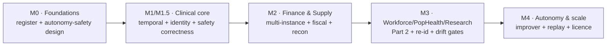

# Remediation Plan

This is the prioritised backlog that turns the ADV-REG findings into dated, owned documentation changes, mapped to the
module(s) that must change, the **acceptance change** that proves the fix, and the **module 13 roadmap phase** at which
the owning capability GAs. Because HEALIX is design-stage, every remediation is a **specification change** (and its
acceptance artefact), not a code patch.

## 1. Priority definitions

| Priority | Meaning | Gate obligation |
|----------|---------|-----------------|
| **P0** | Corrects a defect on the critical path of the gate that first exercises the capability. The owning gate **MUST NOT** pass until the spec is corrected and its acceptance change lands (per `ADV-GOV-003` / `RMP-ACC-142`). All confirmed-major + all cross-cutting autonomy-safety + all Phase-1 clinical-core correctness findings. | Blocks its owning gate |
| **P1** | A major owned by a later phase, or a high-value hardening of a shipping capability. **MUST** be resolved before the owning capability GAs; **MAY** ship after the thin slice. | Blocks the owning phase gate |
| **P2** | A minor spec-completeness / clarity / hardening gap. **SHOULD** be resolved within 90 days of the gate at which it is accepted (`ADV-GOV-004`), or carry a written DGC risk acceptance. | Does not block GA |

Mapping to module 13's phase ladder (RMP-01): **M0** Foundations · **M1 / M1.5** Clinical core · **M2** Finance &
Supply · **M3** Workforce, Pop Health, Research · **M4** Autonomy & scale. The module-15 roadmap row already schedules
a red-team and gate at each milestone; this backlog is what those gates burn down.

## 2. P0 — resolve before the owning gate

| ADV id | Finding (short) | Modules to update | Acceptance change | Owning gate |
|--------|-----------------|-------------------|-------------------|-------------|
| **ADV-AGT-008** | Module 15 empty; `RMP-ACC-140` gates M0 on it | 15, 13, 10, 14 | ADV-REG populated; RT-01..12 harness + honeytoken inventory + poisoning/playbook/improvement suites exist with versioned, checksummed dataset manifests; module-13 traceability check that every "module 15" reference resolves; README link fixed. Satisfies `RMP-ACC-140/141`. | M0 |
| **ADV-AGT-001** | No clinical-safety veto / risk class | 10, 09, 11, 02, 06 | A `clinically_significant` dimension (from the DQ §3 safety-CDE taxonomy incl. UCUM, CVX) forces clinical-safety approval on any CR touching those elements regardless of PHI/score; a clinical-safety reviewer role with veto (or a distinct clinical-correctness attestation); a nightly clinical-drift scan + safety-remapping red-team suite. New `AGT-SAFE-*` + a gate criterion parallel to the PHI gate. | M1 |
| **ADV-AGT-002** | Rollback leaves consumed KG/EDW data wrong | 10, 08, 05, 02, 12 | Artefact rollback drives a scoped reprojection (lineage-enumerated offset ranges replayed through the restored mapping, emitting bitemporal corrections/retractions); post-rollback reconciliation asserts no `current` assertion/row cites a rolled-back CR; §7 rollback SLA covers data-healing completion. New `AGT-ORCH-*` test. | M1 |
| **ADV-AGT-005** | Calibration κ blind to the auto-approved majority | 10, 16, 14 | Mandatory random **blind audit** of the applied auto-approved population (stratified sample) re-reviewed independently and fed into κ; per-type auto-approval suspension on excess audit disagreement; UX-CR-016 promoted to P0 for the audit sample. Design lands at M1; drives the G-06 autonomy ramp through M3. | M1 (design) → M3 |
| **ADV-AGT-006** | `dq_monitor` (rollback sensor) is an improver target with no recall floor | 14, 09, 10 | A MEM-06 §4 fixed point protects dq_monitor detection sensitivity/recall + the AGT-ORCH-016 attribution path (policy-class, not improver-tunable); a RECALL rubric+gate on a refreshed held-out set with injected novel regressions; `dq_downstream` defined and sourced independently of dq_monitor; a second independent regression detector. | M2 (before improver canaries in prod, M3) |
| **ADV-SCALE-001** | KG triple-count vs store sizing contradictory | 08, 12 | ONE authoritative, self-consistent KG growth model (08 §3); OPS-01 §5 driver + headroom corrected to TKG-STORE-002; measured bytes-per-triple-with-index sizing with replica factor + hot working-set; §8.2 conformance load run on hardware sized from the model. | M1 |
| **ADV-SCALE-002** | "5,000/s" used as sustained floor, sizing basis AND peak | 01, 07, 12 | ARC-NFR-002 rewritten to name sustained (~600/s derived) and a bottom-up-derived peak with headroom against each; `07/01 §1.2` Basis + STR-TOP-003 + Flink/Terminology autoscale ceilings re-keyed to the reconciled peak. | M1 |
| **ADV-TMP-001** | UCUM scalar factor cannot bridge mass↔molar / IU | 05, 06, 03 | `ref_unit_conversion` defined in G8 DDL keyed by observation/substance (LOINC + molar mass / UNII) and wired to fact canonicalisation; non-convertible marker for IU/arbitrary/enzyme-activity; two DQ rules (reject source unit not in the LOINC's allowed set; detect multiple unit systems per LOINC across sources). | M1 |
| **ADV-TMP-002** | `*_date_sk` from one per-source TZ vs KG facility-local | 05, 08 | EDW-CONF-009 + dim_date/dim_time prose derive `*_date_sk`/`*_time_sk` from the fact's facility zone (`source_tz` / LOCATION registry), `default_timezone` as fallback + DQ flag; the local-day projection added to the TKG-04 §7.2 reconciliation; facility IANA zone surfaced on `dim_location`. | M1 |
| **ADV-TMP-003** | EDW & KG survivorship authored twice, divergence undetected | 05, 08, 09 | One versioned survivorship rule pack (TKG-ER-012) consumed by the EDW loader; 05 §1 precedence matrix subordinated; TKG-ER-013 requires survived-attribute equality; a reconciliation check diffs survived current values per golden entity (KG-side golden hash defined) and classifies lag vs derivation divergence. | M1 |
| **ADV-TMP-005** | EDW bitemporal block drops valid-time precision/source | 05, 08 | `valid_time_precision` + `valid_time_source` added to the §3.1 block and C13/C14 of the §3.3 + module-08 §9 contract (coordinated breaking change, `hc.kg.*.v2`); exposed via edw_sem as-of accessors + BI "approximate" flag; `ontology_property_iri` assigned so precision enters the reconciliation hash; EDW-side analogue of DQR-TIMELINESS-TEMPORAL-002. | M1 |
| **ADV-INT-004** | `A47`/`A37` required by module 08 are out of module 06 scope | 06, 03, 07, 08 | IOP-02 §4 adds A47 + A37 with mapping to `Patient.identifier`/unmerge, wired to `hc.kg.er.link.v1`; identity events exempt from the volume threshold; A06/A07 aligned between SRC-01 §3.1 and IOP-02 §4. Resolves the cross-module contradiction with TKG-ER-009. | M1 |
| **ADV-INT-005** | Local-code URI collision + inter-module disagreement | 06, 03, 04 | ONE normative local Cerner CodeSystem URI form across IOP-04/02/05, the ConceptMap/profile JSONs, SRC-01 §4.2/SRC-CER-005 and the SRC-00 registry + SRC-04 bindings; a CI linter fails the build on an unregistered/mismatched `source_code_system`. (URI reconciliation is M1; the domain qualifier is M2 with ADV-LEG-002.) | M1 (URI) |
| **ADV-LEG-002** | No Millennium-domain qualifier in local-code & source IRIs | 03, 06, 08, 13 | Domain as a first-class namespace component (`...:cerner:<domain>:code-value|<set>`; `id/patient/cerner/<domain>/<facility>/<mrn>`); same-`(set,value)`/`NOMENCLATURE_ID` conflict reconciliation; facility-mnemonic uniqueness guard at IRI mint; RMP-PH1-012/OQ-16 distinguish facility-within-domain from additional-domain. | M1 (design) → M2 (2nd domain) |
| **ADV-PHI-001** | Adolescent-confidentiality & proxy access unmodeled | 11, 06, 03, 16 | Patient age/minor-status ABAC attribute (facility+state keyed); a GOV-01 §5 adolescent-confidentiality consent gate suppressing minor-consent-service encounters from a proxy principal; GOV-02 recognises a proxy/RelatedPerson launch; age-of-majority auto-revocation as a bitemporal JML event; a privacy_guardian rule + module-03 Cerner proxy/confidential-flag mapping. | M1 (design) → M3 |
| **ADV-PHI-002** | Retained C-CDA/OBX blobs bypass segmentation (no DS4P) | 06, 11, 12 | Document-level sensitivity label computed (max of extracted `meta.security` + NER over narrative) stamped on `DocumentReference.securityLabel` at ingest; the consent/sensitive-category PDP enforced at the object-store proxy on every attachment fetch; sensitive-category sections suppressed or DS4P-redacted before outbound release; de-id `$export` confirmed to process the blob. | M1 → M2 |
| **ADV-LEG-007** | Blank/colliding HL7 assigning authorities quarantine feeds | 03, 06, 08, 09 | Optional steward-approved per-`(source_id, facility)` `default_assigning_authority` in the Source Registry + onboarding step; blank CX-4 namespaced with it (Provenance + DQ flag) only when a default exists, else quarantine; a DQ collision rule routing to the TKG-03 §8 review queue. | M1.5 (2nd facility) |
| **ADV-DQ-001** | No DQ regime for migrated / legacy historical data | 09, 05, 04, 13 | A `migration/backfill` load class (`change_reason_code` + PROV-O); era-aware rule evaluation at `valid_from` (G8 release versioning) or scoped-out as-of; migration-era VALIDITY/SEMANTIC/COMPLETENESS excluded from live DQI with a separate scorecard; a migration rule family (control-total tie-out generalised beyond Cerner FHIR, amount-sum fidelity, key coverage); a module-13 legacy-data acceptance regime before historical GA. | pre-historical-GA |

## 3. P1 — majors owned by a later phase, and high-value hardening

| ADV id | Finding (short) | Modules to update | Acceptance change | Owning gate |
|--------|-----------------|-------------------|-------------------|-------------|
| **ADV-INT-002** | C-CDA hard-quarantine on any Schematron error; R2.1-only | 06, 08 | Tiered CDA validation (extract from structurally-parseable docs, Schematron errors demoted to warnings on an allowlist; hard-quarantine only true parse failure); `DocumentReference` + bytes always produced before extraction (IOP-CDA-002 unconditional); R1.1/unknown-template detection; echo-suppression on source authorship + stable entry ids. Note: module 08 has no clinical-statement ER. | M1 (HIE ingest) |
| **ADV-PHI-003** | No relationship-based snooping / VIP detection | 11, 08, 10 | A targeted-single-access monitoring control over `hc.ops.audit.v1` (same-surname/address, HCM employee match, declared family/proxy, self-access, VIP) for HEALIX consumer surfaces; a sourced patient-level VIP flag as a PDP attribute driving masking + heightened audit; scope boundary vs live Cerner PowerChart logs stated. | M3 |
| **ADV-PHI-005** | Consent revocation not enforced on as-of / as-known KG reads | 11, 08, 07, 12 | Consent evaluated at time-of-access (current `consent_state`) for all consumer-facing reads incl. as-of/as-known KG facade + EDW Time-Travel; `consent_state` added to the TKG-02 §7 ACL; audit-only historical reconstruction (purpose=audit/break-glass) separated from consumer-facing as-of reads. | M3 (Part 2) |
| **ADV-DQ-002** | Recon rules hard-code single-vendor source keys | 09, 05, 03 | XSYS rules join `dim_source_system` on `source_system_sk` and select instances by `system_category_code`/explicit instance-BK set; financial recon scoped by `ledger_sk`/legal-entity via `dim_ledger` + a facility→instance→ledger routing registry; the three source identifiers reconciled into one convention. | M2 |
| **ADV-DQ-006** | Aggregate-sum recon masks offsetting / signed amounts | 09 | XSYS-001/002/006 reconcile separately-computed gross positive and gross negative sub-totals (extend the GL-002 pattern) + a count/line-level companion; tolerance fixed to `GREATEST(ABS(a),ABS(b))` with a two-sided absolute floor so net-negative/low-volume days are neither always-firing nor hypersensitive. | M2 |
| **ADV-TMP-006** | Only GL is period-aware; multi-ledger fiscal can't tie out | 05 | `accounting_period_sk`/`fiscal_period_sk` on revenue-cycle/AP/AR/supply/workforce facts, resolved by the owning ledger/legal-entity's calendar via `dim_fiscal_period`; a ledger/legal-entity FK (or derivation) added to those facts; `dim_date.fiscal_*` restated as the consolidation calendar only; `dim_fiscal_period` carries calendar type + 53rd-week flag; a cross-entity GL↔subledger period reconciliation test. | M2 |
| **ADV-LEG-004** | Mainframe batch not a first-class ingestion pattern | 03, 06, 14 | `copybook_fixed` + a z/OS DB2 CDC pattern in §4.5; copybook as a first-class SRC-REG artifact; source code page declared + transcoded deterministically (COMP-3 parse-or-fail); a named z/OS DB2 CDC channel; FLT-ING-004 rewritten to the deterministic contract. Or a stated upstream-ASCII-transcode ingestion assumption. | M2 |
| **ADV-OPS-002** | Blue/green of EOS Flink jobs under-specified | 07, 12 | Green writes to an isolated validation topic (not the live topic); per-deployment transactional.id prefix + a fencing-aware drain-then-promote cutover with the stated guarantee; a state-serializer-compatibility precondition before savepoint restore + incompatible-state fallback + RTO; §6-vs-OPS-ENV-015 model resolved. | M1 → M2 |
| **ADV-OPS-004** | No capacity/ordering/concurrency plan for mass replay | 07, 08, 05, 12 | A replay-orchestration spec: global concurrency cap; reserved replay capacity lane with an explicit ARC-NFR-001 non-breach requirement; EDW dimension-before-fact sequencing + inferred-row reconciliation; worst-case 30-day/220-topic event-replay sizing; EMPI cache pre-warm. | M2 |
| **ADV-OPS-001** | Historical bootstrap bitemporality + sizing | 03, 05, 08, 12, 13 | Per-group bootstrap sizing against real IDN volumes; a `healix:historicalLoad` provenance marker on bootstrap assertions; G-05/RMP-ACC-080 + the as-known suite scoped to distinguish structural bitemporality from recovered belief history; clinical valid-time history loads via the Debezium `initial` snapshot with overlap/dedup-by-versionId stated. | pre-historical-GA |
| **ADV-UI-001** | Break-glass review queue has no capacity model | 16, 11 | Risk-tiered break-glass SLA (full review for GOV-03 §5.3-flagged anomalies; sampled/attestation auto-disposition for the low-risk majority with a stated minimum sample + 100% high-risk); a risk score/cluster key on the review lane (extend UX-IA-005 batch to break-glass clusters); an aggregate queue-capacity/SLA-burn signal on the Privacy Home. | M1 → M3 |
| **ADV-SEM-002** | Instance-IRI template migration has no path | 02, 08, 05 | An instance-IRI template-migration procedure resolving the ONT-KG-012 conflict (`healix:supersedesIRI`/scoped `owl:sameAs` bridges in a migration graph the facade + reconciliation follow, OR governed re-projection with `healix:priorIRI`); the module-08 graph migration note MUST include an instance-migration plan + reconciliation re-test; the reconciliation engine expects template-migration bridges. | before first template change |
| **ADV-SEM-003** | No terminology-licence seat/usage accounting for the fleet | 99, 06, 04, 11, 10 | A G9 terminology-licence entitlement register (licence class, seat/scope, licensed roles + agent identities, UMLS re-acceptance dates); TS-gateway read metering by licensed system + distinct consumer; a scheduled UMLS/SNOMED/CPT usage-and-seat report; and a Legal/IP determination of whether an agent is a "licensed user" before agents consume licensed displays in prod. | M1 (Legal determination) |
| **ADV-SEM-004** | No CQ coverage metric; CQ pass-rate decays | 02, 13 | A CQ-coverage release-gate metric (% of released classes/object-properties referenced by ≥1 CQ; 100% for G2/G3 top-level classes) alongside pass-rate; CR-OWL-CLASS/PROPERTY requires an accompanying CQ (or a recorded Lead-Ontologist waiver) before approval. | M1 (ongoing) |

## 4. P2 — minor spec-completeness / hardening (burn down within 90 days of the accepting gate)

| ADV id | Finding (short) | Modules | Acceptance change (one-line) | Phase |
|--------|-----------------|---------|------------------------------|-------|
| **ADV-LEG-001** | No worked second-EHR adapter / scope line | 00, 03, 06, 08 | A `00 §6` scope line + one worked non-Cerner adapter; phase cross-EHR ER | M2–M3 |
| **ADV-LEG-003** | Legacy ERP coexistence SoR/COA | 03, 04, 05, 08 | Parameterize TKG-03 §5.1 SoR precedence; required Stage-3 cross-ERP COA ConceptMap | M2 |
| **ADV-LEG-005** | CDM list-price reference + charge-code DQ | 03, 05, 08, 09 | Effective-dated CDM price reference with as-of lookup; `DQR-VALIDITY-CHARGE-*`; service-charge survivorship key | M2 |
| **ADV-LEG-006** | Historical-migration source pattern + archive | 03, 05, 08 | `historical_migration` pattern + lifecycle; migrated-legacy survivorship tier + default precedence; read-only-archive option | pre-historical-GA |
| **ADV-SCALE-003** | Multi-TZ batch window / recon precision | 05, 08, 12 | UTC freshness anchor; current-view rebuild capacity note; periodic full content-hash sweep | M2 |
| **ADV-SCALE-004** | Onboarding/backfill CR surge budget | 10, 12, 13 | Onboarding CR-volume model + per-CR token estimate; time-boxed operator-signed budget class; onboarding-window pause exemption | M2 |
| **ADV-PHI-004** | Part 2 re-disclosure to aggregates / 837 | 11, 05, 06, 08 | G6 aggregates inherit Part 2 provenance; §5 Part 2 gate + restriction indicator on IOP-X12-012; Part 2-aware accounting | M3 |
| **ADV-PHI-006** | LLM data-residency pin | 11, 10, 14 | HIPAA-eligible/US inference-region pin on the §7 LLM-provider row + egress-allowlist constraint | M1 |
| **ADV-PHI-007** | Mosaic / cross-group re-identification | 11, 05, 08, 10 | Recipient-level cumulative disclosure accounting feeding Expert Determination; linking-fabric risk assessment; optional perturbation budget | M3 |
| **ADV-INT-001** | X12 companion-guide conformance artifact | 06, 09 | Versioned per-trading-partner companion-guide profile in the registry; SNIP 5-7 bound to it; enablement/re-cert gated on it | M2 |
| **ADV-INT-003** | Inbound-FHIR US Core skew | 06, 03, 13 | `fhir` block + `us_core_version` in the registry; one worked FHIR-native mapping; quirk fixtures; version-skew-aware SRC-CER-011 | M1–M2 |
| **ADV-INT-006** | HL7 v2 charset / escape long tail | 06, 09 | Charset-normalization rule (Windows-1252, absent/contradictory MSH-18, double-byte); full escape-unescaping before mapping; a PARSE error code | M1 |
| **ADV-DQ-003** | Charge↔AR same-day gross equality | 09, 03 | Configurable settle/maturity window + a distinct "maturing" state; drop the gross-to-net recommendation | M2 |
| **ADV-DQ-004** | Provider ghost-account false positives | 09, 05 | XSYS-003 accepts active privileges/medical-staff as a third linkage leg; ghost/deprovision path only when no active status anywhere; reconsider zero-tolerance severity | M2–M3 |
| **ADV-DQ-005** | No subledger↔GL tie-out assurance | 09, 03 | Detective AR/AP-subledger↔GL-control + cash-to-bank XSYS rules per ledger/period/legal-entity; prerequisite `fact_gl_balance` | M2 |
| **ADV-DQ-007** | Steward capacity / materiality triage | 09, 13 | Derive the FTE floor from a modeled arrival estimate; optional within-issue materiality ordering | M2 |
| **ADV-AGT-003** | Rollback cascade to derived artefacts | 10, 09, 02, 05, 08 | Consistency invariant (no active rule/RML/binding references a rolled-back version) + nightly job; convergence SLA + `pending_rebind` flag; AGT-ORCH-015 clarified | M2 |
| **ADV-AGT-004** | Model/judge drift, snapshot pinning | 10, 14, 12 | Resolved `${MODEL_*}` are dated snapshot ids recorded in the signed release; evaluator/guardian pinned to a separate snapshot/lineage from proposers | M1 |
| **ADV-AGT-007** | No cumulative blast-radius cap per source event | 10, 09, 06, 14 | Cumulative auto-approval budget keyed by source-event/correlation id for ungated CR types (dq_rule, low-risk mapping); per-source/per-domain velocity SLO with auto-pause | M2 |
| **ADV-OPS-003** | Canary vs global schema registration | 07, 12 | Compatible-schema registration stated as its own pre-canary release step; registry named an irreversible roll-forward store; CI assertion that code's target schema id ≤ registry latest | M1 |
| **ADV-OPS-005** | Graph PITR contradictory / unsupported | 12, 08 | Reconcile OPS-DR-005 and TKG-STORE-014 to batch-ULID + Kafka re-apply; logical supersession as primary corruption repair; any-second PITR as a hard OQ-01 criterion only if required | M1 |
| **ADV-OPS-006** | EDW online migration / mid-load failure | 12, 05, 07 | Expand-contract protocol for non-additive DDL; DDL-vs-sink drain rule; uat gate validates migration runtime/lock at scale; resumable/idempotent backfill + partial-state recovery | M2 |
| **ADV-OPS-007** | On-call load + external escalation SLA | 12, 14, 13 | Documented SEV1/SEV2 + DR-failover response SLAs for external parties + a HEALIX-side containment action; an on-call load model staffing Phases 0-1 | M1 |
| **ADV-TMP-004** | DST ambiguous / non-existent wall-clock times | 08, 05, 03 | Deterministic fold-resolution rule + non-existent-time rejection in the normalization policy; make the skew check bidirectional | M1 |
| **ADV-TMP-007** | Type-1 fiscal/reference dims, as-of gaps | 05 | Build `ref_fiscal_period` as a bitemporal G8 ref_* table versioning period status + calendar boundaries; §4.3 clarified | M2 |
| **ADV-UI-002** | No scalable privacy-audit surface | 16, 11 | State per-patient audit/accounting-of-disclosures is out of the PHI-free console; name + link the privileged tool; module 11 names the GOV-LIN-011 interface + cadence | M3 |
| **ADV-UI-003** | No degraded-mode console UX | 16, 11, 12 | "Permissions cannot be evaluated — read-only" banner (fail-closed, 5s); terminology-unavailable `$lookup` fallback; stale/lagging-data banner | M1 |
| **ADV-UI-004** | Expert-only UI, no novice/training path | 16 | Elevate RMP-RISK-010 training into a learnability requirement + metric; glossary-on-hover; comprehension affordance on phi_affecting/high-risk gates | M2–M3 |
| **ADV-UI-005** | No concurrency control on role-fanned queues | 16, 10 | Optimistic-concurrency UX contract (version token → "re-review" reload); optional claim/presence affordance | M2 |
| **ADV-SEM-001** | Subsumption-closure population-drift gate | 06, 09, 05, 02, 13 | Per-consumer population-size-delta gate requiring population-owner sign-off; explicit cohort `terminology_release_id` pin; subsumption CQs re-run per version | M2–M3 |
| **ADV-SEM-005** | No reasoner-runtime / growth release gate | 02, 14, 12 | Polyhierarchy promoted from report-only to refactor-review escalation; per-module HermiT-DL wall-clock budget as a release WARNING; per-module axiom/class growth delta | M2 (ongoing) |

## 5. Phase roll-up

| Phase (RMP-01) | P0 due | P1 due | P2 due (within 90d of accept) |
|----------------|--------|--------|-------------------------------|
| **M0 Foundations** | ADV-AGT-008 | — | — |
| **M1 Clinical core** | ADV-AGT-001/002/005, ADV-TMP-001/002/003/005, ADV-INT-004/005, ADV-SCALE-001/002, ADV-LEG-002(design), ADV-PHI-001(design)/002(start) | ADV-SEM-003/004, ADV-OPS-002(start), ADV-UI-001(start), ADV-INT-002 | ADV-PHI-006, ADV-INT-003/006, ADV-AGT-004, ADV-OPS-003/005/007, ADV-TMP-004, ADV-UI-003 |
| **M1.5** | ADV-LEG-007 | — | — |
| **M2 Finance & Supply** | ADV-AGT-006, ADV-LEG-002(2nd domain), ADV-PHI-002(finish) | ADV-DQ-002/006, ADV-TMP-006, ADV-LEG-004, ADV-OPS-004, ADV-SEM-002 | ADV-LEG-003/005, ADV-SCALE-003/004, ADV-INT-001, ADV-DQ-003/005/007, ADV-AGT-003/007, ADV-OPS-006, ADV-TMP-007, ADV-UI-005, ADV-SEM-001/005 |
| **M3 Workforce/PopHealth/Research** | ADV-AGT-005(finish), ADV-PHI-001(finish) | ADV-PHI-003/005, ADV-UI-001(finish) | ADV-PHI-004/007, ADV-DQ-004, ADV-UI-002/004 |
| **M4 Autonomy & scale** | — | — | re-assessment of all; annual red-team re-run (`ADV-GOV-005`) |
| **pre-historical-GA** | ADV-DQ-001 | ADV-OPS-001 | ADV-LEG-006 |
| **before first IRI template change** | — | ADV-SEM-002 | — |

## 6. Remediation-tracking requirements

| ID | Pri | Ver | Requirement |
|----|-----|-----|-------------|
| **ADV-REM-001** | P0 | inspection | Every `major` finding in ADV-REG MUST appear in this backlog with an owner, a target module change, an acceptance change and an owning gate; no `major` MAY be unmapped (checked at every gate review per `ADV-GOV-003`). |
| **ADV-REM-002** | P0 | inspection | A P0 remediation's owning gate MUST NOT be passed until the specification change has landed in the named module(s) and its acceptance change is verifiable; this binds to `RMP-ACC-142` (critical fixed, not mitigated, before promotion). |
| **ADV-REM-003** | P1 | inspection | A `major` whose fix cannot land by its owning gate MUST carry a written, dated DGC risk acceptance and the module 14 fault class / playbook that covers the residual operational risk (`ADV-GOV-004/006`, `RMP-ACC-143`). |
| **ADV-REM-004** | P1 | inspection | `minor` (P2) findings MUST be remediated within 90 days of the gate at which they are accepted, or carry a DGC deferral; the backlog MUST be re-prioritised at each gate as new findings are registered. |
| **ADV-REM-005** | P2 | analysis | Each remediation MUST record, on closure, the requirement id(s) added or changed in the target module(s), so the register links a finding to the exact spec change that resolved it. |
