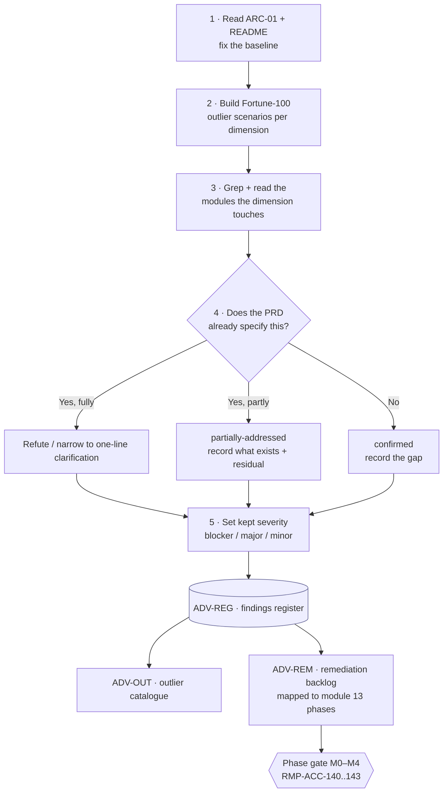
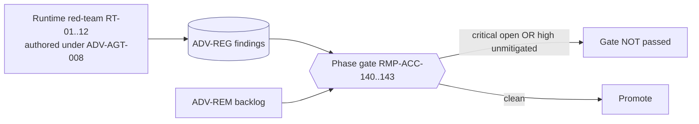

# Module 15 · Adversarial Review & Production Readiness

## 1. Scope

This module is the **honest counter-reading** of the HEALIX PRD. Where every other module argues *how* the platform
should work, module 15 attacks the specification: it hunts for the gaps, internal contradictions and silent
over-claims that a **Fortune-100 health system** — with decades of legacy systems, M&A sprawl, multi-state operations
and accumulated tech debt — would actually hit, and it records what must change **before build** rather than after a
production incident.

Two things define the scope and keep it honest:

1. **This is a design-stage review of a design-stage PRD.** HEALIX is not built. Nothing here is a "the running system
   is broken" finding; every finding is "the *specification* is wrong, incomplete, or internally inconsistent, and if
   built as written would fail in the stated scenario." The production-readiness verdict (§6) is framed accordingly.
2. **Adversarial verification, not adversarial assertion.** Every candidate finding was checked against the actual PRD
   text before being recorded. The PRD is unusually self-aware: a large fraction of the first-pass "blockers" turned
   out to be already specified elsewhere (generic source-registry contracts, FHIR canonicalisation, bitemporal
   reproducibility, Part 2 segmentation, fail-closed enforcement). Those were **downgraded or narrowed**, not inflated.
   What remains is the residue that survived verification. See §4 for the method and §5 for the honest tally.

**In scope:** the ten review dimensions (§3); the verified findings register (ADV-REG); the Fortune-100 legacy /
tech-debt / M&A / scale outlier catalogue (ADV-OUT); the prioritised remediation backlog tied to the module 13 roadmap
(ADV-REM); the severity scale (§2); and the review-gate requirements (§8) that feed `RMP-ACC-140..143`.

**Out of scope:** the *runtime* red-team suites, honeytoken inventories and adversarial datasets themselves (RT-01..12,
the poisoning/playbook/improvement-loop suites) — those are **build deliverables this module must author** (see
ADV-AGT-008), not prose in this README. Live penetration testing of a deployed environment (module 12 / annual vendor
pen-test). This module produces the *register and the gate*; it does not re-derive the safety specification that modules
10, 11, 13 and 14 already carry.

## 2. Severity scale

Design-stage findings use a three-level scale. Each level maps to the runtime findings-register severity that
`RMP-ACC-140` mandates (`critical`/`high`/`medium`/`low`), so a design finding and the red-team finding that later
re-tests the same surface share one register and one burn-down.

| Design severity | Meaning (for a *specification*) | RFC 2119 obligation | Register mapping |
|-----------------|---------------------------------|---------------------|------------------|
| **Blocker** | If built as written, would corrupt clinical/financial data, breach a compliance obligation, or make a core capability unusable. The PRD **MUST** be corrected before the affected capability is built. | MUST fix before build | `critical` |
| **Major** | A genuine gap or internal contradiction that **MUST** be resolved by a documented module change before the affected capability reaches GA, but is bounded — non-destructive failure mode, phased scope, or an interim workaround exists. | MUST fix before that capability's GA | `high` |
| **Minor** | A spec-completeness, clarity, or hardening gap. **SHOULD** be resolved; does not gate GA of the affected capability. | SHOULD fix | `medium` / `low` |

A finding also carries a **verdict** from verification:

- **confirmed** — the gap is real and the PRD does not address it.
- **partially-addressed** — the PRD covers part of the concern (recorded under "what exists"); a narrower residual remains.
- (No candidate survived as a pure **refuted** finding; several were narrowed so far that only a one-line clarification remains — those are recorded as `minor`.)

## 3. Method — ten dimensions

The review ran ten adversarial dimensions. For each, the reviewer read `README.md` and `01-architecture-overview.md`
first, then grepped and read the modules relevant to that dimension, built concrete Fortune-100 outlier scenarios, and
tested each claimed gap against the text.

| # | Dimension | Area code | What it attacks |
|---|-----------|-----------|-----------------|
| 1 | Legacy, tech-debt & M&A | `LEG` | Co-existing EHRs, multi-domain Cerner, legacy ERP/mainframe, decommissioned-system archives, acquired-facility feeds |
| 2 | Scale & performance | `SCALE` | KG triple/store sizing, throughput anchors, batch windows, onboarding/backfill surge |
| 3 | PHI & security edges | `PHI` | Minors/proxy, document-blob segmentation, snooping/VIP, Part 2 re-disclosure, consent revocation, LLM residency, mosaic re-identification |
| 4 | Interoperability conformance mess | `INT` | X12 companion-guide variance, C-CDA version skew, inbound-FHIR US Core skew, identity ADT events, local-code URI collisions, HL7 v2 charset/escapes |
| 5 | DQ & reconciliation at scale | `DQ` | Migrated-data DQ regime, multi-instance recon keys, charge↔AR maturity, provider ghost-accounts, subledger↔GL, offsetting-sum masking, steward materiality |
| 6 | Agent safety & autonomy | `AGT` | Clinical-safety veto, rollback data-healing, derived-artefact cascade, model/judge drift, calibration blind spot, self-optimising detector, blast-radius budget, the empty module 15 |
| 7 | Operability, DR & cutover | `OPS` | Historical bootstrap bitemporality, EOS blue/green, canary-vs-schema, mass replay, graph PITR, online migration, on-call load |
| 8 | EDW & temporal correctness | `TMP` | UCUM unit conversion, timezone date derivation, EDW↔KG survivorship, valid-time precision, DST folds, multi-ledger fiscal calendars, Type-1 reference dims |
| 9 | UI, operability & roles | `UI` | Break-glass review capacity, scalable privacy-audit surface, degraded-mode UX, novice/training path, queue concurrency |
| 10 | Semantic governance & drift | `SEM` | Subsumption-closure drift, instance-IRI migration, terminology licence seats, CQ coverage decay, reasoner-runtime bloat |

## 4. Documents

| Doc id | File | Content |
|--------|------|---------|
| ADV-00 | `README.md` | This overview: scope, severity scale, method, summary, verdict, top blockers, requirement index |
| ADV-REG | [`01-findings-register.md`](01-findings-register.md) | All 63 verified findings, grouped by dimension; per finding: outlier scenario, what exists, gap, recommendation, status |
| ADV-OUT | [`02-fortune100-outliers.md`](02-fortune100-outliers.md) | Focused catalogue of the legacy / tech-debt / M&A / scale outliers and how the platform must handle each, with cross-module change references |
| ADV-REM | [`03-remediation-plan.md`](03-remediation-plan.md) | Prioritised P0/P1/P2 backlog mapping each blocker/major to the module(s) to change and the acceptance change, tied to module 13 phases |

## 5. Summary of findings

63 findings survived verification: **32 major**, **31 minor**, **0 blocker**. 17 are `confirmed`; 46 are
`partially-addressed` (the PRD covers part and a narrower residual remains).

**The single most consequential result of the review is that every first-pass blocker was downgraded.** None of the
originally-claimed "blocker" findings survived as a built-system blocker, because in each case the PRD already specified
the load-bearing capability the finding assumed was missing — e.g. the generic Source Registry and FHIR
canonicalisation (ADV-LEG-001), bitemporal measure/cohort reproducibility (ADV-SEM-001), Part 2 segmentation on Kafka /
KG / EDW (ADV-PHI-004), fail-closed PDP and audit (ADV-UI-003). What remains is real but bounded. This is the expected
and healthy result of reviewing a thorough, internally self-aware design rather than a built system.

### 5.1 Findings by dimension and severity

| Dimension | Area | Blocker | Major | Minor | Total | Confirmed |
|-----------|------|---------|-------|-------|-------|-----------|
| Legacy, tech-debt & M&A | `LEG` | 0 | 3 | 4 | 7 | 2 |
| Scale & performance | `SCALE` | 0 | 2 | 2 | 4 | 2 |
| PHI & security edges | `PHI` | 0 | 4 | 3 | 7 | 1 |
| Interop conformance | `INT` | 0 | 3 | 3 | 6 | 2 |
| DQ & reconciliation | `DQ` | 0 | 3 | 4 | 7 | 2 |
| Agent safety & autonomy | `AGT` | 0 | 5 | 3 | 8 | 3 |
| Operability, DR & cutover | `OPS` | 0 | 3 | 4 | 7 | 1 |
| EDW & temporal correctness | `TMP` | 0 | 5 | 2 | 7 | 4 |
| UI, operability & roles | `UI` | 0 | 1 | 4 | 5 | 0 |
| Semantic governance & drift | `SEM` | 0 | 3 | 2 | 5 | 1 |
| **Total** | — | **0** | **32** | **31** | **63** | **17** |

## 6. Production-readiness verdict (honest)

**HEALIX is not production-ready, and cannot be, because it is not built.** This PRD is a design-stage specification.
The correct question for a design-stage review is not "is it ready to run?" but "is it ready to *build*, and will it
survive contact with a real Fortune-100 estate?" The answer:

- **The design is strong and unusually self-consistent.** The platform correctly anticipates the hardest realities —
  multi-domain Cerner, M&A legacy EHRs, Part 2, EMPI merges, bitemporal reproducibility, fail-closed enforcement — far
  more often than a typical PRD. Most "obvious" attacks were already defended. That is why zero blockers survived.
- **But it is not yet *build*-ready.** 32 major findings are genuine specification defects or internal contradictions
  that must be corrected before the affected capability is built, and they cluster in predictable, high-consequence
  places: **agent-autonomy safety**, **multi-domain / multi-instance identity**, **temporal & unit correctness in the
  EDW**, and **the empty module 15 itself**.
- **One finding is self-referential and gates everything.** Module 15 (this module) was an **empty directory** while
  `RMP-ACC-140` makes a populated findings register a **P0 inspection item from gate M0**. Authoring this module is
  itself the first remediation (ADV-AGT-008); the broken README link to it is resolved by this document.

### 6.1 Top blockers to resolve before build

These are the majors that gate the thin slice, Phase 1/2 GA, or cross-cutting safety, in rough priority order. Full
P0/P1/P2 mapping is in ADV-REM.

| ADV id | Finding | Why it gates build | Phase |
|--------|---------|--------------------|-------|
| **ADV-AGT-008** | Module 15 is empty yet `RMP-ACC-140` gates M0 on it | M0 cannot be passed as specified; RT-01..12 datasets and the register do not exist | M0 |
| **ADV-AGT-001** | No clinical-safety veto / risk class (PHI is guarded, patient harm is not) | A valid-but-wrong RxNorm/UCUM remap can auto-apply; no harm gate parallels the PHI guardian | M1 |
| **ADV-AGT-005** | Calibration κ computed only on human-reviewed CRs, never the auto-approved majority | The whole "autonomy is earned & measured" story rests on a statistically blind metric | M1→M3 |
| **ADV-AGT-006** | `agent.dq_monitor` (the rollback sensor) is itself an improver target with no recall floor | The safety net can be optimised blind; the loop that would catch it depends on it | M2 |
| **ADV-AGT-002** | Artefact rollback does not heal already-consumed KG/EDW rows | Static facts loaded under a bad mapping persist as "current belief" forever | M1 |
| **ADV-TMP-002** | EDW derives `*_date_sk` from one per-source timezone; KG uses facility-local | Multi-state estate mis-dates census/LOS/DRG and silently diverges KG↔EDW | M1 |
| **ADV-TMP-001** | UCUM scalar factor+offset cannot bridge mass↔molar / IU units | Cross-source lab trending and eCQM denominators silently wrong (`ref_unit_conversion` named but unbuilt) | M1 |
| **ADV-TMP-003** | EDW and KG survivorship authored twice with different tie-breakers | The two "faithful projections" (ADR-07) can assert different current values, undetected | M1 |
| **ADV-LEG-002 / ADV-SEM-005 / ADV-INT-005** | Local-code URIs & source IRIs carry no Millennium-domain qualifier (and two modules disagree on the URI form) | Breaks the roadmap's "onboard additional Cerner by configuration" the moment a second *domain* lands | M2 |
| **ADV-TMP-005** | EDW bitemporal block drops `validTimePrecision`/`validTimeSource` | As-of answers over approximate onset are falsely precise; POA/DRG exposure | M1 |
| **ADV-INT-004** | `A47`/`A37` identity events required by module 08 are out of module 06 ingest scope | A cross-module contradiction: module 08 depends on events the interop layer never maps | M1 |
| **ADV-PHI-001** | Adolescent-confidentiality & proxy access unmodeled | Information-blocking / state minor-consent compliance exposure on consumer surfaces | M1→M3 |
| **ADV-PHI-002** | Retained C-CDA/OBX blobs bypass sensitive-category segmentation (no DS4P) | A Part 2 med inside a CCD is re-disclosed on $export / attachment fetch | M1→M2 |
| **ADV-SCALE-001** | KG triple-count and store sizing are mutually contradictory across modules | Capacity plan cannot be signed off; three growth figures disagree | M1 |
| **ADV-DQ-001** | No DQ regime for migrated / legacy historical data | Today's rules evaluate decade-old codes at load-time, flooding stewards and masking real migration defects | pre-historical-GA |

## 7. How this module feeds the gates

## 8. Requirement index

Priorities: P0 launch-blocking, P1 first release, P2 later. Verification: test, inspection, demo, analysis. The
findings themselves are indexed as `ADV-<AREA>-NNN` in ADV-REG; the requirements below govern how the review and its
register operate, and align with `RMP-ACC-140..143`.

### Review-governance requirements (`ADV-GOV`)

| ID | Pri | Ver | Requirement |
|----|-----|-----|-------------|
| **ADV-GOV-001** | P0 | inspection | The findings register (ADV-REG) MUST exist from gate M0 and MUST carry, for every finding: `ADV-<AREA>-NNN` id, dimension, severity (blocker/major/minor mapped to the `RMP-ACC-140` register), verdict, affected modules, outlier scenario, gap, recommendation, owner, due date and status. |
| **ADV-GOV-002** | P0 | inspection | Every finding's gap claim MUST cite the PRD text it was verified against (file plus requirement id); a finding whose cited text already covers the claim MUST be recorded `partially-addressed` or refuted, never re-reported as a new gap. |
| **ADV-GOV-003** | P0 | inspection | No `blocker` finding SHALL be open, and no `major` finding SHALL lack an approved, dated remediation plan (ADV-REM), at the phase gate that owns the affected capability (per the ADV-REM phase mapping and `RMP-ACC-142`). |
| **ADV-GOV-004** | P1 | inspection | Every `major` finding MUST be remediated within 30 days and every `minor` within 90 days of the gate at which it is accepted, OR carry a written DGC risk acceptance (mirrors `RMP-ACC-143`). |
| **ADV-GOV-005** | P0 | inspection | The register MUST be re-run (design findings re-verified against the then-current PRD, runtime red-team re-tested) before every milestone gate and `prod` release, and the delta minuted (`RMP-ACC-141`). |
| **ADV-GOV-006** | P1 | inspection | Each `major`/`blocker` finding MUST name the module 14 fault class or healing playbook that covers the residual operational risk once the design change ships, or state that none applies (mirrors `RMP-ACC-143`). |
| **ADV-GOV-007** | P2 | analysis | The review MUST record, per dimension, which first-pass findings were downgraded or refuted and why, so the register documents the PRD's coverage, not only its gaps. |

### Finding areas (indexed in ADV-REG)

| Area | Range | Count | Doc |
|------|-------|-------|-----|
| `ADV-LEG` | 001–007 | 7 | ADV-REG §1 |
| `ADV-SCALE` | 001–004 | 4 | ADV-REG §2 |
| `ADV-PHI` | 001–007 | 7 | ADV-REG §3 |
| `ADV-INT` | 001–006 | 6 | ADV-REG §4 |
| `ADV-DQ` | 001–007 | 7 | ADV-REG §5 |
| `ADV-AGT` | 001–008 | 8 | ADV-REG §6 |
| `ADV-OPS` | 001–007 | 7 | ADV-REG §7 |
| `ADV-TMP` | 001–007 | 7 | ADV-REG §8 |
| `ADV-UI` | 001–005 | 5 | ADV-REG §9 |
| `ADV-SEM` | 001–005 | 5 | ADV-REG §10 |

## 9. Definition of done for this module

1. ADV-REG holds all 63 findings with the fields `ADV-GOV-001` requires; every gap cites verified PRD text (`ADV-GOV-002`).
2. ADV-REM maps every `major` to a module change, an acceptance change and a module 13 phase; no `major` is unmapped.
3. The runtime red-team deliverables that `RMP-ACC-141` references (RT-01..12 harness, honeytoken inventory, poisoning
   / playbook / improvement-loop suites with versioned, checksummed datasets, and the register schema) exist and are
   indexed from here — the work ADV-AGT-008 scopes.
4. The broken `README.md` link to `15-adversarial-review/README.md` resolves (this document).
5. `depends_on` doc_ids resolve to the modules reviewed; the register is reviewed at every gate (`ADV-GOV-005`).
