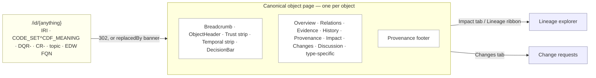
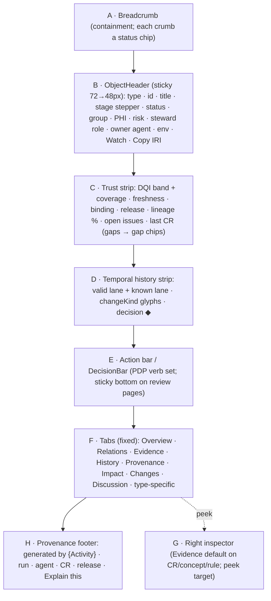

# Information Architecture, Object Model & Page Template

UX-00 states the shell and principles; UX-01 states the personas and homes. This document is the **structural
contract**: the eight navigation areas, the canonical object model and its URL scheme, the fixed page template every
object renders, the command palette and search, the inbox, the cross-linking rules that keep "one object, one page"
true, and the state/empty/error patterns every page reuses. It is the normative home of the `UX-IA-*` requirements
summarised in UX-00 §9; `UX-IA-001..006` carry the meanings fixed there and are extended from `UX-IA-007`. It renders
contracts owned elsewhere (CR schema AGT-03, PHI policy GOV-01, time modes TKG-01 §9, DQ bands DQ-00); it never forks
them.

Requirements use RFC 2119 keywords, a priority (`P0` launch-blocking, `P1` first release, `P2` later) and a
verification method, per `CONVENTIONS.md` §2.

## 1. Navigation model

The information space is a **flat set of eight areas over a deep set of canonical object pages**. Areas are entry
points and queues; every path of any depth ultimately resolves to one canonical object page (§3). There is no nesting
of areas, no per-role menu, and no modal that owns a URL.

| # | Area | Route root | Primary queues / indexes | Prototype |
|---|------|-----------|--------------------------|-----------|
| 1 | Home | `/` → `/w/{role}` | the role home (UX-01 §6) | `index.html` |
| 2 | Inbox | `/inbox` | Needs you · At risk · FYI (§6) | `index.html` (popover), inbox route |
| 3 | Review | `/cr` | CR queue, saved views, batch tray, releases, rollbacks | `change-requests.html` |
| 4 | Ontology | `/ontology` | stage board, schemes, facets, relation board, OWL modules, shapes, CQ-01..20, collisions, drift | `ontology-workbench.html`, `concept.html` |
| 5 | Sources & Flow | `/sources /topics /mappings /profiles` | source registry + onboarding, elements, topics, subjects, mapping specs, connectors, DLQ, replay | `data-catalog.html`, `interop-monitor.html` |
| 6 | Quality & Warehouse | `/dq /edw` | scorecards G1–G9, rules, issues, quarantine, exceptions; groups → schemas → tables → columns, migrations | `dq-console.html`, `data-catalog.html` |
| 7 | Agents & Operations | `/agents /ops` | roster of 20, runs, evaluations, calibration, kill switch, canaries, memory; SLOs S1–S22, pipeline map, incidents | `agent-ops.html`, `interop-monitor.html` |
| 8 | Governance | `/gov` | PHI classification, access matrix, audit explorer, break-glass reviews, consent, lineage coverage, stewardship, KPIs `/kpi` | `settings-governance.html`, `executive.html` |

- **UX-IA-001** (P0, inspection) — The left rail MUST present exactly these eight areas, in this order, identical for
  every role. Items a role cannot act on MUST be visible and navigable **read-only**, never removed and never hidden;
  only defaults, order of saved views and emphasis differ by role (UX-ROLE-001).
- **UX-IA-007** (P0, inspection) — The **lineage explorer** (`/lineage?from={id}`, `lineage-explorer.html`) MUST be
  reachable only from an object's Impact tab or the resolver, MUST be listed under Governance, and MUST NOT appear as a
  Home or as a ninth area. Without `?from` it MUST render a resolver field, not a canvas (UX-GRAPH-001).
- **UX-IA-008** (P1, demo) — Go-to chords `g h/i/c/o/s/q/a/v` and `g l` MUST jump to Home, Inbox, Review, Ontology,
  Sources & Flow, Quality & Warehouse, Agents & Operations, Governance and Lineage respectively; the active area MUST be
  reflected in the rail with `aria-current="page"`, not colour alone.

## 2. Object model

Every first-class thing in the platform is an **object** with a stable identity, a single canonical page, a type, a
subject-area group (G1–G9 where applicable), a pipeline stage where semantic, a steward **role** (never a named
person), an owner agent, and a bitemporal version history. The object model is the same for every role; role changes
what is emphasised, never what exists or where it lives.

- **UX-IA-002** (P0, test) — Every object MUST have exactly one canonical URL (§3) that is also its IRI resolution
  target; a view, filter, as-of or diff of an object is the **same** URL with parameters (§4), never a second page.
  `/id/{anything}` MUST 302 to that page, and a merged or deprecated object MUST remain resolvable and render a
  `replacedBy` banner ("Merged into {survivor} on {date} · IRI remains valid"); the IRI MUST never 404.
- **UX-IA-009** (P0, inspection) — Every object page MUST carry, where the attribute applies, a type chip, a copyable
  mono id, a plain-language title (label first, mono id second — UX-01 content rule), a group chip, a pipeline-stage
  stepper, a steward **role** chip and an owner-agent chip. Stewardship pickers MUST reject a typed person name inline
  (UX-CAT-001); the model holds roles only.

### 2.1 Object types and canonical URLs

| Object | Canonical URL | Type-specific tabs (after the fixed set) |
|--------|---------------|------------------------------------------|
| Concept | `/concept/{scheme}/{id}` | Usage; Collisions (when flagged) |
| Concept scheme | `/scheme/{slug}` | Tree, Facets, Collisions, Exit criteria, Exports |
| Facet | `/scheme/{slug}/facet/{facet}` | — |
| Association / Mapping | `/relation/{ulid}`, `/mapping/{ulid}` | — |
| OWL module | `/ontology/{module}` | Classes, Properties, Axioms, Shapes, Reasoner report |
| Class / Property | `/class/{module}/{Name}`, `/property/{module}/{name}` | Axioms, Shapes, Bindings |
| Axiom | `/axiom/{hash}` | Explanation |
| SHACL shape | `/shape/{graph}/{Name}` | Violations, Fixtures |
| Competency question | `/cq/CQ-07` | Runs, Compare runs |
| Source system / Data element | `/source/{id}`, `/element/{source}/{path}` | Interfaces, Elements, Topics, Profiling, Onboarding (12 steps) |
| Mapping spec | `/mapspec/{id}@v{N}` | Elements, Golden tests |
| Value set / ConceptMap / FHIR profile | `/valueset/{slug}`, `/conceptmap/{slug}`, `/profile/{slug}` | Expansion, Expansion delta |
| DQ rule / issue / exception | `/rule/DQR-…`, `/issue/{id}`, `/exception/{id}` | Results, Fixtures, Versions, Tuning · Steward packet, Exceptions · — |
| Scorecard | `/scorecard/{G}?window=28d` | Trend, Attribution, Simulate |
| Kafka topic / Connector / Processor | `/topic/{name}`, `/connector/{name}`, `/processor/{name}` | Schema versions, Consumers, Replay · Metrics, DLQ (masked), Runbook |
| EDW schema / table / column | `/table/{schema}/{table}`, `/column/{schema}/{table}/{col}` | DDL, Columns, Query templates, Migrations |
| Migration / Named graph | `/migration/{id}`, `/graph/{source}/{date}/{ulid}` | — |
| Change request | `/cr/{CR-id}` | Diff, Evaluation, Privacy, Gates, Dependencies |
| Release | `/release/{artefact}/{version}` | Changelog, Diff, Gate metrics, Rollback |
| Agent / Run / Evaluation | `/agent/agent.{role}`, `/run/{ulid}`, `/evaluation/{id}` | Manifest, Runs, Evaluations, Memory, Tools, Ladder |
| Incident / Playbook / SLO / KPI | `/incident/{id}`, `/playbook/PBK-…`, `/ops/slo/S6`, `/kpi/{slug}` | — |
| Steward role | `/steward/{role-id}` | roles only, never named persons |
| **Universal resolver** | `/id/{anything}` | 302 to the canonical page (§5) |

> **Deferred object type — entity resolution (ER).** ER cases (merge / survivor decisions over
> duplicate `SYN-` patient identities across merged or legacy EHRs — a core Data-Steward job in an
> M&A / multi-facility enterprise) are a **planned** object type and are **not** in the Phase-1
> build. No `/er/{id}` route exists yet, so the table above omits it and `/id/{anything}` must not
> advertise or 302 to an ER page until one ships. The canonical-URL table lists only object types
> the resolver can actually serve, so UX-IA-002 holds. When ER is built, add the object type back
> here with its `/er/{id}` route, its canonical page, and synthetic ER fixtures.

- **UX-IA-010** (P0, test) — `HX.nav.resolve(x)` MUST resolve an IRI, a `CODE_SET^CDF_MEANING` pair (e.g.
  `72^INPATIENT`), a `"cs72 309308"` form, a `DQR-…`, a `CR-…`, a topic name and an EDW FQN to the correct canonical
  route, returning `{ route, replacedBy? }`, and MUST satisfy UX-IA-002 for merged/deprecated objects.

## 3. URL scheme and parameters

Routes are human-legible, containment-ordered and stable (they are cited in CRs, audit rows and lineage traces). In the
static prototype the `HX` router maps canonical routes onto hash params on the page files (e.g.
`concept.html#/concept/encounter-class/inpatient?asOf=…`); the canonical route is always the thing copied, shared and
resolved, so a later server build changes the files behind `HX.nav`, not the IRIs.

| Parameter | Meaning | Omitted default |
|-----------|---------|-----------------|
| `?asOf=` | valid time | Now (Current) |
| `?asKnownAt=` | transaction time | Now (Current) |
| `?version=` | pin a specific version | current |
| `?diff=A..B` | compare two versions / moments | off |
| `?tab=` | select a tab by its fixed key | Overview (or type default) |
| `?env=` | environment lens (`dev/test/uat/prod`) | session env |
| `?depth=` | `analyst` \| `architect` disclosure | `analyst` |
| `#L12`, `#t=` | diff line anchor, timeline cursor | — |

- **UX-IA-011** (P0, test) — `?asOf` and `?asKnownAt` MUST re-render **any** page bitemporally, MUST travel with the
  user across navigation (chips, breadcrumbs, resolver, cross-links all preserve them unless the target explicitly
  resets), and MUST reproduce the exact view on reload. The as-of control MUST name one of the five TKG-01 §9 modes
  exactly — **Current · As-of (valid) · As-known (transaction) · Bitemporal point · Full history** — and offer "Return
  to now" (UX-ONT-002).
- **UX-IA-012** (P0, analysis) — The two tokens `--time-valid` / `--time-known` MUST colour the two time axes (as-of
  lanes, timeline lanes, diff A/B headers, interval glyphs) and MUST be used nowhere else in the CSS (UX-ONT-003).
- **UX-IA-006** (P0, inspection) — The environment lens MUST mark `prod` with a 2 px red line across the top bar and a
  chip, and MUST open a confirm sheet on the first write action per session in `prod`; the synthetic-data ribbon MUST be
  visible on every non-prod and prototype page (AC-17).

## 4. Canonical page template

Every object page is assembled from the **same regions in the same order**. A type lacking a region omits it; the order
never changes. The reference implementation is `prototype/concept.html`; `HX.trust`, `HX.stepper`, `HX.timeline`,
`HX.decisionBar` and `HX.evidence` build the shared regions so numbers and layout match across types.

- **UX-IA-013** (P0, inspection) — The page template MUST render regions A–H in the fixed order above. The
  **ObjectHeader** MUST be sticky (72 px → 48 px on scroll) and MUST never obscure the focus ring of content beneath it
  (2.4.11). The **DecisionBar** MUST be sticky-bottom on review-type pages (CR, issue, rule) and inline under the header
  elsewhere, and its verbs MUST come from `HX.role.verbs` (the PDP set), never hard-coded role→action (UX-CR-001).
- **UX-IA-014** (P0, inspection) — The **Trust strip** MUST pair every DQI band tile with its coverage, and MUST render
  every missing value as an explicit **gap chip** ("Unbound", "No steward", "Coverage 61 %", "No release"), never as
  blank space (UX-P4). Status MUST be icon + text + colour, never colour alone (UX-DS-003).
- **UX-IA-015** (P0, demo) — The **Temporal history strip** MUST show two lanes (valid in `--time-valid`, known in
  `--time-known`) with `changeKind` glyphs at boundaries (new ●, new-version ▶, correction ↺, retraction ✕, merge ⤵,
  unmerge ⤴, each with a text label in tooltip and legend) and decisionTime ◆; clicking a segment MUST set the as-of
  control; it MUST expand to the full History tab.

### 4.1 Tabs (fixed order and semantics)

| Key | Tab | Semantics |
|-----|-----|-----------|
| 1 | Overview | type-appropriate summary; the only type-varying tab body |
| 2 | Relations | typed links (broader/narrower, mappings, bindings), each a chip that peeks and navigates |
| 3 | Evidence | fixed section grammar: Source · Terminology · Local · Statistical · Reasoning · Tests · Agent rationale (quarantined) |
| 4 | History | full-fidelity bitemporal timeline; segments are buttons; retracted segments struck-through but focusable; zoom day/month/release |
| 5 | Provenance | vertical PROV-O activity list (Activity → used → generated), each row linking to CR, run, release, batch graph |
| 6 | Impact | "what depends on this" grouped and counted (EDW columns, FHIR paths, DQ rules, shapes, topics, consumers) + "Preview breaking change" + Lineage ribbon |
| 7 | Changes | CRs touching this object, open ones pinned, filterable by stage via the stepper |
| 8 | Discussion | threaded comments; agent-authored text badged, untrusted source text quoted |

- **UX-IA-016** (P0, inspection) — The eight tabs MUST appear in this fixed order; type-specific tabs MUST insert
  **after** Discussion. An empty tab MUST be rendered **greyed with a reason naming the CR type that would fill it**
  (e.g. "No DQ rules target this column — propose one (`dq_rule` CR)"), never hidden (UX-ONT-001). Tab jumps `e`
  (Evidence), `h` (History), `p` (Provenance), `i` (Impact) and `1`–`8` MUST select tabs by key.
- **UX-IA-017** (P1, inspection) — The **Provenance footer** MUST read "generated by {prov:Activity} · run {id} ·
  {agent} · {CR} · {release} · Explain this" with each element a live cross-link, so provenance is reachable from the
  bottom of every page without opening a separate audit module (UX-P2).

## 5. Search and command palette

The palette (`Ctrl/Cmd-K`; `/` focuses the top-bar field) is the primary way to reach any object and to act on the
current one. It is a combobox with a grouped listbox and a live result count (UX-A11Y-004). It has three modes.

- **Find** (default): type-ahead over `prefLabel`/`altLabel`/`hiddenLabel`, notations, codes, IRIs and ids (`CR-`,
  `DQR-`, `PBK-`, `CQ-`, `ISS-`), table/column/topic names and agent ids. Results group by type with a stage chip and a
  status chip inline. `↑↓` navigate, `Enter` open, `Shift-Enter` peek in the inspector, `Ctrl-Enter` copy the canonical
  URL.
- **Resolve**: structured prefixes — `cs:72 INPATIENT`, `cerner:72^INPATIENT`, `sct:448951000`, `loinc:2524-7`,
  `v3:IMP`, `fusion:INVOICE_TYPE:STANDARD`, `iri:https://…`, `dqr:`, `cr:`, `topic:`, `table:`. The result card shows the
  HEALIX concept (or a `CR-CV-ADD` hint for an unknown code) and, for external codes, `$lookup` display and status;
  licensed codes show a **"licensed display hidden"** chip.
- **Act (`>`)**: verb-first, permission-filtered, scoped to the current page — `> approve`, `> request revision`,
  `> reject`, `> veto`, `> set as-of 2026-03-10`, `> compare with v2026.10.2`, `> watch`, `> open in SPARQL`,
  `> run CQ-07`, `> trip kill switch`.

A single **typed filter grammar** is shared by the palette, every list and every saved view:
`type:cr state:evaluated risk:high group:G2 proposer:agent.taxonomist gate:steward_approval age:>5d stage:2
binding:pending severity:blocker plane:stream`.

- **UX-IA-003** (P0, demo) — The palette MUST offer Find, Resolve and Act. Act verbs MUST be permission-filtered via
  `HX.role.verbs`; gated or destructive verbs MUST open a confirm sheet and nothing MUST execute silently. **Nothing
  patient-level MUST be indexed** in Find, and no reveal control MUST exist in any mode (UX-P5).
- **UX-IA-004** (P0, test) — The typed filter grammar MUST be parsed identically by the palette, lists and saved views;
  `type:cr state:evaluated risk:high group:G2` MUST return the same set in all three (AC-06). An unparseable token MUST
  surface an inline error naming the token, not silently drop it.
- **UX-IA-018** (P1, demo) — Resolve mode MUST handle every §5 prefix, MUST show a `CR-CV-ADD` hint for an unknown code,
  and MUST show a "licensed display hidden" chip for a licensed terminology (e.g. a CPT example) rather than the display
  string.

## 6. Notifications and inbox

The inbox (`/inbox` and a top-bar bell popover with a "needs you / watching" split count) has **three lanes in fixed
order**. Rows are keyboard-actionable (`a/r/v/x/e/o`) and carry an `SLAClock` where an SLA applies.

| Lane | Contents | Signals |
|------|----------|---------|
| **Needs you** | required approver, assigned steward, on-call owner, break-glass review, kill-switch co-sign | SLAClock per row; backup-reviewer escalation strip at day 7 |
| **At risk** | owned objects with SLA ≥ 75 % consumed, band drop, rule in tuning, agent demoted, release window approaching | amber `--warn` emphasis; never a badge |
| **FYI** | watched object changed, a CR you reviewed applied/released/rolled back, evaluator disagreed with you, **agent digest rows** (rolled up per agent per day) | no badges; digests roll up proposed/auto-approved/rejected/vetoed counts with one-line examples |

- **UX-IA-005** (P1, inspection) — The inbox MUST render these three lanes in this fixed order with `SLAClock`s on
  Needs-you rows, and MUST offer "Review as batch (n)" when ≥ 3 Needs-you CRs share a steward **and** an artefact family
  (opening the batch tray, UX-CR-004).
- **UX-IA-019** (P1, inspection) — Agent digest rows MUST live in FYI only and MUST never raise a badge; no lane or
  urgency MUST be conveyed by colour alone. State transitions and toasts MUST announce via a polite live region;
  kill-switch and break-glass entry MUST announce assertively (UX-A11Y-005).

## 7. Cross-linking rules

"One object, one page" holds only if every reference to an object is a live link to that one page and nothing
duplicates an object's content inline. These rules are normative across all eleven pages.

- **UX-IA-020** (P0, inspection) — Every object reference — a chip, a mono id, an IRI, a breadcrumb crumb, a lineage
  hop, a cell in a datatable — MUST link to the referent's canonical page (§3), carrying the current `?asOf`/`?asKnownAt`
  unless the target resets them. An id or IRI MUST be copyable (`y` copies the IRI; `Ctrl-Enter` copies the canonical
  URL from the palette). No page may embed a second editable copy of another object.
- **UX-IA-021** (P0, inspection) — Breadcrumbs MUST be ordered by **containment** (e.g. `G2 Clinical Care › Scheme
  encounter-class › Inpatient`), and each crumb MUST be a chip carrying its **own** status, so the breadcrumb is also a
  status path, not just a trail.
- **UX-IA-022** (P1, demo) — `Shift-click` any chip and `Shift-Enter` on any list/palette row MUST **peek** the referent
  in the right inspector without navigating away, so a reviewer can inspect a SNOMED target or a `dim_encounter_class`
  row without losing the decision context (UX-P1). Peek MUST be a read-only render of the canonical page's Overview.
- **UX-IA-023** (P1, inspection) — A graph canvas MUST open only from an object (focus + hops), as a Lineage ribbon, or
  as the SRE pipeline map — never as a Home or a standalone area (UX-00 §8). The Impact tab's "what depends on this"
  counts MUST link to the depended-on objects, not merely tally them.

## 8. State, empty, error and loading patterns

Every page reuses one small set of non-happy-path patterns so a missing value, a gap, a correction, a merge and a
failure always look and behave the same way. Each pattern **explains the gap and names the next action**.

| Pattern | Class | Behaviour |
|---------|-------|-----------|
| Loading | `.hx-skeleton` | shape-preserving skeletons; never layout shift on load |
| Empty collection | `.hx-empty` | names what is missing **and** the CR type that would fill it (e.g. "No lineage edges recorded — lineage coverage gap, propose a mapping CR") |
| Empty / blocked tab | `.hx-tab--empty` | greyed, reason + the CR type link (UX-IA-016) |
| Missing value | `.hx-chip--gap` | explicit gap chip in the trust strip / grids (UX-IA-014) |
| Not yet asserted | `.hx-placeholder--not-asserted` | at an `asOf`/`asKnownAt` before the fact existed, labels/relations render a placeholder, not blank |
| Masked value | `.hx-masked` | ▒▒▒▒ glyph with tooltip ("masked: phi:direct"); small cells render "< 11"; never blank |
| Merged / deprecated | `.hx-banner--replaced-by` | resolvable, banner names the survivor and date, IRI stays valid (UX-IA-002) |
| Error | `.hx-error` | a reason code **and** a copyable correlation id; no raw stack, no PHI |
| Native-renderer gap | `.hx-diff--fallback` | visible "Native renderer not yet available — showing Turtle/YAML diff" state, never a blank diff |
| Reversible action | `.hx-toast__undo` | 8-second undo toast (e.g. the `CR-TAX-MOVE` draft from a tree reparent) |

- **UX-IA-024** (P0, inspection) — Empty and error states MUST state what is missing and, for a gap an agent or human
  can close, the **CR type** that fixes it. Error states MUST show a reason code and a copyable correlation id and MUST
  NOT expose a raw stack trace or any PHI.
- **UX-IA-025** (P0, demo) — At an `asOf`/`asKnownAt` before a fact was asserted, the page MUST render
  "not yet asserted" placeholders for the absent labels/relations and the amber time banner MUST name the active mode;
  at an `asKnownAt` before a correction, the page MUST render the pre-correction value with the correction glyph
  (UX-ONT-002). Masked and small-cell values MUST render a glyph with tooltip, never blank space (UX-DS-003).
- **UX-IA-026** (P1, demo) — Every reversible action MUST surface an 8-second undo toast; every destructive or gated
  action MUST instead open a confirm sheet stating the gate, environment and consequence (UX-IA-003). A `localStorage`
  read/write for viewer preferences MUST be wrapped so its failure degrades to in-memory without breaking the page, and
  no result payload MUST ever be persisted client-side (AC-17).

## 9. Verification map

| Requirement | Method | Where verified |
|-------------|--------|----------------|
| UX-IA-001, 007, 008 | inspection/demo | eight-area rail, read-only non-actionable areas, go-to chords on every prototype page |
| UX-IA-002, 010 | test | `HX.nav.resolve` + `replacedBy` banner (`concept.html`, `lineage-explorer.html`) |
| UX-IA-003, 004, 018 | demo/test | palette Find/Resolve/Act, typed-grammar parity, licensed-hidden chip |
| UX-IA-005, 019 | inspection | inbox lanes, "Review as batch (n)", FYI digests on `index.html` |
| UX-IA-006, 011, 012 | inspection/test/analysis | env lens + prod confirm; as-of URL round-trip; time-token scan over `assets/app.css` |
| UX-IA-009, 013–017 | inspection/demo | canonical template, header chips, empty tab, trust/temporal strips, provenance footer (`concept.html`) |
| UX-IA-020–023 | inspection/demo | chip peek, containment breadcrumb, Impact cross-links, canvas-only-from-object |
| UX-IA-024–026 | inspection/demo | empty/error/not-asserted/undo patterns across all pages |

Full acceptance criteria (AC-01..AC-19) ship with `prototype/` (see `prototype/README.md`); this document's `UX-IA-*`
requirements are the structural subset those criteria exercise.
