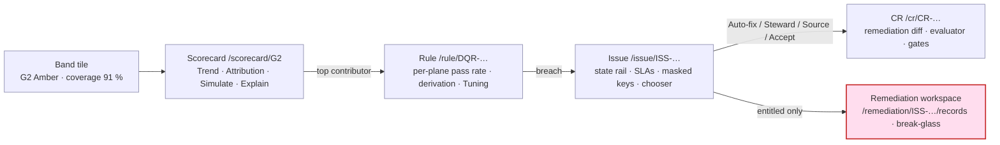
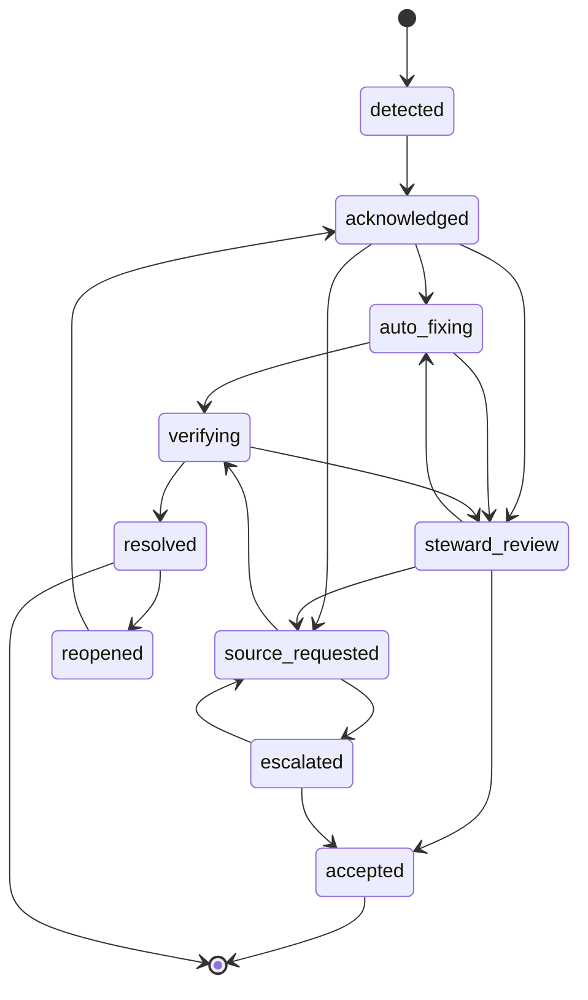

# DQ & Remediation Console

UX-02 is the structural contract (the eight areas, the object model, the fixed page template). This document is the
**steward's and Data Quality Lead's working surface**: how the Console renders the Quality half of Area 6 (Quality &
Warehouse, `/dq`) — the group/source/steward **scorecards**, the **rule** page with its derivation from the ontology,
the **issue** page with its workflow state rail and masked breach drill-down, the **remediation queue** and the single
audited **break-glass remediation workspace** that is the only PHI surface in the whole Console (UX-P5).

It renders contracts owned by module 09 and never forks them: the composite DQ index and its companion metrics
(DQ-SCORE-001..003), the four bands **Green ≥ 99.0 · Amber 97.0–98.9 · Red 95.0–96.9 · Black < 95.0** (DQ-04 §2.4), the
authoritative plane per rule (DQ-SCORE-002), issue SLAs (DQ-SCORE-006, DQ-05 §4), the remediation taxonomy and its
nine workflow states (DQ-05 §2–§3), and the agent-remediator policy (DQ-REM-002/005). Break-glass entitlement follows
GOV-01 (GOV-ACC-012: attestation + MFA, ≤ 4 h, reviewed within 2 business days, unavailable to agents); PHI minimisation
follows DQ-REM-013. Bitemporal rendering follows TKG-01 §9. The reference implementation is `prototype/dq-console.html`.

Requirements use RFC 2119 keywords with a priority (`P0` launch-blocking, `P1` first release, `P2` later) and a
verification method, per `CONVENTIONS.md` §2. The three requirements **UX-DQ-001..003** are normative in UX-00 §9 (four
bands + "Explain this band"; issue state rail + masked drill-down + remediation chooser; the break-glass workspace);
this document owns the detail requirements **UX-DQ-010+** that the `prototype/` build and the AC-05/AC-08 acceptance
criteria exercise. It renders — never redefines — the DQ-00, GOV-01 and AGT-03 contracts.

## 1. Quality area layout

`/dq` opens on five tabs in fixed order: **Scorecards · Rules · Issues · Quarantine · Exceptions**. The default tab and
default saved view follow the viewer's role (a steward lands on their own group's scorecard and their `steward_review`
issues; the Data Quality Lead lands on the enterprise roll-up). Every object inside the area is a canonical page under
the UX-02 §5.2 template, so a rule, an issue, a scorecard and an exception each carry the same breadcrumb, ObjectHeader,
trust strip, temporal strip and fixed tab order; the DQ-specific detail below lives in the type-specific tabs and the
right inspector. The whole area is **PHI-free by construction** (DQ-SCORE-012): the sole exception is the break-glass
workspace of §5, which is a separate red-framed route, never a tab.

## 2. Scorecards by group, source and steward

The **Scorecards** tab renders the three DQ-04 grains as band tiles, each a cross-link to its scorecard page:

- **Group** (`/scorecard/{G}?window=28d`, `vw_dq_scorecard_group`) — one tile per subject-area group G1–G9.
- **Source** (`vw_dq_scorecard_source`) — one tile per source system/facility; this is the view handed to the Cerner
  and Oracle Fusion application owners in the monthly review, so it adds latency p95, schema-drift count and new-code
  count.
- **Steward** (`/steward/{role-id}`, `vw_dq_scorecard_steward`) — roles only, never named persons (UX-CAT-001): issues
  owned, SLA attainment, rules in `tuning`, false-positive rate and draft rules pending > 5 business days.

Every band tile is `.hx-tile--band` and **pairs the DQI with its coverage inseparably** — "Amber 97.6 · coverage 91 %"
— because DQ-SCORE-003 forbids showing the index without coverage, and because silence must not inflate the score
(UX-P4). The band is conveyed by **icon + text + colour**, never colour alone (UX-DS-003): the Black band uses the
reserved `--black-band-*` tokens with a filled square glyph, not red. Breach counts render per severity
(blocker/critical/major/minor), the quarantine rate and open-issue SLA status sit beside the index, and a 7-day and
28-day DQI sparkline uses the `.hx-sparkline` from the shared card library so the number matches the Home band tile.

The scorecard page carries four type-specific tabs after the fixed set — **Trend · Attribution · Simulate** — plus an
always-visible **"Explain this band"** prose panel (`.hx-explain-band`) that names, in plain language, the top failing
rules, the contributing source and the since-when, drawn from `topContributors` (DQ-SCORE-010). Pack-version markers
(`dim_dq_rule.valid_from`) annotate the trend line so a step change caused by a rule change is labelled, not mistaken
for a data change (DQ-04 §6). Setting the as-of control recomputes the card for any past window and pack version
(DQ-SCORE-007), with the amber time banner naming the TKG-01 mode.

> **UX-DQ-010** (P0, inspection) — The Scorecards tab MUST render the group, source and steward grains of DQ-04 §3 as
> `.hx-tile--band` tiles, each pairing the DQI with its coverage adjacently (DQ-SCORE-003) and conveying the band by
> icon + text + colour (UX-DS-003); the steward grain MUST address roles only, never named persons.

> **UX-DQ-011** (P0, demo) — A scorecard page MUST show the four bands of DQ-04 §2.4 with breach counts by severity, the
> 7/28-day sparkline, pack-version markers on the trend, and an "Explain this band" prose panel naming the top failing
> rules, source and since-when (DQ-SCORE-010; extends UX-DQ-001).

> **UX-DQ-012** (P1, demo) — The **Simulate** tab MUST let a steward preview the index impact of a proposed threshold or
> severity change against the trailing 28 days before it is proposed (DQ-SCORE-011); applying the change MUST draft a
> `dq_rule` CR, never mutate the rule in place (AGT-03; UX-ONT-022).

> **UX-DQ-013** (P1, test) — A scorecard page MUST reproduce any past window and pack version from the as-of control
> (DQ-SCORE-007); a group in Red or Black MUST render the certification-revoked banner
> (`dim_dq_certification.is_certified = false`, DQ-SCORE-009) until it returns to Amber for 7 days.

## 3. The rule page and its derivation from the ontology

A DQ rule (`/rule/DQR-…`) is a canonical object with type-specific tabs **Results · Fixtures · Versions · Tuning**. Its
Overview carries the full rule identity drawn from DQ-02: dimension, severity, CDE flag, group, owner role, expression,
threshold (`min`/`max`, window) and version. Because DQ rules are **derived from the ontology** (DQ-FW-002), the rule
page renders the **derivation chain** as a live, cross-linked path — **value set → axiom → SHACL shape → rule** — from
the rule's `derivedFrom` (`{valueSet, axiom, shape}`): the value set links to its canonical page, the axiom to its
Explanation drawer on the OWL module page (ONT-OWL-016, UX-ONT-017), the shape to its Violations tab. This closes the
loop the ontologist sees from the other end in the derived-preview (UX-ONT-018): the steward can trace exactly which
modelled constraint a breach enforces, and CQ-20 ("which DQ rules derive from an axiom that no longer exists") surfaces
a rule whose derivation has gone stale.

The **Results** tab renders the per-plane pass-rate chart (`.hx-chart--line`): one series per target plane
(stream/graph/warehouse) with the **authoritative plane starred** (DQ-SCORE-002), the `threshold.min` drawn as a
labelled threshold line (dataviz skill), and breach and release markers on the time axis. A multi-target rule whose
plane pass rates diverge beyond 0.5 pp shows the plane-agreement warning inline (DQ-04 §2.2). The **Tuning** tab is a
threshold editor that, on submit, drafts a `dq_rule` CR carrying the simulated 28-day index impact (§2, DQ-SCORE-011)
and the evaluator verdict — it never edits the active rule.

> **UX-DQ-014** (P0, demo) — The rule page MUST render the derivation chain **value set → axiom → SHACL shape** from the
> rule's `derivedFrom` as live cross-links (the axiom to its Explanation drawer, the shape to its Violations), so a
> steward can trace a breach to the modelled constraint it enforces (DQ-FW-002; ONT-OWL-006).

> **UX-DQ-015** (P0, demo) — The rule Results chart MUST show a pass-rate series per target plane with the authoritative
> plane marked (DQ-SCORE-002), the `threshold.min` as a labelled line, and breach/release markers; the chart MUST ship a
> data-table alternative (UX-A11Y-004).

> **UX-DQ-016** (P1, demo) — The Tuning tab MUST draft a `dq_rule` CR with the simulated index impact and evaluator
> verdict and MUST NOT mutate the active rule; a threshold change that only tightens MAY auto-route, a loosening MUST
> require the steward gate (AGT-03).

## 4. The issue page: workflow states, SLAs and masked breach drill-down

A DQ issue (`/issue/{id}`) is where a breach becomes work. Its type-specific tabs are **Steward packet · Exceptions**,
and the remediation workspace lives at `/remediation/{issue}/records` behind break-glass (§5). The issue page renders:

**State rail** (`.hx-state-rail`) across the top, mirroring the DQ-05 §3 machine exactly:

Each state is icon + text; the current state is the filled node; a `reopened` issue shows the recurrence badge. Every
transition on the rail links to the `fact_dq_issue` bitemporal row and the `prov:Activity` that recorded it (DQ-REM-009),
so the issue's own history is its audit trail — no separate audit module (UX-P2).

**SLAClocks** (`.hx-sla`) for acknowledge and remediate, per the DQ-04 §5.1 / DQ-05 §4 severity bands (blocker ack
≤ 15 min / fix ≤ 4 h; critical ≤ 30 min / ≤ 24 h; …); a clock turns `--at-risk` at ≥ 75 % consumed and `--breached`
past due, and a breached blocker clock surfaces the issue in the steward's **Needs you** inbox lane with the day-7
backup-reviewer escalation.

**Masked breach drill-down.** The issue shows affected keys as **hashed tokens** and the top failing values with
`.hx-masked` and **small-cell suppression** ("< 11", DQ-PIPE-009): no raw patient identifier, display string or
count-below-threshold ever renders here (DQ-SCORE-012, DQ-REM-013). The `.hx-masked` glyph carries a tooltip naming the
PHI class it hides ("masked: phi:direct"), never blank space (UX-DS-003). Agents have no reveal control because none
exists outside the break-glass workspace (UX-P5).

**Remediation action chooser.** The four DQ-05 actions render as a chooser, each with its guardrail stated:

| Action | Renders | Guardrail shown in the UI |
|--------|---------|----------------------------|
| **Auto-fix within policy** | the `agent.remediator` proposed fix, fix class, ConceptMap/version, confidence | disabled with the reason **"evaluator 0.93 < 0.95 (DQ-REM-002)"** when the score is below policy, or when the fix class is not in DQ-05 §2.1 |
| **Steward-assisted** | the steward packet (summary, hashed keys, evidence, suggested fix, one-click apply) | opens the entitled workspace (§5) when the fix needs record-level values |
| **Source fix** | a source-owner request (issue id, rule, affected keys, reproduction query) with `requested/ack/fixed/verified` timeline | platform does not alter the data; verification is automatic on a later `hc-source-time` (DQ-REM-007) |
| **Accept with exception** | the `.hx-exception-form` (scope, justification, expiry ≤ 12 months, approver) | a `blocker`-rule exception requires a **second approver** before it applies (DQ-REM-008) |

Choosing Auto-fix or Steward-assisted drafts a remediation CR whose diff renders with the `.hx-diff--remediation`
before/after renderer (PHI fields masked in the diff, full only in the workspace) and whose evaluator verdict and gates
appear in the right inspector, one click from the full review in `change-requests.html` (UX-CR-001).

> **UX-DQ-017** (P0, demo) — The issue page MUST render the nine-state rail of DQ-05 §3 (icon + text), SLAClocks for
> acknowledge and remediate against the DQ-04 §5.1 bands, affected keys as hashed tokens, and top failing values with
> `.hx-masked` and small-cell suppression (n < 11); no raw identifier, display or sub-threshold count MUST appear
> (DQ-SCORE-012; extends UX-DQ-002).

> **UX-DQ-018** (P0, demo) — The remediation chooser MUST offer the four DQ-05 actions with their guardrails; **Auto-fix
> within policy** MUST be disabled with the reason "evaluator {score} < 0.95 (DQ-REM-002)" when the score is below policy
> or the fix class is out of DQ-05 §2.1; an **Accept** on a `blocker` rule MUST require a second approver (DQ-REM-008).

> **UX-DQ-019** (P1, inspection) — Each state-rail transition MUST link to its `fact_dq_issue` bitemporal row and
> `prov:Activity` (DQ-REM-009); choosing Auto-fix or Steward-assisted MUST draft a remediation CR reviewable inline with
> its masked diff, evaluator verdict and gates (UX-CR-001), never mutate a record in place (DQ-REM-001).

## 5. The break-glass remediation workspace — the sole PHI surface

Record-level PHI is reachable from one place only: the entitled remediation workspace (`/remediation/{issue}/records`),
opened by **"Open in remediation workspace"** on a steward-assisted issue (DQ-REM-013, GOV-ACC-012). No other control
anywhere in the Console reveals a masked value, and agents can never reach it (GOV-ACC-012).

Opening it first raises the **break-glass sheet** (`.hx-breakglass-sheet`): a required **reason code**
(`PATIENT_SAFETY` / `DATA_CORRECTION`), an **MFA re-prompt** field, the fixed **4-hour** duration, and the notice
"Every record you view writes an AuditEvent". On confirmation the route renders inside the **break-glass frame**
(`.hx-breakglass-frame`): a 4 px `--frame-emergency` inset border, a live countdown chip, a pinned **"Leave
break-glass"** control, and `noindex`/`no-cache` meta. Entry announces assertively via `aria-live` (UX-A11Y-005).
Identifiers shown are **synthetic only** (`SYN-nnnnnn`, "Zz-Test …") because the prototype carries no real PHI
(AC-17); each record viewed writes one `AuditEvent` via `HX.audit.write` (visible in `settings-governance.html`).
Leaving returns to the masked issue page and creates a **Privacy Officer review item** due within 2 business days
(GOV-ACC-012), which lands in that officer's **Needs you** inbox lane with its own SLAClock.

> **UX-DQ-020** (P0, demo) — "Open in remediation workspace" MUST require a reason code and MFA, then render a
> red-framed route (`noindex`/`no-cache`) with a 4-hour countdown, a pinned "Leave break-glass", SYN- identifiers only,
> one AuditEvent per record viewed, and MUST create a Privacy Officer review item (2-business-day SLA) on exit; no reveal
> control MUST exist anywhere else in the Console (GOV-ACC-012; DQ-REM-013; extends UX-DQ-003).

## 6. Quarantine, exceptions, SLAs and trends

The **Quarantine** tab lists records held by blocker/critical rules with their holding rule, count (aggregate, masked)
and oldest age; the **Exceptions** tab lists active `healix:DQException`s with scope, expiry and approver(s), flagging
those expiring ≤ 30 days (which reactivate the issue on expiry, DQ-REM-008) in the steward's **At risk** lane. SLA
status is shown everywhere as the shared `.hx-sla` ring so the steward scorecard's SLA attainment, the issue clocks and
the inbox lanes all read from one source. Trends on the scorecard and rule pages read from `agg_dq_result_day` with the
pack version annotated (DQ-04 §6), and the as-of control replays any historical window (DQ-SCORE-007).

> **UX-DQ-021** (P1, inspection) — The Quarantine and Exceptions tabs MUST show aggregate masked counts only; an
> exception expiring ≤ 30 days MUST surface in the steward's At-risk inbox lane, and its expiry MUST reactivate the
> issue (DQ-REM-008).

## 7. Verification map

| Requirement(s) | Method | Where verified |
|----------------|--------|----------------|
| UX-DQ-010, 011 | inspection/demo | `dq-console.html` Scorecards: group/source/steward band tiles with coverage adjacent, four bands, sparkline, pack markers, "Explain this band" (AC-08) |
| UX-DQ-012, 013 | demo/test | scorecard Simulate drafts a `dq_rule` CR; as-of replays a past window; Red/Black shows certification-revoked banner |
| UX-DQ-014, 015, 016 | demo | rule page derivation chain (value set → axiom → shape), per-plane pass-rate chart with authoritative plane + threshold line, Tuning → `dq_rule` CR (AC-08) |
| UX-DQ-017, 018, 019 | demo/inspection | issue state rail, SLAClocks, hashed keys + masked small-cell values, remediation chooser with the disabled Auto-fix reason, inline remediation CR (AC-08) |
| UX-DQ-020 | demo | break-glass sheet (reason code + MFA) → red-framed workspace (4-h countdown, SYN- ids, AuditEvent per record, Privacy Officer review item on exit) (AC-08) |
| UX-DQ-021 | inspection | Quarantine/Exceptions masked aggregates; expiring exception in At-risk lane |

The three parent requirements UX-DQ-001..003 are verified in UX-00 §9 / AC-08; the UX-DQ-010+ requirements above are the
scorecard-, rule-, issue- and workspace-level detail that AC-08 exercises, and they render — never redefine — the DQ-00
contracts (DQ-SCORE, DQ-REM), the GOV-01 break-glass entitlement (GOV-ACC-012) and the AGT-03 change-request schema.
