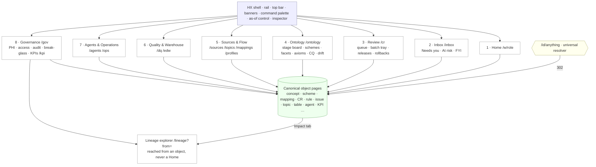

# Module 16 — User Experience & Role Workspaces

## 1. Scope

This module specifies **HEALIX Console**: the single web application through which the nine human personas of
`00-vision-and-scope.md` §5 govern the autonomous knowledge platform. Twenty agents (ARC-01 §5) propose; people
dispose. The Console's job is to make disposing **fast** (a medium-risk change request decidable in ~30 s with diff,
evidence, evaluator verdict, privacy verdict and impact on one screen), **defensible** (every decision records who,
which gate, which environment, and becomes a labelled calibration example for module 10) and **legible** (every
object is one canonical page readable at any point in valid and transaction time, with provenance attached).

In scope: the UX vision and principles; the information architecture and global navigation; the canonical object model
and page template; the role-switcher model and nine role homes; the as-of (bitemporal) control; the design system
(tokens, components, light/dark, WCAG 2.2 AA, keyboard map); and the clickable `prototype/` (eleven static HTML pages
on a shared `HX` runtime and synthetic data).

Out of scope (consumed as contracts, not redefined here): the Change Request schema and gates (AGT-03); PHI policy and
access matrix (GOV-01); the ontology stages and exit criteria (ONT-00); DQ bands, rules and remediation (DQ-00); the
bitemporal time model and its five query modes (TKG-01 §9); topic/SLO catalogs (STR-00, OPS-00). This module renders
those contracts; it never forks them.

**No PHI is shown in this UI** except through one audited, time-boxed, red-framed **break-glass remediation workspace**
(DQ-REM-013, GOV-ACC-012) reached from a DQ issue. The prototype runs on data that is unmistakably synthetic
(`SYN-nnnnnn`, `ZZ-TEST-*`, "Dr. Synthetic A. Example").

## 2. UX vision and principles

> HEALIX Console is **Vision 1 — a decision-first review surface**, with mandated grafts from Vision 0 (Workbench
> depth) and Vision 2 (Atlas resolver, trust strip and executive drill-down). Where the merge decisions of §8 conflict
> with the base, the graft wins.

| ID | Principle | What it forces in the UI |
|----|-----------|--------------------------|
| **UX-P1** | **Decision-first, evidence-adjacent.** | The CR review page is the most polished screen. DecisionBar is always visible; evidence is one keystroke (`e`) away; nothing needed to decide is more than one click or scroll from the diff. |
| **UX-P2** | **One object, one page, all of time.** | Each object has exactly one canonical URL that is also its IRI resolution target. History and provenance are tabs, not a separate audit module. `?asOf` and `?asKnownAt` re-render any page bitemporally and travel with the user. |
| **UX-P3** | **The pipeline is the spine.** | Stage (0 Inventory → 5 Knowledge Graph) is a visible attribute on every semantic object, list filter and queue. When ONT-PIPE-001 blocks stage n+1 work, the UI names the artefact in draft/review and links it; it never greys a button without a reason. |
| **UX-P4** | **Trust is shown, not asserted.** | Every number carries denominator, window and plane; every DQI carries coverage; every agent proposal shows evaluator score, κ for that CR type, autonomy level and rollback rate. Missing data renders as a **gap chip**, never blank space. Status is icon + text + colour, never colour alone. |
| **UX-P5** | **Minimum necessary, enforced in the UI.** | Hashed keys, masked literals, small-cell suppression (n < 11) everywhere. `MaskedValue` reveals only inside the entitled remediation workspace under break-glass. Agents never see a reveal control because none exists for them. |
| **UX-P6** | **Progressive disclosure by role and by risk.** | A low-risk auto-approved CR is a one-line digest receipt; a `phi_affecting` CR is a two-gate review with the privacy verdict pinned at the top. Role changes defaults, order and emphasis — never the object model or the URLs. |

## 3. Information architecture

## 4. Global shell and navigation

**Three-pane layout:** left rail (56 px icons / 240 px labelled, toggle `[`), main canvas (minmax 640 px), right
inspector (360–480 px, resizable, toggle `]`). **Top bar**, left to right: rail toggle · command palette (`Ctrl/Cmd-K`,
`/` focuses) · as-of control (collapsed reads "Now · Now") · environment switch (dev grey · test teal · uat amber ·
prod red, with a first-write-per-session confirm in prod) · inbox bell with "needs you / watching" split · **View as**
role switcher (pure rendering filter, labelled and audited) · theme toggle · help (`?`) · user menu. **Banners** under
the top bar, in order when active: kill-switch (red, all users), time banner (amber, naming the as-of mode and
offering "Return to now"), synthetic-data ribbon (prototype and non-prod).

**Eight navigation areas** (same for every role; items the role cannot act on are visible read-only):

| # | Area | Route(s) | Holds |
|---|------|----------|-------|
| 1 | Home | `/` → `/w/{role}` | the role home (never a graph canvas) |
| 2 | Inbox | `/inbox` | Needs you · At risk · FYI |
| 3 | Review | `/cr` | CR queue, saved views, batch tray, releases, rollbacks |
| 4 | Ontology | `/ontology` | stage board, schemes, concepts, facets, relation board, OWL modules, shapes, CQ-01..20, collisions, drift inbox |
| 5 | Sources & Flow | `/sources /topics /mappings /profiles` | source registry + 12-step onboarding, data elements, Kafka topics, schema subjects, mapping specs, FHIR profiles, connectors, DLQ, replay |
| 6 | Quality & Warehouse | `/dq /edw` | scorecards G1–G9, rules, issues, quarantine, exceptions; groups → schemas → tables → columns, conformed dimensions, migrations, reconciliation |
| 7 | Agents & Operations | `/agents /ops` | roster of 20, runs, evaluations, calibration, kill switch, canaries, memory; SLOs S1–S22, pipeline map, incidents, playbooks, cost |
| 8 | Governance | `/gov` | PHI classification, access matrix, audit explorer, break-glass reviews, consent, lineage coverage, stewardship directory, KPIs `/kpi` |

The lineage explorer is reached from any object's **Impact** tab or `/lineage?from={id}` and is listed under
Governance; it is **not a Home**.

### 4.1 Command palette (`Ctrl/Cmd-K`), three modes

- **Find** (default): type-ahead over labels, notations, codes, IRIs, ids (`CR-`, `DQR-`, `PBK-`, `CQ-`, `ISS-`),
  table/column/topic names, agent ids; results grouped by type with stage and status chips. Nothing patient-level is indexed.
- **Resolve:** structured prefixes (`cs:72 INPATIENT`, `cerner:72^INPATIENT`, `sct:448951000`, `loinc:2524-7`,
  `fusion:…`, `iri:…`, `dqr:`, `cr:`, `topic:`, `table:`); unknown codes show a `CR-CV-ADD` hint; licensed codes show a
  "licensed display hidden" chip.
- **Act (`>`):** verb-first, permission-filtered, scoped to the current page (`> approve`, `> request revision`,
  `> set as-of 2026-03-10`, `> compare with v2026.10.2`, `> trip kill switch`…). Gated/destructive verbs open a confirm
  sheet; nothing executes silently.

A **typed filter grammar** (`type:cr state:evaluated risk:high group:G2 proposer:agent.taxonomist gate:steward_approval
age:>5d stage:2 binding:pending severity:blocker plane:stream`) is shared by the palette, every list and every saved view.

### 4.2 Inbox

Three lanes in fixed order: **Needs you** (required approver, assigned steward, on-call owner, break-glass review,
kill-switch co-sign; each with an SLAClock; backup-reviewer escalation at day 7) · **At risk** (owned objects with SLA
≥ 75 % consumed, band drop, rule in tuning, agent demoted, release window approaching) · **FYI** (watched object changed,
a CR you reviewed applied/released/rolled back, evaluator disagreement; agent digest rows roll up per agent per day).
Rows are keyboard-actionable; when ≥ 3 Needs-you CRs share steward + artefact family the lane offers "Review as batch (n)".

## 5. Object model and canonical page template

### 5.1 One canonical page per object

Every object has exactly one canonical URL that is also its IRI resolution target. Representative set (full list in the
brief embedded in `prototype/`):

| Object | Canonical URL | Type-specific tabs (after the fixed set) |
|--------|---------------|------------------------------------------|
| Concept | `/concept/{scheme}/{id}` | Usage; Collisions (when flagged) |
| Concept scheme | `/scheme/{slug}` | Tree, Facets, Collisions, Exit criteria, Exports |
| Mapping | `/mapping/{ulid}` | — |
| OWL module / Class / Property | `/ontology/{module}`, `/class/…`, `/property/…` | Axioms, Shapes, Reasoner report, Bindings |
| SHACL shape | `/shape/{graph}/{Name}` | Violations, Fixtures |
| Competency question | `/cq/CQ-07` | Runs, Compare runs |
| Source system / Data element | `/source/{id}`, `/element/{source}/{path}` | Interfaces, Elements, Onboarding (12 steps) |
| DQ rule / issue / exception | `/rule/DQR-…`, `/issue/{id}`, `/exception/{id}` | Results, Tuning; Steward packet; remediation at `/remediation/{issue}/records` (break-glass) |
| Scorecard | `/scorecard/{G}` | Trend, Attribution, Simulate |
| Kafka topic / Connector | `/topic/{name}`, `/connector/{name}` | Schema versions, Consumers, Replay, DLQ (masked), Runbook |
| EDW table / column | `/table/{schema}/{table}`, `/column/…` | DDL, Columns, Query templates, Migrations |
| Change request | `/cr/{CR-id}` | Diff, Evaluation, Privacy, Gates, Dependencies |
| Release | `/release/{artefact}/{version}` | Changelog, Diff, Gate metrics, Rollback |
| Agent / Run / Evaluation | `/agent/agent.{role}`, `/run/{ulid}`, `/evaluation/{id}` | Manifest, Runs, Evaluations, Memory, Tools, Ladder |
| SLO / KPI / Incident / Playbook | `/ops/slo/S6`, `/kpi/{slug}`, `/incident/{id}`, `/playbook/PBK-…` | — |
| Steward role | `/steward/{role-id}` | roles only, never named persons |
| **Universal resolver** | `/id/{anything}` | 302 to the canonical page; merged/deprecated objects remain resolvable with a `replacedBy` banner |

### 5.2 Canonical page template (fixed; a type lacking a region omits it, order never changes)

A. **Breadcrumb** by containment, each crumb a chip carrying its own status.
B. **ObjectHeader** (sticky 72 → 48 px): type chip · copyable mono id · plain-language title then mono id · six-dot
   **stage stepper** (filled = released, half = in review, outline = draft) · status · group · PHI · risk · steward role
   · owner agent · env · Watch · Copy IRI (`y`) · overflow.
C. **Trust strip:** DQI band tile always paired with coverage · freshness · binding status · release · lineage
   coverage % · open issues · last CR. Missing values render as gap chips ("Unbound", "No steward", "Coverage 61 %").
D. **Temporal history strip:** two compact lanes — valid-time in `--time-valid`, known-time in `--time-known` — with
   `changeKind` glyphs (new ●, new-version ▶, correction ↺, retraction ✕, merge ⤵, unmerge ⤴), decisionTime ◆;
   clicking a segment sets the as-of control; expands to the full History tab.
E. **Action bar / DecisionBar:** verbs come from the PDP verb set for this object (never hard-coded role→action); sticky
   bottom on review-type pages, inline under the header elsewhere.
F. **Tabs, fixed order:** Overview · Relations · Evidence · History · Provenance · Impact · Changes · Discussion.
   Type-specific tabs insert after Discussion. An empty tab is greyed with a reason and the CR that would fill it, never
   hidden ("No DQ rules target this column — propose one (dq_rule CR)").
G. **Right inspector:** Evidence panel by default on CR/concept/rule pages; History/Provenance/Related elsewhere; the
   peek target for Shift-click.
H. **Provenance footer:** "generated by {prov:Activity} · run {id} · {agent} · {CR} · {release} · Explain this".

Tab semantics: **History** = full-fidelity bitemporal timeline (retracted segments struck-through but focusable);
**Provenance** = vertical PROV-O activity list; **Impact** = "what depends on this" grouped and counted, with a
"Preview breaking change" toggle and the Lineage ribbon; **Changes** = CRs touching this object, open ones pinned,
filterable by stage via the stepper.

### 5.3 URL parameters (uniform)

`?asOf=` (valid time) · `?asKnownAt=` (transaction time) · `?version=` · `?diff=A..B` · `?tab=` · `?env=` ·
`?depth=analyst|architect`. Omitted = Current. The as-of control exposes the **five TKG-01 §9 modes named exactly**:
**Current · As-of (valid) · As-known (transaction) · Bitemporal point · Full history**. The two tokens
`--time-valid` / `--time-known` are reserved for the two time axes only. In the static prototype the HX router maps
these to hash params.

## 6. Role-switcher model and nine role homes

Role derives from IdP groups (`role.ontologist`, `role.steward_g2`, `role.integration_engineer`, `role.dw_architect`,
`role.analyst`, `role.privacy_officer`, `role.platform_sre`, `role.agent_operator`, `role.executive`). **View as** in
the top bar is a *pure rendering filter*: it changes Home, rail order, default saved views, inspector defaults and
emphasis; it **never** changes the verb set (`HX.role.verbs` always resolves against the real principal via the PDP
stub), and every switch writes an AuditEvent. Every Home except Executive uses three bands — **Needs me · At risk ·
What changed** — built from one card library so numbers match across roles. No Home contains a graph canvas.

| Role | Home | Needs me (headline) |
|------|------|---------------------|
| Ontologist / Taxonomist | `/w/ontologist` | `ontologist_approval` gates by stage; exit-criteria health per scheme; collisions; drift inbox |
| Data Steward G1–G5/G8 | `/w/steward` | `steward_approval` CRs by artefact family with BatchApprovalTray; DQ issues; exceptions (an ER-cases (G1) lane is **planned** — see §2.1 of `02-information-architecture.md` — but is not in the Phase-1 prototype) |
| Integration Engineer | `/w/integration` | onboarding checklists (step N/12); topic/profile/mapping CRs; schema compatibility failures |
| Data Warehouse Architect | `/w/architect` | `edw_ddl` CRs with dry-run status; migrations awaiting release window; conformed-dimension proposals |
| Analyst / Data Scientist | `/w/analyst` | search-first; trusted-now tables/value sets; breaches on saved queries; query templates with as-of pinned |
| Privacy & Security Officer | `/w/privacy` | `phi_affecting` CRs with guardian verdict pinned; break-glass reviews (2-business-day SLA); kill-switch co-sign |
| Platform SRE | `/w/sre` | SLO wall S1–S22 by burn rate; active alerts; self-healer actions awaiting human at L3+; pipeline map one click away |
| Agent Operator | `/w/operator` | fleet board (20 cards); rollbacks in 10-min cancel window; demotions; κ < 0.90 suspensions; kill-switch status |
| Executive sponsor | `/w/exec` | one no-scroll screen: G-01..G-06 tiles (G-06 shows "unreviewed PHI-affecting changes = 0"), band map, decisions waiting on humans, rate-limited audited Nudge |

## 7. How the prototype maps to the spec

`prototype/` is a static, dependency-free build: eleven HTML pages, one `assets/app.css` design system, one
`assets/app.js` runtime (`window.HX`), and `data/*.json` synthetic fixtures. Each page calls `HX.mount({page, title,
area})` once to inherit the shell, palette, as-of control, keyboard map and banners.

**Final page set (eleven).** Each shares `assets/app.css` and `assets/app.js`, has `<title>`, `lang`, the viewport
meta and the `<main id="hx-main">` shell mount, and renders from the ten `data/*.json` fixtures
(`agents`, `catalog`, `change-requests`, `concepts`, `dq`, `incidents`, `kpis`, `lineage`, `schemes`, `topics`):

1. [`index.html`](prototype/index.html) — role homes & View-as switcher
2. [`ontology-workbench.html`](prototype/ontology-workbench.html) — ontology stage board, tree, axioms, CQ, drift
3. [`concept.html`](prototype/concept.html) — canonical object template + bitemporal history
4. [`change-requests.html`](prototype/change-requests.html) — CR queue + the primary review surface
5. [`dq-console.html`](prototype/dq-console.html) — Quality & Warehouse scorecards, issues, break-glass
6. [`lineage-explorer.html`](prototype/lineage-explorer.html) — Impact-tab lineage ribbon & graph canvas
7. [`data-catalog.html`](prototype/data-catalog.html) — Sources & Flow onboarding + warehouse catalog
8. [`interop-monitor.html`](prototype/interop-monitor.html) — streams, SLO wall & pipeline map
9. [`agent-ops.html`](prototype/agent-ops.html) — 20-agent fleet board, thresholds, kill switch
10. [`executive.html`](prototype/executive.html) — one-screen executive scorecard + KPI drill-down
11. [`settings-governance.html`](prototype/settings-governance.html) — PHI, access matrix, audit, preferences

An automated integration check (`data/*.json` parse; relative `href`/`src` targets exist; every `HX.*` call defined in
`assets/app.js`; `<title>` / `lang` / viewport / shared shell / asset links present; `node --check` on `app.js` and on
every inline `<script>`) passes clean across all eleven pages.

| Spec area (this doc) | Prototype file | Demonstrates |
|----------------------|----------------|--------------|
| §6 role homes + View-as (§3) | [`prototype/index.html`](prototype/index.html) | nine role homes, role switcher, three bands, Executive variant |
| §5 ontology depth (§4) | [`prototype/ontology-workbench.html`](prototype/ontology-workbench.html) | stage rail + exit criteria, tree (drag → `CR-TAX-MOVE`), facets, relation board, Manchester axiom editor + live ELK, three-column OWL diff, CQ page, collisions/merge, drift inbox |
| §5.2 canonical template + bitemporal | [`prototype/concept.html`](prototype/concept.html) | breadcrumb, header + stage stepper, trust strip with gap chip, two-lane history, eight fixed tabs, provenance footer, as-of correction/"not yet asserted" placeholders, `replacedBy` banner, licensed-hidden chip |
| §5.1 CR review (the primary verb) | [`prototype/change-requests.html`](prototype/change-requests.html) | queue + typed filters, Verdict strip, GateTracker, native SKOS/DDL diffs + visible fallback state, seven-section Evidence with quarantined agent rationale, DecisionBar + confirm sheet + phi_scan guard, batch tray + receipts, releases/rollbacks |
| §6 area Quality & Warehouse | [`prototype/dq-console.html`](prototype/dq-console.html) | four DQ bands + coverage, "Explain this band", per-plane rule chart, issue state rail, masked/small-cell values, remediation chooser, break-glass sheet → red-framed workspace (SYN- ids, 4-h countdown, audited per record) |
| §5.2 Impact tab / lineage | [`prototype/lineage-explorer.html`](prototype/lineage-explorer.html) | refuses to be a landing page; five-column ribbon with version chips, Upstream/Downstream, Copy as Markdown; canvas capped at 150 with clustering + synced list twin |
| §6 Sources & Flow + Warehouse | [`prototype/data-catalog.html`](prototype/data-catalog.html) | 12-step onboarding wizard, stewardship pickers rejecting named persons, table analyst/architect depth, Query templates with as-of + ontology version pinned, Unbound gap chip → binding CR |
| §6 Agents & Operations (ops) | [`prototype/interop-monitor.html`](prototype/interop-monitor.html) | SLO wall S1–S22, pipeline map (layers as columns, clustering, list twin), topic/connector pages, incident with blast-radius budget |
| §6 Agents & Operations (agents) | [`prototype/agent-ops.html`](prototype/agent-ops.html) | 20 agent cards, ladder gauges + demotion triggers, threshold editor (raise only), kill-switch panel with typed scope + co-sign, canary rail, rollback cancel window |
| §6 Executive + KPIs | [`prototype/executive.html`](prototype/executive.html) | one-screen scorecard, KPI drill-down `/kpi/{slug}`, "Explain this band", rate-limited audited Nudge |
| §8 Governance + preferences | [`prototype/settings-governance.html`](prototype/settings-governance.html) | PHI browser, access matrix with simulate, audit explorer (View-as rows), break-glass reviews, preferences (theme/density/shortcuts) |

The design system and runtime contracts are documented in the brief and summarised in
[`prototype/README.md`](prototype/README.md). Nothing but viewer preferences is persisted client-side; no result
payloads are ever stored.

## 8. Merge decisions (binding)

Base is **Vision 1** (decision-first). Mandated grafts (all MUST): from Vision 0 — pipeline-as-spine stepper, the fixed
eight-tab order, the dual-lane as-of control with "not yet asserted" placeholders, the Evidence section grammar,
ontologist depth, the single Lineage ribbon, batch-review rules, break-glass specifics, shell behaviours and the
keyboard map; from Vision 2 — the trust strip with gap chips, the five TKG-01 time modes with reserved tokens, the
universal `/id/{anything}` resolver with `replacedBy` banner, empty states that name the CR type plus an 8-second undo
toast, the stage rail with live exit-criteria and Promote gating, the executive drill-down with rate-limited audited
Nudge, the auto-clustering pipeline map with synced list/tree twin, and the "licensed display hidden" chip.
**Explicit corrections:** four DQ bands — Green ≥ 99.0 / Amber 97.0–98.9 / Red 95.0–96.9 / Black < 95.0 (DQ-00); **no
clinician break-glass** on patient-dimension rows in this console (the sole PHI surface is the entitled remediation
workspace); **no notebooks and no NL→SQL** (tables expose a Query templates tab only); the **graph canvas is never a
Home** (it opens only from an object, as a lineage ribbon, or as the SRE pipeline map).

## 9. Requirement index

Requirements use RFC 2119 keywords, a priority (`P0` launch-blocking, `P1` first release, `P2` later) and a
verification method. Full acceptance criteria (AC-01..AC-19) live in the brief shipped with `prototype/`.

### UX-IA · Information architecture & shell

- **UX-IA-001** (P0, inspection) — The shell MUST present exactly the eight navigation areas of §4, identical for every
  role; areas a role cannot act on MUST be visible read-only, never removed.
- **UX-IA-002** (P0, test) — Every object MUST have exactly one canonical URL (§5.1) that is also its IRI resolution
  target; `/id/{anything}` MUST 302 to it, and a merged/deprecated object MUST remain resolvable with a `replacedBy`
  banner.
- **UX-IA-003** (P0, demo) — The command palette MUST offer Find, Resolve and Act modes; Act verbs MUST be
  permission-filtered and gated/destructive verbs MUST open a confirm sheet; nothing patient-level MUST be indexed.
- **UX-IA-004** (P0, test) — The typed filter grammar of §4.1 MUST be honoured identically by the palette, lists and
  saved views (e.g. `type:cr state:evaluated risk:high group:G2` returns the expected rows).
- **UX-IA-005** (P1, inspection) — The Inbox MUST render the three lanes of §4.2 in fixed order with SLAClocks, and MUST
  offer "Review as batch (n)" when ≥ 3 Needs-you CRs share steward + artefact family.
- **UX-IA-006** (P0, inspection) — The env switch MUST mark prod with a red line and chip and confirm the first write
  per session; the synthetic-data ribbon MUST be visible on every non-prod page.

### UX-ROLE · Roles & homes

- **UX-ROLE-001** (P0, test) — View-as MUST change only Home, rail order, default saved views and emphasis;
  `HX.role.verbs` MUST return the same verb set before and after a switch.
- **UX-ROLE-002** (P0, test) — Every View-as switch MUST write an AuditEvent visible in the audit explorer.
- **UX-ROLE-003** (P0, inspection) — Each of the nine homes of §6 MUST render; the eight non-executive homes MUST use
  the Needs me · At risk · What changed bands; no Home MUST contain a graph canvas.
- **UX-ROLE-004** (P1, demo) — The Executive home MUST fit one screen at 1440×900 without scrolling and MUST show
  G-01..G-06 with G-06's "unreviewed PHI-affecting changes = 0" companion.

### UX-ONT · Ontology workbench & canonical template

- **UX-ONT-001** (P0, inspection) — The canonical page template of §5.2 MUST render in the fixed region and tab order;
  an empty tab MUST be greyed with a reason naming the CR type that would fill it, never hidden.
- **UX-ONT-002** (P0, demo) — The as-of control MUST have two lanes coloured by `--time-valid` / `--time-known`, linked
  by default and unlinkable; setting a valid time before a label correction MUST show the pre-correction value with the
  correction glyph, and before first assertion MUST show "not yet asserted" placeholders; the amber banner MUST name one
  of the five TKG-01 modes and offer "Return to now".
- **UX-ONT-003** (P0, test) — The as-of state MUST travel in the URL (`?asOf`/`?asKnownAt`) and reproduce the view on
  reload; `--time-valid` / `--time-known` MUST be used nowhere else in the CSS.
- **UX-ONT-004** (P0, demo) — The stage rail MUST show criteria met/total per stage with violations clicking through to
  offending concepts; Promote MUST be disabled until all criteria pass and the blocked state MUST name the artefact in
  review.
- **UX-ONT-005** (P1, demo) — A tree drag-to-reparent (and the keyboard "Move to…" alternative) MUST create a
  `CR-TAX-MOVE` draft with an 8-second undo toast; the Manchester axiom editor MUST autocomplete released IRIs only and
  show a live ELK verdict; the OWL diff MUST render three columns with an Explanation drawer.

### UX-CR · Change-request review

- **UX-CR-001** (P0, demo) — The CR page MUST show the Verdict strip (evaluator score + κ, privacy decision, checks
  n/n), the GateTracker, the diff, the seven-section Evidence panel with agent rationale quarantined as untrusted, and a
  sticky DecisionBar whose verbs come from the PDP set.
- **UX-CR-002** (P0, test) — For medium/high-risk CRs, Approve MUST be disabled until the diff has scrolled into view
  and one evidence section is opened, with a tooltip stating why; the evaluator score MUST be collapsed below the diff
  for high-risk CRs.
- **UX-CR-003** (P0, test) — The phi_scan guard MUST block a comment containing a PHI-shaped string (e.g.
  "SSN 123-45-6789") and re-enable submission after removal.
- **UX-CR-004** (P1, demo) — The batch tray MUST merge evidence across ≥ 2 selected CRs, exclude a failing/high-risk CR
  with a stated reason, require a typed count for batches > 10, and produce a receipt with one `approvals[]` entry per CR.
- **UX-CR-005** (P1, inspection) — A `phi_affecting` CR MUST pin the Privacy tab above the diff; an unknown payload
  format MUST render the visible native-renderer fallback state.

### UX-DQ · Quality & remediation

- **UX-DQ-001** (P0, inspection) — Scorecards MUST use the four bands of §8 with coverage shown adjacent and an "Explain
  this band" prose panel; a band MUST never be conveyed by colour alone.
- **UX-DQ-002** (P0, demo) — The issue page MUST show the state rail, SLAClocks, hashed keys, masked values with
  small-cell suppression (n < 11), and the remediation chooser with the disabled Auto-fix reason (e.g. "evaluator 0.93 <
  0.95 (DQ-REM-002)").
- **UX-DQ-003** (P0, demo) — "Open in remediation workspace" MUST require a reason code and MFA, then render a
  red-framed route (`noindex`/`no-cache`) with a 4-hour countdown, SYN- identifiers only, one AuditEvent per record
  viewed, and MUST create a Privacy Officer review item on exit; no reveal control MUST exist anywhere else.

### UX-GRAPH · Lineage & graph canvas

- **UX-GRAPH-001** (P0, inspection) — The lineage explorer MUST refuse to be a landing page: without `?from` it MUST
  show a resolver field, not a canvas.
- **UX-GRAPH-002** (P0, demo) — The Lineage ribbon MUST render the trace in five columns with version chips, toggle
  Upstream/Downstream with the same component, honour as-of (hop versions change at earlier times) and offer "Copy trace
  as Markdown".
- **UX-GRAPH-003** (P1, demo) — The graph canvas MUST cap at 150 nodes with auto-clustering and MUST keep selection in
  sync with a list/tree twin toggled by `v`.

### UX-CAT · Sources, warehouse & streams

- **UX-CAT-001** (P0, demo) — The source page MUST show the 12-step onboarding wizard with the owning actor and CR type
  per step; stewardship pickers MUST reject a typed person name inline (roles only).
- **UX-CAT-002** (P0, demo) — A table page MUST toggle analyst/architect depth; the Query templates tab MUST pin
  `asOf`/`asKnownAt` and the ontology version from the as-of control (no notebooks, no NL→SQL).
- **UX-CAT-003** (P1, demo) — An Unbound column MUST show a gap chip and a "Bind to property" action that drafts a
  binding CR.
- **UX-CAT-004** (P1, demo) — The pipeline map MUST render layers as columns with node size by throughput and lag band
  by colour + label, cluster beyond the cap, and provide a list twin.

### UX-OPS · Agents & operations

- **UX-OPS-001** (P0, inspection) — The fleet board MUST show 20 agent cards matching the ARC-01 §5 roster ids, with
  ladder gauges and demotion triggers.
- **UX-OPS-002** (P0, demo) — The threshold editor MUST allow raising a threshold and disable lowering with "requires
  PRD revision".
- **UX-OPS-003** (P0, demo) — Tripping the kill switch MUST show the consequences, require a typed scope, and raise a
  banner with scope, holder and since-time on every page until released; a privacy-triggered release MUST show the
  co-sign slot.

### UX-DS · Design system

- **UX-DS-001** (P0, analysis) — All colour MUST come from the §5 tokens on `:root`, with dark values under
  `@media (prefers-color-scheme: dark)` guarded by `:root:not([data-theme="light"])` and again under
  `:root[data-theme="dark"]`; `body` MUST set an explicit background.
- **UX-DS-002** (P0, analysis) — An automated contrast pass over all token pairs MUST report ≥ 4.5:1 for text and
  ≥ 3:1 for UI graphics and focus indicators in both themes.
- **UX-DS-003** (P0, inspection) — Every status, PHI, band, risk and stage chip MUST carry icon + text, never colour
  alone; masked values MUST render a glyph with tooltip, never blank space.
- **UX-DS-004** (P1, test) — The eleven pages MUST share `assets/app.js` and `assets/app.css`, render with no console
  errors in Chromium and Firefox at 1440×900, 1024×768 and 390×844, and show no horizontal page scroll at 390 px.

### UX-A11Y · Accessibility & keyboard

- **UX-A11Y-001** (P0, analysis) — The UI MUST meet WCAG 2.2 AA; axe-core MUST report zero serious or critical
  violations on each page in both themes.
- **UX-A11Y-002** (P0, test) — Every list, tree, timeline, chart and canvas MUST be keyboard-operable; every drag (as-of
  thumbs, tree reparent, splitter, canvas) MUST have a non-drag alternative (2.5.7); interactive targets MUST be ≥ 24×24 px.
- **UX-A11Y-003** (P0, inspection) — The focus ring MUST be 2 px `var(--focus)` + 1 px offset, never removed and never
  obscured by sticky bars (2.4.11); help (`?`) and the keyboard map MUST appear in the same place on every page (3.2.6).
- **UX-A11Y-004** (P1, test) — Charts MUST ship a data-table alternative; trees and graphs MUST have list equivalents
  with identical selection; timelines MUST be ARIA sliders with value text; the palette MUST be a combobox with a live
  result count.
- **UX-A11Y-005** (P1, inspection) — Live regions MUST announce state transitions and toasts politely and kill-switch /
  break-glass entry assertively; reduced motion MUST be honoured (opacity only); the UI MUST be usable at 200 % zoom.
- **UX-A11Y-006** (P1, test) — Shortcuts MUST be suspended inside form fields and globally disableable in Preferences;
  the `?` sheet MUST list every shortcut.

## 10. Definition of done

1. Every `P0` requirement above has an automated or demonstrable verification artefact referenced by ID (the AC-01..19
   acceptance suite shipped with `prototype/`).
2. `assets/app.js` passes `node --check`; every `data/*.json` parses; no page logs a console error in Chromium or
   Firefox at the three breakpoints with no horizontal scroll at 390 px (UX-DS-004).
3. The automated contrast pass (UX-DS-002) and axe-core (UX-A11Y-001) are clean in both themes.
4. No real-looking PHI exists anywhere: every patient identifier matches `^SYN-\d{6}$`, every synthetic name begins
   `Zz-Test` or `Synthetic`, and no result payloads are persisted client-side (UX-DQ-003, UX-DS / AC-17).
5. Cross-module `depends_on` entries resolve to approved documents (ONT-00, DQ-00, AGT-03, GOV-01, TKG-01, EDW-00,
   STR-00, OPS-00).
6. Security & privacy review (module 11) confirms the break-glass workspace is the sole PHI surface, agents have no
   reveal control, and View-as never widens the verb set.
